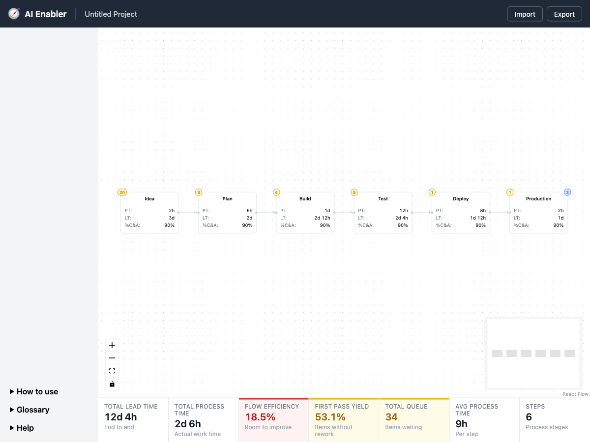
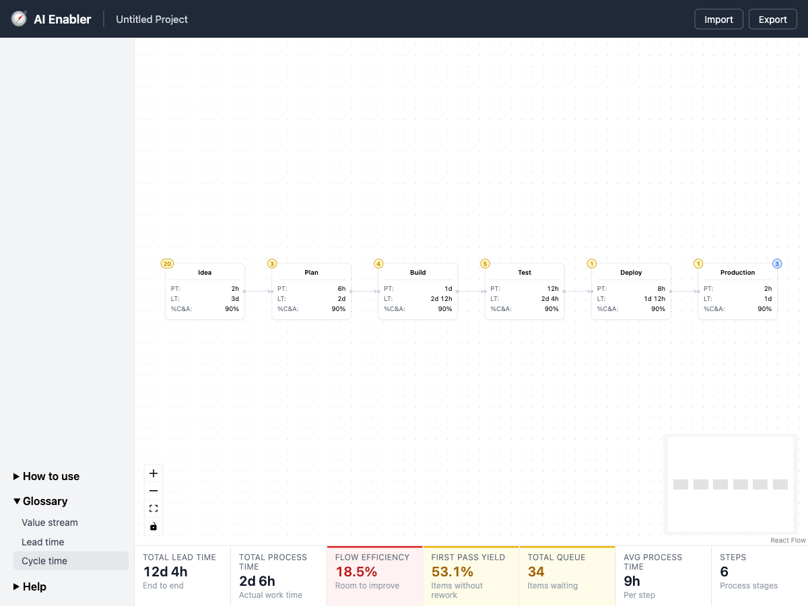
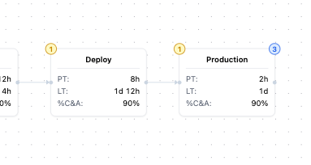
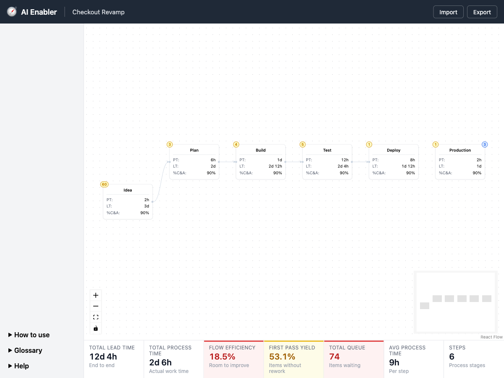

# Prototype handoff: ui-shell

## Goal

Find the app shell layout for the value stream map, plus how per-step data and flow-level metrics read together: a branded header with project name and file actions, a help menu, the canvas, and a metrics bar that stays in sync with the step cards.

## Behavior

1. The app opens on a starter value stream of six steps: Idea, Plan, Build, Test, Deploy, Production. They are connected left to right.
2. The header shows the logo, "AI Enabler", a divider, the project name, and Import and Export on the right.
3. The left menu has three collapsible sections pinned to the bottom: How to use, Glossary, and Help. Each lists placeholder entries.
4. Each step card shows its title, then PT (process time), LT (lead time), and %C&A (percent complete and accurate).
   - A yellow bubble in the upper-left corner shows the step's queue (items waiting).
   - A blue bubble in the upper-right corner shows batch size, only when the step has one. In the sample, only Production has one.
5. Steps connect only from a right-side source to a left-side target. Arrowheads point downstream.
   - An unconnected connector dot is hidden. It appears on hover near that edge or while dragging a connection.
6. Below the canvas, the metrics bar shows seven tiles, all computed from the cards:
   - Total lead time: sum of LT.
   - Total process time: sum of PT.
   - Flow efficiency: PT / LT.
   - First pass yield: the product of each step's %C&A.
   - Total queue: sum of queues.
   - Avg process time: PT / steps.
   - Steps: the step count.
7. Flow efficiency, first pass yield, and total queue are colored green, yellow, or red by threshold.
8. Deleting a step or connection recomputes the metrics and re-hides freed connectors.
9. Export downloads `<project-name>.ai-enabler.json`.
10. Import loads such a file. It replaces the name, layout, step data, and connections, and re-fits the view. A file with a different schema version is rejected with an alert.

## Flow

A single screen with no navigation. The states are:

- Default map.
- A menu section expanded.
- Hover on an open connector.
- The map after an import.
- A failed import, shown as a blocking alert.

## UI

- **Shell:** a CSS grid with a 56px dark header across the top. Below it are a 200px left menu and the canvas. The canvas is a flex column: the React Flow area with a metrics bar under it.
- **Cards:** subdued, with a light gray border, 8px radius, and a faint shadow. Connector dots are small and light, and edges are light slate. The intent is that card content draws the eye.
- **Metrics:** each tile has an uppercase label, a large value, and a small note. A rated tile gets a colored top bar, a tinted background, and a colored value.


Default map: six steps with queue bubbles, the Production batch bubble, and the seven-tile metrics bar.


Glossary section expanded in the bottom-pinned left menu.


Hovering Production's open right edge reveals its hidden connector dot.


After importing an edited file: new project name, moved card, removed connection, and total queue red at 74.

## UX and a11y notes

- ui-ux-designer:
  - (H) Badges have no label or legend, and their contrast is below 4.5:1.
  - (H) Status is shown by color only, and the notes don't change with status. A red 18.5% still reads "Room to improve".
  - (H) Import replaces work with no confirm or undo. It uses a blocking `alert`, gives no success feedback, and validates node and edge shape weakly.
  - (M) The map can't be edited by keyboard, and hover-only connectors can't be found by touch or keyboard users. Step values can't be edited at all.
  - (M) Edges and arrowheads (about 1.5:1) and notes (about 2.5:1) are below contrast minimums. Make subdued styling a hierarchy goal, not a reason to drop below WCAG.
  - (M) PT, LT, and %C&A are not explained. The Glossary entries don't match the terms used. The menu buttons do nothing, and the upper part of the menu is empty.
  - (M) At 1200px, metric labels wrap and the values misalign. The fixed seven-column grid doesn't reflow.
  - (M) Cards are 150px wide with 12px text, and the MiniMap adds clutter for small maps.
  - (L) An empty map shows first pass yield as 100% green. Show "—" with an empty-state prompt instead.
  - (L) The project name can't be edited. Header buttons have no focus ring, there is no skip link, and the document title doesn't show the project.
- a11y-review:
  - 1.4.1: metric status is shown by color only. Add a status word or icon.
  - 1.4.3: these fail 4.5:1. Note text #9ca3af (2.55:1), queue badge #ca8a04/#fef9c3 (2.97:1), batch badge #2563eb/#dbeafe (4.24:1), and the label on the red tile (4.42:1).
  - 2.1.1: connecting steps is pointer-only. Provide a keyboard path and show connectors on focus.
  - 1.3.1: badges are bare numbers. Expand PT, LT, and %C&A in the accessible text, and mark up tiles as dt/dd.
  - 4.1.3: import success and failure are silent or use `alert`. Use a live region and return focus to Import.
  - 1.4.11 / 2.4.7: header button borders are about 2.6:1, and there is no `:focus-visible` style.
  - 2.4.6: the Import button needs a fuller name.
  - Passing: header h1, aria-hidden decorative elements, labeled landmarks, and native details/summary.
- exploratory-testing: 15/15 probes.
  - Critical: importing a node without `position` crashes the whole app to a blank screen. It reproduced on retry.
  - Major: wrong types import silently. They show NaN, and a string queue concatenates to "05".
  - Minor:
    - Empty or missing data reads as 100% first pass yield.
    - Backward connections and cycles are accepted silently.
    - Edges to missing nodes are kept silently.
    - Errors are misleading ("schema version undefined"; `null` is called invalid JSON).
    - A long project name wraps the brand.
    - At 800px the cards are unreadable and the Production badge is clipped.
  - Passed: deleting a node or edge keeps the metrics and connectors in sync. 300 nodes render fine.

## Decisions

- **Metrics are derived from step data, not stored:** this keeps the cards and the bar in sync. Rejected: the static sample values the bar started with.
- **First pass yield is the product of each step's %C&A:** this is the standard rolled-yield definition. Rejected: an average, which hides compounding.
- **Thresholds:**
  - Flow efficiency: green at 70% or more, yellow at 20% or more, red below.
  - First pass yield: green at 70% or more, yellow at 50% or more, red below.
  - Total queue: green below 20, yellow from 20 to 50, red above 50.
  - The user stated these.
- **Effective lead time tile removed:** the user said it isn't needed. Rejected: keeping it with a placeholder 1.5×/2× multiplier range.
- **Connectors are left-to-right only, one target on the left and one source on the right:** flow goes left to right. Rejected: React Flow's default top/bottom handles.
- **Unconnected connectors are hidden until hover or drag:** this keeps the map clean. A 10px invisible hit area makes them findable by pointer.
- **Subdued borders, connectors, and edges, with arrowheads:** these focus attention on card content while still showing direction.
- **The batch bubble shows only when a step has a batch size.**
- **Hide the queue bubble when the queue is 0:** the user decided this at graduation. The prototype always shows it.
- **No backward connections or cycles for now:** rework loops were not covered. The prototype accepts them silently; specs should block them. Rejected for now: rework loops, deferred until their metrics are defined.
- **Native details/summary for the menu sections:** no state is needed.
- **Import and export use versioned JSON (`schemaVersion: 1`):** the user asked for a versioned format so projects reload repeatedly. Other versions are rejected.
- **The duration format uses the two largest units** (`12d 4h`, `4h 30m`, `45m`).
- **A day is 8 working hours for PT and LT:** the user decided this at graduation. The prototype used 24-hour days, so its sample totals will change. Rejected: 24-hour calendar days.

## Data shape

```json
{
  "schemaVersion": 1,
  "exportedAt": "2026-11-13T01:45:46.642Z",
  "project": { "name": "Untitled Project" },
  "nodes": [
    {
      "id": "idea",
      "type": "stage",
      "position": { "x": 0, "y": 0 },
      "data": { "label": "Idea", "pt": 120, "lt": 4320, "ca": 90, "queue": 20, "batch": 3 }
    }
  ],
  "edges": [{ "id": "idea->plan", "source": "idea", "target": "plan" }]
}
```

- `pt` and `lt` are in minutes.
- `ca` is a percentage from 0 to 100.
- `queue` is an item count.
- `batch` is optional.
- The sample data, at 24-hour days, has lead times summing to 12d 4h, process times to 2d 6h, and queues to 34.

## Open questions

- How does the user edit step name, PT, LT, %C&A, queue, and batch? The prototype has no editing.
- What range should effective lead time use, if it ever returns?
- Rework loops (deferred): how should totals and first pass yield treat loops and branching maps when they are added?
- How is the project name set or renamed?
- What goes in How to use, Glossary, and Help? Should the menu stay pinned to the bottom?
- Should import confirm before replacing the current map, and should it offer undo?

## Reference

- Branch: `proto/ui-shell`
- Final commit: 5d15f0891b8306c9f434d20b4f7293ebf7499e3c
- Prototype code is reference only; rebuild through /dev-team:specs, do not merge.
- This file is the source; the issue is a copy.
