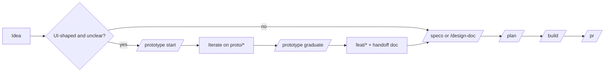

# Prototype awareness — Design Document

## Problem statement

This repo has a `/prototype` skill (`.claude/skills/prototype/`), but the dev-team plugin's
orchestrator and entry points (`/design-doc`, `/specs`, `/plan`, `/build`, `/ship`) do not know it
exists. `.claude/CLAUDE.md` has one line about it, which says what it skips but not where it fits
in the process.

So when you bring a vague, UI-shaped idea to the dev-team process, nothing offers a prototype
first. The process asks you to specify a value stream map UI in prose, which is the problem the
skill was built to solve. The orchestrator also cannot explain the prototype path to you or to
the agents it dispatches.

If we do nothing, `/prototype` gets used only when you remember to type it.

## Proposed approach

Add a section to `.claude/CLAUDE.md` named `### Prototype path`. Every session reads this file,
and so does every subagent, including the dev-team orchestrator and its specialists. The section
has three parts.

1. **Where it fits.** The prototype path comes before the dev-team process:
   `/prototype start <name>` → iterate on `proto/<name>` → `/prototype graduate` → a
   `feat/<name>` branch with a handoff at `docs/prototypes/<name>.md` → `/dev-team:specs` (or
   `/design-doc`) → `/plan` → `/build` → `/pr`. The prototype code is reference only. Graduation
   does not merge it.
2. **When to offer it.** At the first gate of an entry point (orchestrator intake, `/design-doc`
   research, `/specs` intent), ask once whether to prototype first when the request:
   - changes UI or UX (layout, interaction, flow, visuals in `src/`), and
   - has open questions about what to build that a running UI would answer.

   Never offer it for bug fixes, `scripts/`-only work, config or doc changes, or when a
   `docs/prototypes/<name>.md` handoff already exists for the feature. Recommend an answer, as the
   process does for other decisions. If you decline, continue and do not ask again in that
   session.

3. **Handoff as input.** When a handoff exists on the current `feat/*` branch, entry points read
   it as primary input: its decisions, screenshots, and dropped approaches.

Also replace the existing one-line "Prototyping" bullet with a pointer to the new section, so the
rules live in one place.

## Alternatives considered

| Approach                                                                   | Pros                                       | Cons                                                                                        | Why rejected                                                                   |
| -------------------------------------------------------------------------- | ------------------------------------------ | ------------------------------------------------------------------------------------------- | ------------------------------------------------------------------------------ |
| Do nothing                                                                 | No work                                    | Skill stays undiscovered                                                                    | Does not solve the problem                                                     |
| Edit the dev-team plugin files                                             | The entry points get native, exact wording | Changes are lost on plugin upgrade; out of scope (repo only)                                | You chose repo only                                                            |
| `UserPromptSubmit` hook that detects UI-shaped prompts and adds a reminder | Fires every time, deterministic            | Keyword detection is noisy; adds a script and tests; reminds on prompts that do not need it | Heavier than needed. Kept as the fallback if the prose section is not followed |
| New project skill that wraps the entry points                              | Explicit control                           | A second entry point to remember, which repeats the original problem                        | Adds friction                                                                  |

## Key decisions

- **CLAUDE.md only, no hook for now.** It is the one place all agents read. Trade-off: the offer
  depends on the model following prose, not on code.
- **Ask once, at the first gate.** Asking later wastes work already specified. Trade-off: a
  request that becomes UI-heavy partway through gets no offer.
- **Both conditions must hold (UI change and open questions).** This keeps the offer rare. A clear
  UI change goes straight to specs. Trade-off: some borderline cases get no offer.
- **Handoff overrides re-specifying.** If a handoff exists, specs build on it and do not re-ask
  questions it answers.

## Open questions

- Do plugin subagents dispatched by the orchestrator get the project `CLAUDE.md`? Expected yes.
  Confirm during build by dispatching one and asking it to describe the prototype path. (architect)
- How do we verify the offer fires? Proposal: a manual acceptance check with two prompts, one
  UI-shaped and vague (offer expected) and one `scripts/` bug fix (no offer expected). No
  automated test, since this is prompt content, not code. (human)
- CLAUDE.md size: the section must stay short (about 20 lines) so it does not bloat every session.
  (human)

## Scope boundaries

In scope:

- A new `### Prototype path` section in `.claude/CLAUDE.md`, and the replaced bullet.
- A link from the prototype skill's `SKILL.md` to that section, if it helps.

Out of scope:

- Any change to the dev-team plugin.
- Changes to `/prototype` behavior, the push guards, or graduate steps.
- The `UserPromptSubmit` hook (fallback only, as a separate change).
