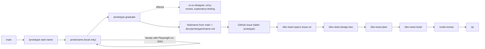

# Prototype skill — Design Document

## Problem statement

The dev-team process (`/specs`, `/design-doc`, `/plan`, `/build`, `/code-review`) is strong at
building a known feature correctly. It is slow for finding out what the feature should be. A value
stream map is a visual, interactive tool, so flow, function, and UI are hard to specify in prose
before you can see and touch them.

Without a fast path, you either guess in the spec and rework later, or you prototype ad hoc and the
prototype code leaks into `main` without tests or review.

## Proposed approach

Add a project skill, `.claude/skills/prototype/SKILL.md`, invoked as `/prototype`. It has three
subcommands.

1. `/prototype start <name>` creates a local branch `proto/<name>` from `main`. It then starts
   `npm run dev:prototype` in the background so you can view the app at `http://localhost:3001` (or the next free port).
2. `/prototype` (or any request while on a `proto/*` branch) iterates fast. Claude edits code
   directly. No tests, no review agents, no plan. Claude commits each working step so you can step
   back. Claude drives the running prototype with the Playwright MCP tools: it opens the page,
   takes screenshots, checks the result, and adjusts the UI in a tight loop.
3. `/prototype graduate` ends the prototype. It writes a handoff document and moves you onto a real
   feature branch, ready for `/dev-team:specs`.

The graduate step:

1. Reads the `proto/<name>` diff against `main` and the iteration history.
2. Offers to run the advisory review agents against the running prototype. The default answer is
   yes. See "Advisory agents" below.
3. Interviews you on anything the code cannot show: why a choice was made, what you rejected, and
   what is still unsure.
4. Captures screenshots of the final prototype into `docs/prototypes/<name>/`.
5. Creates `feat/<name>` from `main`, not from the prototype branch.
6. Writes `docs/prototypes/<name>.md` on `feat/<name>` and commits it with the screenshots.
7. Asks you to confirm, then pushes `feat/<name>` and opens a GitHub issue with `gh issue create`.
   The issue body holds the full handoff text and links to the screenshots on `feat/<name>`. The
   issue gets the `prototype` label.
8. Prints the next command: `/dev-team:specs <issue-url>`. If you decline the push, it prints
   `/dev-team:specs docs/prototypes/<name>.md` instead.

`/dev-team:specs` accepts a GitHub issue URL or a readable `.md` path and runs in validate mode. That mode critiques the
handoff, resolves its ambiguities with you, and produces the intent, architecture notes, and
acceptance criteria. `/dev-team:design-doc` and `/dev-team:plan` then use those outputs as usual.
No change to the dev-team plugin is needed.

The handoff document has these sections:

- **Goal**: what the prototype tried to learn.
- **Behavior**: what the user can do, step by step.
- **Flow**: screens or canvas states and how the user moves between them.
- **UI**: layout and interaction notes. Each note references its screenshot by relative path, for
  example `<name>/canvas.png`.
- **UX and a11y notes**: findings from the advisory agents, if you ran them.
- **Decisions**: choices made, with the reason, plus options tried and rejected.
- **Data shape**: any value stream data structures the prototype invented.
- **Open questions**: what the prototype did not answer.
- **Reference**: the `proto/<name>` branch name and final commit SHA. This section also includes a
  warning that the code is reference only.

### Advisory agents

At graduate, the skill offers to run these dev-team agents. They advise; they do not block
graduate.

- `dev-team:ui-ux-designer` reviews layout, interaction, and visual consistency.
- `dev-team:a11y-review` checks WCAG 2.1 AA, semantic HTML, ARIA, and keyboard use.
- The `dev-team:exploratory-testing` skill clicks through the prototype to find edge cases.

Their findings go into the handoff's **UX and a11y notes** section, so `/dev-team:specs` can turn
them into acceptance criteria. You can also ask for any of them during iteration.

### Ports

`npm run dev` stays on port 3000. A new script, `npm run dev:prototype`, runs Vite on port 3001
and moves up to the next free port if 3001 is taken. The e2e tests reuse any server already on port
3000, so the prototype must never use that port; counting up from 3001 keeps it off 3000. The skill
finds its server by process and repo cwd and reads the real port.

Superseded (2026-11-14): this section first said `strictPort`, one prototype server at a time, and a
second one fails to start. That made a busy port 3001 block the prototype, so the port now falls
back instead.

## Alternatives considered

| Approach                                                | Pros            | Cons                                                                                                 | Why rejected                                              |
| ------------------------------------------------------- | --------------- | ---------------------------------------------------------------------------------------------------- | --------------------------------------------------------- |
| Do nothing; prototype ad hoc                            | No work         | Prototype code can reach `main` untested; insights get lost                                          | Loses the handoff, which is the main value                |
| Prototype on a normal `feat/*` branch, then clean it up | Reuses the code | Untested code becomes the base; the full process turns into a review of existing code, not a rebuild | Conflicts with "reference only, rebuilt properly"         |
| Separate scratch repo or folder                         | Full isolation  | Cannot reuse the app, data, and Vite setup; harder to diff                                           | Too much friction for quick iteration                     |
| Put the handoff on the `proto/*` branch                 | Simpler         | Handoff disappears when you leave the branch                                                         | Handoff must reach `main` through the real feature branch |

## Key decisions

- **Prototype branches never leave your machine.** A check in `.husky/pre-push` refuses to push any
  `proto/*` branch. Trade-off: no remote backup of prototype work. The handoff and screenshots are
  what persist.
- **The feature branch starts from `main`, not from the prototype.** The prototype branch stays
  locally as a read-only reference until the feature ships. Trade-off: you delete old `proto/*`
  branches yourself.
- **Normal commit hooks still run on `proto/*`.** lint-staged and Repowise are fast, so prototype
  commits stay formatted and the guard stays simple. Trade-off: about a second per commit.
- **A Claude Code `PreToolUse` guard blocks `--no-verify`, `HUSKY=0`, and `proto/*` pushes.** It
  stops Claude only; a push you type yourself still meets the git hook. It fails open on unusable
  hook input. It accepts the evasions in the plan Risks: `bash -c`, `$(...)`, `xargs`, `sudo`,
  `git -c core.hooksPath=...`, shell aliases, and quoted refs or flags. It also accepts `HEAD` and
  SHA refspecs, which name no branch. A variable set in an earlier Bash call also stays an accepted
  evasion, for example `export HUSKY` alone after an earlier `HUSKY=0` assignment. Trade-off: it stops accidents, not
  intent.
- **A `SKIP_REPOWISE=1` switch in `.husky/pre-commit` skips the Repowise refresh.** Graduate uses
  it so the handoff commit holds only handoff files. Without it, Repowise adds
  `.claude/CLAUDE.md` and graduate's handoff-only checks fail. Trade-off: the index lags one commit.
- **The skill skips quality gates only on `proto/*` branches.** The skill states this explicitly.
  Any other branch keeps the full process.
- **The handoff is a plain Markdown file that `/specs` validate mode reads.** Trade-off: it relies on
  validate mode's input contract, not a custom integration.
- **Graduate also opens a GitHub issue with the handoff in its body.** The issue is the work item
  for `/dev-team:specs`, `/dev-team:ship`, and later `/dev-team:issues-from-plan`. Screenshots stay
  in the repo because `gh` cannot attach images. Trade-off: the handoff exists in two places; the
  issue body is a copy made at graduate time, and the file in the repo is the source.

## Open questions

None. Resolved:

- The skill runs `npm run dev:prototype` in the background on port 3001 or the next free port and stops it at graduate.
- You delete old `proto/*` branches yourself.
- Graduate offers the advisory agents, with yes as the default.

## Scope boundaries

In scope:

- `.claude/skills/prototype/SKILL.md` with `start`, iterate, and `graduate`.
- The `proto/*` refusal in `.husky/pre-push`.
- The Claude Code `PreToolUse` guard: `.claude/settings.json` and `scripts/claude-push-guard*.js`.
- The `SKIP_REPOWISE` switch in `.husky/pre-commit`.
- The handoff template, inside the skill.
- The `dev:prototype` script in `package.json` (Vite on port 3001, falling back to the next free port).
- The advisory agent offer at graduate.
- The GitHub issue created at graduate, and the `prototype` label if it does not exist.
- A short note in `README.md` and `.claude/CLAUDE.md` listing `/prototype`.

Out of scope:

- Changes to the dev-team plugin.
- Remote backup or sharing of prototypes.
- Automatic cleanup of old prototype branches.
- Any value stream feature itself. The first real prototype comes after this skill ships.

## Visual artifacts

