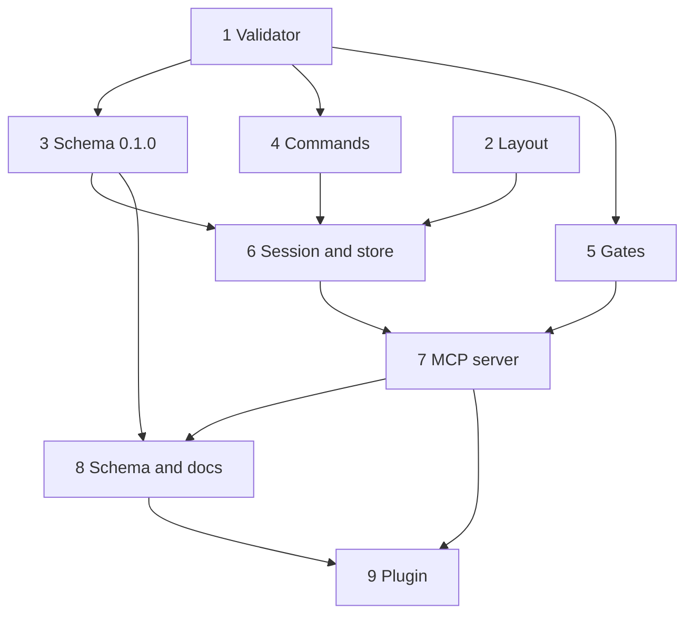

# Plan: AI-driven VSM building through a local MCP server

**Created**: 2026-11-21
**Branch**: feat/ai-contract
**Status**: approved
**Gherkin persistence**: plan-file-only
**Spec**: `docs/specs/ai-contract.md` (AC1–AC24). Requirements doc: [AI-Driven VSM Building: Requirements](https://claude.ai/artifact/2MCD4LvxsfsTacq9KL2yHo). Source issue: #24.

## Goal

Let Claude Code build and edit a VSM one small, validated change at a time through a local stdio MCP server. The server reuses the app's pure rules in `src/flow/`, returns every problem with each change, lays out steps for human readability, and saves a project file marked as changed by AI tools. The GitHub Pages app imports that file for review and validates it again. The server, the `aie-guide` and `aie-review` skills, a JSON Schema, `llms.txt` and `AGENTS.md` ship from this repo as a Claude Code plugin.

**Approach stances** (`knowledge/decision-defaults.md`):

- Scope: only the spec's ACs. Former R4 (UI on the command layer) and the #24 browser follow-ups stay out. The PRs reference #24 but do not close it.
- Data change: expand only. Schema 0.1.0 adds one optional field with an identity hop, and 0.0.0 files keep importing. 0.1.0 ships in the same PR as its only producer (the server), so the release is not a one-way door without a consumer.
- Integration: PRs with green checks (default), split at the ship boundaries below.
- Replace vs. merge: `CLAUDE.md`, configs and the product plan get additive edits; `AGENTS.md` and `llms.txt` are new.

**Catalog**: every new failure mode in Slices 2–7 adds its catalog entry only; repair guides and docs come later with D1/D2 (user decision 2026-11-21).

**Ship boundaries**: PR1 = Slice 1 (import lists every problem; useful alone). PR2 = Slices 2–7 (the working server; minimum viable subset, AC1–AC19, AC22; first demo with `claude mcp add`). PR3 = Slices 8–9 (contract docs, save-file parity and plugin distribution, AC20, AC21, AC23).

**Design decisions made during plan review** (not in the spec; correct them at this gate):

- Problems are catalog diagnostics (Logging for AI Agents spec, MSG-01–06, CAT-01–04, UPK-01). `src/flow/diagnostics/catalog.json` lists every code with severity, title, summary, fix, docs anchor, owner, status and the schema version it was added in. Codes are namespaced by area (`FILE_`, `STEP_`, `CONN_`, `MARK_`, `CMD_`, `GATE_`) and never reused. Problems are built only through `problem(code, details)`, which throws on an unknown code. Each problem carries `code`, `severity`, `message`, `fix` and, where it applies, `stepId`, `edgeId`, `field` and an `untrusted` field holding user text such as step names.
- Validation runs in two phases: shape and per-item rules all collected, then relational rules only on items that passed phase 1. The validator never throws on untrusted input.
- Every problem message names its step by title (falling back to `Step #n`) or its connection by number, and states the field with its key, for example `process time (pt) must be 0 or more`.
- The import's lead line is "Import rejected: 1 problem" or "Import rejected: N problems". The list shows at most 10 problems plus "and N more". The announcement is the count plus the first problem. On rejection, focus moves to the status heading; Dismiss returns focus to the Import button. The current map is never changed by a rejected import.
- AI notice text (a constant like `EDITED_NOTICE`): `This file was changed by AI tools (<tool>) on <YYYY-MM-DD>. Review the steps and numbers before relying on them.` It appears in the confirmation dialog and the outcome line. The mark is honored only for files whose own schema version is 0.1.0 or later. A malformed mark rejects the import with a message saying which part is wrong and that removing `modifiedBy` fixes it.
- Layout runs once, when `save_project` writes the file, because the server cannot see the map. Commands never move existing steps.
- Commands take no position arguments. Unknown arguments are a problem, so a call with `x`/`y` is rejected.
- `open_project` requires a valid file (the same pipeline as import), so every opened project starts valid and a command is rejected only for problems it introduces.
- A new `discard_changes` tool gives a way out of unsaved changes; its summary says how many changes were discarded. `create_project` and `open_project` are both blocked by unsaved changes, and a created project starts unsaved. `save_project` may overwrite only the file the session opened; saving a new project under an existing name is refused. Only successful commands (`create_project` and the editing commands) are logged; open, save, discard and reads are not.
- A rejected tool call sets MCP `isError: true` with the same `{ ok, problems, summary }` JSON content. Results return at most 20 problems plus a total. `add_step` returns the new step id. A missing-step problem lists the valid step ids and titles. A successful command returns the summary and problems, not the whole project. The pure `applyCommand` does return `{ ok, project, problems, summary }`; only the MCP tool content leaves the project out, and `get_project` returns it (AC3).

## Acceptance Criteria

- [ ] AC1 Validator returns every problem with a code and message
- [ ] AC2 Import shows every problem
- [ ] AC3 Commands exist and return project, problems and summary
- [ ] AC4 Rejected commands change nothing
- [ ] AC5 Removing a step removes its connections
- [ ] AC6 MCP tools over stdio, registrable with `claude mcp add`
- [ ] AC7 Tool result shape lets a follow-up call fix a mistake
- [ ] AC8 Open, edit and save round-trips with the app
- [ ] AC9 Save is explicit; unsaved changes block opening another file
- [ ] AC10 Open and save take a name only, confined to `./projects`
- [ ] AC11 No shell, network or path tools
- [ ] AC12 Deterministic left-to-right layout without overlaps in every file the MCP server saves; no position arguments
- [ ] AC13 Human positions survive the app's export; the next MCP save lays out again
- [ ] AC14 Save writes schema 0.1.0 with a valid hash and `modifiedBy`
- [ ] AC15 AI notice; the edited notice wins on a hash mismatch; the app's export drops the mark
- [ ] AC16 Schema 0.1.0 fixture, upgrade hop and checks; 0.0.0 still imports
- [ ] AC17 App validates every import regardless of mark
- [ ] AC18 One stderr log line per applied command; stdout is protocol only
- [ ] AC19 `data-complete` gate and a one-function gate registry
- [ ] AC20 JSON Schema passes every fixture; `llms.txt` and `AGENTS.md`
- [ ] AC21 Plugin registers the server and both skills
- [ ] AC22 Colocated tests; coverage and mutation pass at the current bar
- [ ] AC24 Every problem comes from the diagnostics catalog with a stable code, severity and fix line
- [ ] AC23 Every writable save-file field has a command; Definition of Done rule added

## Slices

### Slice 1: Validator returns every problem

**Depends-on:** none
**Files:** `src/flow/diagnostics/catalog.json`, `src/flow/diagnostics/problem.js`, `src/flow/diagnostics/problem.test.js`, `src/flow/schema/validate.js`, `src/flow/schema/validate.test.js`, `src/flow/importFile.js`, `src/flow/importFile.test.js`, `src/flow/importFlow.js`, `src/flow/importFlow.test.js`, `src/flow/schema/upgrades.js`, `src/flow/schema/upgrades.test.js`, `src/shell/ImportStatus.jsx`, `src/App.jsx`, `e2e/export-import.spec.js`

**Behavior:**

```gherkin
Feature: Validation reports every problem

  Scenario: A file with three different problems reports all three
    # Still passes if: problems are reported in a different order
    Given a project file with an empty project name, a step "Plan" with process time -1, and a connection to a missing step
    When the file is validated
    Then three problems are reported, each with a code and a message
    And the process-time problem names "Plan" and process time (pt)
    And the connection problem carries that connection's id

  Scenario: The same rule failing on two steps reports both
    # Still passes if: the two messages are identical except for the step name
    Given steps "Plan" and "Build" both with process time -1
    When the file is validated
    Then two problems are reported, one naming "Plan" and one naming "Build"

  Scenario: Broken items do not crash relational checks
    # Still passes if: the null connection's problem names it by position instead of id
    Given a file whose connections include null and a connection from a missing step to itself
    When the file is validated
    Then the result lists a problem for each, and validation does not throw

  Scenario: A valid file reports no problems
    # Still passes if: the validator also accepts extra unknown top-level fields
    Given a valid project file
    When the file is validated
    Then it is valid and the problem list is empty

  Scenario: A file that is not shaped like a project stops at one problem
    # Still passes if: the message text is reworded
    Given a file whose steps are not a list
    When the file is validated
    Then exactly one problem is reported with the FILE_NOT_A_PROJECT code

  Scenario: Importing an invalid file lists every problem
    # Still passes if: list items use a different bullet style
    Given the app shows a map
    When the user imports a file with two different problems
    Then the import is rejected with the lead line "Import rejected: 2 problems"
    And both problems are listed
    And "Import rejected: 2 problems" and the first problem are announced
    And focus moves to the import status heading
    And the map is unchanged

  Scenario: Many problems are capped
    # Still passes if: the list items use numbers instead of bullets
    When the user imports a file with 14 problems
    Then 10 problems are listed followed by "and 4 more"

  Scenario: Dismiss returns focus
    # Still passes if: dismissing also clears the announcement region
    Given a rejected import is shown
    When the user dismisses it
    Then focus returns to the Import button

  Scenario: A file that is not JSON is one problem
    # Still passes if: the message mentions the file name
    When the user imports a file that is not JSON
    Then the import is rejected with one problem saying the file is not valid JSON

  Scenario: An invalid file with an AI mark is still rejected
    # Still passes if: the mark's tool name differs
    When the user imports an invalid file with two problems that carries a modifiedBy AI mark
    Then the import is rejected with the lead line "Import rejected: 2 problems"
    And both problems are listed

  Scenario: Importing a valid file still works
    # Still passes if: the confirmation text is reworded
    When the user imports a valid exported file and confirms
    Then the map is replaced with the file's steps and connections
```

**Steps:**

#### Step 1.0: Diagnostics catalog and problem helper

**Complexity**: standard
**IMPLEMENT**: `src/flow/diagnostics/catalog.json` with today's validation codes, and `problem(code, details)` returning `{ code, severity, message, fix, ...details }` from the catalog. Codes are area-prefixed UPPER_SNAKE. A message may name a step by its title, shortened to 80 characters (for example `Step "Plan" (#2): process time (pt) must be a whole number, 0 or more.`); the raw user text is also kept in `untrusted` (for example `untrusted: { title }`). `code`, `fix` and `field` never hold user text.
**TEST**: `problem.test.js`: known code, unknown code throws, every catalog entry has every required field and a unique, area-prefixed code.
**REFACTOR**: Keep message templates in the catalog, not in rule code.
**Files**: `src/flow/diagnostics/catalog.json`, `src/flow/diagnostics/problem.js`, `src/flow/diagnostics/problem.test.js`
**Covers**: AC24
**Commit**: `feat: add the diagnostics catalog and problem helper`

#### Step 1.1: Collect every rule failure in two phases

**Complexity**: complex
**IMPLEMENT**: `validateProjectFile` returns `{ ok, problems: [{ code, message, stepId?, edgeId?, field? }] }`. Shape guards stop at one problem. Phase 1 collects every per-item problem; phase 2 runs relational rules (duplicate ids, missing endpoints, self, duplicate, loop) only on items that passed phase 1. Messages name the step by title (or `Step #n`) and the field with its key.
**TEST**: `validate.test.js`: the validator scenarios, one case per rule, a null step, a null connection, an assertion that every per-item message names its step or connection, and an assertion that every code the validator can emit is in the catalog.
**REFACTOR**: Fold `firstBadStep` into an every-item rule helper; keep messages in one table.
**Files**: `src/flow/schema/validate.js`, `src/flow/schema/validate.test.js`
**Covers**: AC1
**Commit**: `feat: report every problem from project file validation`

#### Step 1.2: Import pipeline carries problems

**Complexity**: standard
**IMPLEMENT**: The import pipeline result becomes `{ ok: false, problems }`. `checkEnvelope`, `upgradeToCurrent` and the JSON parse emit one problem each, with codes `FILE_NOT_JSON`, `FILE_NOT_A_PROJECT`, `FILE_NEWER_SCHEMA`, `FILE_UNRELEASED_SCHEMA`, `FILE_NO_UPGRADE_PATH` and `FILE_UPGRADE_FAILED`, plus `FILE_UNREADABLE` when the file cannot be read or hashed.
**TEST**: `importFile.test.js` and `upgrades.test.js` updated to the problems shape.
**REFACTOR**: Remove the single-`message` result once nothing reads it.
**Files**: `src/flow/importFile.js`, `src/flow/importFile.test.js`, `src/flow/schema/upgrades.js`, `src/flow/schema/upgrades.test.js`
**Covers**: AC2
**Commit**: `refactor: carry problem lists through the import pipeline`

#### Step 1.3: The import status lists every problem

**Complexity**: standard
**IMPLEMENT**: `IMPORT_ERROR` state holds `problems`; `describeImportStatus` returns a lead line, up to 10 items and an "and N more" line; the announcement is the lead line plus the first problem. `ImportStatus` renders a heading (tabindex -1, focused on rejection) and a `<ul>`; `App.jsx` passes the list. Dismiss keeps returning focus to Import.
**TEST**: `importFlow.test.js` for the description and cap; e2e for two problems, 14 problems, focus, dismiss, not-JSON and an unchanged map; `importFile.test.js` and e2e for an invalid file carrying a `modifiedBy` AI mark, still rejected with every problem listed (AC17; Slice 3 adds the mark's own checks).
**REFACTOR**: Keep all wording in `importFlow.js` so components only render.
**Files**: `src/flow/importFlow.js`, `src/flow/importFlow.test.js`, `src/shell/ImportStatus.jsx`, `src/App.jsx`, `e2e/export-import.spec.js`
**Covers**: AC2, AC17
**Commit**: `feat: list every problem when an import is rejected`

### Slice 2: Deterministic auto-layout

**Depends-on:** none
**Files:** `src/flow/layout.js`, `src/flow/layout.test.js`

**Behavior:**

```gherkin
Feature: Auto-layout for readability

  Scenario: Steps in a line are laid out left to right
    # Still passes if: the horizontal gap between columns changes
    Given Idea connects to Build and Build connects to Release
    When the map is laid out
    Then Idea is left of Build and Build is left of Release

  Scenario: A skip connection still points left to right
    # Still passes if: Build is placed above Idea instead of level with it
    Given Idea connects to Build, Build to Release, and Idea directly to Release
    When the map is laid out
    Then every connection points from left to right

  Scenario: Parallel steps share a column without overlapping
    # Still passes if: parallel steps are stacked in a different vertical order
    Given Idea connects to both Design and Build
    When the map is laid out
    Then Design and Build are in the same column and their cards do not overlap

  Scenario: Ties follow file order
    # Still passes if: ties are broken by title when both titles differ
    Given Design (id "z") comes before Build (id "a") in the file and both follow Idea
    When the map is laid out
    Then Design is above Build

  Scenario: Same map, same layout
    # Still passes if: the whole layout is shifted by a constant offset
    Given a map laid out once
    When the same map is laid out again
    Then every step gets the same position
    And a map with different connections gets different positions

  Scenario: Unconnected steps do not overlap
    # Still passes if: unconnected steps go in the first column instead of the last
    Given two steps and no connections
    When the map is laid out
    Then the two cards do not overlap

  Scenario: A loop does not hang the layout
    # Still passes if: steps in the loop share one column
    Given a map with a loop between two steps
    When the map is laid out
    Then layout finishes and returns a position for every step

  Scenario: An empty map
    # Still passes if: the layout returns the same array object for an empty map
    Given a map with no steps
    When the map is laid out
    Then no steps are returned
```

**Steps:**

#### Step 2.1: Layered left-to-right layout

**Complexity**: standard
**IMPLEMENT**: Pure `layoutSteps(nodes, edges)`: column = longest path from a source (with a visited guard for loops); rows ordered by file order; spacing from `STEP_CARD_WIDTH` (144, matching `--card-width: 9rem` in `src/index.css` at a 16px root) and `STEP_CARD_HEIGHT` (240, above the tallest card) defined in `layout.js`, with a comment tying the width to `--card-width`. A test reads `--card-width` from `src/index.css` and checks it matches.
**TEST**: `layout.test.js` covering every scenario, with overlap computed from the card constants.
**REFACTOR**: Separate column assignment from row placement.
**Files**: `src/flow/layout.js`, `src/flow/layout.test.js`
**Covers**: AC12
**Commit**: `feat: add deterministic left-to-right layout`

### Slice 3: Schema 0.1.0 and the AI mark

**Depends-on:** 1
**Files:** `src/flow/schema/version.js`, `src/flow/schema/version.test.js`, `src/flow/schema/upgrades.js`, `src/flow/schema/upgrades.test.js`, `src/flow/schema/fixtures/0.1.0.json`, `src/flow/schema/fixtures/0.1.0-marked.json`, `src/flow/schema/fixtures/expected/0.0.0.json`, `src/flow/schema/fixtures/expected/0.1.0.json`, `src/flow/schema/fixtures/expected/0.1.0-marked.json`, `src/flow/schema/validate.js`, `src/flow/schema/validate.test.js`, `src/flow/schema/shape.test.js`, `src/flow/projectFile.js`, `src/flow/projectFile.test.js`, `src/flow/importFile.js`, `src/flow/importFile.test.js`, `src/flow/importFlow.js`, `src/flow/importFlow.test.js`, `src/shell/ConfirmDialog.jsx`, `src/App.jsx`, `e2e/export-import.spec.js`, `docs/schema-versioning.md`

**Behavior:**

```gherkin
Feature: Files changed by AI tools

  Scenario: An AI-marked file with a valid hash shows the AI notice
    # Still passes if: the notice appears before the file name line instead of after it
    Given a schema 0.1.0 file marked as changed by "aie-mcp" on 2026-11-20, with a matching content hash
    When the user imports it
    Then the confirmation and the outcome line say "This file was changed by AI tools (aie-mcp) on 2026-11-20. Review the steps and numbers before relying on them."
    And neither says the file was changed outside AI Enabler

  Scenario: A later edit outside both tools shows only the edited notice
    # Still passes if: the edited notice is reworded
    Given an AI-marked file whose content hash does not match
    When the user imports it
    Then the confirmation says the file was changed outside AI Enabler
    And it does not mention AI tools

  Scenario: An AI-marked file with no content hash counts as edited
    # Still passes if: an empty-string hash is treated the same as a missing one
    Given an AI-marked file with no content hash
    When the user imports it
    Then the confirmation says the file was changed outside AI Enabler

  Scenario: An invalid AI-marked file is still rejected
    # Still passes if: the AI notice text is reworded
    Given an AI-marked file with a valid hash and a step with process time -1
    When the user imports it
    Then the import is rejected with that problem
    And no AI notice is shown

  Scenario Outline: A malformed mark is a problem
    # Still passes if: a tool name other than "aie-mcp" is accepted
    Given a schema 0.1.0 file whose mark has <defect>
    When the file is validated
    Then a problem names the bad part of the mark and says removing it fixes the file

    Examples:
      | defect            |
      | no time           |
      | the time "soon"   |
      | an empty tool     |

  Scenario: A mark on an older-schema file is ignored
    # Still passes if: the stray mark is dropped by the upgrade instead of skipped by the notice
    Given a schema 0.0.0 file with a stray mark and a matching hash
    When the user imports it
    Then no AI notice is shown
    And a malformed stray mark on a 0.0.0 file is ignored, not validated

  Scenario: The app's export drops the mark and keeps dragged positions
    # Still passes if: the export also drops other unknown top-level fields
    Given the user imported an AI-marked file and dragged a step to a new place
    When the user exports the project
    Then the file has schema 0.1.0, no mark, and the dragged position

  Scenario: Older files still import
    # Still passes if: the confirmation text is reworded
    Given the released schema 0.0.0 fixture
    When it is imported
    Then it is upgraded to 0.1.0 and imports with no AI notice
```

**Steps:**

#### Step 3.1: Release schema 0.1.0 with an optional mark

**Complexity**: standard
**IMPLEMENT**: Per `docs/schema-versioning.md`: fixture `0.1.0.json` (no mark, matching the app's export shape) and `0.1.0-marked.json` (with a mark), both with valid hashes; version bump; identity hop; regenerated snapshots; the 0.0.0→0.1.0 hop copies every 0.0.0 field and drops a stray `modifiedBy` (0.0.0 never defined it, so it is ignored, not validated); validate `modifiedBy` (`tool` non-empty string, `at` ISO time) with messages that name the bad part and say removing the field fixes it.
**TEST**: `upgrades.test.js` registry and fixture checks, `version.test.js`, `validate.test.js` mark outline, `shape.test.js` against the unmarked fixture.
**REFACTOR**: Document `modifiedBy` and the two-fixture pattern in `docs/schema-versioning.md`.
**Files**: `src/flow/schema/version.js`, `src/flow/schema/version.test.js`, `src/flow/schema/upgrades.js`, `src/flow/schema/upgrades.test.js`, `src/flow/schema/fixtures/0.1.0.json`, `src/flow/schema/fixtures/0.1.0-marked.json`, `src/flow/schema/fixtures/expected/0.0.0.json`, `src/flow/schema/fixtures/expected/0.1.0.json`, `src/flow/schema/fixtures/expected/0.1.0-marked.json`, `src/flow/schema/validate.js`, `src/flow/schema/validate.test.js`, `src/flow/schema/shape.test.js`, `docs/schema-versioning.md`
**Covers**: AC16
**Commit**: `feat: release schema 0.1.0 with an optional AI mark`

#### Step 3.2: Show the AI notice on import

**Complexity**: standard
**IMPLEMENT**: `parseImport` keeps `edited` and adds `changedBy: { tool, at }` only when the hash matches, the file's own version is ≥ 0.1.0 and the mark is present. `reduceImport` adds `AI_NOTICE(tool, date)` (date = the UTC date of `at`, `YYYY-MM-DD`; text as in the design decisions) to the dialog announcement and outcome; `ConfirmDialog` shows it; `App.jsx` passes it.
**TEST**: `importFile.test.js` and `importFlow.test.js` for valid, mismatched, missing hash, invalid content and older-schema cases; e2e imports `0.1.0-marked.json`.
**REFACTOR**: Keep the notice string a single exported constant builder, like `EDITED_NOTICE`.
**Files**: `src/flow/importFile.js`, `src/flow/importFile.test.js`, `src/flow/importFlow.js`, `src/flow/importFlow.test.js`, `src/shell/ConfirmDialog.jsx`, `src/App.jsx`, `e2e/export-import.spec.js`
**Covers**: AC15, AC17
**Commit**: `feat: show a notice for files changed by AI tools`

#### Step 3.3: The app's export drops the mark and keeps positions

**Complexity**: trivial
**IMPLEMENT**: Confirm `toProjectFile` writes 0.1.0, never copies `modifiedBy`, and keeps each step's position.
**TEST**: `projectFile.test.js`: a project from an AI-marked file with one moved step exports without `modifiedBy` and with that position.
**REFACTOR**: Keep the pick lists the single source of exported fields.
**Files**: `src/flow/projectFile.js`, `src/flow/projectFile.test.js`
**Covers**: AC13, AC15
**Commit**: `test: app export drops the AI mark and keeps positions`

### Slice 4: Pure command layer

**Depends-on:** 1
**Files:** `src/flow/commands/index.js`, `src/flow/commands/index.test.js`, `src/flow/commands/steps.js`, `src/flow/commands/steps.test.js`, `src/flow/commands/connections.js`, `src/flow/commands/connections.test.js`

**Behavior:**

```gherkin
Feature: One validated change at a time

  Scenario: Create a project
    # Still passes if: the summary is reworded
    When a project named "Checkout" is created
    Then the result succeeds with a project named "Checkout", no steps and no connections

  Scenario: Create a project with a blank name
    # Still passes if: a name of only spaces gets a different message from an empty one
    When a project named "  " is created
    Then the result fails with a problem saying the project name is empty

  Scenario: Add a step and learn its id
    # Still passes if: the generated id uses a different prefix
    Given a project with no steps
    When a step named "Build" is added
    Then the result succeeds, the project has one step "Build", and the result gives its id

  Scenario: A step with an invalid value is not added
    # Still passes if: the problem also lists the accepted arguments
    Given a project with no steps
    When a step named "Build" is added with pt -1
    Then the result fails with a problem naming "Build" and pt
    And the project still has no steps

  Scenario: Update a step's name
    # Still passes if: the old name is also kept as an alias
    Given a project with a step "Build"
    When it is renamed "Build and test"
    Then the step is named "Build and test"

  Scenario Outline: Set each metric
    # Still passes if: setting a metric to its current value is reported as a change
    Given a project with a step "Build" whose queue is 4
    When its <field> is set to <value>
    Then its <field> is <value> and its queue is still 4 unless that was the field set

    Examples:
      | field | value |
      | pt    | 120   |
      | lt    | 600   |
      | ca    | 80    |
      | queue | 6     |
      | batch | 3     |

  Scenario: Several mistakes are all reported
    # Still passes if: problems come back in a different order
    Given a project with a step "Build"
    When its pt is set to -1 and its ca to 150 in one command
    Then the result fails with two problems naming "Build" and the fields pt and ca
    And the project is unchanged

  Scenario: Positions are not accepted
    # Still passes if: the problem lists the accepted arguments in a different order
    Given a project with a step "Build"
    When "Build" is updated with x 100 and y 50
    Then the result fails with a problem saying x and y are not accepted
    And the project is unchanged

  Scenario: Connect and disconnect
    # Still passes if: the summary names the steps by id instead of title
    Given steps Idea and Build with no connection
    When Idea is connected to Build and then disconnected from it
    Then each result succeeds and the project ends with no connections

  Scenario Outline: Rejected connections
    # Still passes if: duplicate and loop share one problem code
    Given steps Idea and Build where Idea connects to Build
    When <connection> is requested
    Then the result fails with the <code> problem and the project is unchanged

    Examples:
      | connection          | code                  |
      | Build to Build      | CONN_SELF             |
      | Idea to Build again | CONN_DUPLICATE        |
      | Build to Idea       | CONN_LOOP             |
      | Idea to "ghost"     | CONN_ENDPOINT_MISSING |

  Scenario: Disconnecting a connection that does not exist
    # Still passes if: the problem names the connection by its endpoints instead of its id
    Given two unconnected steps
    When they are disconnected
    Then the result fails with the CONN_NOT_FOUND problem and the project is unchanged

  Scenario: Removing a step removes its connections
    # Still passes if: the summary counts connections in words instead of digits
    Given steps Idea, Build and Release connected in a line
    When Build is removed
    Then the project has Idea and Release and no connections
    And the summary says 2 connections were removed

  Scenario: Removing an unconnected step
    # Still passes if: the summary omits the connection count when it is 0
    Given a step "Note" with no connections
    When "Note" is removed
    Then the step is gone and the summary says 0 connections were removed

  Scenario: A command on a missing step lists the valid steps
    # Still passes if: the valid steps are listed by id only
    Given a project with steps "Idea" and "Build"
    When a step with id "ghost" is updated
    Then the result fails with a problem saying the step does not exist and listing Idea and Build
```

**Steps:**

#### Step 4.1: Command result, argument checks and create project

**Complexity**: standard
**IMPLEMENT**: The in-memory project is the project file shape (`project`, `nodes`, `edges`) without `schemaVersion`, `exportedAt` or `contentHash`. `applyCommand(project, { name, args }, { newId })` checks args against each command's allowed keys, applies the pure change, validates with `validateProjectFile`, and returns `{ ok, project, problems, summary, created? }`, returning the input on failure. Add `createProject` with an injected `newId`.
**TEST**: `index.test.js`: create, blank name, unknown command, unknown argument, rejected candidate returns the same project object.
**REFACTOR**: Keep the command table as data mapping names to allowed args and pure functions.
**Files**: `src/flow/commands/index.js`, `src/flow/commands/index.test.js`
**Covers**: AC3, AC4, AC12
**Commit**: `feat: add the command layer with validated results`

#### Step 4.2: Step commands

**Complexity**: standard
**IMPLEMENT**: `addStep` (returns `created` id), `updateStep`, `setStepMetrics`, `removeStep` (cascades connections and counts them). `setStepMetrics` takes its allowed arguments from `STEP_DATA_FIELDS` minus `label`. Missing-step problems list valid ids and titles.
**TEST**: `steps.test.js` covering the step scenarios and the metric outline.
**REFACTOR**: Share a find-step-or-problem helper.
**Files**: `src/flow/commands/steps.js`, `src/flow/commands/steps.test.js`, `src/flow/commands/index.js`
**Covers**: AC3, AC4, AC5
**Commit**: `feat: add step commands`

#### Step 4.3: Connection commands

**Complexity**: standard
**IMPLEMENT**: `connect` and `disconnect`, with a `CONN_NOT_FOUND` problem. `connect` only adds the connection; the rejection comes from `validateProjectFile`, which uses `connectionProblem`.
**TEST**: `connections.test.js` covering the connection scenarios and outline.
**REFACTOR**: Reuse the validator's problem codes and messages through its public results; do not move or edit `validate.js` here (Slice 3 owns it this wave).
**Files**: `src/flow/commands/connections.js`, `src/flow/commands/connections.test.js`, `src/flow/commands/index.js`
**Covers**: AC3, AC4
**Commit**: `feat: add connection commands`

### Slice 5: Gate checks

**Depends-on:** 1
**Files:** `src/flow/gates/index.js`, `src/flow/gates/index.test.js`, `src/flow/gates/dataComplete.js`, `src/flow/gates/dataComplete.test.js`

**Behavior:**

```gherkin
Feature: Stage-gate checks

  Scenario: Steps missing data are reported one by one
    # Still passes if: missing fields are listed in a different order
    Given "Review" has no data and "Build" has everything but queue
    When the data-complete gate runs
    Then two problems are reported
    And the "Review" problem names pt, lt, ca and queue
    And the "Build" problem names only queue

  Scenario: Zero is data, not missing
    # Still passes if: a negative queue is also counted as present
    Given every step has pt, lt, ca and queue, and one step has queue 0
    When the data-complete gate runs
    Then no problems are reported

  Scenario: Batch size is not required
    # Still passes if: batch becomes required only for steps that have a queue
    Given every step has pt, lt, ca and queue and no step has a batch size
    When the data-complete gate runs
    Then no problems are reported

  Scenario: An empty project
    # Still passes if: the problem is worded as a warning instead of an error
    Given a project with no steps
    When the data-complete gate runs
    Then one problem says the project has no steps

  Scenario: An unknown gate
    # Still passes if: the known gates are listed in a different order
    When a gate named "nope" is requested
    Then a problem says the gate is unknown and lists "data-complete"

  Scenario: A new gate needs only registration
    # Still passes if: the registry also accepts a gate that returns undefined
    Given a test gate registered as one function
    When that gate is requested
    Then its problems are returned
```

**Steps:**

#### Step 5.1: Gate registry and data-complete

**Complexity**: standard
**IMPLEMENT**: `runGate(project, gateId, registry = GATES)`; `data-complete` returns a problem per incomplete step naming missing fields, and one for an empty project.
**TEST**: `index.test.js` and `dataComplete.test.js` covering every scenario, with a test-only registry.
**REFACTOR**: Name the checked fields `GATE_STEP_FIELDS` (pt, lt, ca, queue), drawn from `STEP_DATA_FIELDS`, with a test pinning the list. Every step data field stays optional for files and commands (user decision 2026-11-21: they can be provided later); the gate only reports what is still to fill in.
**Files**: `src/flow/gates/index.js`, `src/flow/gates/index.test.js`, `src/flow/gates/dataComplete.js`, `src/flow/gates/dataComplete.test.js`
**Covers**: AC19
**Commit**: `feat: add stage-gate checks with data-complete`

### Slice 6: Editing session and projects folder

**Depends-on:** 2, 3, 4
**Files:** `src/flow/session.js`, `src/flow/session.test.js`, `mcp/store.js`, `mcp/store.test.js`, `vitest.config.js`, `stryker.config.mjs`

**Behavior:**

```gherkin
Feature: Open, edit and save a project

  Scenario: Open, change one step, save
    # Still passes if: the layout uses a different column gap
    Given "team.json" in the projects folder was exported by the app
    When it is opened, one step's queue is set to 8, and it is saved at a fixed time
    Then the saved file has that queue, laid-out positions, schemaVersion 0.1.0, exportedAt at the fixed time, and the mark tool "aie-mcp" at the fixed time
    And every other field matches the original
    And its content hash is valid

  Scenario: A 0.0.0 file opens and saves as 0.1.0
    # Still passes if: the upgrade runs on save instead of on open
    Given "old.json" uses schema 0.0.0
    When it is opened and saved
    Then the saved file uses schema 0.1.0

  Scenario: Save lays the map out
    # Still passes if: layout also runs on open
    Given an open project whose steps were dragged so a connection points right to left
    When a step is added and the project is saved
    Then in the saved file every connection points left to right, no cards overlap, and the positions match the deterministic layout

  Scenario: Commands do not move steps
    # Still passes if: a new step is placed at the origin instead of after the last step
    Given an open project
    When a step's queue is set
    Then no existing step's position changes until save

  Scenario: Nothing is written before save
    # Still passes if: apply writes the file and restores it before returning
    Given an open project
    When a step is added and nothing is saved
    Then the store recorded no write

  Scenario: A rejected command does not mark the session unsaved
    # Still passes if: the rejected command is still logged
    Given a freshly opened project
    When a command is rejected
    Then opening another file is allowed

  Scenario Outline: Unsaved changes block switching
    # Still passes if: the problem names save_project before discard_changes
    Given an open project with an unsaved change
    When <action>
    Then a problem says there are unsaved changes and names save_project and discard_changes
    And the open project is still the first one

    Examples:
      | action                    |
      | another file is opened    |
      | a new project is created  |

  Scenario: Discard clears unsaved changes
    # Still passes if: discard also closes the project
    Given an open project with an unsaved change
    When the changes are discarded
    Then another file can be opened

  Scenario: Saving allows switching
    # Still passes if: save also reloads the file from disk
    Given an open project with an unsaved change
    When it is saved
    Then another file can be opened

  Scenario Outline: Names outside the projects folder are rejected for open and save
    # Still passes if: the problem omits the rejected name
    Given the projects folder holds "link-out.json", a symlink to a file outside it
    When a project named <name> is opened or saved
    Then a problem says the name is not allowed
    And nothing is read or written outside the projects folder

    Examples:
      | name             |
      | "../secret.json" |
      | ".."             |
      | "a/b.json"       |
      | "a\\b.json"      |
      | "/etc/passwd"    |
      | ""               |
      | "notes.txt"      |
      | "link-out.json"  |

  Scenario: A new project cannot overwrite an existing file
    # Still passes if: the problem suggests a specific alternative name
    Given "team.json" exists and a new project was created
    When it is saved as "team.json"
    Then a problem says the name is taken and to choose another
    And "team.json" is unchanged

  Scenario: Save creates the projects folder
    # Still passes if: the folder is created with different permissions
    Given no projects folder exists
    When a new project is saved as "first.json"
    Then the folder and the file exist

  Scenario: An unwritable folder keeps the project in memory
    # Still passes if: the problem includes the system error code
    Given the projects folder cannot be written
    When the open project is saved
    Then a problem says the file could not be saved
    And the project is still open with its unsaved change

  Scenario Outline: Files that cannot be opened
    # Still passes if: the problem messages are reworded
    Given no project is open
    When <file> is opened
    Then the result fails with the <code> problem
    And no project is open

    Examples:
      | file                                  | code               |
      | "missing.json", which does not exist  | FILE_NOT_FOUND     |
      | "broken.json", which is not JSON      | FILE_NOT_JSON      |
      | "bad.json", with a negative pt        | STEP_COUNT_INVALID |

  Scenario: Saving with no open project
    # Still passes if: the problem suggests create_project only
    Given no project is open
    When save is requested
    Then a problem says no project is open and names open_project and create_project
```

**Steps:**

#### Step 6.1: Pure editing session

**Complexity**: standard
**IMPLEMENT**: A plain session value with pure transitions: `openInto(session, text, name)` (through `parseImport`, so files are upgraded and must be valid; unsaved changes in `session` block it), `applyToSession(session, command, deps)` (dirty only on success; positions untouched, new steps placed provisionally), `discard`, `toSaveFile(session, { now, tool })` (via `toProjectFile` and `withContentHash`, running `layoutSteps` first and adding `modifiedBy: { tool, at }` before `withContentHash`, so the hash covers it; `mcp/tools.js` passes `'aie-mcp'`), and guards for unsaved changes and no open project.
**TEST**: `session.test.js` covering the session scenarios with an injected `now` and `newId`.
**REFACTOR**: Keep state in values passed in and returned; no closures holding state.
**Files**: `src/flow/session.js`, `src/flow/session.test.js`
**Covers**: AC8, AC9, AC12, AC13, AC14
**Commit**: `feat: add the pure editing session`

#### Step 6.2: Confined projects-folder store and test wiring

**Complexity**: complex
**IMPLEMENT**: Add `mcp/**/*.test.js` to the vitest `include`, `mcp/**/*.js` to coverage and to Stryker `mutate`, excluding `mcp/server.js` and tests. `mcp/store.js`: `createStore(startDir)` resolves `./projects` once; a name must match `^[A-Za-z0-9][A-Za-z0-9._-]*\.json$`; the folder's realpath is checked; the target is `lstat`ed and a symlink is rejected for both read and write; the folder is created on save; I/O errors become `FILE_NOT_FOUND` or `FILE_SAVE_FAILED` problems (new catalog codes).
**TEST**: `mcp/store.test.js` against a temp directory: every outline name for read and write, a non-string name, a name with a NUL byte, saving a new project over an existing file, a symlink inside pointing out, a symlinked save target, a missing folder, an unwritable folder, a missing file.
**REFACTOR**: One `resolveName` used by both read and write.
**Files**: `mcp/store.js`, `mcp/store.test.js`, `vitest.config.js`, `stryker.config.mjs`
**Covers**: AC10, AC22
**Commit**: `feat: confine project files to the projects folder`

### Slice 7: MCP server

**Depends-on:** 5, 6
**Files:** `mcp/server.js`, `mcp/tools.js`, `mcp/tools.test.js`, `mcp/server.test.js`, `package.json`, `package-lock.json`, `eslint.config.js`, `CLAUDE.md`

**Behavior:**

```gherkin
Feature: Claude Code builds a VSM through MCP tools

  Scenario: Only project tools are offered
    # Still passes if: tools are listed in a different order
    Given the server is started over stdio
    When its tools are listed
    Then the tool names are exactly create_project, add_step, update_step, remove_step, set_step_metrics, connect, disconnect, open_project, save_project, discard_changes, get_project and list_problems
    And no tool input is named path, file, dir, url or command

  Scenario: Build a VSM from empty using only the tools
    # Still passes if: the summaries are reworded
    Given the server is started over stdio in an empty folder
    When a project is created, three steps are added and connected, metrics are set, and it is saved as "demo.json"
    Then every call succeeds
    And the app's import accepts "demo.json" with the AI notice

  Scenario: A failed call can be fixed by a follow-up call
    # Still passes if: the problem also carries a suggested value
    Given an open project with step "Build"
    When its pt is set to -5
    Then the call is marked as an error and a problem names "Build", pt and the rule "0 or more"
    When its pt is set to 30
    Then the call succeeds

  Scenario: Bad arguments get the same result shape
    # Still passes if: the problem names the argument by JSON path
    Given an open project
    When add_step is called with no name
    Then the call is marked as an error with ok false, a problem naming the name argument, and a summary

  Scenario: Every tool returns the result shape
    # Still passes if: get_project also returns a summary of step count
    Given an open project
    When each of get_project, list_problems, open_project, save_project, discard_changes and one failing command is called
    Then each result has ok, problems and summary

  Scenario: Problems for a gate
    # Still passes if: problems are grouped by step
    Given an open project with a step missing its queue
    When list_problems is called with gate "data-complete"
    Then one problem names that step and queue

  Scenario: Problems with no gate
    # Still passes if: gate problems are listed in a different order
    Given an open valid project
    When list_problems is called with no gate
    Then it returns no structural problems plus the problems of every registered gate

  Scenario: An unknown gate through the tool
    # Still passes if: the known gates are listed in another order
    Given an open project
    When list_problems is called with gate "nope"
    Then the call is marked as an error with a problem saying the gate is unknown and listing "data-complete"

  Scenario: Long problem lists are capped
    # Still passes if: the cap keeps the last problems instead of the first
    Given an open project with 25 steps missing data
    When list_problems is called with gate "data-complete"
    Then 20 problems are returned and the total says 25

  Scenario: Applied commands are logged to stderr, one line each
    # Still passes if: the log line also carries a timestamp
    Given the server is started over stdio
    When a step named "Build\nInjected" is added and a rejected command is sent
    Then stderr has exactly one line, naming add_step and its summary with the newline escaped
    And stdout carries only protocol messages

  Scenario: A path-like name through the server
    # Still passes if: the problem does not echo the name
    Given the server is started over stdio
    When open_project is called with "../secret.json"
    Then the call is marked as an error with the name-not-allowed problem

  Scenario Outline: Tools with no open project
    # Still passes if: the problem lists create_project before open_project
    Given the server has no open project
    When <tool> is called
    Then the call is marked as an error with a problem naming open_project and create_project

    Examples:
      | tool          |
      | add_step      |
      | get_project   |
      | list_problems |
      | save_project  |
```

**Steps:**

#### Step 7.1: Tool host over the session and store

**Complexity**: standard
**IMPLEMENT**: `mcp/tools.js` exports the tool list (names, input schemas derived from the command table) and `createToolHost({ store, now, newId, log })`, which holds the session between calls and returns `{ isError, content: { ok, problems, total, summary, ... } }`. It formats the one-line log, e.g. `add_step: Added step "Build" (step-1)`, escaping control characters, and calls `log` only for applied commands; open, save, discard and reads log nothing (tested). The host checks every argument itself: the derived JSON schemas are published as hints only, and bad arguments return `{ ok: false, problems, summary }` with `isError`.
**TEST**: `mcp/tools.test.js` with a fake store and log: every scenario except the stdio ones.
**REFACTOR**: Derive command tools from the command table so a new command cannot miss its tool.
**Files**: `mcp/tools.js`, `mcp/tools.test.js`
**Covers**: AC6, AC7, AC11, AC18, AC19
**Commit**: `feat: define MCP tools over the editing session`

#### Step 7.2: Stdio server

**Complexity**: complex
**IMPLEMENT**: Add `@modelcontextprotocol/sdk` as an exact devDependency (bundled later). `mcp/server.js` wires the tool host to stdio through the SDK's low-level `Server` with `tools/list` and `tools/call` handlers (no SDK-side argument validation) and writes log lines to stderr. Add an ESLint `no-restricted-imports` rule: `mcp/**` may import `src/flow/**` only, and `src/**` may not import `mcp/`. Add the `mcp/` rule to `CLAUDE.md`.
**TEST**: `mcp/server.test.js` spawns the server in a temp folder: lists tools, runs the build-from-empty flow and imports the saved file with `parseImport`, the path-like name, and stderr and stdout separation.
**REFACTOR**: Keep `server.js` to wiring only.
**Files**: `mcp/server.js`, `mcp/server.test.js`, `package.json`, `package-lock.json`, `eslint.config.js`, `CLAUDE.md`
**Covers**: AC6, AC11, AC18, AC22
**Commit**: `feat: serve VSM tools over stdio MCP`

### Slice 8: JSON Schema, llms.txt and AGENTS.md

**Depends-on:** 3, 7
**Files:** `public/schema/project-0.1.0.json`, `src/flow/schema/jsonSchema.test.js`, `src/flow/schema/parity.test.js`, `CLAUDE.md`, `public/llms.txt`, `AGENTS.md`, `mcp/docs.test.js`, `package.json`, `package-lock.json`, `docs/product/ai-enabler-plan.md`

**Behavior:**

```gherkin
Feature: AI-facing contract docs

  Scenario: Every released fixture passes the JSON Schema
    # Still passes if: the schema allows unknown top-level fields
    Given the JSON Schema for 0.1.0
    When every released fixture, upgraded to 0.1.0, and the starter export are checked
    Then each one passes
    And a raw 0.0.0 file is rejected for its schema version

  Scenario Outline: Files the JSON Schema rejects are also invalid in the app
    # Still passes if: the JSON Schema accepts a 0-length step label
    Given a file with <defect>
    When it is checked by the JSON Schema and by the validator
    Then both reject it

    Examples:
      | defect                 |
      | steps that are a string |
      | no project id          |
      | a pt of -1             |
      | a malformed AI mark    |

  Scenario: llms.txt covers the contract
    # Still passes if: the sections are in a different order
    When public llms.txt is read
    Then it names every MCP tool
    And it gives each step field with its meaning and unit
    And it lists loops, duplicate ids and missing endpoints as server-only rules
    And it says step and box mean the same thing

  Scenario: Every writable save-file field has a command
    # Still passes if: a command can set the field only to some values
    Given the JSON Schema and the command table
    When writable fields are compared with command arguments
    Then every field except schemaVersion, contentHash, exportedAt, modifiedBy, ids and positions is set by some command

  Scenario: A new field with no command fails the check
    # Still passes if: the failure lists the field by JSON pointer instead of dotted path
    Given a schema with an extra step field that no command sets
    When the parity check runs
    Then it fails and names that field

  Scenario: AGENTS.md points to llms.txt
    # Still passes if: AGENTS.md also repeats part of llms.txt
    When AGENTS.md is read
    Then it contains a link to /llms.txt and a link to the repo conventions in CLAUDE.md
```

**Steps:**

#### Step 8.1: JSON Schema for 0.1.0

**Complexity**: standard
**IMPLEMENT**: `public/schema/project-0.1.0.json` (draft 2020-12, `$id` on the Pages URL, `schemaVersion` const `0.1.0`). Add a dev-only JSON Schema validator.
**TEST**: `parity.test.js`: every writable JSON Schema path maps to a command argument (exemptions listed once), and a synthetic schema with an unset field fails. `jsonSchema.test.js`: the upgraded (`expected/`) form of every fixture, the raw 0.1.0 fixtures, the starter export, a raw 0.0.0 file rejected, and the outline samples against both validators.
**REFACTOR**: Share samples with `validate.test.js` where they overlap.
**Files**: `public/schema/project-0.1.0.json`, `src/flow/schema/jsonSchema.test.js`, `src/flow/schema/parity.test.js`, `package.json`, `package-lock.json`
**Covers**: AC20, AC23
**Commit**: `feat: publish the project file JSON Schema`

#### Step 8.2: llms.txt, AGENTS.md and the product plan

**Complexity**: standard
**IMPLEMENT**: `public/llms.txt` (format, fields with meaning and unit, the step/box term, tools, gates, server-only rules, "the app's numbers win") and `AGENTS.md`. Update E13 in `docs/product/ai-enabler-plan.md`: the MCP server is in, and autosave and `window.aie` are follow-ups. Add the Definition of Done rule to the product plan's "Keeping things current" section and to `CLAUDE.md`: a change that adds a save-file field also adds its command, MCP tool and `llms.txt` entry.
**TEST**: `mcp/docs.test.js` reads `public/llms.txt` and `AGENTS.md` and checks every tool name from the tool list, each step field key with its unit (minutes for `pt` and `lt`, percent for `ca`, items for `queue` and `batch`), the three server-only rules and the two links.
**REFACTOR**: Keep `llms.txt` the single source; `AGENTS.md` links to it.
**Files**: `public/llms.txt`, `AGENTS.md`, `mcp/docs.test.js`, `docs/product/ai-enabler-plan.md`, `CLAUDE.md`
**Covers**: AC20, AC23
**Commit**: `docs: add llms.txt and AGENTS.md for AI clients`

### Slice 9: Plugin and skills

**Depends-on:** 7, 8
**Files:** `.claude-plugin/marketplace.json`, `plugin/.claude-plugin/plugin.json`, `plugin/.mcp.json`, `plugin/skills/aie-guide/SKILL.md`, `plugin/skills/aie-review/SKILL.md`, `plugin/server/aie-mcp.js`, `plugin/schema/project-0.1.0.json`, `vite.mcp.config.js`, `scripts/plugin-bundle-check.js`, `scripts/plugin-bundle-check.test.js`, `scripts/plugin-bundle-check-cli.js`, `scripts/plugin-manifest.test.js`, `package.json`, `.github/workflows/ci.yml`, `eslint.config.js`, `.prettierignore`, `.oxlintrc.json`, `vitest.config.js`

**Behavior:**

```gherkin
Feature: Install AIE tools as a Claude Code plugin

  Scenario: The plugin registers the server and both skills
    # Still passes if: the skills' descriptions are reworded
    Given the repo's marketplace manifest
    When the plugin is read
    Then it registers the MCP server at the bundled path and the aie-guide and aie-review skills

  Scenario: The bundled server runs on its own
    # Still passes if: the bundle is minified
    Given only the bundled server file copied into an empty folder outside the repo
    When it is started with Node 24 and its tools are listed
    Then it responds with the full tool list

  Scenario: A fresh bundle passes the check
    # Still passes if: the check also prints the bundle size
    Given the bundle and schema copy were just built from source
    When the bundle check runs
    Then it passes

  Scenario Outline: A stale artifact fails the check
    # Still passes if: the check stops at the first stale file
    Given <artifact> differs from what the build produces
    When the bundle check runs
    Then it fails and names <artifact>

    Examples:
      | artifact                           |
      | the bundled server                 |
      | the plugin's copy of the JSON Schema |

  Scenario: aie-review reports problems without editing
    # Still passes if: the report groups problems by gate instead of by step
    When the aie-review skill is read
    Then its description says when to use it
    And it calls list_problems for the requested gate, reports each problem's step and fix with a count, and says not to change the project

  Scenario: aie-guide teaches the contract and the review step
    # Still passes if: it links llms.txt by its site URL instead of a relative path
    When the aie-guide skill is read
    Then its description says when to use it
    And it points to llms.txt, checks the file's schemaVersion first, and after a save tells the user the file path and to import it in AI Enabler
```

**Steps:**

#### Step 9.1: Bundle the server and check it in CI

**Complexity**: complex
**IMPLEMENT**: Start with a spike: build `mcp/server.js` with a Vite SSR library config (`vite.mcp.config.js`) into a single `plugin/server/aie-mcp.js`, and fall back to bundling the SDK some other way if Vite cannot. `npm run build:plugin` builds it and copies the JSON Schema. `scripts/plugin-bundle-check.js` (pure compare of SHA-256 hashes) with a thin `-cli.js` rebuilds into a temp folder, compares both artifacts, and on failure names the stale file and says to run `npm run build:plugin`. Add a CI step. Ignore `plugin/server/` in ESLint, oxlint, Prettier, coverage and Stryker.
**TEST**: `scripts/plugin-bundle-check.test.js` for fresh and stale cases; a spawn test copying the bundle alone to an `os.tmpdir()` folder and listing tools.
**REFACTOR**: Keep the comparison pure and the CLI thin.
**Files**: `vite.mcp.config.js`, `plugin/server/aie-mcp.js`, `plugin/schema/project-0.1.0.json`, `scripts/plugin-bundle-check.js`, `scripts/plugin-bundle-check.test.js`, `scripts/plugin-bundle-check-cli.js`, `package.json`, `.github/workflows/ci.yml`, `eslint.config.js`, `.prettierignore`, `.oxlintrc.json`, `vitest.config.js`
**Covers**: AC21
**Commit**: `build: bundle the MCP server into the plugin`

#### Step 9.2: Manifests and skills

**Complexity**: standard
**IMPLEMENT**: `.claude-plugin/marketplace.json`, `plugin/.claude-plugin/plugin.json`, `plugin/.mcp.json` (runs `node ${CLAUDE_PLUGIN_ROOT}/server/aie-mcp.js`), and the two skills with trigger-style descriptions and the output contracts in the scenarios.
**TEST**: `scripts/plugin-manifest.test.js` parses the manifests, checks the server path and skill folders exist, and checks each skill's required phrases (`list_problems`, the no-edit rule, `schemaVersion`, `llms.txt`, the import instruction).
**REFACTOR**: Point both skills at `llms.txt` instead of repeating it.
**Files**: `.claude-plugin/marketplace.json`, `plugin/.claude-plugin/plugin.json`, `plugin/.mcp.json`, `plugin/skills/aie-guide/SKILL.md`, `plugin/skills/aie-review/SKILL.md`, `scripts/plugin-manifest.test.js`
**Covers**: AC21
**Commit**: `feat: ship aie-guide and aie-review in a Claude Code plugin`

## Parallelization



| Wave | Slices (parallel) |
| ---- | ----------------- |
| 1    | 1, 2              |
| 2    | 3, 4, 5           |
| 3    | 6                 |
| 4    | 7                 |
| 5    | 8                 |
| 6    | 9                 |

## Complexity Classification

| Rating     | Criteria                                                                         | Review depth                                        |
| ---------- | -------------------------------------------------------------------------------- | --------------------------------------------------- |
| `trivial`  | Single-file rename, config change, typo fix, documentation-only                  | Skip inline review; covered by final `/code-review` |
| `standard` | New function, test, module, or behavioral change within existing patterns        | Spec-compliance + relevant quality agents           |
| `complex`  | Architectural change, security-sensitive, cross-cutting concern, new abstraction | Full agent suite including opus-tier agents         |

## Pre-PR Quality Gate

- [ ] All tests pass (`npm test`, `npm run test:e2e`), and `mcp/` tests are among them
- [ ] Linter passes (`npm run lint`, `npm run lint:deep`)
- [ ] `npm run format:check` passes
- [ ] Coverage and `npx stryker run` at the current bar, including `mcp/` outside `server.js`
- [ ] Plugin bundle check passes (PR3)
- [ ] `/code-review` passes
- [ ] `docs/schema-versioning.md`, `llms.txt`, `AGENTS.md`, `CLAUDE.md` and the E13 text in the product plan are updated
- [ ] PR bodies reference #24 without closing it

## Risks & Open Questions

- The committed bundle is a build artifact in git; any PR touching `src/flow` or `mcp/` must rebuild it (PR3 onward). The hash check catches drift, but Vite output may differ across platforms; pin the Vite version and build on the CI OS if that happens.
- Reverting PR2 after users export 0.1.0 files would make the reverted app reject them as newer. Accepted stance: forward-fix only, and keep the 0.1.0 reader even if the server is pulled.
- Bundling the MCP SDK through Vite SSR is the main technical risk; Step 9.1 starts with a spike and has a fallback.
- `claude mcp add` registrability (AC6) is shown by the stdio spawn test only, per the spec's "only the server's own behavior is tested".
- Removing a step cascades its connections (spec inference); no reviewer objected.
- The edited notice wins over the AI notice on a hash mismatch, so a hand-edited AI file reads as plain edited.
- Every MCP save re-lays out the map, so human drags are lost on the next MCP save.
- Former R4 and the #24 browser follow-ups need their own issues.
- Follow-up item after E13, "Diagnostics for AI agents": per-code repair guides in `aie-review` (GDE), a test gate that fails on unexpected error codes (GTE-01, 02, 04–06), coded JSON console records in dev and production with session id, version and platform, allow-list redaction and per-code rate limits (PRD-01–03, 05, SEC-01, 05), dev-only access via Chrome DevTools MCP (ACC-01, 06, 08), a "Copy diagnostics" JSONL export (ACC-05), app-code codes for React misuse and accessibility (CAT-06), and generated docs pages from the catalog (CAT-05, 07, UPK-02).

## Build Progress

### Slices (grouped by wave)

#### Wave 1

- [x] Slice 1: Validator returns every problem
  - [x] Step 1.0: Diagnostics catalog and problem helper
  - [x] Step 1.1: Collect every rule failure in two phases
  - [x] Step 1.2: Import pipeline carries problems
  - [x] Step 1.3: The import status lists every problem
- [ ] Slice 2: Deterministic auto-layout
  - [x] Step 2.1: Layered left-to-right layout

#### Wave 2

- [ ] Slice 3: Schema 0.1.0 and the AI mark
  - [x] Step 3.1: Release schema 0.1.0 with an optional mark
  - [x] Step 3.2: Show the AI notice on import
  - [x] Step 3.3: The app's export drops the mark and keeps positions
- [ ] Slice 4: Pure command layer
  - [x] Step 4.1: Command result, argument checks and create project
  - [x] Step 4.2: Step commands
  - [x] Step 4.3: Connection commands
- [ ] Slice 5: Gate checks
  - [x] Step 5.1: Gate registry and data-complete

#### Wave 3

- [ ] Slice 6: Editing session and projects folder
  - [x] Step 6.1: Pure editing session
  - [x] Step 6.2: Confined projects-folder store and test wiring

#### Wave 4

- [ ] Slice 7: MCP server
  - [ ] Step 7.1: Tool host over the session and store
  - [ ] Step 7.2: Stdio server

#### Wave 5

- [ ] Slice 8: JSON Schema, llms.txt and AGENTS.md
  - [ ] Step 8.1: JSON Schema for 0.1.0
  - [ ] Step 8.2: llms.txt, AGENTS.md and the product plan

#### Wave 6

- [ ] Slice 9: Plugin and skills
  - [ ] Step 9.1: Bundle the server and check it in CI
  - [ ] Step 9.2: Manifests and skills

## Plan Review Summary

Plan tier: complex (9 slices, 6 waves, complex steps, security-sensitive store). Reviewers: Acceptance, Design, Strategic, UX, Parallelization.

- Round 1: Parallelization approved. Acceptance, Design, Strategic and UX returned needs-revision.
- Round 2: all four approved. Their warnings were folded into the plan (save overwrite protection, singular lead line, tool name injected into the session, literal tool list, JSON Schema `schemaVersion` const with upgraded fixtures, unit checks in `llms.txt`, revert stance, sharper falsifiers, and two more scenarios).
- **Resolved blocker**: Slice 6 - `mcp/` tests were outside the vitest, coverage and Stryker include lists
- **Resolved blocker**: Slice 1 - the multi-problem import list had no structure, cap, announcement rule or focus rule
- **Resolved blocker**: Slice 3 - AC13 and AC17 had no scenarios
- **Resolved blocker**: Slice 4 - AC12's no-positions rule was untested
- **Resolved blocker**: Slice 6 - AC10 covered open only, and the symlink case had no setup
- **Resolved blocker**: Slice 7 - AC7's result shape was untested for bad arguments
- **Resolved blocker**: Slice 9 - the bundle test could resolve `node_modules` from the repo
- Remaining warnings: Step 9.1 is the widest and riskiest step and starts with a spike; PR2 is large (six slices), with an optional split into 2a (Slices 2–5) and 2b (Slices 6–7).
