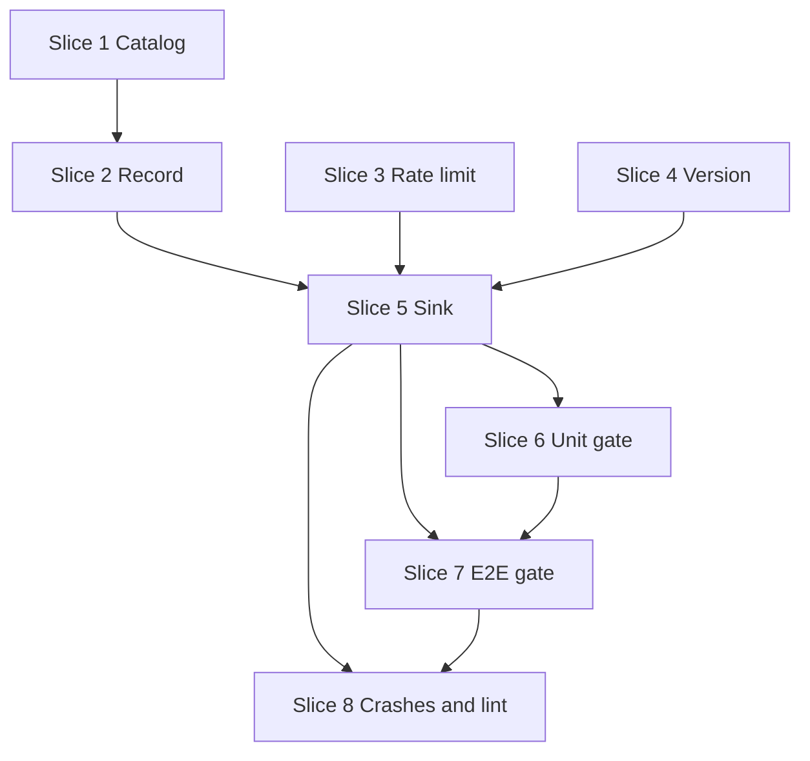

# Plan: D1 Diagnostics core and gate

**Created**: 2026-11-22
**Branch**: feat/diagnostics-core
**Status**: approved
**Gherkin persistence**: plan-file-only
**Spec**: `docs/specs/diagnostics-core.md` (AC1–AC17). Plan AC18 and AC19 split out the Reload and narrow-screen checks from spec AC6. Row 4 of the MVP build order v2. No GitHub issue.

## Goal

Make the browser app write one coded, single-line JSON record to the console for each diagnostic it raises, in dev and production, with the app version, a session id and the platform. Records pass an allow-list, so no map content reaches the console, and they are rate-limited per code. An error boundary, React root error options and global handlers code every crash, so no uncoded crash output reaches the console. Unit and e2e gates fail on uncoded console errors and on unexpected or missing expected codes. The app version becomes `0.1.0`, read from `package.json`, and `CHANGELOG.md` starts.

**Approach stances** (`decision-defaults.md`): scope — only the spec's events (imports, crashes, uncaught errors, rejections); MCP server untouched. Replace-vs-merge — the catalog gains codes and severities in place; no existing code changes. Integration — open a PR to `main` through `/pr`; no direct merge.

**Lint position**: AC16 and AC17 are enforced by ESLint (`npm run lint:deep`, run in CI). oxlint has no config here and keeps its defaults; the pre-commit hook does not check these two rules.

## Acceptance Criteria

- [ ] AC1 A rejected import writes exactly one `aie` record per reported problem, via `console.error` for `error` severity
- [ ] AC2 Every record has `version` = `package.json` version, a `session` that is equal for all records of one page load and differs after reload, `platform: "browser"`, `build` of `"dev"` or `"prod"`, and `time` matching ISO 8601 UTC (`YYYY-MM-DDTHH:mm:ss.sssZ`)
- [ ] AC3 A production build writes the same codes and fields, without dev-only error detail
- [ ] AC4 Record privacy. Check (unit, `record.test.js`): a problem with `SECRET-MARKER` in `message`, `params`, `untrusted`, `stepId`, `edgeId` and an extra key `detail` builds a record whose keys equal `RECORD_KEYS` exactly and whose JSON text has no `SECRET-MARKER`; a `field` of `SECRET-MARKER` is dropped and a `field` of `project.name` is kept. Check (e2e): after importing a file with a step named `SECRET-MARKER` that fails validation, no console message text contains `SECRET-MARKER`
- [ ] AC5 At most 5 records per code in a sliding 60 s window: an earlier emitted record of the same code counts while `now - time < 60000` ms, so with records at 0–4 s a 6th at 59.999 s is dropped and one at 60.000 s is emitted; dropped ones are counted into `suppressed` on the next emitted record of that code; codes are independent
- [ ] AC6 Crash screen (dev; the crash event exists only in dev). Check (e2e `crash.spec.js`): import a map with a step named `SECRET-MARKER` and confirm it is visible; dispatch the dev crash event with `render`; then the page has one `<main>` with an `h1` reading exactly "Something went wrong", the exact line "The app hit an error and can't continue. Reload to start again; your unsaved map will be lost. If this keeps happening, report the code below.", the text "Error code: APP_RENDER_FAILED" and a button named "Reload"; `document.activeElement` is the `h1`; axe reports 0 violations; the page's visible text has no `SECRET-MARKER`
- [ ] AC7 Crash records. Check (e2e, dev): a forced render crash writes exactly one `APP_RENDER_FAILED` record and no other console message of level error or warning; a forced uncaught `Error` writes exactly one `APP_UNCAUGHT_ERROR` record whose `error` has `name`, `message` and `stack`, and no other console error; a forced rejection with a string reason writes exactly one `APP_UNHANDLED_REJECTION` record with `error.name` `NonError`. Check (unit, `record.test.js`): for `build: "prod"`, `error` has exactly one key, `name`
- [ ] AC8 `report` and `reportError` throw on a code not in the catalog and write nothing
- [ ] AC9 The Vitest gate fails a test, printing one line per problem: for an uncoded `console.error` or `console.warn` call, `uncoded error: <text>` or `uncoded warn: <text>` (the console method name); for a record whose code the test did not declare (any severity), `unexpected <code> (<severity>): <catalog fix>`; for a record whose code is not in the catalog, `unknown code <code>`; for a declared code never written, `expected <code> was not seen`
- [ ] AC10 E2E gate. The Playwright gate applies the AC9 rules and failure lines to browser console messages. Page errors follow one of two pass rules, and `e2e/gate.spec.js` has a test that asserts which one Chromium shows: Rule A, when no page error is raised after the app's handler calls `preventDefault()`: any page error fails with `page error: <message>`. Rule B, when a page error is still raised: each record of a declared `APP_UNCAUGHT_ERROR` or `APP_UNHANDLED_REJECTION` covers one page error, and an uncovered page error fails with `page error: <message>`. Check (`scripts/e2e-imports.test.js`): no `e2e/*.js` file except `e2e/fixtures.js` imports `test` from `@playwright/test`, statically (`import { test } from`, including `test as x`) or through `import()`; importing `expect` or other Playwright helpers directly stays allowed; synthetic texts with a static and a dynamic `test` import are reported, and one importing only `expect` is not
- [ ] AC11 No global suppression: the gate code reads no option, environment variable or file that lets a code or console text pass without a per-test declaration. Check (unit): `checkDiagnostics` throws on any key other than `entries`, `pageErrors` and `expected`; the e2e fixture's `diagnostics` object has exactly one key, `expect`; and the texts of the gate code, which is `src/flow/diagnostics/gate.js`, `src/testHelpers.js`, `vitest.setup.js` and `e2e/fixtures.js`, contain no `process.env`, no `import.meta.env` and no import of `node:fs`
- [ ] AC12 Gates in CI. Check (unit): `vitest.config.js` `test.setupFiles` includes `vitest.setup.js`; `package.json` `scripts.test` is `vitest run` and `scripts["test:e2e"]` is `playwright test`; every `e2e/*.spec.js` gets `test` from `./fixtures.js` (AC10); and `.github/workflows/ci.yml` runs on `pull_request` and runs `npm test` and `npm run test:e2e`
- [ ] AC13 Catalog fields. Check (unit, `problem.test.js`): every entry's `severity` is `error`, `warning` or `hint`; `APP_RENDER_FAILED`, `APP_UNCAUGHT_ERROR` and `APP_UNHANDLED_REJECTION` each have non-empty `code` (equal to the key), `title`, `summary`, `message` and `fix`, `severity: "error"`, `owner: "app"`, `status: "active"`, `since: "0.1.0"`, and `docs` equal to `#` plus the code in lower case with `_` replaced by `-` (for example `#app-render-failed`)
- [ ] AC14 App version. Check (unit): `package.json` `version` is `0.1.0` and `APP_VERSION` from `src/shell/version.js` equals `0.1.0`; among non-test `src/` files only `src/shell/version.js` contains `__APP_VERSION__`; linting `import pkg from '../../package.json'` in `src/shell/Other.js` reports an error. Check (e2e, pages project): no served JavaScript asset contains the text `devDependencies`
- [ ] AC15 `CHANGELOG.md` starts with `# Changelog`, has `## [Unreleased]` followed by `## [0.1.0] - YYYY-MM-DD`, and the `[0.1.0]` section has one list item mentioning each of `Pages`, `MCP` and `diagnostics` (case-insensitive); a test fails when the `package.json` version has no such section
- [ ] AC16 Console rule. ESLint `no-console` is set to `error` for `src/**`, and off only for `src/shell/diagnostics.js`, `src/testHelpers.js`, `src/**/*.test.{js,jsx}` and `src/flow/diagnostics/gate-selftest/*.fixture.js`. Check (`scripts/lint-rules.test.js`, ESLint `lintText`): `console.log('x')` and `console.error('x')` in `src/shell/Other.js` each report `no-console`; the same code in each allowed path reports nothing. Aliasing, such as `const c = console`, is outside this rule
- [ ] AC17 Class rule. ESLint `no-restricted-syntax` with the `ClassDeclaration`, `ClassExpression` and `ThisExpression` selectors is `error` for every `src/` file, tests included. For `src/shell/ErrorBoundary.jsx` only, it keeps `ClassExpression` and drops `ClassDeclaration` and `ThisExpression`. Check (`scripts/lint-rules.test.js`): a class declaration using `this` in `ErrorBoundary.jsx` reports nothing; a class expression there reports `no-restricted-syntax`; a class declaration and a `this` in `src/shell/Other.jsx` and in `src/shell/Other.test.jsx` each report `no-restricted-syntax`; exactly one config entry's `files` names `ErrorBoundary.jsx`
- [ ] AC18 Reload recovery. Check (e2e `crash.spec.js`): on the crash screen, activating Reload leads to a page with no "Something went wrong" heading and a visible `main` landmark named "Value stream map" (the map canvas)
- [ ] AC19 Narrow screen. Check (e2e `crash.spec.js`): at a 320 by 640 viewport the crash screen's `document.documentElement.scrollWidth` is at most 320 and the Reload button is inside the viewport

## Slices

### Slice 1: Catalog severities and APP codes

**Depends-on:** none
**Files:** `src/flow/diagnostics/catalog.json`, `src/flow/diagnostics/problem.test.js`

**Behavior:**

```gherkin
Feature: Catalog severities and app codes

  Scenario: The catalog accepts the three severities
    # Still passes if: no catalog entry actually uses warning or hint
    Given the diagnostics catalog
    Then every entry's severity is one of error, warning or hint

  Scenario: An entry with any other severity fails the catalog check
    # Still passes if: the check accepts mixed-case severities such as "Error"
    Given a catalog entry with severity "debug"
    When the catalog check runs
    Then it fails and names that entry

  Scenario: The app codes exist with every catalog field
    # Still passes if: an app code's summary is reworded
    Then the catalog has APP_RENDER_FAILED, APP_UNCAUGHT_ERROR and APP_UNHANDLED_REJECTION
    And each has severity error, owner app, status active, since 0.1.0 and a docs anchor
```

**Steps:**

#### Step 1.1: Allow three severities and add the APP codes

**Complexity**: standard
**IMPLEMENT**: Change the catalog test's severity rule to `error | warning | hint`, add `APP` to its area list, and add the three `APP_` entries to `catalog.json`.
**TEST**: `problem.test.js`: the severity predicate over all entries; the same predicate reports a synthetic `debug` entry; per-code `toMatchObject({ severity: 'error', owner: 'app', status: 'active', since: '0.1.0' })` and the docs anchor for each `APP_` code.
**REFACTOR**: Name the severity set once (`SEVERITIES`) in the test.
**Files**: `src/flow/diagnostics/catalog.json`, `src/flow/diagnostics/problem.test.js`
**Covers**: AC13
**Commit**: `feat: allow warning and hint severities and add app crash codes`

### Slice 2: Allow-listed record builder

**Depends-on:** 1
**Files:** `src/flow/diagnostics/record.js`, `src/flow/diagnostics/record.test.js`

**Behavior:**

```gherkin
Feature: Records carry only allow-listed fields

  Scenario: A problem becomes a record with exactly the allow-listed keys
    # Still passes if: the context's time comes from a skewed clock
    Given a FILE_NOT_JSON problem and a context with version, session, platform, build and time
    When a record is built
    Then the record's keys are exactly source, code, severity, version, session, platform, build and time
    And source is "aie" and severity is the catalog severity

  Scenario: User and map text never reaches the record
    # Still passes if: the marker is split across two keys and only rejoined text is checked
    Given a problem whose message, params, untrusted, stepId, edgeId and an extra key "detail" all contain "SECRET-MARKER"
    When a record is built
    Then the record's JSON text does not contain "SECRET-MARKER"

  Scenario: A known field name is kept and an unknown one is dropped
    # Still passes if: the known-field set has extra entries no code uses
    Given one problem with field "project.name" and one with field "SECRET-MARKER"
    When records are built
    Then the first record has field "project.name"
    And the second record has no field key

  Scenario: Every field name the code sets is known
    # Still passes if: a field set only by a future command is missing
    Given the field values produced by the validator and the commands over their test inputs
    Then each is in the known-field set

  Scenario: A suppressed count is carried only when above zero
    # Still passes if: suppressed is a string rather than a number
    Given a suppressed count of 2 and then of 0
    When records are built
    Then the first record has suppressed 2
    And the second record has no suppressed key

  Scenario: Production error detail is the name only
    # Still passes if: a dev record's stack is truncated
    Given an APP_UNCAUGHT_ERROR with a TypeError whose message contains "SECRET-MARKER"
    When a record is built for build "prod"
    Then the record's error holds only name "TypeError" and no marker
    When a record is built for build "dev"
    Then the record's error holds the name, the message and the stack

  Scenario: A thrown non-Error is named NonError
    # Still passes if: a thrown null is named NonError too
    Given a thrown string
    When an error record is built
    Then the record's error name is "NonError"

  Scenario: Records are recognised and parsed back
    # Still passes if: a record padded with leading whitespace is not recognised
    Given a record serialised to one line
    Then it parses back to the same record
    And a console line that is not JSON, a JSON array, or JSON without source "aie" is not a record
```

**Steps:**

#### Step 2.1: Build a record from a problem, a context and a suppressed count

**Complexity**: complex
**IMPLEMENT**: `toRecord(problem, context, suppressed = 0)` copies only `code`, `severity`, the context keys, `field` when it is in `KNOWN_FIELDS`, and `suppressed` when above zero. `RECORD_KEYS` is one frozen array. `serializeRecord` returns one line.
**TEST**: `record.test.js`: exact key set, `time` matches the ISO 8601 UTC pattern, marker redaction across every excluded and extra key, known and unknown `field`, suppressed 2 and 0, single-line output; a drift test that collects `field` from `validateProjectFile` over the validator test inputs and from the commands' rejection results, and checks each is in `KNOWN_FIELDS`.
**REFACTOR**: Keep `RECORD_KEYS` and `KNOWN_FIELDS` side by side.
**Files**: `src/flow/diagnostics/record.js`, `src/flow/diagnostics/record.test.js`
**Covers**: AC2, AC4, AC5
**Commit**: `feat: build allow-listed diagnostic records`

#### Step 2.2: Error records for crash codes

**Complexity**: standard
**IMPLEMENT**: `toErrorRecord(code, error, context, suppressed = 0)` builds the base record from `problem(code)` and adds `error: { name }` for `prod` and `{ name, message, stack }` for `dev`; a non-Error value gets name `"NonError"`.
**TEST**: `record.test.js`: both builds, a thrown string, the marker absent in prod.
**REFACTOR**: Share the base record with `toRecord`.
**Files**: `src/flow/diagnostics/record.js`, `src/flow/diagnostics/record.test.js`
**Covers**: AC3, AC7
**Commit**: `feat: add error detail to crash records by build`

#### Step 2.3: Recognise and parse records

**Complexity**: standard
**IMPLEMENT**: `parseRecord(text)` returns the record or `null` for non-JSON, non-object JSON, or JSON without `source: "aie"`.
**TEST**: `record.test.js`: round trip, non-JSON, JSON array, foreign JSON.
**REFACTOR**: Name the `aie` source once and use it in both directions.
**Files**: `src/flow/diagnostics/record.js`, `src/flow/diagnostics/record.test.js`
**Covers**: AC9, AC10
**Commit**: `feat: parse diagnostic records from console text`

### Slice 3: Per-code rate limiter

**Depends-on:** none
**Files:** `src/flow/diagnostics/rateLimit.js`, `src/flow/diagnostics/rateLimit.test.js`

**Behavior:**

```gherkin
Feature: Per-code rate limits

  Scenario: The first five records of a code in a minute are emitted
    # Still passes if: the limit counts dropped records toward the window
    Given no records yet
    When FILE_NOT_JSON occurs at 0, 1, 2, 3 and 4 seconds
    Then all 5 are emitted

  Scenario: Records over the limit are dropped and counted
    # Still passes if: the count is reset when a different code is emitted
    Given FILE_NOT_JSON was emitted at 0, 1, 2, 3 and 4 seconds
    When it occurs at 10 and 20 seconds
    Then neither is emitted
    When it occurs at 60 seconds
    Then it is emitted with suppressed 2

  Scenario: The window slides from each emitted record
    # Still passes if: the window boundary is inclusive at exactly 60.000 s for every record but the first
    Given FILE_NOT_JSON was emitted at 0, 1, 2, 3 and 4 seconds
    When it occurs at 59.999 seconds
    Then it is dropped
    When it occurs at 60.000 seconds
    Then it is emitted

  Scenario: One code's limit does not affect another
    # Still passes if: the state map keeps codes that have aged out
    Given FILE_NOT_JSON has reached its limit
    When STEP_ID_MISSING occurs
    Then it is emitted with no suppressed key

  Scenario: The limiter never changes the state it is given
    # Still passes if: the returned state shares unchanged entries with the input
    Given a limiter state
    When a code is admitted
    Then the input state is unchanged
```

**Steps:**

#### Step 3.1: Admit or drop by code within a sliding minute

**Complexity**: standard
**IMPLEMENT**: `admit(state, code, now)` returns `{ state, emit, suppressed }`. State is a frozen map of code → `{ times, dropped }` (times of emitted records only). `RATE_LIMIT = 5`, `RATE_WINDOW_MS = 60_000`; a time is in the window when `now - time < RATE_WINDOW_MS`.
**TEST**: `rateLimit.test.js`: each scenario with injected times.
**REFACTOR**: Keep pruning of old times in one helper.
**Files**: `src/flow/diagnostics/rateLimit.js`, `src/flow/diagnostics/rateLimit.test.js`
**Covers**: AC5
**Commit**: `feat: rate-limit diagnostic records per code`

### Slice 4: App version and changelog

**Depends-on:** none
**Files:** `package.json`, `package-lock.json`, `vite.config.js`, `src/shell/version.js`, `src/shell/version.test.js`, `CHANGELOG.md`, `scripts/changelog.js`, `scripts/changelog.test.js`

**Behavior:**

```gherkin
Feature: App version and changelog

  Scenario: The app reads its version from package.json
    # Still passes if: package.json is also bundled in full
    Given package.json has version 0.1.0
    Then the app version is 0.1.0

  Scenario: The changelog has a complete entry for the current version
    # Still passes if: the heading's date is wrong
    Given CHANGELOG.md
    Then it has an Unreleased section
    And a section headed with version 0.1.0 that mentions the Pages deploy, the AI contract and diagnostics

  Scenario: A version with no changelog section fails
    # Still passes if: a section with only a heading and no items is accepted for other versions
    Given changelog text with no section for version 0.2.0
    Then the changelog check reports 0.2.0 as missing
```

**Steps:**

#### Step 4.1: Inject the version at build time

**Complexity**: standard
**IMPLEMENT**: Set `package.json` and lockfile root version to `0.1.0`. `vite.config.js` reads `package.json` through `new URL('./package.json', import.meta.url)` and defines `__APP_VERSION__` as its `version` only. `src/shell/version.js` exports `APP_VERSION`.
**TEST**: `version.test.js`: `APP_VERSION` equals `package.json` version (read with `readFileSync`) and equals the literal `0.1.0`.
**REFACTOR**: Keep the only `__APP_VERSION__` reference in `version.js`, with an inline global comment.
**Files**: `package.json`, `package-lock.json`, `vite.config.js`, `src/shell/version.js`, `src/shell/version.test.js`
**Covers**: AC14
**Commit**: `feat: read the app version from package.json at build time`

#### Step 4.2: Start the changelog

**Complexity**: standard
**IMPLEMENT**: `CHANGELOG.md` in Keep a Changelog format: empty `Unreleased`, and `[0.1.0]` listing the Pages deploy, the AI contract with the MCP server, and diagnostics (nothing has been released before, so all of D1 belongs in 0.1.0). `scripts/changelog.js` exports pure `versionSection(text, version)` returning the section body or `null`.
**TEST**: `scripts/changelog.test.js`: the real file starts with `# Changelog`, has `## [Unreleased]` then `## [<package.json version>] - YYYY-MM-DD`, and that section has a list item mentioning each of `Pages`, `MCP` and `diagnostics`; `versionSection` returns `null` for a missing version.
**REFACTOR**: Keep the heading pattern in one constant.
**Files**: `CHANGELOG.md`, `scripts/changelog.js`, `scripts/changelog.test.js`
**Covers**: AC15
**Commit**: `docs: start CHANGELOG.md at 0.1.0`

### Slice 5: Console sink and import records

**Depends-on:** 2, 3, 4
**Files:** `src/shell/diagnostics.js`, `src/shell/diagnostics.test.js`, `src/shell/useProject.js`, `e2e/console.js`, `e2e/diagnostics.spec.js`, `e2e/pages.spec.js`

**Behavior:**

```gherkin
Feature: Coded console records

  Scenario: Records go to the console method for their severity
    # Still passes if: the sink writes the record object instead of its JSON text
    Given a sink with error, warning and hint codes in its catalog
    When one problem of each severity is reported
    Then the error goes to console.error, the warning to console.warn and the hint to console.info

  Scenario: Reporting an unknown code throws and writes nothing
    # Still passes if: the thrown message omits the code
    When report or reportError is called with code "NOPE_UNKNOWN"
    Then it throws
    And the console received nothing

  Scenario: The sink applies the rate limit and carries the dropped count
    # Still passes if: suppressed is emitted on the 6th record itself
    Given FILE_NOT_JSON was reported 7 times within one minute
    When it is reported again after the window
    Then the console has 6 FILE_NOT_JSON records
    And the last one has suppressed 2 and the first five have no suppressed key

  Scenario: A missing random UUID source does not break the sink
    # Still passes if: the fallback id is not UUID-shaped
    Given crypto.randomUUID is not available
    When the sink is created
    Then it has a session id and reports normally

  Scenario: A non-JSON import writes exactly one coded record
    # Still passes if: the record's time is in the past
    Given the app is open
    When the user imports a file that is not JSON
    Then the console shows exactly one error record with code FILE_NOT_JSON and the app version

  Scenario: A file with several problems writes one record per problem
    # Still passes if: records arrive in a different order from the problem list
    Given a file that fails validation with 3 problems, each with a different code
    When the user imports it, dismisses the status and imports it again
    Then the console shows 3 records after the first import and 3 more after the second

  Scenario: Records in one page load share version and session, and reload changes the session
    # Still passes if: the session id is a counter rather than random
    Given the user imported two invalid files
    Then both records have the same version and the same UUID-shaped session
    When the page reloads and the user imports an invalid file again
    Then the new record has a different session

  Scenario: Step names from the file never reach the console
    # Still passes if: the marker appears only in a console.debug line
    Given a file with a step named "SECRET-MARKER" that fails validation
    When the user imports it
    Then no console message contains "SECRET-MARKER"

  Scenario: The production build writes the same record
    # Still passes if: the production time field has a different precision
    Given the production build served at the Pages base path
    When the user imports a file that is not JSON
    Then the console shows a FILE_NOT_JSON record with build "prod", the package.json version, and the same keys as the dev record
    And the production JavaScript does not contain the text "devDependencies"
```

**Steps:**

#### Step 5.1: Sink that writes admitted records by severity

**Complexity**: complex
**IMPLEMENT**: `createDiagnostics({ console, now, build, session, version, catalog })` (catalog defaults to the real one; record severity is the catalog's) returns `{ report(problem), reportError(code, error), reset() }`; it holds limiter state in a closure, throws on unknown codes before writing, and writes `serializeRecord` output through `error`/`warn`/`info` by severity. Tests inject a small catalog with `warning` and `hint` codes. `newSessionId()` uses `crypto.randomUUID` when present, else a v4 id from `crypto.getRandomValues`. The module's default instance exports `report`, `reportError` and `resetDiagnostics`.
**TEST**: `diagnostics.test.js` with an injected console stub: the first four scenarios.
**REFACTOR**: Keep the module-level instance to a few lines; logic lives in the factory. `resetDiagnostics` ships in the bundle as one small function; only `src/testHelpers.js` and the setup call it.
**Files**: `src/shell/diagnostics.js`, `src/shell/diagnostics.test.js`
**Covers**: AC1, AC2, AC5, AC8
**Commit**: `feat: write coded diagnostic records to the console`

#### Step 5.2: Report rejected-import problems

**Complexity**: standard
**IMPLEMENT**: In `useProject.js`, the effect that already reacts to `importState` changes calls `report` once per problem when the new state is `IMPORT_ERROR`. `e2e/console.js` collects console messages and page errors for a page; Slice 7's fixture builds on it.
**TEST**: `e2e/diagnostics.spec.js`: exactly one record, three-problem file twice, session and version, marker absent. `e2e/pages.spec.js`: prod record keys, version, and a fetch of each served JS asset showing no `devDependencies` text.
**REFACTOR**: No new effect; reuse the change guard already there.
**Files**: `src/shell/useProject.js`, `e2e/console.js`, `e2e/diagnostics.spec.js`, `e2e/pages.spec.js`
**Covers**: AC1, AC2, AC3, AC4, AC14
**Commit**: `feat: record rejected-import problems in the console`

### Slice 6: Unit test gate

**Depends-on:** 2, 5
**Files:** `src/flow/diagnostics/gate.js`, `src/flow/diagnostics/gate.test.js`, `src/testHelpers.js`, `vitest.setup.js`, `vitest.config.js`, `stryker.config.mjs`, `vitest.selftest.config.js`, `src/flow/diagnostics/gate-selftest/*`

**Behavior:**

```gherkin
Feature: Unit tests fail on uncoded or unexpected diagnostics

  Scenario: A test with only expected codes passes
    # Still passes if: the gate ignores console.log entirely
    Given a test that declares FILE_NOT_JSON as expected
    When it writes one FILE_NOT_JSON record
    Then the test passes

  Scenario: An uncoded console error or warning fails the test
    # Still passes if: console.log output is also allowed
    Given a test that writes "something broke" to console.error, and another that writes it to console.warn
    Then both tests fail and each failure shows the console text

  Scenario: An unexpected code fails the test with its fix line
    # Still passes if: the failure omits the record's time
    Given a test that declares no codes
    When it writes a STEP_ID_MISSING record
    Then the test fails, naming STEP_ID_MISSING, its severity and its catalog fix line

  Scenario: An unexpected hint record fails the test
    # Still passes if: the failure prints the severity in upper case
    Given a test that declares no codes
    When it writes a hint-severity record to console.info
    Then the test fails, naming that code

  Scenario: A record with a code absent from the catalog fails cleanly
    # Still passes if: the failure omits the record's session
    Given a test that writes an aie record with code "NOT_IN_CATALOG"
    Then the test fails, saying the code is not in the catalog, and the gate itself does not throw

  Scenario: A declared code that never appears fails the test
    # Still passes if: the failure does not name the test file
    Given a test that declares FILE_NOT_JSON as expected
    When it writes no records
    Then the test fails, naming FILE_NOT_JSON as expected but not seen

  Scenario: Expectations and rate limits do not leak between tests
    # Still passes if: the reset also clears unrelated console spies between tests
    Given two tests in one describe block, the first declaring FILE_NOT_JSON and writing it 5 times
    When the second declares FILE_NOT_JSON and writes it once, and a third declares nothing and writes it once
    Then the second passes because the limiter and expectations reset before every test, and the third fails
```

**Steps:**

#### Step 6.1: Pure gate check

**Complexity**: standard
**IMPLEMENT**: `checkDiagnostics({ entries, pageErrors = [], expected })` takes console entries (`{ level, text }`), page errors and expected codes; returns failure lines for uncoded error/warn entries, records with unexpected codes (any severity, with severity and catalog fix, or "not in the catalog"), expected codes never seen, and page errors not paired (rule in Step 7.1). The function has no allow-list parameter.
**TEST**: `gate.test.js`: each scenario as a pure case asserting the exact AC9 failure line, plus the pairing cases from Slice 7, plus an AC11 test that `checkDiagnostics` accepts only `entries`, `pageErrors` and `expected` and throws on any other key, and that the gate files' texts have no `process.env`, `import.meta.env` or `node:fs` import.
**REFACTOR**: Format each failure line in one function shared by both gates.
**Files**: `src/flow/diagnostics/gate.js`, `src/flow/diagnostics/gate.test.js`
**Covers**: AC9, AC10, AC11
**Commit**: `feat: check console entries against expected diagnostic codes`

#### Step 6.2: Find existing unit-test console noise

**Complexity**: standard
**IMPLEMENT**: Run `npm test` with temporary console spies that only list offenders. Fix each at its source; any file fixed is added to this slice's Files at build time (grep today shows no console use in tests). Stop condition: if more than 5 distinct sources appear, stop and split the cleanup into its own slice before Step 6.3, with the user's approval.
**TEST**: The listing run reports no offenders; full suite green.
**REFACTOR**: Remove the temporary spies.
**Covers**: AC9
**Commit**: `test: remove console noise from unit tests` (skipped when none)

#### Step 6.3: Wire the gate into every Vitest test

**Complexity**: complex
**IMPLEMENT**: `src/testHelpers.js` holds the per-test state and exports `expectDiagnostics(codes)`. `vitest.setup.js` imports it, spies on `console.error`, `console.warn` and `console.info` in `beforeEach`, calls `resetDiagnostics()`, and fails in `afterEach` with `checkDiagnostics` lines. `vitest.config.js` adds `setupFiles`, and its coverage excludes `vitest.setup.js`, `vitest.selftest.config.js` and `src/flow/diagnostics/gate-selftest/**`; `stryker.config.mjs` excludes the same fixtures from mutation. `globalHandlers.js` and `devCrash.js` stay under mutation. Self-test fixtures are `src/flow/diagnostics/gate-selftest/*.fixture.js`, outside the main `include`; `vitest.selftest.config.js` includes only them and uses the same `setupFiles`. If a test calls `vi.restoreAllMocks()`, the setup re-spies in its next `beforeEach`.
**TEST**: `gate.test.js` spawns `vitest run --config vitest.selftest.config.js --reporter=json` once and asserts per-fixture pass/fail and the failure text for each scenario. Full suite green with the gate on.
**REFACTOR**: The setup file holds no decision logic.
**Files**: `src/testHelpers.js`, `vitest.setup.js`, `vitest.config.js`, `stryker.config.mjs`, `vitest.selftest.config.js`, `src/flow/diagnostics/gate-selftest/*`, `src/flow/diagnostics/gate.test.js`
**Covers**: AC9, AC11, AC12
**Commit**: `test: fail unit tests on uncoded or unexpected diagnostics`

### Slice 7: E2E test gate

**Depends-on:** 5, 6
**Files:** `e2e/fixtures.js`, `e2e/console.js`, `e2e/gate.spec.js`, `e2e/*.spec.js`, `e2e/canvas.js`, `e2e/views.js`, `e2e/axe.js`, `scripts/e2e-imports.js`, `scripts/e2e-imports.test.js`, `scripts/ci-workflow.js`, `scripts/ci-workflow.test.js`

**Behavior:**

```gherkin
Feature: E2E tests fail on uncoded or unexpected diagnostics

  Scenario: An expected record passes
    # Still passes if: the fixture ignores console.info records
    Given a test that declares FILE_NOT_JSON as expected
    When the user imports a file that is not JSON
    Then the test passes

  Scenario: An unexpected record fails the test
    # Still passes if: the failure lists the code without its severity
    Given a test that declares no codes
    When the user imports a file that is not JSON
    Then the test fails, naming FILE_NOT_JSON and its fix line

  Scenario: A page error paired with an expected crash code passes
    # Still passes if: one expected record covers two page errors of the same kind
    Given a test that declares APP_UNCAUGHT_ERROR as expected
    When the page throws an uncaught error and the app records it
    Then the test passes

  Scenario: A page error with no expected crash code fails
    # Still passes if: the failure omits the error's stack
    Given a test that declares no codes
    When the page throws an uncaught error
    Then the test fails and shows the error text

  Scenario: Normal canvas use writes no diagnostics
    # Still passes if: an error appears only after a long idle period
    Given a test that declares no codes
    When the user adds a step, drags it, zooms and resizes the window
    Then the test passes with no records and no page errors

  Scenario: Every e2e file uses the shared fixture
    # Still passes if: a helper module re-exports Playwright's test under another name
    Given an e2e file other than the fixture that imports test from Playwright directly
    Then the import check fails and names that file
```

**Steps:**

#### Step 7.1: Shared fixture with the gate

**Complexity**: complex
**IMPLEMENT**: `e2e/fixtures.js` extends Playwright `test` with an auto fixture that attaches `e2e/console.js` to `page`, a `diagnostics.expect(codes)` fixture, and an after-test `checkDiagnostics` call. Pairing rule: each page error is covered by one record of an expected `APP_UNCAUGHT_ERROR` or `APP_UNHANDLED_REJECTION`; each such record covers at most one page error. Re-exports `expect`. First spike whether Chromium still raises `pageerror` after the app's handler calls `preventDefault()`: if it does not, drop the pairing rule and keep AC10's strict "any page error fails"; if it does, keep the pairing and record it as a spec deviation in Risks. Confirm early that Playwright loads `catalog.json` through `gate.js` with `with { type: 'json' }`.
**TEST**: `e2e/gate.spec.js`: a test asserting whether Chromium raises a page error after `preventDefault()` (Rule A or B of AC10); pass cases normally; fail cases with `test.fail()`. Page errors are raised with `page.evaluate` and a timer, and `APP_` records are written with `page.evaluate` too, so this slice does not need Slice 8.
**REFACTOR**: One collector; no per-spec setup.
**Files**: `e2e/fixtures.js`, `e2e/console.js`, `e2e/gate.spec.js`
**Covers**: AC10, AC11
**Commit**: `test: add the e2e diagnostics gate fixture`

#### Step 7.2: Find existing e2e console noise

**Complexity**: standard
**IMPLEMENT**: Run `npm run test:e2e` with the collector in list-only mode. Fix each source (for example a ResizeObserver loop error). Same stop condition as Step 6.2.
**TEST**: The listing run reports no offenders.
**REFACTOR**: Remove list-only mode.
**Covers**: AC10
**Commit**: `test: remove console noise from e2e runs` (skipped when none)

#### Step 7.3: Move every e2e file onto the fixture

**Complexity**: standard
**IMPLEMENT**: Every `e2e/*.js` file that imports `test` uses `./fixtures.js`. Tests that reject imports declare their codes, derived from the problem lists they already assert on. `scripts/e2e-imports.js` (pure) lists files whose text imports `test` from `@playwright/test`, statically or with `import()`, given file names and texts; `expect`-only imports are allowed. `scripts/ci-workflow.js` (pure) reports whether a workflow object runs on `pull_request` and which `run` commands it has.
**TEST**: `scripts/e2e-imports.test.js`: synthetic static and dynamic `test` imports are reported and an `expect`-only import is not; the real `e2e/` folder has no offender except `fixtures.js`. `scripts/ci-workflow.test.js`: `.github/workflows/ci.yml`, parsed with `yaml`, runs on `pull_request` and runs `npm test` and `npm run test:e2e`; `package.json` scripts and `vitest.config.js` `setupFiles` match AC12. An AC11 check that the fixture's `diagnostics` API has only `expect`. `npm run test:e2e` green, including the "normal canvas use" spec.
**REFACTOR**: Remove the now-unused direct imports.
**Files**: `e2e/*.spec.js`, `e2e/canvas.js`, `e2e/views.js`, `e2e/axe.js`, `scripts/e2e-imports.js`, `scripts/e2e-imports.test.js`, `scripts/ci-workflow.js`, `scripts/ci-workflow.test.js`
**Covers**: AC10, AC12
**Commit**: `test: run every e2e spec through the diagnostics gate`

### Slice 8: Crash handling and lint rules

**Depends-on:** 5, 7
**Files:** `src/shell/ErrorBoundary.jsx`, `src/shell/CrashScreen.jsx`, `src/shell/globalHandlers.js`, `src/shell/globalHandlers.test.js`, `src/shell/devCrash.js`, `src/shell/devCrash.test.js`, `src/main.jsx`, `eslint.config.js`, `scripts/lint-rules.test.js`, `e2e/crash.spec.js`, `e2e/pages.spec.js`

**Behavior:**

```gherkin
Feature: Crashes are coded and never blank

  Scenario: A render crash shows the crash screen and writes one record
    # Still passes if: the explanation line is reworded
    Given the app is open in dev
    When a render crash is forced
    Then the console shows exactly one APP_RENDER_FAILED error record and no other console output
    And the page shows a main region with the heading "Something went wrong", the explanation line, "Error code: APP_RENDER_FAILED" and a Reload button
    And focus is on the heading
    And the page has no accessibility violations

  Scenario: The crash screen is usable on a narrow screen
    # Still passes if: the code wraps mid-word
    Given the crash screen is showing in a 320 px wide window
    Then the Reload button is visible without horizontal scrolling

  Scenario: Reload recovers the app
    # Still passes if: Reload keeps an unrelated query parameter
    Given the crash screen is showing
    When the user activates Reload
    Then the crash heading is gone and the canvas is visible

  Scenario: The crash screen shows no map content
    # Still passes if: map content appears only in the page title
    Given the user imported a map with a step named "SECRET-MARKER" and sees it on the canvas
    When a render crash is forced
    Then the page text does not contain "SECRET-MARKER"
    And no console message contains "SECRET-MARKER"

  Scenario: An uncaught error is coded
    # Still passes if: the dev record also includes the error message
    Given the app is open in dev
    When an uncaught error is forced
    Then the console shows one APP_UNCAUGHT_ERROR error record and no other console error

  Scenario: An unhandled rejection is coded
    # Still passes if: a rejection with an Error reason is also named NonError
    Given the app is open in dev
    When an unhandled rejection with a string reason is forced
    Then the console shows one APP_UNHANDLED_REJECTION record whose error name is NonError

  Scenario: A failure while reporting does not loop
    # Still passes if: the handler writes a fallback line to the console
    Given the report function throws
    When the global error handler runs
    Then it returns without throwing and does not call report again

  Scenario: The crash hook does not exist in production
    # Still passes if: the production bundle keeps the hook's code but never wires it
    Given the production build
    When the dev crash event is dispatched
    Then the app keeps running and writes no APP_ record
    And the production JavaScript does not contain the text "aie-dev-crash"

  Scenario: Lint keeps the console and class exceptions to one file each
    # Still passes if: a console call inside a template literal goes undetected
    Then a console call in a src file other than the sink fails lint
    And a console call in the sink or in a test file passes lint
    And a class in src/shell/ErrorBoundary.jsx passes lint
    And a class or this in any other src file fails lint
```

**Steps:**

#### Step 8.1: Dev-only crash event

**Complexity**: standard
**IMPLEMENT**: `devCrash.js` exports `DEV_CRASH_EVENT` (`aie-dev-crash`) and pure `crashKind(detail)` returning `render | error | rejection | null`. `main.jsx`, only under `import.meta.env.DEV`, listens for the event: `render` sets state that makes a child throw on its next render, `error` throws in a timer, `rejection` rejects with a string. The event works on a loaded map, so an import can come first.
**TEST**: `devCrash.test.js` for `crashKind`. `e2e/pages.spec.js`: dispatching `DEV_CRASH_EVENT` (imported from `devCrash.js`) in the production build leaves the canvas visible and writes no `APP_` record; the same dispatch in dev crashes (covered in `crash.spec.js`).
**REFACTOR**: Keep the hook out of `App.jsx`.
**Files**: `src/shell/devCrash.js`, `src/shell/devCrash.test.js`, `src/main.jsx`, `e2e/pages.spec.js`
**Covers**: AC6, AC7
**Commit**: `test: add a dev-only crash event`

#### Step 8.2: Global handlers

**Complexity**: standard
**IMPLEMENT**: `globalHandlers.js` exports `installGlobalHandlers(target, reportError)`: `error` → `APP_UNCAUGHT_ERROR`, `unhandledrejection` → `APP_UNHANDLED_REJECTION`; each calls `event.preventDefault()`, because otherwise Chromium prints its own uncoded "Uncaught" console error, which the gate would fail; a reentrancy flag and a try/catch stop a throwing `reportError` from looping. `main.jsx` installs it.
**TEST**: `globalHandlers.test.js` with a fake target: Error reason, string reason, `preventDefault` called, throwing `reportError` returns quietly and is called once. `e2e/crash.spec.js`: the uncaught-error and rejection scenarios.
**REFACTOR**: `main.jsx` only composes.
**Files**: `src/shell/globalHandlers.js`, `src/shell/globalHandlers.test.js`, `src/main.jsx`, `e2e/crash.spec.js`
**Covers**: AC7
**Commit**: `feat: record uncaught errors and unhandled rejections`

#### Step 8.3: Error boundary, root options and crash screen

**Complexity**: complex
**IMPLEMENT**: `ErrorBoundary.jsx`, the one class component: `componentDidCatch` → `reportError('APP_RENDER_FAILED', error)`, render `CrashScreen` on error. `main.jsx` passes `createRoot` options: `onCaughtError` does nothing (the boundary reports), `onUncaughtError` → `reportError('APP_RENDER_FAILED')`, `onRecoverableError` → `reportError('APP_UNCAUGHT_ERROR')`, so React writes no console output of its own. `CrashScreen.jsx` (function component) applies `toCssCustomProperties(tokens)` on its own root, because the App shell's variables are gone. It renders `<main>` with `<h1 tabIndex={-1}>Something went wrong</h1>` focused on mount, the line "The app hit an error and can't continue. Reload to start again; your unsaved map will be lost. If this keeps happening, report the code below.", `Error code: <code>APP_RENDER_FAILED</code>` as selectable text, and a Reload button calling `location.reload()`. Layout is centered with a max width and wraps at 320 px.
**TEST**: `e2e/crash.spec.js`: the render-crash, narrow-screen, Reload and no-map-content scenarios, with exactly one record under StrictMode.
**REFACTOR**: `ErrorBoundary.jsx` holds state and lifecycle only; all markup is in `CrashScreen.jsx`.
**Files**: `src/shell/ErrorBoundary.jsx`, `src/shell/CrashScreen.jsx`, `src/main.jsx`, `e2e/crash.spec.js`
**Covers**: AC6, AC7, AC18, AC19
**Commit**: `feat: show a crash screen and record render crashes`

#### Step 8.4: Lint rules for the console and the class exception

**Complexity**: standard
**IMPLEMENT**: `eslint.config.js`, in the existing `src/**` block: `no-console: error`, except `src/shell/diagnostics.js`, `src/**/*.test.{js,jsx}`, `src/testHelpers.js` and the gate self-test fixtures; the existing `no-restricted-imports` block also forbids `package.json` imports in non-test `src/`. A block for `src/shell/ErrorBoundary.jsx` only sets `no-restricted-syntax` to the `ClassExpression` selector alone.
**TEST**: `scripts/lint-rules.test.js` uses the ESLint Node API `lintText` with virtual paths for each case in the lint scenario, asserts exactly one config entry names `ErrorBoundary.jsx`, checks a `package.json` import in `src/shell/Other.js` is an error, and checks only `src/shell/version.js` contains `__APP_VERSION__` among non-test `src/` files; `npm run lint:deep` green.
**REFACTOR**: Keep the `src/` rules in one block plus the one-file exceptions.
**Files**: `eslint.config.js`, `scripts/lint-rules.test.js`
**Covers**: AC14, AC16, AC17
**Commit**: `chore: limit console use and classes to one file each`

## Parallelization

Waves derived by `scripts/plan_waves.py`.



| Wave | Slices (parallel) |
| ---- | ----------------- |
| 1    | 1, 3, 4           |
| 2    | 2                 |
| 3    | 5                 |
| 4    | 6                 |
| 5    | 7                 |
| 6    | 8                 |

## Complexity Classification

| Rating     | Criteria                                                                         | Review depth                                        |
| ---------- | -------------------------------------------------------------------------------- | --------------------------------------------------- |
| `trivial`  | Single-file rename, config change, typo fix, documentation-only                  | Skip inline review; covered by final `/code-review` |
| `standard` | New function, test, module, or behavioral change within existing patterns        | Spec-compliance + relevant quality agents           |
| `complex`  | Architectural change, security-sensitive, cross-cutting concern, new abstraction | Full agent suite including opus-tier agents         |

## Pre-PR Quality Gate

- [ ] All tests pass (`npm test`, `npm run test:e2e`)
- [ ] Linter passes (`npm run lint`, `npm run lint:deep`)
- [ ] `npm run format:check` passes
- [ ] `/code-review` passes
- [ ] `CHANGELOG.md` matches what shipped
- [ ] `graphify update .` run if `graphify-out/` exists

## Risks & Open Questions

- Existing console noise in unit or e2e runs is unknown until Steps 6.2 and 7.2. Each is fixed at its source; a stop condition splits the work if more than 5 sources appear. None may go on a global allow-list.
- React 19's default root error logging is assumed (it writes `console.error` for caught errors). Step 8.3 overrides all three root options, and the e2e "no other console output" assertion confirms it.
- The N14 card (on `docs/mvp-order-v2`) still says severity `debug` for `USAGE_SEND_FAILED`; it must say `hint`. That file is outside this branch; the coordinator or the mvp-docs agent should edit it.
- A crash that recurs on load (not possible today, since nothing persists) would loop through Reload. The crash line tells the user to report the code. E1 adds storage and should revisit this.
- Slice 7 touches every e2e file. Other branches editing e2e files during the PR will conflict; land promptly.
- Gate self-tests spawn one child Vitest run, adding a few seconds to `npm test`.
- Step 7.1's page-error pairing rule (if the spike keeps it) refines AC10's "any page error fails"; note it in the PR's decisions.
- The `reportError` path from `onUncaughtError` and `onRecoverableError` has no e2e test (a boundary catches every render error, and the app has no hydration); it is covered by code review only.

## Plan Review Summary

Plan tier: complex (6 waves, 8 slices, complex steps) — reviewers: Acceptance, Design, UX, Strategic, Parallelization.

- **Resolved blocker**: Slice 8 - React 19 default root error logging writes uncoded console output (root options added in Step 8.3).
- **Resolved blocker**: Slice 7 - page errors from coded crashes had no gate rule (pairing rule and spike in Step 7.1).
- **Resolved blocker**: Slice 8 - the no-map-content crash scenario could not set up its map (dev crash event after import, Step 8.1).
- **Resolved blocker**: Slice 6 - depended on Slice 5's `resetDiagnostics` while in the same wave (now `Depends-on: 2, 5`).
- Warnings applied: UX crash-screen copy, `<main>` landmark, own theme tokens, 320 px layout; `suppressed` slot and `KNOWN_FIELDS` drift test; catalog injection for severity routing; distinct codes in the multi-problem fixture; lint rules proven by an ESLint `lintText` test; bundle checks for `devDependencies` and the crash event; changelog content under `[0.1.0]`; noise-discovery steps with a stop condition; coverage and Stryker exclusions for gate fixtures.
- Remaining observations: AC16 and AC17 are ESLint-only (not in pre-commit); `resetDiagnostics` ships in the bundle; the sink loads in every unit test through the setup file; the plan is large (22 steps), with Slices 1–5 shippable on their own.

## Build Progress

### Slices (grouped by wave)

#### Wave 1

- [x] Slice 1: Catalog severities and APP codes
  - [x] Step 1.1: Allow three severities and add the APP codes
- [x] Slice 3: Per-code rate limiter
  - [x] Step 3.1: Admit or drop by code within a sliding minute
- [x] Slice 4: App version and changelog
  - [x] Step 4.1: Inject the version at build time
  - [x] Step 4.2: Start the changelog

#### Wave 2

- [x] Slice 2: Allow-listed record builder
  - [x] Step 2.1: Build a record from a problem, a context and a suppressed count
  - [x] Step 2.2: Error records for crash codes
  - [x] Step 2.3: Recognise and parse records

#### Wave 3

- [x] Slice 5: Console sink and import records
  - [x] Step 5.1: Sink that writes admitted records by severity
  - [x] Step 5.2: Report rejected-import problems

#### Wave 4

- [x] Slice 6: Unit test gate
  - [x] Step 6.1: Pure gate check
  - [x] Step 6.2: Find existing unit-test console noise
  - [x] Step 6.3: Wire the gate into every Vitest test

#### Wave 5

- [ ] Slice 7: E2E test gate
  - [ ] Step 7.1: Shared fixture with the gate
  - [ ] Step 7.2: Find existing e2e console noise
  - [ ] Step 7.3: Move every e2e file onto the fixture

#### Wave 6

- [ ] Slice 8: Crash handling and lint rules
  - [ ] Step 8.1: Dev-only crash event
  - [ ] Step 8.2: Global handlers
  - [ ] Step 8.3: Error boundary, root options and crash screen
  - [ ] Step 8.4: Lint rules for the console and the class exception
