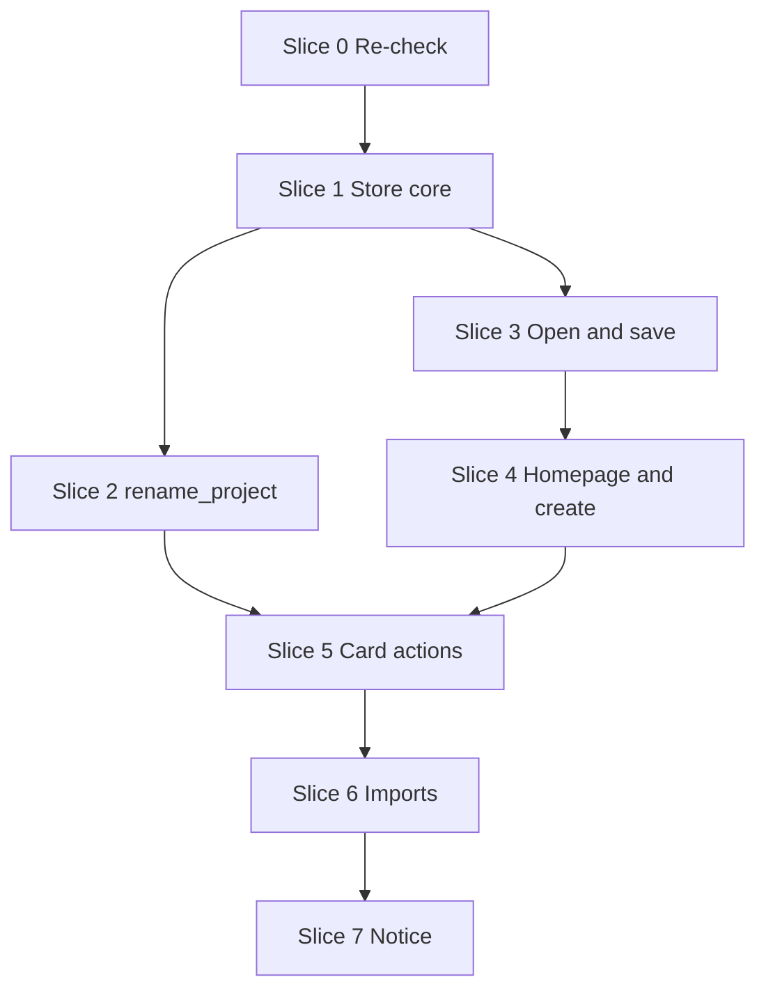

# Plan: E1 Homepage

**Created**: 2026-11-22
**Branch**: feat/homepage
**Status**: approved (2026-11-22, by the user, with all six R rules; spec AC30–AC35)
**Examination**: not-applicable (standing rule: the plugin recorder bug does not credit file-redirected output, and summary reporters hide test names; code review and CI still gate the PR)
**Gherkin persistence**: plan-file-only
**Spec**: `docs/specs/homepage.md` (AC1–AC35, gate passed 2026-11-22). Issue #27, row 8 of `plans/mvp-order.md`.
**Build waits for**: R4 (`feat/ui-on-commands`) to merge; D2 merged in #52. Step 0.1 re-checks the seams after both merge.

## Goal

Make the homepage the entry point. It lists the projects saved in this browser and lets the user create, open, rename, duplicate, delete, import and export them. Projects live in IndexedDB as save-file text and are saved after every accepted change, so a reload loses nothing. A new project is an empty map. `rename_project` joins the command layer and MCP. Each store failure has a catalog code and a guide.

**Approach stances** (`knowledge/decision-defaults.md`):

- Scope: the spec's ACs, plus the review-driven rules marked **R** below, which need the user's confirmation at this gate (see Risks & Open Questions). No type picker (E2), usage events (N14), help pages (N17), undo (E5) or live cross-tab sync.
- Data change: none to the save file and no schema bump. A new browser database, `ai-enabler` version 1, is created on first use. There is no older store to migrate.
- Replace vs. merge: the starter map is replaced by the homepage and an empty new project. The starter builders move to test helpers. ui-shell AC27 and AC34's id swap are marked superseded in `docs/specs/ui-shell.md`, not deleted.
- Integration: one PR with green checks (default), merged alone after R4 and D2. Fallback split if review finds it too big: PR A = Slices 1–4 and 7 (store, rename, open and save, list and create, blocked storage); PR B = Slices 5–6 (card actions and imports).

**Design decisions** (correct them at this gate):

- **Layers.** `src/flow/projectStore.js` is persistence only: save, list, read, remove, write ordering, and error mapping, over an injected adapter (`listIndex`, `getFile`, `put(entry, text)`, `remove(id)`). `src/flow/projectLibrary.js` holds the library rules on top of it: create, rename, duplicate, import as new (id choice), import onto, export. `src/flow/homeFlow.js` is a pure reducer for the homepage: dialogs, the pending action, focus target and announcements. React stays thin: `useHomepage` wires the reducer to the library, and `HomePage.jsx` and `ProjectCard.jsx` only render.
- **Adapter choice and readiness.** `openStoreAdapter()` in `src/shell/storeAdapter.js` resolves once to `{ adapter, persistent, problems }`: the IndexedDB adapter, or the memory adapter with `STORE_UNAVAILABLE` when `indexedDB` is missing, `open` throws, or `open` fires `error` or `blocked`. `StoreProvider` exposes `{ status: 'opening' | 'ready', library, persistent }` and stays readiness plus context. The storage-problems state and the "notice shows" rule live in a pure `src/flow/storeStatus.js` reducer, and the one-time persist request runs in `openStoreAdapter()`. Nothing reads the store before `ready`. This lands in Slice 3. Slice 7 adds only the notice and its tests.
- **Layout constants.** `src/flow/storeLayout.js` names the database, version and the `index` and `files` stores. The adapter and `e2e/store.js` both import it.
- **Atomic writes.** The adapter writes both stores in one `readwrite` transaction and resolves on `oncomplete`. It rejects on `onerror` and `onabort`, so a half write leaves nothing.
- **Ordering.** Every store call runs on one queue per project id. Serializing and hashing happen inside the queue. `list()` waits for every pending write, so the homepage never shows stale names or dates. A failed link maps its error and never blocks the next one. The queue may later coalesce to the newest pending project per id without changing its interface; AC13's test asserts that the newest write is the one stored.
- **Error mapping.** In the store: `put` or `remove` throwing maps to `STORE_WRITE_FAILED`; `listIndex` or `getFile` throwing maps to `STORE_UNAVAILABLE`; a missing id maps to `STORE_PROJECT_NOT_FOUND`. Names and ids go only in `untrusted`. In the library: a stored file that fails the import pipeline maps to `STORE_FILE_INVALID`, followed by the pipeline's problems. Removing an unknown id is `STORE_PROJECT_NOT_FOUND`.
- **One reporter.** `StoreProvider` reports every problem in a failed store result once through D1's `report`, at the call site of the operation. Effects never report, so React StrictMode cannot double count.
- **Store status channel.** Store problems have their own state in `StoreProvider` (`storeProblems`), rendered through R4's `ProblemsPanel` with the heading "Not saved: N problems", in a region labelled "Storage problems". Only a successful write of the same project clears it. R4's edit-rejection panel is left alone.
- **Save hook.** `useCanvasEdits` and `useProject` take an `onAccepted(memoryProject)` callback. It receives the project from `runEdit`'s or the import's result, not from React state. The shell passes `library.save`. Saves are queued, not awaited, so the UI never waits.
- **Shell per project.** `App.jsx` renders the shell with `key={id}` and `useProject({ initial })` from `useStoredProject(id)`, so moving between projects never reuses canvas state.
- **Import flow.** `useImportFlow` and `readImport` move out of `useProject.js` into `src/shell/useImportFlow.js`, with `getCurrentProject` and `onReplace` parameters. The header and card imports share it.
- **Confirm wording.** One reducer wording for header and card imports, with the target named: "Replace <current name> with <incoming name>?", and "Replace <name> with the imported version of <name>?" when the names match. This replaces "Replace current map with …" (ui-shell AC33–34). **R**
- **Sorting.** Only the store sorts. Last modified: `modifiedAt` descending, then id ascending. Name: `localeCompare(other, 'en', { sensitivity: 'base' })`, then id ascending.
- **Dates.** A card shows `<time datetime="<ISO>">` with `Intl.DateTimeFormat('en-GB', { dateStyle: 'medium', timeStyle: 'short', timeZone })` text, for example "22 Nov 2026, 10:00". The zone is the browser's. Tests inject `UTC`.
- **E2e waiting and seeding.** `e2e/store.js` seeds and reads IndexedDB with `page.evaluate`, using `storeLayout.js`. `waitForStored(page, id, predicate)` polls the stored text until the predicate holds, so reload tests never race a write. The adapter contract runs in the page against the Vite dev server by dynamic import of `/src/flow/storeContract.js` and `/src/shell/indexedDbAdapter.js`. No production test seam.
- **Failure injection.** `page.addInitScript` variants: `indexedDB` deleted; `indexedDB.open` throwing; `open` firing `error`; and the transaction aborting on the `files` put (async), for writes.
- **Unopenable cards.** The library marks a card `openable: false` only when its file fails to open (`STORE_FILE_INVALID`); a write failure leaves the card fully usable so the user can retry. Its menu shows Replace from file, Export and Delete. Rename and Duplicate are hidden. Replace from file repairs the card without parsing the old file. **R**
- **Homepage write failures.** A failed create or rename keeps its dialog open with the typed name kept and the problem shown in it, so the user can retry, and nothing navigates. A failed duplicate, delete or import leaves the list unchanged, lists the problem in the storage panel above the list, returns focus to the card's "More actions" button (or "Import project"), and announces "Not saved. <message>". No success announcement is spoken. **R**
- **Lasting notice.** `StoreNotice` shows "Not saved in this browser. Export to keep your work." while `persistent` is false, and also while the open project has a failed save. It clears on the next successful write. While it shows, `beforeunload` asks before leaving the tab. Leaving a project with an unsaved (failed) change for another route asks first through `ConfirmDialog` (AC32): in-app links go through one `useLeaveGuard` hook that the header home link and later N17's Help link call, and a `hashchange` away (Back, typed hash) is reverted with `history.pushState` to the project hash while the dialog asks. With every change saved, including the memory fallback, nothing asks. **R**
- **Durable storage.** On the first successful write, the app calls `navigator.storage.persist()` once, best effort, with no UI. Help adds "Clearing this site's data deletes its projects. Export to keep a copy." **R**
- **Card menu.** Each card has an "Open <name>" link and a "More actions for <name>" disclosure button. The menu holds Rename, Duplicate, Replace from file, Export and Delete. Escape closes it and returns focus to its button, and so does Tab out of it or a click outside. "Replace from file" is the card's import, so it is not confused with "Import project". **R**
- **Routes and focus.** Titles: home "AI Enabler"; project "<name> · AI Enabler" (as today); missing "Project not found · AI Enabler"; cannot open "Can't open <name> · AI Enabler". On a route change, focus moves to the page's `h1`. Loading shows "Loading projects…" (homepage) or "Opening project…" (project route) in a status line with `aria-busy`. The empty state renders only after the list arrives.
- **Long names.** Card names wrap; there is no truncation on the homepage. The header keeps its truncation.

## Acceptance Criteria

- [ ] AC1 `#/` shows the homepage with heading, Projects region, New project and Import project; title "AI Enabler".
- [ ] AC2 One card per project with name and modified date; empty-state text when none.
- [ ] AC3 Sort by last modified (default, newest first) or by name (A to Z, case-insensitive); stable ties.
- [ ] AC4 The header brand links home from a project.
- [ ] AC5 Create runs `create_project`, saves, lists and opens the project; a blank name keeps the dialog open; Cancel changes nothing.
- [ ] AC6 A new project shows the hint "This map has no steps yet. Import a project file to fill it."
- [ ] AC7 Opening a card goes to `#/projects/<id>`; a direct load and a reload show the same project.
- [ ] AC8 Opening runs the import pipeline (old files upgrade) and writes nothing.
- [ ] AC9 An unknown id shows "Project not found" with a home link and reports `STORE_PROJECT_NOT_FOUND`.
- [ ] AC10 A stored file that cannot be opened shows "Can't open <name>", lists `STORE_FILE_INVALID` and the file's problems; the card can still be exported and deleted.
- [ ] AC11 Every accepted change is saved; a rejected one writes nothing; a reload shows the change.
- [ ] AC12 Stored text is the export form with `contentHash`.
- [ ] AC13 Writes for one project apply in call order.
- [ ] AC14 A failed write keeps the change, reports and lists `STORE_WRITE_FAILED`; export still works; the next write catches up.
- [ ] AC15 Rename runs `rename_project` and saves; a blank name is rejected.
- [ ] AC16 Duplicate saves "<name> (copy)" with a new id; the homepage stays; focus moves to the new card.
- [ ] AC17 Delete confirms, removes, announces; focus moves to next, previous, or New project.
- [ ] AC18 Card import confirms with notices, replaces the map and name, keeps the card's id, saves; a rejection changes nothing.
- [ ] AC19 Homepage import adds a new project, keeps the file id unless taken, stays on the homepage, focuses the new card.
- [ ] AC20 Card export equals open-then-export; an unopenable file exports its stored text.
- [ ] AC21 Blocked IndexedDB reports `STORE_UNAVAILABLE`; the app works in memory with a lasting "Not saved in this browser. Export to keep your work." notice.
- [ ] AC22 Each store problem is reported once through D1's `report`; D1 gates pass.
- [ ] AC23 `rename_project` MCP tool, `llms.txt` entry, parity mapping, plugin bundle check.
- [ ] AC24 Four `STORE_` codes with guides; D2's guide tests pass.
- [ ] AC25 The "stores nothing" test is replaced; ui-shell AC27 marked superseded; the export-shape test uses a fixture.
- [ ] AC26 Starter-dependent e2e tests seed a fixture; route tests updated.
- [ ] AC27 Help says projects save automatically and that the last change wins across two tabs.
- [ ] AC28 All homepage states pass axe and work by keyboard.
- [ ] AC29 The in-project header Import replaces that project and keeps its id.
- [ ] AC30 An unopenable card offers only Replace from file, Export and Delete; replace repairs it.
- [ ] AC31 A refused homepage write changes nothing, keeps the dialog or lists the problem, never announces success.
- [ ] AC32 The lasting notice also shows after a failed save until a save works; leaving the tab, or the project for another route, asks first while a change is unsaved.
- [ ] AC33 Import confirmations read "Replace <current> with <incoming>?".
- [ ] AC34 The card's import is labelled "Replace from file".
- [ ] AC35 Durable storage is requested once; help says clearing site data deletes projects.

## Slices

### Slice 0: Re-check the seams after R4 and D2 merge

**Depends-on:** none
**Files:** `plans/homepage.md`

**Behavior:**

```gherkin
Feature: Plan matches the merged code

  Scenario: The R4 and D2 names the plan uses exist on main
    # Still passes if: R4 renamed a private helper the plan does not use
    Given R4 and D2 are merged into main
    When the plan's named seams are looked up
    Then runEdit, useCanvasEdits, ProblemsPanel, problemsView and the guides folder all exist, or the plan is amended before Slice 1
```

**Steps:**

#### Step 0.1: Rebase and re-check

**Complexity**: trivial
**IMPLEMENT**: Rebase on `main`. Confirm the R4 and D2 names and file paths in Slices 1–7. Amend file lists that changed.
**TEST**: `npm test` and `npm run test:e2e` green on the rebased branch.
**REFACTOR**: None needed beyond plan edits.
**Files**: `plans/homepage.md`
**Commit**: `docs: re-check the E1 plan against merged R4 and D2`

### Slice 1: Store core, library rules and store codes

**Depends-on:** 0
**Files:** `src/flow/storeLayout.js`, `src/flow/projectStore.js`, `src/flow/projectStore.test.js`, `src/flow/memoryStoreAdapter.js`, `src/flow/memoryStoreAdapter.test.js`, `src/flow/storeContract.js`, `src/flow/diagnostics/catalog.json`, `src/flow/diagnostics/guides/STORE_UNAVAILABLE.md`, `src/flow/diagnostics/guides/STORE_WRITE_FAILED.md`, `src/flow/diagnostics/guides/STORE_PROJECT_NOT_FOUND.md`, `src/flow/diagnostics/guides/STORE_FILE_INVALID.md`, `plugin/server/aie-mcp.js`
**Invariants:** `npm test`, `npm run check:plugin`

**Behavior:**

```gherkin
Feature: Project store

  Scenario: A saved project is listed and reads back as an unedited export
    # Still passes if: the stored text is indented differently
    Given an empty store and the time 2026-11-22 10:00 UTC
    When the project "Checkout" is saved
    Then the list shows "Checkout" modified at 2026-11-22 10:00 UTC
    And importing the text read back shows no "changed outside AI Enabler" notice

  Scenario: Listing sorts by last modified, newest first
    # Still passes if: the list is read twice
    Given projects "A" modified on day 1, "B" on day 3 and "C" on day 2
    When the list is read with the default sort
    Then the order is "B", "C", "A"

  Scenario: Listing sorts by name, ignoring case and accents
    # Still passes if: the list is read twice
    Given projects "beta", "Alpha", "Éclair" and "gamma"
    When the list is read sorted by name
    Then the order is "Alpha", "beta", "Éclair", "gamma"

  Scenario: Ties keep a stable order by id
    # Still passes if: the list is read twice
    Given projects with ids "a2" and "a1", both named "Same" and both modified at 2026-11-22 10:00 UTC
    When the list is read by last modified, and then by name
    Then both reads return "a1" then "a2"

  Scenario: An empty store lists nothing
    # Still passes if: the empty list is a new array each call
    Given an empty store
    When the list is read
    Then it is empty

  Scenario: Writes for one project land in the order they were made
    # Still passes if: writes for different projects are also serialized
    Given a store whose first write is slow
    When "Checkout" is saved with 3 steps and then with 2 steps
    Then reading "Checkout" gives 2 steps

  Scenario: The list waits for a pending save
    # Still passes if: the list also waits for reads
    Given a store whose writes are slow
    When "Checkout" is renamed to "Payments" and saved, and the list is read before the write finishes
    Then the list shows "Payments"

  Scenario: The next write after a failure stores the latest state
    # Still passes if: the retry waits for the next change
    Given a store whose first write fails and later writes succeed
    When "Checkout" is saved with 3 steps and then with 2 steps
    Then the first save reports STORE_WRITE_FAILED
    And reading "Checkout" gives 2 steps, modified at the second save's time

  Scenario Outline: A store call the browser refuses is a coded problem without the name
    # Still passes if: the adapter's error text is dropped from the record
    Given a store whose <call> fails
    When "Checkout" is <operation>
    Then the result is <code>, the message does not contain "Checkout", and the name is only in untrusted

    Examples:
      | call      | operation | code               |
      | put       | saved     | STORE_WRITE_FAILED |
      | remove    | removed   | STORE_WRITE_FAILED |
      | getFile   | read      | STORE_UNAVAILABLE  |
      | listIndex | listed    | STORE_UNAVAILABLE  |

  Scenario: Reading or removing an id that is not stored is a coded problem
    # Still passes if: the problem's untrusted id is trimmed
    Given an empty store
    When project "nope" is read, and then removed
    Then both results are STORE_PROJECT_NOT_FOUND

  Scenario: Removing a project drops it from the list and from reads
    # Still passes if: remove also compacts the store
    Given projects "A" and "B"
    When "A" is removed
    Then only "B" is listed and "A" reads as not found

  Scenario: Every store code has a guide
    # Still passes if: a guide gains an extra paragraph after the marker
    Given the catalog
    Then STORE_UNAVAILABLE, STORE_WRITE_FAILED, STORE_PROJECT_NOT_FOUND and STORE_FILE_INVALID each have a guide that says no tool repairs it
```

**Steps:**

#### Step 1.1: Store codes and guides

**Complexity**: standard
**IMPLEMENT**: Add the four `STORE_` entries to `catalog.json` (`owner: "app"`, docs anchors, no names in messages). User-facing messages: "This browser is not saving projects." / "This change could not be saved in this browser." / "There is no saved project at this link." / "The saved copy of this project can't be opened." Add one D2-format guide each, using the "No tool repairs this." marker. Rebuild the bundle with `npm run build:plugin`.
**TEST**: D2's guide tests and the catalog tests pass; `npm run check:plugin` passes.
**REFACTOR**: Keep the guide wording parallel across the four codes.
**Files**: `src/flow/diagnostics/catalog.json`, `src/flow/diagnostics/guides/STORE_UNAVAILABLE.md`, `src/flow/diagnostics/guides/STORE_WRITE_FAILED.md`, `src/flow/diagnostics/guides/STORE_PROJECT_NOT_FOUND.md`, `src/flow/diagnostics/guides/STORE_FILE_INVALID.md`, `plugin/server/aie-mcp.js`
**Covers**: AC24
**Commit**: `feat: add the browser store catalog codes and their guides`

#### Step 1.2: Memory adapter and a shared adapter contract

**Complexity**: standard
**IMPLEMENT**: `storeLayout.js` constants. `createMemoryStoreAdapter()` copies on read and write. `storeContract.js` exports the adapter contract as plain async checks (put then get, put replaces, remove, list), so Vitest runs them on the memory adapter and Slice 3's e2e runs them on IndexedDB.
**TEST**: The contract against the memory adapter.
**REFACTOR**: Keep the contract free of Vitest imports so the browser can run it.
**Files**: `src/flow/storeLayout.js`, `src/flow/memoryStoreAdapter.js`, `src/flow/memoryStoreAdapter.test.js`, `src/flow/storeContract.js`
**Covers**: AC21
**Commit**: `feat: add an in-memory project store adapter and its contract`

#### Step 1.3: Save, list, read and remove

**Complexity**: complex
**IMPLEMENT**: `createProjectStore(adapter, { now })` with `save(memoryProject)` (serialize and hash inside the queue; index entry `{ id, name, modifiedAt }`), `list({ sort })` (waits for pending writes; the comparators above), `read(id)` (raw text) and `remove(id)`. One queue per id. Error mapping as in the design decisions.
**TEST**: Every Slice 1 scenario except the guide one, with the memory adapter wrapped to be slow or to fail per call.
**REFACTOR**: Name the two comparators; one result helper for `{ ok, problems }`.
**Files**: `src/flow/projectStore.js`, `src/flow/projectStore.test.js`
**Covers**: AC3, AC12, AC13, AC14
**Commit**: `feat: add the project store over a pluggable adapter`

### Slice 2: rename_project

**Depends-on:** 1
**Files:** `src/flow/commands/index.js`, `src/flow/commands/index.test.js`, `src/flow/schema/parity.test.js`, `mcp/tools.test.js`, `mcp/docs.test.js`, `public/llms.txt`, `plugin/server/aie-mcp.js`
**Invariants:** `npm test`, `npm run check:plugin`

**Behavior:**

```gherkin
Feature: Rename a project

  Scenario: Renaming changes only the name
    # Still passes if: the summary quotes the old name too
    Given an open project "Checkout" with 2 steps
    When it is renamed to "Payments"
    Then the project is named "Payments" with the same id, steps and connections

  Scenario: A blank name is rejected
    # Still passes if: a name of only tabs is reported with a different field
    Given an open project "Checkout"
    When it is renamed to "   "
    Then the rename is rejected with FILE_PROJECT_NAME_EMPTY and the name stays "Checkout"

  Scenario: rename_project needs a name
    # Still passes if: the error text is reworded
    Given an MCP session with project "Checkout" open
    When a client calls rename_project with no arguments
    Then the call is rejected and the project is still named "Checkout"

  Scenario: Renaming with no project open is rejected
    # Still passes if: the problem message is reworded
    Given an MCP session with no open project
    When a client calls rename_project with name "Payments"
    Then the call is rejected with CMD_NO_PROJECT

  Scenario: Rename is an MCP tool and counts as an unsaved change
    # Still passes if: the tool's description is reworded
    Given an MCP session with project "Checkout" open and saved
    When a client calls rename_project with name "Payments"
    Then get_project shows "Payments" and the session has unsaved changes

  Scenario: The AI docs list the tool
    # Still passes if: the entry's sentence is reworded
    Given the AI contract docs
    Then rename_project is listed with its required name argument
```

**Steps:**

#### Step 2.1: The rename_project command and tool

**Complexity**: standard
**IMPLEMENT**: A `rename_project` entry in `COMMANDS` (`args: ['name']`, needs a project, not `uiOnly`), summary `Renamed project to "<name>"`. Add the `llms.txt` line, map `project.name` to `rename_project.name` in the parity test, and rebuild the bundle. Only Slices 1 and 2 regenerate the bundle.
**TEST**: Command unit tests, MCP tool and docs tests, parity, `npm run check:plugin`.
**REFACTOR**: Share the name-setting shape with `create_project` only if it reads clearer.
**Files**: `src/flow/commands/index.js`, `src/flow/commands/index.test.js`, `src/flow/schema/parity.test.js`, `mcp/tools.test.js`, `mcp/docs.test.js`, `public/llms.txt`, `plugin/server/aie-mcp.js`
**Covers**: AC15, AC23
**Commit**: `feat: add rename_project as a command and MCP tool`

### Slice 3: Open and save from the browser store

**Depends-on:** 1
**Files:** `src/flow/storeStatus.js`, `src/flow/storeStatus.test.js`, `src/flow/projectLibrary.js`, `src/flow/projectLibrary.test.js`, `src/flow/importFlow.js`, `src/flow/importFlow.test.js`, `src/flow/project.js`, `src/flow/project.test.js`, `src/flow/projectFile.test.js`, `src/flow/metrics.test.js`, `src/flow/stepView.test.js`, `src/flow/schema/shape.test.js`, `src/flow/schema/jsonSchema.test.js`, `src/flow/schema/validate.test.js`, `src/flow/schema/version.test.js`, `src/testHelpers.js`, `src/shell/indexedDbAdapter.js`, `src/shell/storeAdapter.js`, `src/shell/StoreProvider.jsx`, `src/shell/useStoredProject.js`, `src/shell/useImportFlow.js`, `src/shell/useProject.js`, `src/shell/useCanvasEdits.js`, `src/shell/ProjectMissing.jsx`, `src/shell/StoreProblems.jsx`, `src/shell/HelpMenu.jsx`, `src/App.jsx`, `src/index.css`, `e2e/store.js`, `e2e/views.js`, `e2e/fixtures/starter.ai-enabler.json`, `e2e/store.spec.js`, `e2e/shell.spec.js`, `e2e/routes.spec.js`, `e2e/cards.spec.js`, `e2e/connections.spec.js`, `e2e/crash.spec.js`, `e2e/example.spec.js`, `e2e/diagnostics.spec.js`, `e2e/export-import.spec.js`, `e2e/gate.spec.js`, `e2e/pages.spec.js`, `e2e/metrics.spec.js`, `e2e/a11y.spec.js`, `e2e/gate-wiring.selftest.js`, `docs/specs/ui-shell.md`
**Invariants:** `npm test`, `npm run test:e2e`

**Behavior:**

```gherkin
Feature: Projects open from and save to the browser

  Scenario: The browser store meets the adapter contract
    # Still passes if: the contract checks run in a different order
    Given the app is open in a browser
    When the adapter contract runs against the browser store
    Then every check passes, and the only database in the browser is "ai-enabler"

  Scenario: A write that fails halfway stores nothing
    # Still passes if: the files store is written before the index store
    Given a browser that aborts the transaction while writing the file text for "Checkout"
    When "Checkout" is saved
    Then it is not listed and reads as not found

  Scenario: A saved project opens at its link and survives a reload
    # Still passes if: the canvas re-fits on reload
    Given a saved project "Checkout" with 6 steps
    When the user opens its link and reloads
    Then the map shows "Checkout" with 6 steps
    And the page title is "Checkout · AI Enabler"

  Scenario Outline: An accepted edit stays after a reload
    # Still passes if: the canvas re-fits on reload
    Given the saved project "Checkout" is open with 6 steps
    When the user makes the edit "<edit>", waits for it to be stored, and reloads
    Then the map shows the result of "<edit>"

    Examples:
      | edit                        |
      | delete the step Idea        |
      | connect Idea to Test        |
      | move the step Plan right    |

  Scenario: A rejected edit writes nothing
    # Still passes if: the rejection is listed with different wording
    Given the saved project "Checkout" is open and an accepted delete of "Idea" has been stored
    When the user tries to connect "Plan" to itself, which is rejected with CONN_SELF
    Then the stored project is the one with "Idea" deleted and no new connection

  Scenario: Opening a file saved at an older schema upgrades it without saving
    # Still passes if: the upgrade is announced
    Given a project saved at schema 0.0.0, modified on day 1
    When the user opens it
    Then the map shows its steps
    And its modified date is still day 1

  Scenario: An unknown project link shows "Project not found"
    # Still passes if: the home link wording changes
    Given no project with id "nope" is saved
    When the user opens the link for "nope"
    Then the page title is "Project not found · AI Enabler", focus is on its heading, and it links to the homepage
    And STORE_PROJECT_NOT_FOUND is reported exactly once

  Scenario: An unknown id with markup is shown as text
    # Still passes if: the id is shortened on the page
    Given no project with id "" is saved
    When the user opens that link
    Then the page says "Project not found", no image element is created, and the problem message does not contain the id

  Scenario: A saved copy that fails validation shows "Can't open"
    # Still passes if: the file's own problems are listed in a different order
    Given a saved project "Broken" whose file has a step with no position
    When the user opens it
    Then the page says "Can't open Broken" with a link to the homepage
    And the problems list STORE_FILE_INVALID first, then STEP_POSITION_MISSING, and STORE_FILE_INVALID is reported exactly once

  Scenario: Missing and unopenable pages are accessible
    # Still passes if: the home link wording changes
    Given an unknown project link and a saved project "Broken" that fails validation
    Then both pages have no axe violations and the home link is reachable and usable by keyboard

  Scenario: A failed save keeps the change and says so until a save works
    # Still passes if: the problem lists the failing project's id
    Given the saved project "Checkout" is open and the browser aborts the next write
    When the user deletes the step "Idea"
    Then the map keeps the deletion
    And "Not saved. This change could not be saved in this browser." is announced, STORE_WRITE_FAILED is listed under "Storage problems" and reported once, and Export still downloads the file
    When the browser accepts writes again and the user deletes the step "Plan"
    Then the storage problem clears and, after a reload, both steps are gone

  Scenario: The header Import keeps the open project's id
    # Still passes if: the notice line under the question is reworded
    Given the saved project "Checkout" is open at its link
    When the user imports a file named "Payments" with a different id and confirms "Replace Checkout with Payments?"
    Then after a reload the same link shows "Payments", and the store holds one project

  Scenario: Help says how saving works
    # Still passes if: the lines are in a different order
    Given any page with the help menu
    When the user opens "How to use"
    Then it says projects save automatically in this browser
    And it says that with one project open in two tabs, the last change wins
    And it says that clearing this site's data deletes its projects
```

**Steps:**

#### Step 3.1: IndexedDB adapter, adapter choice and provider

**Complexity**: complex
**IMPLEMENT**: `indexedDbAdapter.js`: one transaction per write, resolving on `oncomplete` and rejecting on `onerror` and `onabort`. `storeAdapter.js`: `openStoreAdapter()` picks IndexedDB or the memory fallback, as in the design decisions. `StoreProvider.jsx`: `status`, `library` (from `projectLibrary.js`: `open(id)` and `save(memoryProject)` for now), `persistent`, `storeProblems`, the single reporter, and the one-time `navigator.storage.persist()` call. `e2e/store.js`: seed, read and `waitForStored`.
**TEST**: The contract and half-write scenarios in `store.spec.js` (the contract runs in the page through `page.evaluate` on the built module); library unit tests for `open` (found, not found, invalid with `STORE_FILE_INVALID` first) and the persist call.
**REFACTOR**: Keep the adapter to request-to-promise plumbing only.
**Files**: `src/shell/indexedDbAdapter.js`, `src/shell/storeAdapter.js`, `src/shell/StoreProvider.jsx`, `src/flow/projectLibrary.js`, `src/flow/projectLibrary.test.js`, `src/App.jsx`, `e2e/store.js`, `e2e/store.spec.js`
**Covers**: AC12, AC22, AC35
**Commit**: `feat: store projects in IndexedDB behind one adapter choice`

#### Step 3.2: Seed e2e projects while the starter still exists

**Complexity**: standard
**IMPLEMENT**: Add `e2e/fixtures/starter.ai-enabler.json` (the six starter steps). `openStarterView` seeds it and opens its link; the route still renders the starter, so behavior is unchanged. Move `createStarterProject` and the starter memory builder to `src/testHelpers.js` and point the unit tests at it.
**TEST**: `npm test` and `npm run test:e2e` green with no behavior change.
**REFACTOR**: One seeding helper for valid and corrupt records.
**Files**: `e2e/fixtures/starter.ai-enabler.json`, `e2e/views.js`, `e2e/store.js`, `src/testHelpers.js`, `src/flow/project.js`, `src/flow/project.test.js`, `src/flow/projectFile.test.js`, `src/flow/metrics.test.js`, `src/flow/stepView.test.js`, `src/flow/schema/shape.test.js`, `src/flow/schema/jsonSchema.test.js`, `src/flow/schema/validate.test.js`, `src/flow/schema/version.test.js`, `e2e/cards.spec.js`, `e2e/connections.spec.js`, `e2e/crash.spec.js`, `e2e/example.spec.js`, `e2e/diagnostics.spec.js`, `e2e/export-import.spec.js`, `e2e/gate.spec.js`, `e2e/pages.spec.js`, `e2e/metrics.spec.js`, `e2e/a11y.spec.js`, `e2e/gate-wiring.selftest.js`
**Covers**: AC25, AC26
**Commit**: `test: seed e2e projects through the browser store`

#### Step 3.3: The project route loads from the store

**Complexity**: complex
**IMPLEMENT**: `useStoredProject(id)` waits for `ready`, then returns opening, found, not found or cannot open. `App.jsx` renders the shell with `key={id}` and `useProject({ initial })` when found, else `ProjectMissing.jsx` (titles, `h1` focus, home link, the problems panel). The home route shows a placeholder heading until Slice 4. Route tests change to the stored-project link.
**TEST**: Reload, upgrade-without-write, not found, markup id, cannot open and accessibility scenarios; each declares its codes with `expectDiagnostics` and asserts one record.
**REFACTOR**: Remove the starter wording from `views.js`.
**Files**: `src/shell/useStoredProject.js`, `src/shell/ProjectMissing.jsx`, `src/shell/useProject.js`, `src/App.jsx`, `src/index.css`, `e2e/routes.spec.js`, `e2e/store.spec.js`, `e2e/a11y.spec.js`, `e2e/views.js`
**Covers**: AC7, AC8, AC9, AC10, AC22, AC26, AC28
**Commit**: `feat: open projects from the browser store`

#### Step 3.4: Save after every accepted change

**Complexity**: complex
**IMPLEMENT**: `onAccepted(memoryProject)` from `useCanvasEdits` and `useProject` calls `library.save`. A failed save keeps the in-memory project, sets `storeProblems`, and announces "Not saved. <message>". `StoreProblems.jsx` renders the panel. The next successful save of that project clears it. Replace the "stores nothing" test with the reload outline.
**TEST**: `storeStatus` unit tests (set on failure, cleared only by a successful write of the same project); the edit outline, rejected-edit and failed-save scenarios (async abort by init script), each waiting with `waitForStored`; `expectDiagnostics` for `STORE_WRITE_FAILED`.
**REFACTOR**: One place builds the save call.
**Files**: `src/flow/storeStatus.js`, `src/flow/storeStatus.test.js`, `src/shell/useProject.js`, `src/shell/useCanvasEdits.js`, `src/shell/StoreProblems.jsx`, `src/shell/StoreProvider.jsx`, `e2e/shell.spec.js`, `e2e/store.spec.js`
**Covers**: AC11, AC13, AC14, AC22, AC25
**Commit**: `feat: save the open project after every accepted change`

#### Step 3.5: Shared import flow that keeps the id; help and spec notes

**Complexity**: standard
**IMPLEMENT**: Move `useImportFlow` and `readImport` to `useImportFlow.js` with `getCurrentProject` and `onReplace`. The reducer always keeps the current project's id and uses the new confirm wording. Add the three "How to use" lines. Mark ui-shell AC27, its "no browser storage" constraint, AC33–34's wording and AC34's id swap as superseded by `docs/specs/homepage.md`.
**TEST**: Reducer unit tests (different id and name, same name, wording); header-import e2e with reload; help lines e2e.
**REFACTOR**: Drop the id branch from the reducer and its dead tests.
**Files**: `src/shell/useImportFlow.js`, `src/shell/useProject.js`, `src/flow/importFlow.js`, `src/flow/importFlow.test.js`, `src/shell/HelpMenu.jsx`, `docs/specs/ui-shell.md`, `e2e/export-import.spec.js`, `e2e/shell.spec.js`
**Covers**: AC27, AC29, AC33, AC35
**Commit**: `feat: share the import flow, keep the project id, and explain saving`

### Slice 4: Homepage list and create

**Depends-on:** 3
**Files:** `src/flow/homeFlow.js`, `src/flow/homeFlow.test.js`, `src/flow/homepageView.js`, `src/flow/homepageView.test.js`, `src/flow/projectLibrary.js`, `src/flow/projectLibrary.test.js`, `src/shell/useHomepage.js`, `src/shell/HomePage.jsx`, `src/shell/ProjectCard.jsx`, `src/shell/ProjectNameDialog.jsx`, `src/shell/Header.jsx`, `src/App.jsx`, `src/index.css`, `e2e/homepage.spec.js`, `e2e/a11y.spec.js`
**Invariants:** `npm test`, `npm run test:e2e`

**Behavior:**

```gherkin
Feature: Homepage list and create

  Scenario: The homepage lists saved projects, newest first
    # Still passes if: the card's border style changes
    Given saved projects "A" modified on 21 Nov 2026 at 09:00 UTC and "B" on 22 Nov 2026 at 10:00 UTC, in a browser set to UTC
    When the user opens the homepage
    Then the title is "AI Enabler"
    And the cards read "B" with "22 Nov 2026, 10:00", then "A" with "21 Nov 2026, 09:00"

  Scenario: Sorting by name
    # Still passes if: the sort control is a button group instead of a select
    Given saved projects "beta" and "Alpha"
    When the user sorts by name
    Then the cards read "Alpha" then "beta"

  Scenario: The list does not flash empty while loading
    # Still passes if: the loading line is worded differently
    Given saved projects "A" and a store that is slow to answer
    When the user opens the homepage
    Then "Loading projects…" shows and "No projects yet" is never shown before the card "A" appears

  Scenario: No saved projects
    # Still passes if: the empty-state text is not announced
    Given nothing is saved
    When the user opens the homepage
    Then it says "No projects yet. Create one or import a project file."
    And "New project" and "Import project" are available

  Scenario: Creating a project opens its empty map
    # Still passes if: the dialog closes with a fade
    Given the homepage
    When the user creates a project named "Checkout"
    Then the "Checkout" map opens at its own link with no steps and focus on its heading
    And the map says "This map has no steps yet. Import a project file to fill it."
    And "Checkout" is listed on the homepage

  Scenario: A blank name keeps the dialog open
    # Still passes if: the dialog title changes
    Given the New project dialog is open
    When the user creates a project named "  "
    Then the dialog stays open, the field is marked invalid and described by FILE_PROJECT_NAME_EMPTY's message, and focus is on the field
    And nothing is saved

  Scenario: A failed create stays on the homepage
    # Still passes if: the dialog heading changes
    Given a browser that aborts writes
    When the user creates a project named "Checkout"
    Then the dialog stays open and shows "This change could not be saved in this browser."
    And nothing navigates and nothing is listed

  Scenario: Cancelling create changes nothing
    # Still passes if: the dialog closes with a fade
    Given the New project dialog is open
    When the user cancels
    Then no project is saved and focus is on "New project"

  Scenario: The brand leads home
    # Still passes if: the link has extra visible text
    Given a project is open
    When the user follows the "AI Enabler" link in the header
    Then the homepage shows with focus on its heading

  Scenario: Homepage states are accessible
    # Still passes if: a color is changed within contrast limits
    Given the homepage with no projects, with three projects, one with a 200-character name, and with the create dialog open
    Then each state has no axe violations, every control is reachable by keyboard, and the long name wraps inside its card at 320px width
```

**Steps:**

#### Step 4.1: List, sort, loading and empty state

**Complexity**: standard
**IMPLEMENT**: `homepageView.js` formats index entries into card items (name, `<time>` text and ISO, link) with an injected zone; it does not sort. `homeFlow.js` starts with the list states (loading, empty, list). `useHomepage` loads `library.list({ sort })` when `ready`. `HomePage.jsx` and `ProjectCard.jsx` render. The home route renders `HomePage`; title "AI Enabler"; focus to `h1` on route change.
**TEST**: View and flow unit tests (date text in UTC, both list states); e2e list, sort, loading, empty.
**REFACTOR**: Keep `HomePage.jsx` free of logic beyond props.
**Files**: `src/flow/homepageView.js`, `src/flow/homepageView.test.js`, `src/flow/homeFlow.js`, `src/flow/homeFlow.test.js`, `src/shell/useHomepage.js`, `src/shell/HomePage.jsx`, `src/shell/ProjectCard.jsx`, `src/App.jsx`, `src/index.css`, `e2e/homepage.spec.js`
**Covers**: AC1, AC2, AC3
**Commit**: `feat: list saved projects on the homepage`

#### Step 4.2: Create dialog and empty-map hint

**Complexity**: standard
**IMPLEMENT**: `library.create(name)` runs `create_project` and saves. `ProjectNameDialog.jsx` (one field, `aria-invalid` and `aria-describedby` on a problem, focus back to the field) shows command and store problems. On success the app navigates to the new link. Replace the empty-map message with the hint.
**TEST**: Library unit tests (created, blank, write fails); create, blank, failed-create and cancel scenarios.
**REFACTOR**: Keep the dialog generic (title, label, submit text) for rename.
**Files**: `src/flow/projectLibrary.js`, `src/flow/projectLibrary.test.js`, `src/flow/homeFlow.js`, `src/flow/homeFlow.test.js`, `src/shell/ProjectNameDialog.jsx`, `src/shell/useHomepage.js`, `src/shell/HomePage.jsx`, `src/App.jsx`, `e2e/homepage.spec.js`
**Covers**: AC5, AC6, AC31
**Commit**: `feat: create a project from the homepage`

#### Step 4.3: Brand link home and accessibility

**Complexity**: standard
**IMPLEMENT**: The header brand becomes a link to `#/` on the project route. Card names wrap. Add axe and reflow checks for the homepage states.
**TEST**: Brand-link and accessibility scenarios.
**REFACTOR**: Reuse the existing axe helper.
**Files**: `src/shell/Header.jsx`, `src/index.css`, `e2e/a11y.spec.js`, `e2e/homepage.spec.js`
**Covers**: AC4, AC28
**Commit**: `feat: link the header brand to the homepage`

### Slice 5: Card actions: rename, duplicate, delete, export

**Depends-on:** 2, 4
**Files:** `src/flow/projectLibrary.js`, `src/flow/projectLibrary.test.js`, `src/flow/homeFlow.js`, `src/flow/homeFlow.test.js`, `src/shell/useHomepage.js`, `src/shell/ProjectCard.jsx`, `src/shell/CardMenu.jsx`, `src/shell/HomePage.jsx`, `src/index.css`, `e2e/homepage.spec.js`, `e2e/a11y.spec.js`
**Invariants:** `npm test`, `npm run test:e2e`

**Behavior:**

```gherkin
Feature: Card actions

  Scenario: The card menu works by keyboard
    # Still passes if: the menu opens below instead of beside the button
    Given a saved project "Checkout"
    When the user opens "More actions for Checkout" with the keyboard and presses Escape
    Then the menu closes and focus is on "More actions for Checkout"
    When the user opens it again and presses Tab past its last item
    Then the menu closes

  Scenario: Renaming from a card
    # Still passes if: the dialog's title is reworded
    Given a saved project "Checkout"
    When the user chooses Rename on its card
    Then the name field holds "Checkout"
    When the user saves the name "Payments"
    Then the card reads "Payments", focus is on its "More actions for Payments" button, and opening it shows "Payments"

  Scenario: Cancelling a rename changes nothing
    # Still passes if: the dialog closes with a fade
    Given a saved project "Checkout"
    When the user chooses Rename on its card and cancels
    Then the card still reads "Checkout" and focus is on "More actions for Checkout"

  Scenario: Renaming to a blank name is rejected
    # Still passes if: the problem is shown above the field instead of below
    Given a saved project "Checkout"
    When the user renames it to "" from its card
    Then the dialog stays open with FILE_PROJECT_NAME_EMPTY's message and the card still reads "Checkout"

  Scenario: Duplicating keeps the user on the homepage
    # Still passes if: the copy's modified time is a second later than expected
    Given a saved project "Checkout" with 6 steps and 5 connections
    When the user duplicates it
    Then a card "Checkout (copy)" appears with focus, and "Duplicated Checkout" is announced
    And the copy's export equals the source's except for id, name and export time, and its file opens without a "changed outside AI Enabler" notice

  Scenario: Duplicating a copy appends again
    # Still passes if: the copy is listed last
    Given a saved project "Checkout (copy)"
    When the user duplicates it
    Then a card "Checkout (copy) (copy)" appears

  Scenario: Deleting asks first and moves focus to the next card
    # Still passes if: the confirm button reads "Delete project"
    Given saved projects "A", "B" and "C" in that order
    When the user deletes "B" and confirms "Delete B? This can't be undone."
    Then "B" is gone, "Deleted B" is announced, and focus is on the card "C"

  Scenario: Deleting the last card moves focus to the previous one
    # Still passes if: the announcement is delayed
    Given saved projects "A" and "B" in that order
    When the user deletes "B" and confirms
    Then focus is on the card "A"

  Scenario: Deleting the only project moves focus to New project
    # Still passes if: the empty state is shown before focus moves
    Given only "A" is saved
    When the user deletes "A" and confirms
    Then the empty state shows and focus is on "New project"

  Scenario: Cancelling delete changes nothing
    # Still passes if: the confirm dialog's title is reworded
    Given a saved project "A"
    When the user starts to delete "A" and cancels
    Then "A" is listed once, the confirm dialog is closed, focus is on "More actions for A", and the store still holds "A"

  Scenario Outline: A card action the browser refuses changes nothing
    # Still passes if: the announcement text is reworded
    Given saved projects "A" and "B" and a browser that aborts writes
    When the user tries to <action> "A"
    Then the list is unchanged, STORE_WRITE_FAILED is listed under "Storage problems" and reported once, and no success is announced

    Examples:
      | action                  |
      | delete                  |
      | duplicate               |
      | rename to "A2"          |

  Scenario: A project that cannot be opened offers only repair actions
    # Still passes if: the hidden actions are shown disabled instead
    Given a saved project "Broken" whose file has a step with no position, which the user has tried to open
    When the user opens "More actions for Broken"
    Then the menu offers Replace from file, Export and Delete, and not Rename or Duplicate

  Scenario: A project that cannot be opened can still be deleted
    # Still passes if: the confirm text uses the stored name
    Given a saved project "Broken" whose file has a step with no position
    When the user deletes "Broken" from its card and confirms
    Then "Broken" is gone from the list and its link shows "Project not found"

  Scenario: Exporting from a card matches exporting from the map
    # Still passes if: exportedAt differs between the two files
    Given a saved project "Checkout"
    When the user exports it from its card, and again from its open map
    Then both downloads are "checkout.ai-enabler.json" with the same project content

  Scenario: Exporting a copy that cannot be opened downloads it unchanged
    # Still passes if: the file name falls back to "project"
    Given a saved project "Broken" whose file has a step with no position
    When the user exports it from its card
    Then the download is the stored text, byte for byte
```

**Steps:**

#### Step 5.1: Card menu and rename

**Complexity**: standard
**IMPLEMENT**: `CardMenu.jsx` disclosure (Escape, Tab out and outside click close it and return focus). `library.rename(id, name)` reads, opens, runs `rename_project`, saves; an unopenable file returns `STORE_FILE_INVALID` and marks the card. `homeFlow.js` handles the rename dialog and focus.
**TEST**: Library and flow unit tests; menu, rename, cancel and blank scenarios.
**REFACTOR**: A `withOpenedProject(id, fn)` helper in the library for read, open, apply, save.
**Files**: `src/shell/CardMenu.jsx`, `src/shell/ProjectCard.jsx`, `src/flow/projectLibrary.js`, `src/flow/projectLibrary.test.js`, `src/flow/homeFlow.js`, `src/flow/homeFlow.test.js`, `src/shell/useHomepage.js`, `src/index.css`, `e2e/homepage.spec.js`
**Covers**: AC15, AC28
**Commit**: `feat: rename a project from its card`

#### Step 5.2: Duplicate

**Complexity**: standard
**IMPLEMENT**: `library.duplicate(id)` opens the source and saves a new project through `save` (new id, "<name> (copy)", `modifiedAt` now), so the copy's hash is its own. `homeFlow.js` focuses the new card.
**TEST**: Library unit tests (copy equals source apart from id, name, modifiedAt; copy of a copy; failed write leaves no copy; unopenable source rejected); duplicate scenarios.
**REFACTOR**: Name the copy suffix as a constant.
**Files**: `src/flow/projectLibrary.js`, `src/flow/projectLibrary.test.js`, `src/flow/homeFlow.js`, `src/flow/homeFlow.test.js`, `src/shell/useHomepage.js`, `e2e/homepage.spec.js`
**Covers**: AC16
**Commit**: `feat: duplicate a project from its card`

#### Step 5.3: Delete with confirm and focus

**Complexity**: standard
**IMPLEMENT**: A pure `focusAfterRemove(ids, removedId)` in `homeFlow.js` (next, else previous, else New project). Delete opens `ConfirmDialog` with "Delete <name>? This can't be undone.", removes, announces.
**TEST**: Unit tests over id lists (first, middle, last, only); delete, cancel, unopenable-delete and failed-write scenarios.
**REFACTOR**: Share the announcement builder with duplicate.
**Files**: `src/flow/homeFlow.js`, `src/flow/homeFlow.test.js`, `src/shell/useHomepage.js`, `src/shell/HomePage.jsx`, `e2e/homepage.spec.js`
**Covers**: AC10, AC17, AC22, AC31
**Commit**: `feat: delete a project from its card`

#### Step 5.4: Export from a card and unopenable menus

**Complexity**: standard
**IMPLEMENT**: `library.exportFile(id)` returns a fresh export for an openable file and the raw text otherwise. The card downloads it with `projectFileName`. The menu for an unopenable card hides Rename and Duplicate. Axe check with the menu open and the delete confirm open.
**TEST**: Library unit tests; export, unopenable-menu scenarios; a11y.
**REFACTOR**: One download path shared with the header export.
**Files**: `src/flow/projectLibrary.js`, `src/flow/projectLibrary.test.js`, `src/shell/ProjectCard.jsx`, `src/shell/CardMenu.jsx`, `e2e/homepage.spec.js`, `e2e/a11y.spec.js`
**Covers**: AC10, AC20, AC28, AC30
**Commit**: `feat: export a project from its card`

### Slice 6: Imports from the homepage

**Depends-on:** 5
**Files:** `src/flow/projectLibrary.js`, `src/flow/projectLibrary.test.js`, `src/flow/importFlow.js`, `src/flow/importFlow.test.js`, `src/flow/homeFlow.js`, `src/flow/homeFlow.test.js`, `src/shell/useHomepage.js`, `src/shell/useImportFlow.js`, `src/shell/HomePage.jsx`, `src/shell/ProjectCard.jsx`, `src/shell/CardMenu.jsx`, `src/shell/HomeStatus.jsx`, `e2e/homepage.spec.js`
**Invariants:** `npm test`, `npm run test:e2e`

**Behavior:**

```gherkin
Feature: Import from the homepage

  Scenario: Replacing a card from a file keeps its link
    # Still passes if: the notices are listed in the other order
    Given a saved project "Checkout" at its link
    When the user chooses "Replace from file" on its card with a file "Payments" and confirms "Replace Checkout with Payments?"
    Then the card reads "Payments" and its link still opens it

  Scenario: An edited file shows its notice before replacing
    # Still passes if: the confirm button's label changes
    Given a saved project "Checkout"
    When the user chooses "Replace from file" with a file changed outside AI Enabler
    Then the confirmation says "This file was changed outside AI Enabler after it was exported."

  Scenario: A file marked by an AI tool shows the AI notice before replacing
    # Still passes if: the confirm button's label changes
    Given a saved project "Checkout"
    When the user chooses "Replace from file" with an unedited file marked as changed by "aie-mcp" on 2026-11-20
    Then the confirmation says "This file was changed by AI tools (aie-mcp) on 2026-11-20. Review the steps and numbers before relying on them."

  Scenario: Cancelling a replace changes nothing
    # Still passes if: the confirm dialog's title is reworded
    Given a saved project "Checkout"
    When the user chooses "Replace from file" and cancels
    Then the card's name, steps and modified time are unchanged and focus is on "More actions for Checkout"

  Scenario: A rejected replace changes nothing and lists its problems
    # Still passes if: the problems panel heading takes focus
    Given a saved project "Checkout"
    When the user chooses "Replace from file" with a file that has a step with no position
    Then "Checkout" is unchanged and STEP_POSITION_MISSING is listed

  Scenario: Replacing an unopenable card repairs it
    # Still passes if: the confirmation names the stored name
    Given a saved project "Broken" whose file has a step with no position
    When the user chooses "Replace from file" on its card with a valid file "Fixed" and confirms
    Then the card reads "Fixed" and its link opens the map

  Scenario: A replace the browser refuses changes nothing
    # Still passes if: the announcement text is reworded
    Given a saved project "Checkout" and a browser that aborts writes
    When the user chooses "Replace from file" with a valid file "Payments" and confirms
    Then the card still reads "Checkout", STORE_WRITE_FAILED is listed and reported once, and focus is on "More actions for Checkout"

  Scenario: Importing on the homepage adds a project with the file's id
    # Still passes if: the status line can be dismissed by Escape
    Given no saved project has id "abc"
    When the user imports a file "Payments" with id "abc" and 6 steps from the homepage
    Then a card "Payments" appears with focus, without a confirmation, and its link is the one for "abc"
    And a status line shows and announces "Imported Payments, 6 steps"

  Scenario: A taken id gets a new one
    # Still passes if: the new id is not a UUID
    Given a saved project with id "abc"
    When the user imports a file "Payments" with id "abc" from the homepage
    Then both projects are listed, the new one has a different link, and the status says "Imported Payments as a new project, 6 steps"

  Scenario: Two quick imports of one id both land
    # Still passes if: the two cards are listed in either order
    Given no saved project has id "abc"
    When the same file with id "abc" is imported twice before either finishes
    Then two projects are listed, one with the id "abc" and one with a new id

  Scenario: A homepage import shows its notices
    # Still passes if: the status line can be dismissed by Escape
    Given the homepage
    When the user imports a file changed outside AI Enabler
    Then the status line shows and announces "This file was changed outside AI Enabler after it was exported."

  Scenario: A rejected homepage import adds nothing
    # Still passes if: the rejection is announced with different wording
    Given the homepage
    When the user imports a file that is not JSON
    Then no card is added and FILE_NOT_JSON is listed

  Scenario: A homepage import the browser refuses adds nothing
    # Still passes if: the announcement text is reworded
    Given a browser that aborts writes
    When the user imports a valid file from the homepage
    Then no card is added, STORE_WRITE_FAILED is listed and reported once, and no success is announced
```

**Steps:**

#### Step 6.1: Replace a card from a file

**Complexity**: complex
**IMPLEMENT**: "Replace from file" uses `useImportFlow` with `getCurrentProject` = the card's name and id (no parse of the old file) and `onReplace` = `library.replace(id, replacement)`. Rejections go to the homepage problems panel.
**TEST**: Reducer unit cases for the card name, the edited and AI notices; library unit test for replace on an unopenable card; replace scenarios.
**REFACTOR**: No second copy of the import orchestration.
**Files**: `src/shell/useImportFlow.js`, `src/shell/CardMenu.jsx`, `src/shell/ProjectCard.jsx`, `src/shell/useHomepage.js`, `src/flow/projectLibrary.js`, `src/flow/projectLibrary.test.js`, `src/flow/importFlow.js`, `src/flow/importFlow.test.js`, `e2e/homepage.spec.js`
**Covers**: AC18, AC22, AC30, AC34
**Commit**: `feat: replace a project from a file on its card`

#### Step 6.2: Import a new project on the homepage

**Complexity**: standard
**IMPLEMENT**: `library.importNew(file)` checks the id and writes in one queued operation (a store-wide queue for id choice), keeping the file's `project.id` unless taken. `HomeStatus.jsx` shows the outcome line as `role="status"` with a Dismiss button; it stays until dismissed or the next action with notices. Focus moves to the new card.
**TEST**: Library unit tests (free id, taken id, two concurrent imports, write fails); homepage-import scenarios.
**REFACTOR**: One id-choice function, named for what it decides.
**Files**: `src/flow/projectLibrary.js`, `src/flow/projectLibrary.test.js`, `src/flow/homeFlow.js`, `src/flow/homeFlow.test.js`, `src/shell/HomeStatus.jsx`, `src/shell/useHomepage.js`, `src/shell/HomePage.jsx`, `e2e/homepage.spec.js`
**Covers**: AC19, AC22, AC31
**Commit**: `feat: import a project file from the homepage`

### Slice 7: Blocked storage notice

**Depends-on:** 6
**Files:** `src/flow/storeStatus.js`, `src/flow/storeStatus.test.js`, `src/shell/useLeaveGuard.js`, `src/shell/Header.jsx`, `src/shell/StoreNotice.jsx`, `src/shell/StoreProvider.jsx`, `src/shell/HomePage.jsx`, `src/shell/ProjectMissing.jsx`, `src/App.jsx`, `src/index.css`, `e2e/store.spec.js`, `e2e/a11y.spec.js`
**Invariants:** `npm test`, `npm run test:e2e`

**Behavior:**

```gherkin
Feature: Working when the browser is not saving

  Scenario Outline: Storage that is <state> falls back to this tab, with a lasting notice
    # Still passes if: the notice is shown below the header instead of above
    Given the browser's IndexedDB is <state>
    When the user opens the homepage
    Then STORE_UNAVAILABLE is listed and reported exactly once
    And the page says "Not saved in this browser. Export to keep your work."

    Examples:
      | state                              |
      | missing                            |
      | throwing on open                   |
      | failing to open with an error event |
      | blocked by another tab             |

  Scenario: Projects still work until the tab closes
    # Still passes if: the exported file name uses a different slug rule
    Given the browser refuses to open IndexedDB
    When the user creates "Checkout", imports steps onto it, deletes a step, renames it to "Payments", duplicates it, and exports it
    Then each action takes effect, the export downloads, and the notice shows on the homepage and on the map

  Scenario: The notice shows on the not-found page too
    # Still passes if: the notice uses a different icon
    Given the browser refuses to open IndexedDB
    When the user opens a project link that is not in this tab
    Then the page says "Project not found" and shows the notice

  Scenario Outline: Leaving a project with an unsaved change asks first
    # Still passes if: the dialog's buttons are in the other order
    Given the saved project "Checkout" is open, the browser aborts the next write, and the user deletes the step "Idea"
    When the user leaves through <way> and answers <answer>
    Then <outcome>

    Examples:
      | way                     | answer | outcome                                                                  |
      | the header home link    | Stay   | the map still shows "Checkout" without "Idea", at the same link          |
      | the header home link    | Leave  | the homepage shows                                                      |
      | the browser's Back      | Stay   | the map still shows "Checkout" without "Idea", at the same link          |

  Scenario: Leaving a fully saved project does not ask
    # Still passes if: the homepage loads more slowly
    Given the saved project "Checkout" is open and its last change was stored
    When the user follows the header home link
    Then the homepage shows with no confirmation

  Scenario: Leaving the tab while not saved asks first
    # Still passes if: the browser's own prompt wording is used
    Given the browser refuses to open IndexedDB and a project is open
    When the user tries to close or reload the tab
    Then the browser asks before leaving

  Scenario: A failed save shows the lasting notice until a save works
    # Still passes if: the notice fades in
    Given the saved project "Checkout" is open and the browser aborts the next write
    When the user deletes a step
    Then the notice shows
    When the browser accepts writes again and the user makes another change
    Then the notice is gone

  Scenario: The notice is accessible
    # Still passes if: the notice uses a different icon
    Given the browser refuses to open IndexedDB
    Then the homepage and the project view have no axe violations
```

**Steps:**

#### Step 7.1: Lasting notice and leave guard

**Complexity**: standard
**IMPLEMENT**: `StoreNotice.jsx` renders on every route while `persistent` is false or the open project has a failed save. `beforeunload` is set while it shows. `useLeaveGuard` (pure rule in `storeStatus.js`: ask only when the open project has an unsaved change) wraps the header home link and reverts a `hashchange` away while `ConfirmDialog` asks Leave or Stay. The fallback itself already exists from Step 3.1.
**TEST**: Blocked-storage outline, memory workflow, not-found, the in-app leave outline and the no-ask case, the tab leave guard, failed-save notice, a11y; `expectDiagnostics` for `STORE_UNAVAILABLE` and `STORE_WRITE_FAILED`.
**REFACTOR**: The notice rule is one selector in `storeStatus.js`, unit tested.
**Files**: `src/flow/storeStatus.js`, `src/flow/storeStatus.test.js`, `src/shell/useLeaveGuard.js`, `src/shell/Header.jsx`, `src/shell/StoreNotice.jsx`, `src/shell/StoreProvider.jsx`, `src/shell/HomePage.jsx`, `src/shell/ProjectMissing.jsx`, `src/App.jsx`, `src/index.css`, `e2e/store.spec.js`, `e2e/a11y.spec.js`
**Covers**: AC14, AC21, AC22, AC28, AC32
**Commit**: `feat: show a lasting notice while the browser is not saving`

## Parallelization



| Wave | Slices (parallel) |
| ---- | ----------------- |
| 1    | 0                 |
| 2    | 1                 |
| 3    | 2, 3              |
| 4    | 4                 |
| 5    | 5                 |
| 6    | 6                 |
| 7    | 7                 |

## Complexity Classification

| Rating     | Criteria                                                                         | Review depth                                        |
| ---------- | -------------------------------------------------------------------------------- | --------------------------------------------------- |
| `trivial`  | Single-file rename, config change, typo fix, documentation-only                  | Skip inline review; covered by final `/code-review` |
| `standard` | New function, test, module, or behavioral change within existing patterns        | Spec-compliance + relevant quality agents           |
| `complex`  | Architectural change, security-sensitive, cross-cutting concern, new abstraction | Full agent suite including opus-tier agents         |

## Pre-PR Quality Gate

- [ ] `npm test` passes
- [ ] `npm run test:e2e` passes, including the D1 gates
- [ ] `npm run lint` and `npm run format:check` pass
- [ ] `npm run check:plugin` passes
- [ ] `npm run test:coverage` at the current bar
- [ ] `/code-review` passes; `.pr-review-passed` is written only by `dev-team:code-review`, never by hand
- [ ] `docs/specs/ui-shell.md` superseded notes, `docs/specs/homepage.md` updated with the **R** rules, and a `CHANGELOG.md` entry

## Risks & Open Questions

- **R rules: accepted by the user 2026-11-22** and recorded in the spec as AC30–AC35:
  1. Unopenable cards show only Replace from file, Export and Delete; replace repairs them.
  2. A failed homepage write (create, rename, duplicate, delete, import) changes nothing, keeps a dialog open or lists the problem, and never announces success.
  3. The lasting "Not saved" notice also shows after a failed save, until a save works, and a leave prompt guards it.
  4. One confirm wording everywhere: "Replace <current> with <incoming>?" (replaces ui-shell's "Replace current map with …").
  5. The card's import is labelled "Replace from file".
  6. Ask the browser for durable storage once, and add a help line that clearing site data deletes projects.
- No "Saved" indicator is planned; the lasting notice covers the failure case. Add one later if dogfooding asks for it.
- First run: until E3b (add step) or N17 (sample project), a new project can be filled only by importing a file. This is accepted for E1; the hint says so.
- The IndexedDB adapter is covered by e2e and the shared contract, not unit tests. If coverage drops below the bar, exclude it in `vitest.config.js` like other browser-only shell files.
- Slice 3 is wide. Step 3.2 moves the e2e suite onto seeded projects before the route changes, so a failure is localized.
- Two tabs: a save from a tab that still has a deleted project open writes it back. This is the accepted "last write wins"; help says so.
- Card row 8 says "No `llms.txt` change"; the spec's accepted `rename_project` decision supersedes it.
- `rename_project` does not need R4 or D2 and could ship as its own early PR. Recommend no: one PR keeps the bundle rebuilds in order.

## Plan Review Summary

Plan tier: complex (7 waves, complex steps). Reviewers: Acceptance, Design, UX, Strategic, Parallelization.

- **Resolved blocker**: Slice 3 - adapter open and memory fallback had no seam until Slice 7 (design). Now `openStoreAdapter` and `StoreProvider.status` in Step 3.1.
- **Resolved blocker**: Slice 3 - store failures were routed into R4's edit-rejection panel (design). Now a separate storage channel cleared only by a successful write.
- **Resolved blocker**: Slice 4 - homepage writes had no failure path, and create could land on "Project not found" (UX). Now failure scenarios in Slices 4, 5 and 6 (R rule 2).
- **Resolved blocker**: Slice 4 - date format undefined (acceptance). Now `en-GB` medium date and short time in the browser's zone; tests inject UTC.
- **Resolved blocker**: Slice 1 - no tie or accented-name scenario (acceptance). Added.
- **Resolved blocker**: Slice 1 - no recovery scenario (acceptance). Added in Slice 1 and Slice 3.
- **Resolved blocker**: Slice 5 - delete and other actions on an unopenable card undefined (acceptance). Added (R rule 1).
- **Resolved blocker**: Slice 1 - read, list and remove failures unmapped; mapping disagreed with Step 7.1 (acceptance). One mapping in the store, open-time failures in `openStoreAdapter`.
- **Resolved blocker**: Slice 3 - not-found and cannot-open pages had no accessibility check (acceptance). Added.
- Warnings applied: per-id queue covers reads, list waits for writes, hashing inside the queue; `projectLibrary.js` split from `projectStore.js`; pure `homeFlow.js` behind a thin `HomePage.jsx`; shared `useImportFlow.js`; `key={id}` shell; one reporter; `storeLayout.js` shared with e2e; atomic write resolves on `oncomplete`, with an async-abort test; duplicate and import-new go through `save`; store owns sorting; confirm wording decided; Step 3.2 split so the e2e migration runs before the route change; missing starter consumers declared; save-wait helper for reload tests; connect and move reload cases; AI notice and status line; rename prefill and cancel; markup id; three blocked-storage variants; falsifiers that contradicted their own Then replaced; menu keyboard rules; route titles and focus; loading states; long-name wrap; fallback PR split named; Step 0 re-check.
- Second pass: Acceptance, Design and UX approve with no blockers. Applied: openable flag only on open failures; retry keeps the typed name; failure focus and panel placement; in-app navigation does not prompt; status line role and lifetime; blocked-open row; failed replace scenario; Tab-out menu check; pure `storeStatus.js` so `StoreProvider` stays small; contract runs on the Vite dev server; queue may coalesce later.
- Not applied: a "Saved" indicator (UX warning); click-outside menu scenario and name-length limit (acceptance warnings: the spec sets no name limit, and click-outside follows the same close path as Tab-out); weaker falsifiers in Slice 1 kept, since each still names a change the scenario does not detect.

## Build Progress

### Slices (grouped by wave)

#### Wave 1

- [x] Slice 0: Re-check the seams after R4 and D2 merge
  - [x] Step 0.1: Rebase and re-check

#### Wave 2

- [x] Slice 1: Store core, library rules and store codes
  - [x] Step 1.1: Store codes and guides
  - [x] Step 1.2: Memory adapter and a shared adapter contract
  - [x] Step 1.3: Save, list, read and remove

#### Wave 3

- [x] Slice 2: rename_project
  - [x] Step 2.1: The rename_project command and tool
- [x] Slice 3: Open and save from the browser store
  - [x] Step 3.1: IndexedDB adapter, adapter choice and provider
  - [x] Step 3.2: Seed e2e projects while the starter still exists
  - [x] Step 3.3: The project route loads from the store
  - [x] Step 3.4: Save after every accepted change
  - [x] Step 3.5: Shared import flow that keeps the id; help and spec notes

#### Wave 4

- [x] Slice 4: Homepage list and create
  - [x] Step 4.1: List, sort, loading and empty state
  - [x] Step 4.2: Create dialog and empty-map hint
  - [x] Step 4.3: Brand link home and accessibility

#### Wave 5

- [x] Slice 5: Card actions: rename, duplicate, delete, export
  - [x] Step 5.1: Card menu and rename
  - [x] Step 5.2: Duplicate
  - [x] Step 5.3: Delete with confirm and focus
  - [x] Step 5.4: Export from a card and unopenable menus

#### Wave 6

- [ ] Slice 6: Imports from the homepage
  - [ ] Step 6.1: Replace a card from a file
  - [ ] Step 6.2: Import a new project on the homepage

#### Wave 7

- [ ] Slice 7: Blocked storage notice
  - [ ] Step 7.1: Lasting notice and leave guard
