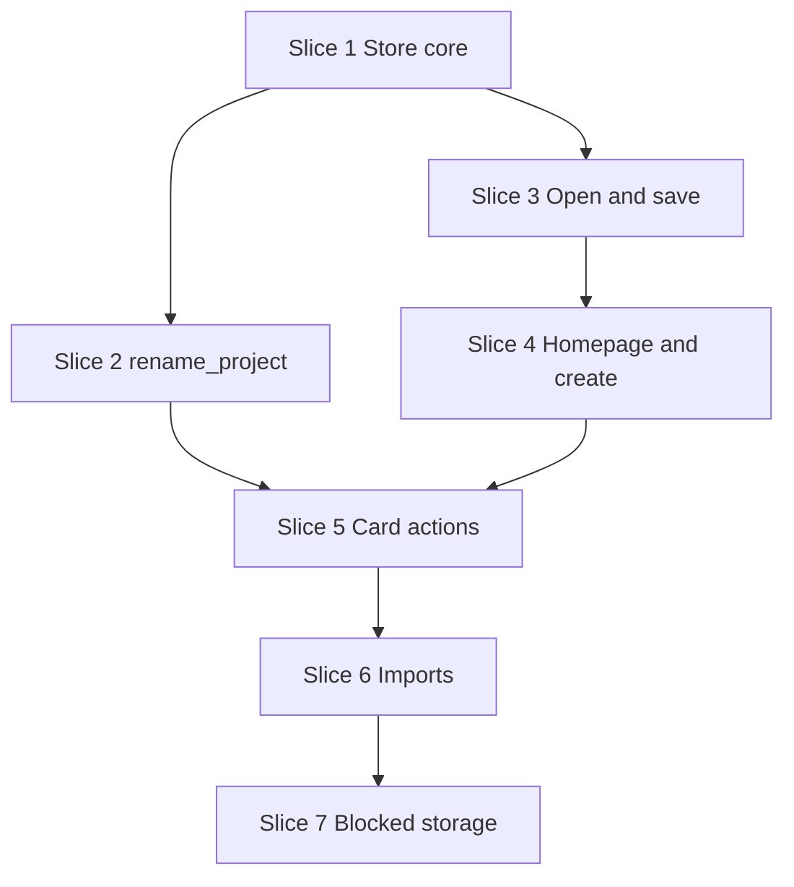

# Plan: E1 Homepage

**Created**: 2026-11-22
**Branch**: feat/homepage
**Status**: draft
**Examination**: not-applicable (standing rule: the plugin recorder bug does not credit file-redirected output, and summary reporters hide test names; code review and CI still gate the PR)
**Gherkin persistence**: plan-file-only
**Spec**: `docs/specs/homepage.md` (AC1–AC29, gate passed 2026-11-22). Issue #27, row 8 of `plans/mvp-order.md`.
**Build waits for**: R4 (`feat/ui-on-commands`) and D2 (repair guides) to merge. Slice 1 needs D2's guide folder and guide test. Slices 3–7 need R4's `applyEdit`, `useCanvasEdits.js`, `ProblemsPanel` and `problemsView.js`. Rebase on `main` after both merge and before Step 1.1.

## Goal

Make the homepage the entry point. It lists the projects saved in this browser and lets the user create, open, rename, duplicate, delete, import and export them. Projects live in IndexedDB as save-file text and are saved after every accepted change, so a reload loses nothing. A new project is an empty map. `rename_project` joins the command layer and MCP. Each store failure has a catalog code and a guide.

**Approach stances** (`knowledge/decision-defaults.md`):

- Scope: only the spec's ACs. No type picker (E2), usage events (N14), help pages (N17), undo (E5) or live cross-tab sync.
- Data change: none to the save file and no schema bump. A new browser database, `ai-enabler` version 1, is created on first use. There is no older store to migrate.
- Replace vs. merge: the starter map is replaced by the homepage and an empty new project. The six starter steps stay as test data. ui-shell AC27 and AC34's id swap are marked superseded in `docs/specs/ui-shell.md`, not deleted.
- Integration: one PR with green checks (default). It touches `src/flow` and `mcp/`, so it merges alone, after R4 and D2.

**Design decisions made during planning** (correct them at this gate):

- **Store seam.** `src/flow/projectStore.js` is pure logic over an injected adapter with four async calls: `listIndex()`, `getFile(id)`, `put(entry, text)` and `remove(id)`. `src/flow/memoryStoreAdapter.js` is the test adapter and the blocked-storage fallback. `src/shell/indexedDbAdapter.js` is thin: two object stores (`index`, `files`) written in one transaction. It is proven by e2e against the real browser, so no new dependency is added.
- **Store results.** Every store call returns `{ ok, problems, ... }` like the command layer. Adapter errors are mapped once, in the store, to `STORE_WRITE_FAILED` or `STORE_UNAVAILABLE`.
- **Write order.** The store keeps one promise chain per project id, so writes apply in call order.
- **Save hook.** `useProject.js` gets `saveProject(memoryProject)`. It runs after R4's `applyEdit` accepts an edit, after a confirmed import, and after create and rename. A save never blocks the UI. A failed save goes to the problems panel.
- **Routes.** `App.jsx` renders `HomePage` on `ROUTE.HOME` and the existing shell on `ROUTE.PROJECT`. `routes.js` does not change. `useStoredProject(id)` loads the project for the shell: loading, found, not found, or cannot open.
- **E2e seeding.** `e2e/store.js` writes a project file straight into IndexedDB with `page.evaluate`, using the adapter's layout, then opens `#/projects/<id>`. `openStarterView` keeps its name and seeds the six-step fixture `e2e/fixtures/starter.ai-enabler.json`, so most specs change only where they call `page.goto('/')`. The same helper writes a corrupt record for AC10.
- **Failure injection.** E2e makes IndexedDB fail with `page.addInitScript`: `indexedDB.open` throws for AC21, and `IDBObjectStore.prototype.put` throws for AC14. No production hook is added.
- **Dialog.** `ProjectNameDialog.jsx` is one native `<dialog>` used for create and rename, like `ConfirmDialog`. Command problems show inside it through `problemsView.js`.
- **Card menu.** Each card has an "Open <name>" link and a "More actions for <name>" button that opens a menu: Rename, Duplicate, Import, Export, Delete. The menu is a disclosure with buttons, not an ARIA menu, so Tab order stays simple.

## Acceptance Criteria

- [ ] AC1 `#/` shows the homepage with heading, Projects region, New project and Import project; title "AI Enabler".
- [ ] AC2 One card per project with name and modified date; empty-state text when none.
- [ ] AC3 Sort by last modified (default, newest first) or by name (A to Z, case-insensitive); stable ties.
- [ ] AC4 The header brand links home from a project.
- [ ] AC5 Create runs `create_project`, saves, lists and opens the project; a blank name keeps the dialog open; Cancel changes nothing.
- [ ] AC6 A new project shows the hint "This map has no steps yet. Import a project file to fill it."
- [ ] AC7 Opening a card goes to `#/projects/<id>`; a direct load and a reload show the same project.
- [ ] AC8 Opening runs the import pipeline (old files upgrade) and writes nothing.
- [ ] AC9 An unknown id shows "Project not found" with a home link and reports `STORE_PROJECT_NOT_FOUND`.
- [ ] AC10 A stored file that cannot be opened shows "Can't open <name>", lists `STORE_FILE_INVALID` and the file's problems; the card can still be exported and deleted.
- [ ] AC11 Every accepted change is saved; a rejected one writes nothing; a reload shows the change.
- [ ] AC12 Stored text is the export form with `contentHash`.
- [ ] AC13 Writes for one project apply in call order.
- [ ] AC14 A failed write keeps the change, reports and lists `STORE_WRITE_FAILED`; export still works; the next write catches up.
- [ ] AC15 Rename runs `rename_project` and saves; a blank name is rejected.
- [ ] AC16 Duplicate saves "<name> (copy)" with a new id; the homepage stays; focus moves to the new card.
- [ ] AC17 Delete confirms, removes, announces; focus moves to next, previous, or New project.
- [ ] AC18 Card import confirms with notices, replaces the map and name, keeps the card's id, saves; a rejection changes nothing.
- [ ] AC19 Homepage import adds a new project, keeps the file id unless taken, stays on the homepage, focuses the new card.
- [ ] AC20 Card export equals open-then-export; an unopenable file exports its stored text.
- [ ] AC21 Blocked IndexedDB reports `STORE_UNAVAILABLE`; the app works in memory with a lasting "Not saved in this browser. Export to keep your work." notice.
- [ ] AC22 Each store problem is reported once through D1's `report`; D1 gates pass.
- [ ] AC23 `rename_project` MCP tool, `llms.txt` entry, parity mapping, plugin bundle check.
- [ ] AC24 Four `STORE_` codes with guides; D2's guide tests pass.
- [ ] AC25 The "stores nothing" test is replaced; ui-shell AC27 marked superseded; the export-shape test uses a fixture.
- [ ] AC26 Starter-dependent e2e tests seed a fixture; route tests updated.
- [ ] AC27 Help says projects save automatically and that the last change wins across two tabs.
- [ ] AC28 All homepage states pass axe and work by keyboard.
- [ ] AC29 The in-project header Import replaces that project and keeps its id.

## Slices

### Slice 1: Project store core and store codes

**Depends-on:** none
**Files:** `src/flow/projectStore.js`, `src/flow/projectStore.test.js`, `src/flow/memoryStoreAdapter.js`, `src/flow/memoryStoreAdapter.test.js`, `src/flow/diagnostics/catalog.json`, `src/flow/diagnostics/guides/STORE_UNAVAILABLE.md`, `src/flow/diagnostics/guides/STORE_WRITE_FAILED.md`, `src/flow/diagnostics/guides/STORE_PROJECT_NOT_FOUND.md`, `src/flow/diagnostics/guides/STORE_FILE_INVALID.md`, `plugin/server/aie-mcp.js`
**Invariants:** `npm test`, `npm run check:plugin`

**Behavior:**

```gherkin
Feature: Project store

  Scenario: Saving a project stores its export form and index entry
    # Still passes if: the stored text is indented differently
    Given an empty store and the time 2026-11-22 10:00 UTC
    When the project "Checkout" is saved
    Then the index lists "Checkout" modified at 2026-11-22 10:00 UTC
    And reading it back gives a file whose content hash matches

  Scenario: Listing sorts by last modified, newest first
    # Still passes if: ties are broken by name instead of id
    Given projects "A" modified on day 1, "B" on day 3 and "C" on day 2
    When the list is read with the default sort
    Then the order is "B", "C", "A"

  Scenario: Listing sorts by name, ignoring case
    # Still passes if: accented names sort by a different locale rule
    Given projects "beta", "Alpha" and "gamma"
    When the list is read sorted by name
    Then the order is "Alpha", "beta", "gamma"

  Scenario: An empty store lists nothing
    # Still passes if: the empty list is a new array each call
    Given an empty store
    When the list is read
    Then it is empty

  Scenario: Writes for one project land in the order they were made
    # Still passes if: writes for different projects are also serialized
    Given a store whose first write is slow
    When "Checkout" is saved with 3 steps and then with 2 steps
    Then reading "Checkout" gives 2 steps

  Scenario: Reading an id that is not stored is a coded problem
    # Still passes if: the problem's untrusted id is trimmed
    Given an empty store
    When project "nope" is read
    Then the result is STORE_PROJECT_NOT_FOUND

  Scenario: A write the browser refuses is a coded problem
    # Still passes if: the adapter's error text is dropped from the record
    Given a store whose writes fail
    When "Checkout" is saved
    Then the result is STORE_WRITE_FAILED and nothing is listed

  Scenario: Removing a project drops its file and index entry
    # Still passes if: removing an unknown id is reported as a success
    Given projects "A" and "B"
    When "A" is removed
    Then only "B" is listed and "A" reads as not found

  Scenario: Every store code has a guide
    # Still passes if: a guide's wording is changed
    Given the catalog
    Then STORE_UNAVAILABLE, STORE_WRITE_FAILED, STORE_PROJECT_NOT_FOUND and STORE_FILE_INVALID each have a guide that says no tool repairs it
```

**Steps:**

#### Step 1.1: Store codes and guides

**Complexity**: standard
**IMPLEMENT**: Add the four `STORE_` entries to `catalog.json` (`owner: "app"`, docs anchors, no names in messages) and one D2-format guide each, using the "No tool repairs this." marker. Rebuild the plugin bundle (`npm run build:plugin`) because it embeds the catalog and guides.
**TEST**: D2's guide tests and the catalog tests pass with the four codes; `npm run check:plugin` passes.
**REFACTOR**: Keep the guide wording parallel across the four codes.
**Files**: `src/flow/diagnostics/catalog.json`, `src/flow/diagnostics/guides/STORE_UNAVAILABLE.md`, `src/flow/diagnostics/guides/STORE_WRITE_FAILED.md`, `src/flow/diagnostics/guides/STORE_PROJECT_NOT_FOUND.md`, `src/flow/diagnostics/guides/STORE_FILE_INVALID.md`, `plugin/server/aie-mcp.js`
**Covers**: AC24
**Commit**: `feat: add the browser store catalog codes and their guides`

#### Step 1.2: Memory adapter

**Complexity**: standard
**IMPLEMENT**: `createMemoryStoreAdapter()` with `listIndex`, `getFile`, `put`, `remove`. It copies on read and write, so callers never share objects.
**TEST**: Adapter contract tests: put then get, put replaces, remove, list of entries.
**REFACTOR**: Name the contract cases so Slice 3's e2e mirrors them.
**Files**: `src/flow/memoryStoreAdapter.js`, `src/flow/memoryStoreAdapter.test.js`
**Covers**: AC21
**Commit**: `feat: add an in-memory project store adapter`

#### Step 1.3: Save, list, read and remove

**Complexity**: complex
**IMPLEMENT**: `createProjectStore(adapter, { now, newId })` with `save(memoryProject)` (`toProjectFile` then `withContentHash`, index entry `{ id, name, modifiedAt }`), `list({ sort })`, `read(id)` (raw text), `remove(id)`. One promise chain per id. Adapter throws map to `STORE_WRITE_FAILED`, a missing id to `STORE_PROJECT_NOT_FOUND`. Names and ids go in `untrusted`.
**TEST**: Every Slice 1 scenario except the guide one, with the memory adapter and a slow and a failing adapter wrapper.
**REFACTOR**: Pull the two sort comparators into named functions; one result helper for `{ ok, problems }`.
**Files**: `src/flow/projectStore.js`, `src/flow/projectStore.test.js`
**Covers**: AC2, AC3, AC12, AC13, AC14
**Commit**: `feat: add the project store over a pluggable adapter`

### Slice 2: rename_project

**Depends-on:** 1
**Files:** `src/flow/commands/index.js`, `src/flow/commands/index.test.js`, `src/flow/schema/parity.test.js`, `mcp/tools.test.js`, `mcp/docs.test.js`, `public/llms.txt`, `plugin/server/aie-mcp.js`
**Invariants:** `npm test`, `npm run check:plugin`

**Behavior:**

```gherkin
Feature: Rename a project

  Scenario: Renaming changes only the name
    # Still passes if: the summary quotes the old name too
    Given an open project "Checkout" with 2 steps
    When it is renamed to "Payments"
    Then the project is named "Payments" with the same id, steps and connections

  Scenario: A blank name is rejected
    # Still passes if: a name of only tabs is reported with a different field
    Given an open project "Checkout"
    When it is renamed to "   "
    Then the rename is rejected with FILE_PROJECT_NAME_EMPTY and the name stays "Checkout"

  Scenario: Renaming with no project open is rejected
    # Still passes if: the problem message is reworded
    Given an MCP session with no open project
    When a client calls rename_project with name "Payments"
    Then the call is rejected with CMD_NO_PROJECT

  Scenario: Rename is an MCP tool and counts as an unsaved change
    # Still passes if: the tool's description is reworded
    Given an MCP session with project "Checkout" open and saved
    When a client calls rename_project with name "Payments"
    Then get_project shows "Payments" and the session has unsaved changes

  Scenario: The AI docs list the tool
    # Still passes if: the entry's sentence is reworded
    Given the AI contract docs
    Then rename_project is listed with its required name argument
```

**Steps:**

#### Step 2.1: The rename_project command and tool

**Complexity**: standard
**IMPLEMENT**: A `rename_project` entry in `COMMANDS` (`args: ['name']`, needs a project, not `uiOnly`), summary `Renamed project to "<name>"`. Add the `llms.txt` line, map `project.name` to `rename_project.name` in the parity test, and rebuild the bundle.
**TEST**: Command unit tests, MCP tool and docs tests, parity, `npm run check:plugin`.
**REFACTOR**: Share the name-setting shape with `create_project` only if it reads clearer.
**Files**: `src/flow/commands/index.js`, `src/flow/commands/index.test.js`, `src/flow/schema/parity.test.js`, `mcp/tools.test.js`, `mcp/docs.test.js`, `public/llms.txt`, `plugin/server/aie-mcp.js`
**Covers**: AC15, AC23
**Commit**: `feat: add rename_project as a command and MCP tool`

### Slice 3: Open and save from the browser store

**Depends-on:** 1
**Files:** `src/shell/indexedDbAdapter.js`, `src/shell/useProjectStore.js`, `src/shell/useStoredProject.js`, `src/shell/useProject.js`, `src/shell/useCanvasEdits.js`, `src/shell/ProjectMissing.jsx`, `src/shell/HelpMenu.jsx`, `src/App.jsx`, `src/flow/importFlow.js`, `src/flow/importFlow.test.js`, `src/flow/project.js`, `src/flow/project.test.js`, `src/flow/schema/version.test.js`, `src/index.css`, `e2e/store.js`, `e2e/views.js`, `e2e/fixtures/starter.ai-enabler.json`, `e2e/shell.spec.js`, `e2e/routes.spec.js`, `e2e/store.spec.js`, `e2e/cards.spec.js`, `e2e/connections.spec.js`, `e2e/example.spec.js`, `e2e/diagnostics.spec.js`, `e2e/export-import.spec.js`, `e2e/gate.spec.js`, `e2e/pages.spec.js`, `e2e/metrics.spec.js`, `e2e/gate-wiring.selftest.js`, `docs/specs/ui-shell.md`
**Invariants:** `npm test`, `npm run test:e2e`

**Behavior:**

```gherkin
Feature: Projects open from and save to the browser

  Scenario: A saved project opens at its link and survives a reload
    # Still passes if: the canvas re-fits on reload
    Given a saved project "Checkout" with 6 steps
    When the user opens its link and reloads
    Then the map shows "Checkout" with 6 steps

  Scenario: A deleted step stays deleted after a reload
    # Still passes if: the save happens after a short delay
    Given the saved project "Checkout" is open with 6 steps
    When the user deletes the step "Idea" and reloads
    Then the map has 5 steps and no "Idea"
    And the browser holds exactly one database, "ai-enabler"

  Scenario: A rejected edit writes nothing
    # Still passes if: the rejection is listed with different wording
    Given the saved project "Checkout" is open
    When an edit is rejected
    Then the stored project is unchanged

  Scenario: Opening a file saved at an older schema upgrades it without saving
    # Still passes if: the upgrade is announced
    Given a project saved at schema 0.0.0, modified on day 1
    When the user opens it
    Then the map shows its steps
    And its modified date is still day 1

  Scenario: An unknown project link shows "Project not found"
    # Still passes if: the not-found heading takes focus
    Given no project with id "nope" is saved
    When the user opens the link for "nope"
    Then the page says "Project not found" with a link to the homepage
    And STORE_PROJECT_NOT_FOUND is reported once

  Scenario: A saved copy that fails validation shows "Can't open"
    # Still passes if: the file's own problems are listed in a different order
    Given a saved project "Broken" whose file has a step with no position
    When the user opens it
    Then the page says "Can't open Broken" with a link to the homepage
    And the problems list STORE_FILE_INVALID first, then STEP_POSITION_MISSING

  Scenario: A failed save keeps the change and says so
    # Still passes if: the problem lists the failing project's id
    Given the saved project "Checkout" is open and the browser refuses writes
    When the user deletes a step
    Then the map keeps the deletion
    And STORE_WRITE_FAILED is announced and listed, and Export still downloads the file

  Scenario: The header Import keeps the open project's id
    # Still passes if: the confirm dialog wording changes
    Given the saved project "Checkout" is open at its link
    When the user imports a file named "Payments" with a different id and confirms
    Then the map shows "Payments" at the same link after a reload

  Scenario: Help says how saving works
    # Still passes if: the two lines are in the other order
    Given any page with the help menu
    When the user opens "How to use"
    Then it says projects save automatically in this browser
    And it says that with one project open in two tabs, the last change wins
```

**Steps:**

#### Step 3.1: IndexedDB adapter and store provider

**Complexity**: complex
**IMPLEMENT**: `createIndexedDbAdapter()` opens `ai-enabler` v1 with `index` and `files` stores and writes both in one transaction. `useProjectStore()` builds one `createProjectStore` per app and gives it to the tree through context.
**TEST**: E2e `store.spec.js` seeds through `e2e/store.js`, reads back through the app (put, replace, remove, list), and asserts the database name.
**REFACTOR**: Keep the adapter to request-to-promise plumbing only.
**Files**: `src/shell/indexedDbAdapter.js`, `src/shell/useProjectStore.js`, `src/App.jsx`, `e2e/store.js`, `e2e/store.spec.js`
**Covers**: AC12, AC25
**Commit**: `feat: store projects in IndexedDB`

#### Step 3.2: The project route loads from the store

**Complexity**: complex
**IMPLEMENT**: `useStoredProject(id)` reads the file, runs `parseImport`, and returns loading, found, not found or cannot open. `App.jsx` renders the shell only when found, else `ProjectMissing.jsx` ("Project not found" or "Can't open <name>", a home link, the problems panel). The home route renders a placeholder heading until Slice 4. `createStarterProject` goes; `openStarterView` seeds `starter.ai-enabler.json` through `e2e/store.js`; every starter-dependent spec and the route specs switch to it. The export-shape test compares the fixture's export.
**TEST**: Opening, upgrade-without-write, not found and cannot open scenarios; the whole existing e2e suite passes on seeded projects.
**REFACTOR**: Remove `EMPTY_MAP_MESSAGE`'s reload wording from `views.js`; one seeding helper for valid and corrupt records.
**Files**: `src/shell/useStoredProject.js`, `src/shell/ProjectMissing.jsx`, `src/shell/useProject.js`, `src/App.jsx`, `src/flow/project.js`, `src/flow/project.test.js`, `src/flow/schema/version.test.js`, `src/index.css`, `e2e/views.js`, `e2e/fixtures/starter.ai-enabler.json`, `e2e/routes.spec.js`, `e2e/cards.spec.js`, `e2e/connections.spec.js`, `e2e/example.spec.js`, `e2e/diagnostics.spec.js`, `e2e/export-import.spec.js`, `e2e/gate.spec.js`, `e2e/pages.spec.js`, `e2e/metrics.spec.js`, `e2e/gate-wiring.selftest.js`, `e2e/store.spec.js`
**Covers**: AC7, AC8, AC9, AC10, AC22, AC26
**Commit**: `feat: open projects from the browser store`

#### Step 3.3: Save after every accepted change

**Complexity**: complex
**IMPLEMENT**: `saveProject` in `useProject.js` runs after an accepted `applyEdit` and a confirmed import. A failed save keeps the in-memory project, announces and lists `STORE_WRITE_FAILED` through the problems panel, and reports it once. Replace the "stores nothing" test with the reload test.
**TEST**: Reload, rejected-edit and failed-save scenarios (writes refused by an init script).
**REFACTOR**: One place builds the save call from the current project.
**Files**: `src/shell/useProject.js`, `src/shell/useCanvasEdits.js`, `e2e/shell.spec.js`, `e2e/store.spec.js`
**Covers**: AC11, AC14, AC22, AC25
**Commit**: `feat: save the open project after every accepted change`

#### Step 3.4: Header import keeps the project id; help and spec notes

**Complexity**: standard
**IMPLEMENT**: The import reducer's replacement always keeps the open project's id; the confirm wording still depends on the name. Add the two "How to use" lines. Mark ui-shell AC27, its "no browser storage" constraint and AC34's id swap as superseded by `docs/specs/homepage.md`.
**TEST**: Reducer unit test for a different id and name; e2e header-import-then-reload; e2e help lines.
**REFACTOR**: Drop the id branch from the reducer and its dead test cases.
**Files**: `src/flow/importFlow.js`, `src/flow/importFlow.test.js`, `src/shell/HelpMenu.jsx`, `docs/specs/ui-shell.md`, `e2e/export-import.spec.js`, `e2e/shell.spec.js`
**Covers**: AC25, AC27, AC29
**Commit**: `feat: keep the open project's id on import and explain saving in help`

### Slice 4: Homepage list and create

**Depends-on:** 3
**Files:** `src/shell/HomePage.jsx`, `src/shell/ProjectCard.jsx`, `src/shell/ProjectNameDialog.jsx`, `src/shell/Header.jsx`, `src/flow/homepageView.js`, `src/flow/homepageView.test.js`, `src/App.jsx`, `src/index.css`, `e2e/homepage.spec.js`, `e2e/a11y.spec.js`
**Invariants:** `npm test`, `npm run test:e2e`

**Behavior:**

```gherkin
Feature: Homepage list and create

  Scenario: The homepage lists saved projects, newest first
    # Still passes if: the date is shown in a different format
    Given saved projects "A" modified on day 1 and "B" on day 2
    When the user opens the homepage
    Then the title is "AI Enabler"
    And the cards read "B" then "A", each with its modified date

  Scenario: Sorting by name
    # Still passes if: the sort control is a button group instead of a select
    Given saved projects "beta" and "Alpha"
    When the user sorts by name
    Then the cards read "Alpha" then "beta"

  Scenario: No saved projects
    # Still passes if: the empty-state text is not announced
    Given nothing is saved
    When the user opens the homepage
    Then it says "No projects yet. Create one or import a project file."
    And "New project" and "Import project" are available

  Scenario: Creating a project opens its empty map
    # Still passes if: the name field is prefilled
    Given the homepage
    When the user creates a project named "Checkout"
    Then the "Checkout" map opens at its own link with no steps
    And the map says "This map has no steps yet. Import a project file to fill it."
    And "Checkout" is listed on the homepage

  Scenario: A blank name keeps the dialog open
    # Still passes if: the Create button is not disabled
    Given the New project dialog is open
    When the user creates a project named "  "
    Then the dialog stays open and shows FILE_PROJECT_NAME_EMPTY's message
    And nothing is saved

  Scenario: Cancelling create changes nothing
    # Still passes if: focus returns to a different control
    Given the New project dialog is open
    When the user cancels
    Then no project is saved and focus is on "New project"

  Scenario: The brand leads home
    # Still passes if: the link has extra visible text
    Given a project is open
    When the user follows the "AI Enabler" link in the header
    Then the homepage shows

  Scenario: Homepage states are accessible
    # Still passes if: a color is changed within contrast limits
    Given the homepage with no projects, with three projects, and with the create dialog open
    Then each state has no axe violations and every control is reachable by keyboard
```

**Steps:**

#### Step 4.1: List, sort and empty state

**Complexity**: standard
**IMPLEMENT**: `homepageView.js` turns index entries and a sort into card view items (name, formatted date, link). `HomePage.jsx` and `ProjectCard.jsx` render them, with the sort control and the empty state. The home route renders `HomePage`; the document title is "AI Enabler".
**TEST**: View unit tests for both sorts and empty; e2e list, sort, empty.
**REFACTOR**: Keep the date formatter in the view module.
**Files**: `src/flow/homepageView.js`, `src/flow/homepageView.test.js`, `src/shell/HomePage.jsx`, `src/shell/ProjectCard.jsx`, `src/App.jsx`, `src/index.css`, `e2e/homepage.spec.js`
**Covers**: AC1, AC2, AC3
**Commit**: `feat: list saved projects on the homepage`

#### Step 4.2: Create dialog and empty-map hint

**Complexity**: standard
**IMPLEMENT**: `ProjectNameDialog.jsx` with one required field. Create runs `create_project`, saves, and navigates to the new link; problems show in the dialog. Replace the empty-map message with the hint.
**TEST**: Create, blank name, cancel scenarios.
**REFACTOR**: Keep the dialog generic (title, label, submit text) for Slice 5's rename.
**Files**: `src/shell/ProjectNameDialog.jsx`, `src/shell/HomePage.jsx`, `src/App.jsx`, `e2e/homepage.spec.js`
**Covers**: AC5, AC6
**Commit**: `feat: create a project from the homepage`

#### Step 4.3: Brand link home and accessibility

**Complexity**: standard
**IMPLEMENT**: The header brand becomes a link to `#/` on the project route. Add axe checks for the homepage states.
**TEST**: Brand-link and accessibility scenarios.
**REFACTOR**: Reuse the existing axe helper.
**Files**: `src/shell/Header.jsx`, `src/index.css`, `e2e/a11y.spec.js`, `e2e/homepage.spec.js`
**Covers**: AC4, AC28
**Commit**: `feat: link the header brand to the homepage`

### Slice 5: Card actions: rename, duplicate, delete, export

**Depends-on:** 2, 4
**Files:** `src/flow/projectStore.js`, `src/flow/projectStore.test.js`, `src/shell/ProjectCard.jsx`, `src/shell/HomePage.jsx`, `src/shell/useHomeFocus.js`, `src/index.css`, `e2e/homepage.spec.js`, `e2e/a11y.spec.js`
**Invariants:** `npm test`, `npm run test:e2e`

**Behavior:**

```gherkin
Feature: Card actions

  Scenario: Renaming from a card
    # Still passes if: the dialog's field is not preselected
    Given a saved project "Checkout"
    When the user renames it to "Payments" from its card
    Then the card reads "Payments" and opening it shows "Payments"

  Scenario: Renaming to a blank name is rejected
    # Still passes if: the problem is shown above the field instead of below
    Given a saved project "Checkout"
    When the user renames it to "" from its card
    Then the dialog stays open with FILE_PROJECT_NAME_EMPTY's message and the card still reads "Checkout"

  Scenario: Duplicating keeps the user on the homepage
    # Still passes if: the copy's modified date is a second later than expected
    Given a saved project "Checkout" with 6 steps
    When the user duplicates it
    Then a card "Checkout (copy)" appears with focus, and "Duplicated Checkout" is announced
    And opening the copy shows 6 steps at a different link

  Scenario: Duplicating a copy appends again
    # Still passes if: the copy suffix is localized
    Given a saved project "Checkout (copy)"
    When the user duplicates it
    Then a card "Checkout (copy) (copy)" appears

  Scenario: Deleting asks first and moves focus to the next card
    # Still passes if: the confirm button reads "Delete project"
    Given saved projects "A", "B" and "C" in that order
    When the user deletes "B" and confirms "Delete B? This can't be undone."
    Then "B" is gone, "Deleted B" is announced, and focus is on "C"

  Scenario: Deleting the last card moves focus to the previous one
    # Still passes if: the announcement is delayed
    Given saved projects "A" and "B" in that order
    When the user deletes "B" and confirms
    Then focus is on "A"

  Scenario: Deleting the only project moves focus to New project
    # Still passes if: the empty state is shown before focus moves
    Given only "A" is saved
    When the user deletes "A" and confirms
    Then the empty state shows and focus is on "New project"

  Scenario: Cancelling delete changes nothing
    # Still passes if: focus returns to the card instead of its menu button
    Given a saved project "A"
    When the user starts to delete "A" and cancels
    Then "A" is still listed

  Scenario: Exporting from a card matches exporting from the map
    # Still passes if: exportedAt differs between the two files
    Given a saved project "Checkout"
    When the user exports it from its card, and again from its open map
    Then both downloads are "checkout.ai-enabler.json" with the same project content

  Scenario: Exporting a copy that cannot be opened downloads it unchanged
    # Still passes if: the file name falls back to "project"
    Given a saved project "Broken" whose file has a step with no position
    When the user exports it from its card
    Then the download is the stored text, byte for byte
```

**Steps:**

#### Step 5.1: Rename from a card

**Complexity**: standard
**IMPLEMENT**: The card's "More actions" disclosure with Rename, which reads the file, runs `rename_project` through the dialog, and saves.
**TEST**: Rename scenarios.
**REFACTOR**: A small `withStoredProject(id, fn)` in the store for read, parse, apply, save.
**Files**: `src/flow/projectStore.js`, `src/flow/projectStore.test.js`, `src/shell/ProjectCard.jsx`, `src/shell/HomePage.jsx`, `src/index.css`, `e2e/homepage.spec.js`
**Covers**: AC15
**Commit**: `feat: rename a project from its card`

#### Step 5.2: Duplicate

**Complexity**: standard
**IMPLEMENT**: `store.duplicate(id)` with a new id, "<name> (copy)" and `modifiedAt` now. `useHomeFocus.js` focuses a card by id after the list refreshes.
**TEST**: Store unit tests; duplicate scenarios.
**REFACTOR**: Name the copy suffix as a constant.
**Files**: `src/flow/projectStore.js`, `src/flow/projectStore.test.js`, `src/shell/useHomeFocus.js`, `src/shell/HomePage.jsx`, `e2e/homepage.spec.js`
**Covers**: AC16
**Commit**: `feat: duplicate a project from its card`

#### Step 5.3: Delete with confirm and focus

**Complexity**: standard
**IMPLEMENT**: Delete opens `ConfirmDialog` with "Delete <name>? This can't be undone.", removes, announces, and focuses next, previous, or New project.
**TEST**: Delete scenarios, including all three focus targets and cancel.
**REFACTOR**: Reuse the pure `focusAfterDelete` choice if it fits a list of ids.
**Files**: `src/shell/HomePage.jsx`, `src/shell/useHomeFocus.js`, `e2e/homepage.spec.js`
**Covers**: AC17
**Commit**: `feat: delete a project from its card`

#### Step 5.4: Export from a card

**Complexity**: standard
**IMPLEMENT**: `store.exportFile(id)` returns a fresh export for an openable file and the raw text otherwise; the card downloads it with `projectFileName`. Axe check with the menu open.
**TEST**: Export scenarios; a11y.
**REFACTOR**: One download path shared with the header export.
**Files**: `src/flow/projectStore.js`, `src/flow/projectStore.test.js`, `src/shell/ProjectCard.jsx`, `e2e/homepage.spec.js`, `e2e/a11y.spec.js`
**Covers**: AC20, AC28
**Commit**: `feat: export a project from its card`

### Slice 6: Imports from the homepage

**Depends-on:** 5
**Files:** `src/flow/projectStore.js`, `src/flow/projectStore.test.js`, `src/flow/importFlow.js`, `src/flow/importFlow.test.js`, `src/shell/HomePage.jsx`, `src/shell/ProjectCard.jsx`, `src/shell/useHomeImport.js`, `e2e/homepage.spec.js`
**Invariants:** `npm test`, `npm run test:e2e`

**Behavior:**

```gherkin
Feature: Import from the homepage

  Scenario: Importing onto a card replaces that project and keeps its link
    # Still passes if: the AI notice is shown before the edited notice
    Given a saved project "Checkout" at its link
    When the user imports a file "Payments" onto the "Checkout" card and confirms "Replace Checkout with Payments?"
    Then the card reads "Payments" and its link still opens it

  Scenario: An edited file shows its notice before replacing
    # Still passes if: the notice wording changes
    Given a saved project "Checkout"
    When the user imports a file changed outside AI Enabler onto its card
    Then the confirmation says the file was changed outside AI Enabler

  Scenario: Cancelling a card import changes nothing
    # Still passes if: focus returns to the card instead of its menu button
    Given a saved project "Checkout"
    When the user imports a file onto its card and cancels
    Then "Checkout" is unchanged

  Scenario: A rejected card import changes nothing and lists its problems
    # Still passes if: the problems panel heading takes focus
    Given a saved project "Checkout"
    When the user imports a file with a step that has no position onto its card
    Then "Checkout" is unchanged and STEP_POSITION_MISSING is listed

  Scenario: Importing on the homepage adds a project with the file's id
    # Still passes if: the outcome announcement leaves out the step count
    Given no saved project has id "abc"
    When the user imports a file "Payments" with id "abc" from the homepage
    Then a card "Payments" appears with focus, without a confirmation
    And its link is the one for "abc"

  Scenario: A taken id gets a new one
    # Still passes if: the new id is not a UUID
    Given a saved project with id "abc"
    When the user imports a file with id "abc" from the homepage
    Then both projects are listed, and the new one has a different link

  Scenario: A rejected homepage import adds nothing
    # Still passes if: the rejection is announced with different wording
    Given the homepage
    When the user imports a file that is not JSON
    Then no card is added and FILE_NOT_JSON is listed
```

**Steps:**

#### Step 6.1: Import onto a card

**Complexity**: complex
**IMPLEMENT**: The card's Import reads the file through `parseImport`, runs the import reducer against the stored project (card name as the current name), and on confirm saves the replacement under the card's id. Rejections go to the homepage problems panel.
**TEST**: Card-import scenarios.
**REFACTOR**: `useHomeImport.js` holds both homepage import paths; the reducer stays shared with the header import.
**Files**: `src/shell/useHomeImport.js`, `src/shell/ProjectCard.jsx`, `src/shell/HomePage.jsx`, `src/flow/importFlow.js`, `src/flow/importFlow.test.js`, `e2e/homepage.spec.js`
**Covers**: AC18, AC22
**Commit**: `feat: import a file onto a project card`

#### Step 6.2: Import a new project on the homepage

**Complexity**: standard
**IMPLEMENT**: `store.importNew(file)` keeps the file's `project.id` unless it is taken, then uses `newId`. No confirmation; the outcome and notices are announced; focus moves to the new card.
**TEST**: Store unit tests for both id cases; homepage-import scenarios.
**REFACTOR**: One id-choice function, named for what it decides.
**Files**: `src/flow/projectStore.js`, `src/flow/projectStore.test.js`, `src/shell/useHomeImport.js`, `src/shell/HomePage.jsx`, `e2e/homepage.spec.js`
**Covers**: AC19
**Commit**: `feat: import a project file from the homepage`

### Slice 7: Blocked storage

**Depends-on:** 6
**Files:** `src/shell/useProjectStore.js`, `src/shell/StoreNotice.jsx`, `src/shell/HomePage.jsx`, `src/App.jsx`, `src/index.css`, `e2e/store.spec.js`, `e2e/a11y.spec.js`
**Invariants:** `npm test`, `npm run test:e2e`

**Behavior:**

```gherkin
Feature: Working when the browser blocks storage

  Scenario: Blocked storage falls back to this tab, with a lasting notice
    # Still passes if: the notice is shown above the header instead of below
    Given the browser refuses to open IndexedDB
    When the user opens the homepage
    Then STORE_UNAVAILABLE is listed and reported once
    And the page says "Not saved in this browser. Export to keep your work."

  Scenario: Projects still work until the tab closes
    # Still passes if: the copy is created with a later modified date
    Given the browser refuses to open IndexedDB
    When the user creates "Checkout", opens it, and exports it
    Then the map opens, the export downloads, and the notice shows on the map too

  Scenario: The notice is accessible
    # Still passes if: the notice uses a different icon
    Given the browser refuses to open IndexedDB
    Then the homepage and the project view have no axe violations
```

**Steps:**

#### Step 7.1: Memory fallback and notice

**Complexity**: standard
**IMPLEMENT**: When `indexedDB.open` throws or errors, `useProjectStore` uses `createMemoryStoreAdapter()`, records `STORE_UNAVAILABLE` once, and exposes `persistent: false`. `StoreNotice.jsx` shows the notice on every route while `persistent` is false; the homepage lists the problem.
**TEST**: Blocked-storage scenarios with an init script.
**REFACTOR**: Keep the fallback choice in one function.
**Files**: `src/shell/useProjectStore.js`, `src/shell/StoreNotice.jsx`, `src/shell/HomePage.jsx`, `src/App.jsx`, `src/index.css`, `e2e/store.spec.js`, `e2e/a11y.spec.js`
**Covers**: AC21, AC22, AC28
**Commit**: `feat: keep working in memory when the browser blocks storage`

## Parallelization



| Wave | Slices (parallel) |
| ---- | ----------------- |
| 1    | 1                 |
| 2    | 2, 3              |
| 3    | 4                 |
| 4    | 5                 |
| 5    | 6                 |
| 6    | 7                 |

## Complexity Classification

| Rating     | Criteria                                                                         | Review depth                                        |
| ---------- | -------------------------------------------------------------------------------- | --------------------------------------------------- |
| `trivial`  | Single-file rename, config change, typo fix, documentation-only                  | Skip inline review; covered by final `/code-review` |
| `standard` | New function, test, module, or behavioral change within existing patterns        | Spec-compliance + relevant quality agents           |
| `complex`  | Architectural change, security-sensitive, cross-cutting concern, new abstraction | Full agent suite including opus-tier agents         |

## Pre-PR Quality Gate

- [ ] `npm test` passes
- [ ] `npm run test:e2e` passes, including the D1 gates
- [ ] `npm run lint` and `npm run format:check` pass
- [ ] `npm run check:plugin` passes
- [ ] `npm run test:coverage` at the current bar
- [ ] `/code-review` passes
- [ ] `docs/specs/ui-shell.md` superseded notes and `CHANGELOG.md` entry written

## Risks & Open Questions

- Build waits for R4 and D2. If R4's hook names change before merge (`applyEdit`, `useCanvasEdits.js`, `ProblemsPanel`), Slice 3's file list follows them.
- Slice 3 is wide: it moves about ten e2e specs onto seeded projects. The seeding helper keeps each spec's change to its opening line; the risk is a slower e2e run.
- The IndexedDB adapter is covered by e2e, not unit tests. If coverage drops below the bar, exclude it in `vitest.config.js` like other browser-only shell files, or add an IndexedDB fake as a dev dependency. The plan prefers the exclusion.
- Two tabs: a save from a tab that still has a deleted project open writes it back. This is the accepted "last write wins"; help says so.

## Build Progress

### Slices (grouped by wave)

#### Wave 1

- [ ] Slice 1: Project store core and store codes
  - [ ] Step 1.1: Store codes and guides
  - [ ] Step 1.2: Memory adapter
  - [ ] Step 1.3: Save, list, read and remove

#### Wave 2

- [ ] Slice 2: rename_project
  - [ ] Step 2.1: The rename_project command and tool
- [ ] Slice 3: Open and save from the browser store
  - [ ] Step 3.1: IndexedDB adapter and store provider
  - [ ] Step 3.2: The project route loads from the store
  - [ ] Step 3.3: Save after every accepted change
  - [ ] Step 3.4: Header import keeps the project id; help and spec notes

#### Wave 3

- [ ] Slice 4: Homepage list and create
  - [ ] Step 4.1: List, sort and empty state
  - [ ] Step 4.2: Create dialog and empty-map hint
  - [ ] Step 4.3: Brand link home and accessibility

#### Wave 4

- [ ] Slice 5: Card actions: rename, duplicate, delete, export
  - [ ] Step 5.1: Rename from a card
  - [ ] Step 5.2: Duplicate
  - [ ] Step 5.3: Delete with confirm and focus
  - [ ] Step 5.4: Export from a card

#### Wave 5

- [ ] Slice 6: Imports from the homepage
  - [ ] Step 6.1: Import onto a card
  - [ ] Step 6.2: Import a new project on the homepage

#### Wave 6

- [ ] Slice 7: Blocked storage
  - [ ] Step 7.1: Memory fallback and notice
