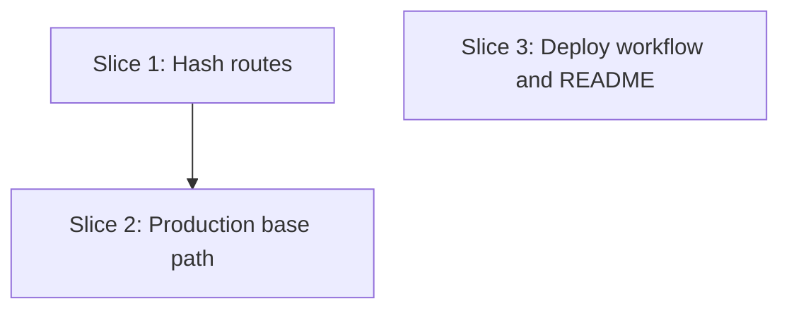

# Plan: Pages deploy, hash routes, base path

**Created**: 2026-11-21
**Branch**: feat/pages-deploy
**Status**: implemented
**Gherkin persistence**: plan-file-only
**Spec**: `docs/specs/pages-deploy.md` (AC1–AC13, answers S1–S4). Source issue: #25 (N13).

## Goal

Publish AIE to `https://bailejl.github.io/ai-enabler/` after CI passes on `main`, and give the app hash routes (`#/`, `#/projects/<id>`) that survive a direct load or a refresh on Pages and on localhost. Both routes render today's app shell until E1 adds storage.

Stance on high-reversal-cost axes:

- **integration**: open a PR to `main`. Use auto-merge only when it waits for green checks. No direct-to-trunk.
- **scope**: AC1–AC13 only. No custom domain (S1), no project storage, no usage counts.
- **replace-vs-merge**: merge. `ci.yml` is not changed, and the deploy is a new workflow.

## Prerequisites

- [x] **Manual, done by the user:** Settings → Pages → Source = GitHub Actions [S4]. Done on 2026-11-21. The coordinator checked `build_type=workflow`, URL `https://bailejl.github.io/ai-enabler/`. The build never calls `gh api` to change Pages settings.

## Plan decisions

- **P1. Deploy trigger.** A new `.github/workflows/deploy.yml` runs on two triggers: `workflow_run` (workflow `CI`, type `completed`, branch `main`) and `workflow_dispatch`. The `deploy` job runs in two cases. First, the CI run concluded `success` and its event is `push`. Second, the event is `workflow_dispatch` and the ref is `refs/heads/main`. A dispatch from any other ref runs a separate `refuse` job that fails with `::error::Deploys run from main only`, so the maintainer sees why nothing deployed. A separate workflow keeps `ci.yml`'s `cancel-in-progress` from cancelling a deploy halfway through. The `github-pages` environment's default branch rule adds a second guard. [S2]
- **P2. Built commit, and no stale overwrite.** For `workflow_run`, the first step compares `workflow_run.head_sha` with the current `main` tip (`git ls-remote https://github.com/${{ github.repository }} refs/heads/main`). This runs before checkout, so the step names the URL and not `origin`. If they differ, the job writes a `::notice::` and skips the remaining steps: a newer commit has its own CI run and will deploy. This also covers a re-run of an old CI run. When the SHAs match, checkout uses `head_sha`. A dispatch uses `github.sha`.
- **P3. Permissions.** The workflow sets `contents: read` at the top level. Only the `deploy` job adds `pages: write` and `id-token: write`. Concurrency group is `pages`, with `cancel-in-progress: false`.
  - **Changed at build review:** the workflow is now three jobs. `check` runs the P1 condition and the P2 tip check, and exposes `current`. `build` (`needs: check`, `if: current == 'true'`) runs checkout, setup, `npm run build`, and `upload-pages-artifact` with read-only permissions. `deploy` (`needs: build`) holds `pages: write` and `id-token: write`, and runs only `actions/deploy-pages`. This way a compromised npm dependency never runs with Pages or OIDC permissions, and a skipped stale commit creates no `github-pages` deployment record. `actions/configure-pages` was dropped because the base path is fixed.
- **P4. Base path.** `scripts/pages-base.js` exports `PAGES_BASE = '/ai-enabler/'` and a pure `viteBase({ command, isPreview })`. It returns `PAGES_BASE` for a build or a preview, and `/` otherwise. `vite.config.js` becomes a function config that calls `viteBase`. `vitest.config.js` calls that function with `{ command: 'serve', mode: 'test' }` before `mergeConfig`. `playwright.config.js` imports `PAGES_BASE`, so the value is named once and neither config imports the other.
- **P5. Router.** `src/shell/routes.js` holds pure functions, and `src/shell/useRoute.js` is a thin hook. No router dependency. The module lives in `src/shell/` because it is app navigation, not value stream logic, and a header comment says so. The id is parsed but not used (S3).
- **P6. Canonical hash.** `resolveHash(hash)` returns `{ route, hash }`.
  - The shape is canonical, not the encoding. Home is `#/`. A project is `#/projects/` followed by the id segment **exactly as written**: no re-encoding, with one trailing slash dropped.
  - Anything else resolves to home with `#/`: a missing segment, extra segments (including `abc//`), or a segment that `decodeURIComponent` rejects.
  - A valid id such as `a@b` or `a%2Fb` is never rewritten.
  - `route.id` is the decoded id. `toHash(route)` builds a hash from a route, encoding the id with `encodeURIComponent`, for code that creates links (E1).
- **P7. Sync function.** `syncHash(win)` in `routes.js` reads `win.location.hash` and resolves it. It calls `win.history.replaceState(win.history.state, '', canonical)` when the hash is not canonical, and returns the route. The hook only wires `useState`, the mount call, and the `hashchange` listener to it. `syncHash` is unit tested with a stub `win`.
- **P8. Observable route.** The app root gets `data-route="home|project"`. It changes nothing visible. It makes AC9 testable now, and N14 and E1 can read it later.
- **P9. Production-build e2e.** `playwright.config.js` gets a second `webServer`:
  - Command `npm run build && npm run preview`, with `env: { PORT: String(previewPort) }`. Vite reads `PORT` for `preview.port`.
  - Readiness `url` is `http://localhost:<previewPort>/ai-enabler/`.
  - `reuseExistingServer: false`, so it never serves a stale `dist`.
  - `timeout: 120000`, because the command runs a full build first.
  - `previewPort` is `PREVIEW_PORT`, or `PORT + 1000` when that is unset.

  A `pages` project runs only `e2e/pages.spec.js`, and `chromium` ignores that file. `npm run test:e2e` runs both projects, so CI and the pre-push hook check the production base path with no workflow change.

- **P10. Workflow tests parse YAML.** `scripts/deploy-workflow.test.js` parses `deploy.yml` with the `yaml` package. `yaml` is already in the lockfile as a transitive dependency; this plan adds it as an explicit dev dependency. The test scopes assertions to the top level and to each job. It also evaluates the `deploy` and `refuse` job conditions over a table of (event, conclusion, CI event, ref) cases, using a small evaluator for the exact expression shape used. The `if` expressions use only `==`, `&&`, `||`, and parentheses over `github.*`. The test also pins each expression string, so any edit forces an update to the table. `scripts/ci-workflow.test.js` is not changed.

## Acceptance Criteria

- [ ] AC1: The deploy workflow publishes a green CI push to `main` if that commit is still the tip of `main`, and skips an older green commit with a notice (P2). Before merge, this is verified by the deploy-workflow tests: the condition table and the tip-check runs. The live publish to `https://bailejl.github.io/ai-enabler/` is verified by Post-merge verification item 1, not by this examination.
- [ ] AC2: A push to `main` whose CI run does not succeed does not deploy, and the site keeps the last good build. A pull request never deploys.
- [ ] AC3: The deployed page's initial load has no 404 for any asset and renders the app shell. Scope is the initial load: the app has no lazy chunks today.
- [ ] AC4: The deploy can also be started by hand (`workflow_dispatch`) on `main`.
- [ ] AC5: `#/` renders the app shell.
- [ ] AC6: A direct load or a refresh of `/ai-enabler/#/projects/<id>` returns the app, not a 404, renders the shell, and keeps `#/projects/<id>` as written.
- [ ] AC7: `#/` and `#/projects/<id>` render the same app shell. The id is not checked against any store.
- [ ] AC8: No hash, an empty hash, or an unknown hash is replaced with `#/` (replace, not push), and the shell renders.
- [ ] AC9: A hash change from the address bar, or from back and forward, updates the route (`data-route`) without a full reload.
- [ ] AC10: The route module parses `#/`, `#/projects/<id>`, a trailing slash, and unknown paths, and builds the hash for each route. Unit tested.
- [ ] AC11: `npm run dev` serves the same routes at `http://localhost:<PORT>/` with AC5–AC9 behavior.
- [ ] AC12: An e2e check serves a production build under `/ai-enabler/` and passes AC3, AC6, and AC8 in CI.
- [ ] AC13: The README states the live URL.

Before merge, AC1, AC2, and AC4 are covered only by the parsed-workflow test (Step 3.1). `workflow_run` and `workflow_dispatch` use the workflow file on the default branch, so they cannot run before merge. After merge, Post-merge verification checks them live. The red-CI-on-`main` case cannot be exercised live. The table test covers it.

## Slices

### Slice 1: Hash routes

**Depends-on:** none
**Files:** `src/shell/routes.js`, `src/shell/routes.test.js`, `src/shell/useRoute.js`, `src/App.jsx`, `e2e/routes.spec.js`, `e2e/views.js`

**Behavior:**

```gherkin
Feature: Hash routes

  Scenario: The home route renders the shell
    # Still passes if: the home view renders the same for every unknown hash
    Given the app is served
    When a user opens "/#/"
    Then the app shell shows the starter steps
    And the address hash is "#/"
    And the shell reports route "home"

  Scenario: A project deep link survives a direct load and a refresh
    # Still passes if: the parsed id is never stored anywhere
    Given the app is served
    When a user opens "/#/projects/abc123" directly
    And the user refreshes the page
    Then the app shell shows the starter steps
    And the address hash is "#/projects/abc123"
    And the shell reports route "project"

  Scenario: An unknown project id still renders the app shell
    # Still passes if: every id is treated as unknown to storage, even one E1 would know
    Given no project with id "does-not-exist" is stored anywhere
    When a user opens "/#/projects/does-not-exist"
    Then the app shell shows the starter steps
    And the address hash is "#/projects/does-not-exist"

  Scenario: A project id with reserved characters is not rewritten
    # Still passes if: the decoded id is never shown anywhere
    Given the app is served
    When a user opens "/#/projects/a@b"
    Then the address hash is "#/projects/a@b"
    And the app shell shows the starter steps

  Scenario Outline: A missing or unknown hash becomes the home route without a new history entry
    # Still passes if: the replace happens one frame after the first render
    Given the app is served
    When a user opens "<address>"
    Then the address hash is "#/"
    And the app shell shows the starter steps
    And the history length equals that of a fresh page opened at "/#/"

    Examples:
      | address                 |
      | /                       |
      | /#                      |
      | /#/nowhere              |
      | /#/projects/            |
      | /#/projects/abc/extra   |
      | /#/projects/abc//       |
      | /#/projects/%E0%A4%A    |

  Scenario: A trailing slash on a project link is dropped
    # Still passes if: the slashed form renders briefly before the rewrite
    Given the app is served
    When a user opens "/#/projects/abc123/"
    Then the address hash is "#/projects/abc123"
    And the app shell shows the starter steps

  Scenario: Back and forward switch the route without a reload
    # Still passes if: both routes render identical shell markup
    Given a user opened "/#/" and deleted one starter step
    When the user changes the address to "#/projects/abc123"
    Then the shell reports route "project"
    When the user goes back
    Then the shell reports route "home"
    And the address hash is "#/"
    And the map still has one step fewer than the starter steps

  Scenario: An address change to an unknown hash is replaced in place
    # Still passes if: the browser keeps a duplicate "#/" entry behind the replaced one
    Given a user opened "/#/projects/abc123"
    When the user changes the address to "#/nowhere"
    Then the address hash is "#/"
    And the shell reports route "home"
    And no history entry holds "#/nowhere"
```

**Steps:**

#### Step 1.1: Route module parses, builds, and syncs hashes

**Complexity**: standard
**IMPLEMENT**: Add `src/shell/routes.js` with a header comment explaining why it lives in `src/shell/` (P5). It exports `ROUTE` (`home`, `project`), `resolveHash`, `toHash`, and `syncHash`, with the rules in P6 and P7.
**TEST**: Table-driven Vitest cases in `src/shell/routes.test.js`.

- `resolveHash` covers every row of the Slice 1 Outline, plus `#/`, `#/projects/abc`, `#/projects/abc/`, `#/projects/a@b`, `#/projects/a+b`, `#/projects/a,b`, and `#/projects/a%2Fb`. Each case states the expected route and canonical hash. Valid ids keep their raw hash.
- `toHash` round-trips: `resolveHash(toHash(route)).route` equals `route` for home and for the ids `abc`, `a b`, `ü`, and `a/b`.
- `syncHash` uses a stub `win`. It calls `replaceState` once for a non-canonical hash and never for a canonical one, and it returns the route.

**REFACTOR**: Name the route patterns as constants, and drop any branch the tests do not exercise.
**Files**: `src/shell/routes.js`, `src/shell/routes.test.js`
**Covers**: AC8, AC10
**Commit**: `feat: parse, build and sync hash routes`

#### Step 1.2: The app follows the hash

**Complexity**: standard
**IMPLEMENT**: Add `src/shell/useRoute.js`. It calls `syncHash(window)` on mount and on every `hashchange`, keeps the route in state, removes the listener on unmount, and returns the route. `App.jsx` calls `useRoute()` above `Shell` and sets `data-route` on the app root (P8). Shell state persists across hash changes.
**TEST**: `e2e/routes.spec.js` covers every Slice 1 scenario against `npm run dev` at `/` (AC11).

- Read `location.hash` and `history.length` with `page.evaluate`.
- Change the hash with `page.evaluate(() => { location.hash = … })`, which records a history entry the way the address bar does.
- Check "no history entry holds #/nowhere" by going back and checking that the hash is exactly `#/projects/abc123`.
- Add an `appShell(page)` / `expectStarterSteps(page)` helper to `e2e/views.js`. Slice 1 owns `e2e/views.js`.

**REFACTOR**: Keep `window` access to this one hook call. Reuse `STARTER_STEP_COUNT` and `cards`.
**Files**: `src/shell/useRoute.js`, `src/App.jsx`, `e2e/routes.spec.js`, `e2e/views.js`
**Covers**: AC5, AC6, AC7, AC8, AC9, AC11
**Commit**: `feat: hash routes for home and project links`

### Slice 2: Production base path

**Depends-on:** 1
**Files:** `scripts/pages-base.js`, `scripts/pages-base.test.js`, `vite.config.js`, `vitest.config.js`, `playwright.config.js`, `e2e/pages.spec.js`

**Behavior:**

```gherkin
Feature: The production build works under the Pages base path

  Scenario: Every asset of the initial load is served under /ai-enabler/
    # Still passes if: an asset loaded only after a user action uses the wrong base
    Given the production build is served under "/ai-enabler/"
    When a user opens "/ai-enabler/#/"
    Then no request for a script, stylesheet, or other asset fails or returns 404
    And the app shell shows the starter steps

  Scenario: A bare base-path load is normalized and keeps the base path
    # Still passes if: the dev server at "/" also normalizes correctly
    Given the production build is served under "/ai-enabler/"
    When a user opens "/ai-enabler/"
    Then the page path is "/ai-enabler/"
    And the address hash is "#/"
    And the app shell shows the starter steps

  Scenario: A project deep link loads directly and after a refresh under the base path
    # Still passes if: the server also answers the same page at "/"
    Given the production build is served under "/ai-enabler/"
    When a user opens "/ai-enabler/#/projects/abc" directly
    And the user refreshes the page
    Then the page path is "/ai-enabler/"
    And the address hash is "#/projects/abc"
    And the app shell shows the starter steps

  Scenario Outline: Vite resolves the base for each command
    # Still passes if: a future "vite optimize" command also resolves "/"
    Given the Vite command is "<command>" with preview "<preview>"
    When the base path is resolved
    Then it is "<base>"

    Examples:
      | command | preview | base         |
      | build   | false   | /ai-enabler/ |
      | serve   | true    | /ai-enabler/ |
      | serve   | false   | /            |
```

**Steps:**

#### Step 2.1: Build and preview use /ai-enabler/, dev uses /

**Complexity**: standard
**IMPLEMENT**: Add `scripts/pages-base.js` (P4). Make `vite.config.js` a function config, and update `vitest.config.js` to call it. Add the preview webServer and the `pages` project to `playwright.config.js` (P9), plus `testIgnore: 'pages.spec.js'` on `chromium`.
**TEST**:

- `scripts/pages-base.test.js` covers the Outline.
- `e2e/pages.spec.js` scenario 1 records `requestfailed` events and every response with status ≥ 400, and asserts that both lists are empty. If `isPreview` were missing, this test would fail with a 404 at `/ai-enabler/`.
- The existing `chromium` suite still passes at `/`, and `npm test` still passes.

**REFACTOR**: Keep `vite.config.js` free of test concerns. The only shared value is `PAGES_BASE`.
**Files**: `scripts/pages-base.js`, `scripts/pages-base.test.js`, `vite.config.js`, `vitest.config.js`, `playwright.config.js`, `e2e/pages.spec.js`
**Covers**: AC3, AC12
**Commit**: `build: serve the production build under /ai-enabler/`

#### Step 2.2: Routes under the base path

**Complexity**: standard
**IMPLEMENT**: No production code. These scenarios fail if Slice 1's `replaceState` target drops the base path.
**TEST**: `e2e/pages.spec.js` scenarios 2 and 3. They check `location.pathname` and `location.hash`, use `page.reload()`, and import the shell helper from `e2e/views.js` read-only.
**REFACTOR**: Remove any duplicate setup between the two scenarios.
**Files**: `e2e/pages.spec.js`
**Covers**: AC6, AC8, AC12
**Commit**: `test: routes work under the Pages base path`

### Slice 3: Deploy workflow and README

**Depends-on:** none
**Files:** `.github/workflows/deploy.yml`, `scripts/deploy-workflow.test.js`, `package.json`, `package-lock.json`, `README.md`
**Invariants:** `grep -q 'https://bailejl.github.io/ai-enabler/' README.md`

**Behavior:**

```gherkin
Feature: Deploy to GitHub Pages after green CI

  Scenario: A green CI run on a push to main deploys that commit
    # Still passes if: the deploy takes several minutes longer than CI
    Given a push to main whose CI run passes
    And that commit is still the tip of main
    When the deploy workflow runs
    Then the site at "https://bailejl.github.io/ai-enabler/" serves the build of that commit

  Scenario Outline: A CI run on main that did not succeed does not deploy
    # Still passes if: the deploy workflow run is listed as skipped rather than absent
    Given a push to main whose CI run concluded "<conclusion>"
    When the deploy workflow is triggered
    Then no deploy job runs (skipped or absent)
    And the site keeps serving the last good build

    Examples:
      | conclusion |
      | failure    |
      | cancelled  |
      | timed_out  |

  Scenario: A green CI run for an older commit does not overwrite a newer deploy
    # Still passes if: the notice text differs from the plan's wording
    Given a green CI run on main for a commit that is no longer the tip of main
    When the deploy workflow runs
    Then nothing is deployed
    And the run shows a notice that a newer commit will deploy

  Scenario: A pull request never deploys
    # Still passes if: the pull request's CI run triggers a skipped deploy run
    Given a pull request whose CI run passes
    When the deploy workflow is triggered
    Then no deploy job runs (skipped or absent)

  Scenario: A fork pull request from a branch named main never deploys
    # Still passes if: the pull request's CI run is red
    Given a pull request from a fork whose branch is named "main" and whose CI run passes
    When the deploy workflow is triggered
    Then no deploy job runs (skipped or absent)

  Scenario: A manual deploy from main publishes main
    # Still passes if: the manual run rebuilds an identical commit
    Given the main branch
    When a maintainer starts the deploy workflow by hand on main
    Then the site serves the build of main

  Scenario: A manual deploy from another branch fails with a reason
    # Still passes if: the environment rule would also block it
    Given a branch other than main
    When a maintainer starts the deploy workflow by hand on that branch
    Then no deploy job runs
    And the run fails with the message "Deploys run from main only"
```

**Steps:**

#### Step 3.1: Deploy workflow gated on green CI

**Complexity**: complex
**IMPLEMENT**: Add `.github/workflows/deploy.yml` per P1–P3. The `deploy` job runs these steps in order:

1. The tip check (P2).
2. Checkout at the P2 ref, with `persist-credentials: false`.
3. `./.github/actions/setup`.
4. `npm run build`.
5. `actions/configure-pages`.
6. `actions/upload-pages-artifact` with `path: dist`.
7. `actions/deploy-pages` in environment `github-pages`, whose `url` is the deploy step's `page_url` output.

The `refuse` job handles an off-`main` dispatch. Add `yaml` as a dev dependency, and extend `lint:ci` to validate `deploy.yml`.
**TEST**: `scripts/deploy-workflow.test.js` (P10) asserts these:

- The triggers are `workflow_run` with workflows `[CI]`, types `[completed]`, branches `[main]`, plus `workflow_dispatch`. There is no `push` or `pull_request` trigger.
- The condition table, for the `deploy` and `refuse` jobs:
  - success + push + main: deploy.
  - failure, cancelled, or timed_out + push: no deploy.
  - success + pull_request (including head branch `main`): no deploy.
  - dispatch on main: deploy.
  - dispatch on another ref: refuse, with no deploy.
- Top-level permissions are exactly `contents: read`. Only `deploy` has `pages: write` and `id-token: write`.
- Concurrency is `pages` with `cancel-in-progress: false`.
- The tip check runs before checkout, and later steps are gated on its output.
- Checkout uses `workflow_run.head_sha`, and `upload-pages-artifact` gets `dist`.
- The `lint:ci` script validates `.github/workflows/deploy.yml`.

`npm run lint:ci` passes.

**REFACTOR**: Keep the condition evaluator to the operators the workflow uses. If the workflow needs more, simplify the workflow.
**Files**: `.github/workflows/deploy.yml`, `scripts/deploy-workflow.test.js`, `package.json`, `package-lock.json`
**Covers**: AC1, AC2, AC4
**Commit**: `ci: deploy to GitHub Pages after CI passes on main`

#### Step 3.2: README states the live URL

**Complexity**: trivial
**IMPLEMENT**: In the README Status section, add the live URL. Add one line saying that deploys run after CI passes on `main`. Add another saying that links use `#/` (`#/`, `#/projects/<id>`), not path-style URLs.
**TEST**: The slice invariant greps for the live URL. `npm run format:check` passes.
**REFACTOR**: Keep the README Commands table unchanged, because there is no new user-facing command.
**Files**: `README.md`
**Covers**: AC13
**Commit**: `docs: link the live site from the README`

## Post-merge verification

Run these after the PR merges and CI on `main` is green. Record the run URLs in the PR thread.

1. The deploy run triggered by CI succeeds, and the `github-pages` environment accepts the `head_sha` deploy. Open `https://bailejl.github.io/ai-enabler/`. The shell renders, and the network panel shows no 404 (AC1, AC3).
2. Open `https://bailejl.github.io/ai-enabler/#/projects/abc`, then refresh. The shell renders, and the hash stays (AC6).
3. Run `gh workflow run deploy.yml --ref main` and check that it deploys. Then run it with `--ref` set to a scratch branch, and check that the `refuse` job fails with its message (AC4).
4. Open the next trivial PR. Once its CI is green, check that no deploy job ran for it (AC2). A red CI on `main` is covered only by the condition table.

## Parallelization



| Wave | Slices (parallel) |
| ---- | ----------------- |
| 1    | 1, 3              |
| 2    | 2                 |

Slice 2 follows Slice 1, because its routing scenarios need Slice 1's code and read `e2e/views.js`, which Slice 1 owns. Slice 3 shares no files and no runtime behavior with Slice 1. When Slices 1 and 3 build in parallel worktrees, only Slice 1 runs Playwright. Give each worktree its own `PORT`. Ship all three slices in one PR.

## Complexity Classification

| Rating     | Criteria                                                                         | Review depth                                        |
| ---------- | -------------------------------------------------------------------------------- | --------------------------------------------------- |
| `trivial`  | Single-file rename, config change, typo fix, documentation-only                  | Skip inline review; covered by final `/code-review` |
| `standard` | New function, test, module, or behavioral change within existing patterns        | Spec-compliance + relevant quality agents           |
| `complex`  | Architectural change, security-sensitive, cross-cutting concern, new abstraction | Full agent suite including opus-tier agents         |

## Pre-PR Quality Gate

- [x] Unit tests pass, including the route module, the deploy-workflow table and the tip-check runs: `npm run test:gate`
- [x] E2E tests pass, `chromium` and `pages` projects, on ports derived from the worktree path so no other worktree's server is reused: `npm run test:e2e:gate`
- [x] Linter passes: `npm run lint`
- [x] Deep linter passes: `npm run lint:deep`
- [x] Workflow validation passes: `npm run lint:ci`
- [x] Format check passes: `npm run format:check`
- [x] Production build succeeds: `npm run build`
- [x] Route tests run against the Vite dev server at `/` (AC5–AC9, AC11): `npm run test:e2e:gate -- e2e/routes.spec.js --project=chromium`
- [x] Production build under `/ai-enabler/` (AC3, AC6, AC8, AC12): `npm run test:e2e:gate -- --project=pages`
- [x] Route module unit tests (AC10): `npm run test:gate -- src/shell/routes.test.js`
- [x] Deploy workflow and README tests pass (AC1, AC2, AC4, AC13): `npm run test:gate -- scripts/deploy-workflow.test.js scripts/readme.test.js`
- [x] `/code-review` passes
- [x] README updated

## Risks & Open Questions

- **The first deploy happens after merge.** `workflow_run` fires only from the workflow file on the default branch. Mitigation: the parsed-workflow test, `lint:ci`, and Post-merge verification. If it fails, fix forward. The site has no earlier build to lose.
- **`yaml` dev dependency (P10).** It is already in the lockfile transitively. Adding it explicitly gives the security-relevant workflow test a real parser instead of regex.
- **e2e time.** The `pages` project adds a production build to every `npm run test:e2e`, including pre-push. Measure the cost during build. If it adds more than about 15 seconds, raise it before the PR.
- **Back after a typed unknown hash.** The browser pushes the typed hash, and the app then replaces it with `#/`. This can leave two `#/` entries, so one Back press seems to do nothing. This comes from using replace and is accepted.
- **Vite `isPreview`.** Vite 8 must set `isPreview` for `vite preview`. If it does not, scenario 1 of the pages e2e fails, and the fallback is `process.argv.includes('preview')` with a code comment.
- **A red newer commit skips an older green one.** P2 skips a green commit when it is no longer the tip, even if the newer commit then fails CI. The site keeps the last deployed build until `main` is green again. A manual dispatch is the way to recover. This is accepted.
- **Stale-skip test depth.** Before merge, the tip check is only tested structurally: later steps are gated on its output, and its script compares `head_sha` with the `ls-remote` result. It cannot be exercised live on demand.
- **For E1 and N14.** E1 defines the not-found experience for an unknown project id (S3 renders the shell for now). E1 also owns the document title and focus on a route change. N14 extends `useRoute` and can read `data-route`.

## Plan Review Summary

Plan tier: complex (Step 3.1 is `complex`, and the deploy permissions are security-sensitive). Reviewers: Acceptance, Design, UX, Strategic, Parallelization (all 5). There were two iterations, and no critic raised a blocker.

- **Iteration 1.** Strategic, UX, and Parallelization approved. Acceptance and Design returned needs-revision, with warnings only. That revision:
  - Kept raw ids, so links are not re-encoded.
  - Made `data-route` observable.
  - Added the pure `syncHash` with a unit test.
  - Asserted the history for replace.
  - Added bare `/ai-enabler/` normalization, so Slice 2 now depends on Slice 1, and gave Slice 1 ownership of `e2e/views.js`.
  - Wired the preview server (port env, readiness URL, no reuse).
  - Added `PAGES_BASE` in `scripts/pages-base.js`, the stale-commit tip check, and the off-`main` refuse job.
  - Replaced regex with parsed YAML and a condition table.
  - Added scenarios for a non-success CI conclusion and for a fork PR from a branch named `main`.
  - Added the README grep invariant and a real post-merge PR check.
- **Iteration 2.** Acceptance and Design approved. Their remaining warnings were fixed in the plan:
  - `ls-remote` uses the repository URL, not `origin`.
  - The preview server has a 120 s timeout.
  - The expression strings are pinned.
  - AC1 states the tip qualifier.
  - The trailing-slash falsifier is fixed.
  - The history oracles are tighter.
  - The risk lines for the red newer commit and the stale-skip test depth are added.
- **Accepted as is:**
  - Slices 1–3 ship in one PR. Strategic suggested splitting the deploy from the routes, but AC6 and AC12 couple them.
  - The double `#/` history entry after a typed unknown hash is accepted.
  - The Vite base Outline uses implementation terms, which is acceptable for a unit table.
  - "No lazy chunks" is to be confirmed during build.

## Acceptance Examination

`met` = observed as met; `not-met` = observed as not met; `indeterminate` = could not be observed; `tainted` = the examiner ran a command it must not.

### AC1 — met

```
$ npm run test:gate -- scripts/deploy-workflow.test.js scripts/readme.test.js
> vitest run --reporter=dot scripts/deploy-workflow.test.js scripts/readme.test.js ... Test Files  2 passed (2)  Tests  30 passed (30). The criterion names the deploy-workflow tests as its pre-merge check, and they passed. The dot reporter does not name individual tests. The live publish is post-merge, out of scope.
```

### AC2 — met

```
$ npm run test:gate -- scripts/deploy-workflow.test.js scripts/readme.test.js
Test Files  2 passed (2)  Tests  30 passed (30). The deploy-workflow condition-table tests passed. The dot reporter does not name the individual failure, cancelled, timed_out and pull_request cases. Also: lint:ci printed 'action-validator .github/workflows/ci.yml && action-validator .github/workflows/deploy.yml && action-validator .github/actions/setup/action.yml' with no errors.
```

### AC3 — met

```
$ npm run test:e2e:gate -- --project=pages
> PORT=${PORT:-3417} playwright test --reporter=dot --project=pages  Running 3 tests using 1 worker ···  3 passed (2.0s)
```

### AC4 — met

```
$ npm run test:gate -- scripts/deploy-workflow.test.js scripts/readme.test.js
Test Files  2 passed (2)  Tests  30 passed (30). The deploy-workflow tests passed. The dot reporter does not name the workflow_dispatch case.
```

### AC5 — met

```
$ npm run test:e2e:gate -- e2e/routes.spec.js --project=chromium
> PORT=${PORT:-3417} playwright test --reporter=dot e2e/routes.spec.js --project=chromium  Running 16 tests using 1 worker ················  16 passed (6.1s)
```

### AC6 — met

```
$ npm run test:e2e:gate -- --project=pages
Running 3 tests using 1 worker ···  3 passed (2.0s). Also e2e/routes.spec.js --project=chromium: 16 passed (6.1s)
```

### AC7 — met

```
$ npm run test:e2e:gate -- e2e/routes.spec.js --project=chromium
Running 16 tests using 1 worker ················  16 passed (6.1s)
```

### AC8 — met

```
$ npm run test:e2e:gate -- e2e/routes.spec.js --project=chromium
Running 16 tests using 1 worker ················  16 passed (6.1s). Also --project=pages: 3 passed (2.0s)
```

### AC9 — met

```
$ npm run test:e2e:gate -- e2e/routes.spec.js --project=chromium
Running 16 tests using 1 worker ················  16 passed (6.1s)
```

### AC10 — met

```
$ npm run test:gate -- src/shell/routes.test.js
> vitest run --reporter=dot src/shell/routes.test.js ... Test Files  1 passed (1)  Tests  32 passed (32)
```

### AC11 — met

```
$ npm run test:e2e:gate -- e2e/routes.spec.js --project=chromium
> PORT=${PORT:-3417} playwright test --reporter=dot e2e/routes.spec.js --project=chromium  16 passed (6.1s). The route behavior passed on the chromium project served at PORT. The output does not itself name the dev server.
```

### AC12 — met

```
$ npm run test:e2e:gate -- --project=pages
> PORT=${PORT:-3417} playwright test --reporter=dot --project=pages  Running 3 tests using 1 worker ···  3 passed (2.0s). Passed locally. A CI run was not observed in this examination.
```

### AC13 — met

```
$ npm run test:gate -- scripts/deploy-workflow.test.js scripts/readme.test.js
> vitest run --reporter=dot scripts/deploy-workflow.test.js scripts/readme.test.js ... Test Files  2 passed (2)  Tests  30 passed (30)
```

### Audit details

- Overall: met
- Binding hash: 9b2febc1374a95ac416ca5e0df35e168168aa0bef5b3c229c682def6bf1f070c
- Inputs digest: 21b036a47c8afc7bb610a1fff48644ae818577d460f73ea8290d49b787c640ac
- Agent: af2c1d7871f6d975c
- Recorded at: 2026-11-21T20:29:12+00:00
- Audit findings: none

Output above is untrusted examiner text and may contain secrets from command output.

## Build Progress

### Slices (grouped by wave)

#### Wave 1

- [x] Slice 1: Hash routes
  - [x] Step 1.1: Route module parses, builds, and syncs hashes
  - [x] Step 1.2: The app follows the hash
- [x] Slice 3: Deploy workflow and README
  - [x] Step 3.1: Deploy workflow gated on green CI
  - [x] Step 3.2: README states the live URL

#### Wave 2

- [x] Slice 2: Production base path
  - [x] Step 2.1: Build and preview use /ai-enabler/, dev uses /
  - [x] Step 2.2: Routes under the base path
