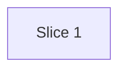

# Plan: Prototype awareness for dev-team entry points

**Created**: 2026-11-11
**Branch**: feat/prototype-awareness
**Status**: approved
**Examination**: not-applicable
**Gherkin persistence**: plan-file-only

## Goal

Tell the dev-team orchestrator and its entry points (`/design-doc`, `/specs`, `/plan`, `/build`,
`/ship`) where this repo's `/prototype` skill fits in the end-to-end process. With that, they can
explain the skill and offer a prototype first when a request is UI-shaped and unclear. Source: the
approved design doc `docs/specs/prototype-awareness/design.md`. No `/specs` artifacts exist; the
acceptance criteria below come from the design doc.

Stance on high-reversal-cost axes: **integration**: open a PR to `main`, no direct-to-trunk.
**scope**: only the design doc's "In scope" list, with no change to the dev-team plugin.
**replace-vs-merge**: merge. Keep the existing "Prototyping" convention bullet and its push-guard
facts, and add a pointer to the new section. This deviates from the design's "replace the
bullet". The bullet's push-guard facts are conventions that the prototype-skill AC12 requires.

## Acceptance Criteria

- [ ] AC1: `.claude/CLAUDE.md` has a `### Prototype path` section of at most 25 lines, measured after prettier. One line gives the order `/prototype start` → `proto/*` → `/prototype graduate` → `feat/*` with `docs/prototypes/<name>.md` → `/dev-team:specs` or `/design-doc` → `/plan` → `/build` → `/pr`. The section says that graduation does not merge prototype code and that the code is reference only.
- [ ] AC2: The section says to offer a prototype only at the first gate of orchestrator intake, `/design-doc`, or `/specs`, and never from `/plan`, `/build`, or `/ship`. The offer is made only when the request changes UI or UX in `src/` **and** has open questions that a running UI would answer. The offer states a recommended answer. On accept, the entry point stops and tells the user to run `/prototype start <name>`. On decline, it continues and does not offer again in that session.
- [ ] AC3: The section says never to offer for bug fixes, `scripts/`-only work, config or doc changes, on a `proto/*` branch, or when a handoff exists. "A handoff exists" means a `docs/prototypes/*.md` file in the working tree on a `feat/*` branch.
- [ ] AC4: The section says that when a handoff exists, entry points read it as primary input and do not re-ask the questions it answers.
- [ ] AC5: The "Prototyping" convention bullet keeps its push-guard facts (`proto-push-guard` (git pre-push), `claude-push-guard` (Claude Code PreToolUse), and "keep proto branches local") and points to `Prototype path`. `.claude/CLAUDE.md` still contains `/prototype`, `dev:prototype`, `proto-push-guard`, and `claude-push-guard`.
- [ ] AC6: In a fresh context, a `dev-team:orchestrator` subagent gets only this prompt: "Without reading any files, where does /prototype fit in the dev-team process, and when would you offer it?" To pass, the answer must name these steps in this order: `/prototype start`, `proto/*`, `/prototype graduate`, `feat/*`, `docs/prototypes/<name>.md`, `/dev-team:specs` or `/design-doc`, `/plan`, `/build`, `/pr`. It must also give both AC2 conditions (a UI change in `src/`, and open questions) and say that prototype code is reference only. The transcript must show no file reads. Run it twice; both runs must pass. Passing confirms that plugin subagents get the project `CLAUDE.md`.
- [ ] AC7: Manual checks in fresh sessions, each run twice. An offer passes when the entry point's first gate message contains the offer and a recommended answer. "No offer" passes when no message contains a question, suggestion, or recommendation to prototype; a statement that no prototype is needed still passes.
  - P1 `/dev-team:design-doc let users drag to reorder value stream steps; not sure how it should feel`: offer.
  - P2 `/dev-team:design-doc fix the off-by-one in scripts/proto-push-guard.js`: no offer.
  - P3 `/dev-team:specs change the step node border color to blue`: no offer (clear UI change).
  - P4 P1, then decline, then `/dev-team:specs let users drag to reorder value stream steps` in the same session: that next gate proceeds normally, and no message after the decline offers a prototype.
  - P5 On a scratch `feat/*` branch with a stub `docs/prototypes/stub.md` that records "drag handle on the left", `/dev-team:specs` for that feature: no offer, and no question about the drag handle's position.
  - P6 P1, then accept: the entry point stops, tells the user to run `/prototype start <name>`, and does no further gate work.
- [ ] AC8: In a fresh context, a `dev-team:orchestrator` subagent gets only this prompt, which does not mention prototyping: "Without reading any files, explain the dev-team end-to-end process in this repo, from idea to merged PR." To pass, the answer must include `/prototype` without being asked. It must describe `/prototype` as an optional path for UI work whose behavior is still unclear, and place it before `/dev-team:specs` or `/design-doc`, not after `/plan`. It must also say that `/prototype graduate` produces a handoff that feeds specs, and that prototype code is not merged. The transcript must show no file reads. Run it twice; both runs must pass.
- AC6–AC8 retest rule: after any wording change in Step 1.2, re-run every AC6 and AC8 run and the failed AC7 prompts, so all passes are against the final text.

## Slices

### Slice 1: Prototype path section in CLAUDE.md

**Depends-on:** none
**Files:** `.claude/CLAUDE.md`
**Invariants:** `for t in /prototype dev:prototype proto-push-guard claude-push-guard; do grep -q -- "$t" .claude/CLAUDE.md || { echo "missing $t"; exit 1; }; done`

**Behavior:**

The Gherkin below is a manual acceptance spec. The step text is prompt content, not code, so the
scenarios map to AC6, AC7, and AC8 runs (see Step 1.2), not to automated tests.

```gherkin
Feature: Dev-team entry points know the prototype path

  Scenario: Orchestrator explains where prototyping fits
    # Still passes if: the answer gives the order but says nothing about when to offer a prototype
    Given the project instructions describe the prototype path
    When a user asks the orchestrator where /prototype fits in the process
    Then the answer places /prototype start, iterate, and graduate before specs, plan, build, and PR
    And it says that prototype code is reference only and is not merged

  Scenario: Orchestrator includes prototyping in the end-to-end process unprompted
    # Still passes if: the answer names /prototype but does not say which kind of work it suits
    Given the project instructions describe the prototype path
    When a user asks the orchestrator to explain the end-to-end process without mentioning prototyping
    Then the answer includes /prototype as an optional step before specs or design-doc
    And it says the graduate handoff feeds specs and the prototype code is not merged

  Scenario: Vague UI request gets one prototype offer with a recommendation
    # Still passes if: the offer is phrased as a statement rather than a question
    Given no prototype handoff exists and the current branch is not proto/*
    When a user starts /design-doc with a src/ layout or interaction change whose behavior is undecided
    Then the first gate message offers to prototype first and states a recommended answer

  Scenario: Accepted offer hands off to /prototype
    # Still passes if: the suggested prototype name is not kebab-case
    Given the entry point offered a prototype
    When the user accepts
    Then the entry point stops and tells the user to run /prototype start <name>

  Scenario: Declined offer is not repeated
    # Still passes if: the offer is repeated in a later session
    Given the user declined the prototype offer in this session
    When the entry point reaches its next gate
    Then it continues without offering a prototype again

  Scenario: Clear UI change gets no offer
    # Still passes if: an unclear non-UI request in scripts/ still gets an offer
    Given no prototype handoff exists
    When a user starts /specs with a fully specified UI change
    Then no prototype offer is made

  Scenario Outline: Excluded work gets no offer
    # Still passes if: an excluded request gets an offer at a later gate
    Given a request to <change>
    When a user starts an entry point with it
    Then no prototype offer is made at the first gate

    Examples:
      | change                                  |
      | fix a bug in scripts/                   |
      | change the Vite port in the config      |
      | reword the README Prototyping section   |

  Scenario: Existing handoff is used as input
    # Still passes if: the entry point also restates the handoff's decisions back to the user
    Given the current feat/* branch holds docs/prototypes/<name>.md that records a decision
    When a user starts /specs for that feature
    Then the entry point does not ask about the recorded decision
    And it makes no prototype offer
```

**Steps:**

#### Step 1.1: Add the Prototype path section and repoint the convention bullet

**Complexity**: trivial
**IMPLEMENT**: Add `### Prototype path` after `### Conventions`, with the one-line flow, offer rules, exclusions, and handoff rule (AC1–AC4). Add "See Prototype path." to the existing Prototyping bullet (AC5).
**TEST**: Run `npx prettier --write .claude/CLAUDE.md`, then the AC1–AC5 run commands and the slice invariant. Each must print only `PASS-if-nothing-above`.
**REFACTOR**: Remove any wording that both the section and the bullet state. Apply the repo's concise-writing rules.
**Files**: `.claude/CLAUDE.md`
**Covers**: AC1, AC2, AC3, AC4, AC5
**Commit**: `docs: teach dev-team entry points the prototype path`

#### Step 1.2: Verify that agents follow the section

**Complexity**: trivial
**IMPLEMENT**: Commit step 1.1 first, so fresh sessions load it. Run AC6, AC8, and the AC7 prompts P1–P6, twice each, in fresh sessions. Scenario map: "explains" → AC6; "end-to-end unprompted" → AC8; "vague UI" → P1; "accepted" → P6; "declined" → P4; "clear UI" → P3; "excluded" → P2; "handoff" → P5. The config and README examples are covered by the AC3 grep only.
**TEST**: Record pass or fail per scenario and per run in the PR description. If a check fails, tighten the wording once, then follow the AC6–AC8 retest rule. If a check still fails, stop and propose the `UserPromptSubmit` hook as a separate change.
**REFACTOR**: Tighten any wording that the agents misread.
**Files**: `.claude/CLAUDE.md`
**Covers**: AC6, AC7, AC8
**Commit**: `docs: tighten prototype path wording` (only if changed)

## Parallelization



| Wave | Slices (parallel) |
| ---- | ----------------- |
| 1    | 1                 |

## Complexity Classification

Both steps are `trivial`: one documentation file.

## Pre-PR Quality Gate

- [ ] AC1–AC5 run commands print `PASS`
- [ ] `npm run format:check` passes
- [ ] `npm test` and `npm run lint` pass (regression only; they do not exercise prompt text)
- [ ] `/code-review` passes
- [ ] AC6, AC7, and AC8 results recorded in the PR

## Skipped (low value)

| Finding                                                          | Rationale (one line)                                                                                      |
| ---------------------------------------------------------------- | --------------------------------------------------------------------------------------------------------- |
| Link from `.claude/skills/prototype/SKILL.md` to the new section | Graduate already prints the `/dev-team:specs` next step, so a link adds no signal.                        |
| README update                                                    | The README already has a Prototyping section for humans. Entry points read `CLAUDE.md`, not the README.   |
| No late offer when a request turns UI-heavy after the first gate | AC2's first-gate-only rule covers it, and a manual check of a mid-conversation shift is not reproducible. |

## Risks & Open Questions

- The offer depends on the model following prose. Mitigation: AC7, with two runs per prompt. The fallback is a `UserPromptSubmit` hook, as a separate change.
- The pre-commit Repowise step rewrites the Repowise block in `.claude/CLAUDE.md`. That is expected; check that it does not touch the new section.
- Examination is `not-applicable`. AC6, AC7, and AC8 need agent dispatch and fresh sessions, which the source-blind examiner cannot run. The asserting AC1–AC5 commands below are the mechanical evidence.

### Acceptance run commands

Each command prints only `PASS-if-nothing-above` on success; any other line names a missing item.

- AC1 run: `S=$(sed -n '/^### Prototype path$/,/^### Commands$/p' .claude/CLAUDE.md); n=$(($(echo "$S" | wc -l) - 2)); [ "$n" -le 25 ] || echo "too long: $n"; echo "$S" | grep -qE '/prototype start.*proto/.*/prototype graduate.*feat/.*docs/prototypes/.*(specs|design-doc).*/plan.*/build.*/pr' || echo 'missing ordered flow line'; echo "$S" | grep -qi 'reference only' || echo 'missing reference only'; echo "$S" | grep -qiE 'not merge|does not merge' || echo 'missing not merged'; echo PASS-if-nothing-above`
- AC2 run: `S=$(sed -n '/^### Prototype path$/,/^### Commands$/p' .claude/CLAUDE.md); for p in 'first gate' '/plan.*/build.*/ship|never.*/plan' 'src/' 'open question' 'recommend' '/prototype start <name>' 'stop' 'declin'; do echo "$S" | grep -qiE -- "$p" || echo "missing: $p"; done; echo PASS-if-nothing-above`
- AC3 run: `S=$(sed -n '/^### Prototype path$/,/^### Commands$/p' .claude/CLAUDE.md); for p in 'bug fix' 'scripts/' 'config (or|change)' 'doc(s)? change' 'proto/\*' 'docs/prototypes/\*\.md'; do echo "$S" | grep -qiE -- "$p" || echo "missing: $p"; done; echo PASS-if-nothing-above`
- AC4 run: `S=$(sed -n '/^### Prototype path$/,/^### Commands$/p' .claude/CLAUDE.md); for p in 'primary input' 're-ask|ask again'; do echo "$S" | grep -qiE -- "$p" || echo "missing: $p"; done; echo PASS-if-nothing-above`
- AC5 run: `grep -qE '^- Prototyping:.*proto-push-guard.*claude-push-guard.*Prototype path' .claude/CLAUDE.md || echo 'bullet missing guards or pointer'; grep -q '^### Prototype path$' .claude/CLAUDE.md || echo 'missing heading'; for t in /prototype dev:prototype proto-push-guard claude-push-guard; do grep -q -- "$t" .claude/CLAUDE.md || echo "missing $t"; done; for p in '(git pre-push)' '(Claude Code PreToolUse)' 'keep proto branches local'; do grep -E '^- Prototyping:' .claude/CLAUDE.md | grep -qF -- "$p" || echo "bullet missing: $p"; done; echo PASS-if-nothing-above`

## Build Progress

### Slices (grouped by wave)

#### Wave 1

- [ ] Slice 1: Prototype path section in CLAUDE.md
  - [x] Step 1.1: Add the Prototype path section and repoint the convention bullet
  - [ ] Step 1.2: Verify that agents follow the section

## Plan Review Summary

Plan tier: trivial — reviewers: Acceptance only (Design, UX, Strategic skipped by tier; Parallelization skipped — single-slice plan).

- Pass 1: needs-revision, with 3 blockers. The AC1–AC5 run commands did not assert anything, and AC1's order was unchecked. Warnings: entry points without gates, the accept path, where a handoff lives, AC6 auto-load proof, AC7 thinness, and missing negative scenarios.
- Pass 2: all 3 blockers resolved. One procedural blocker remained, because the falsifier JSON was not supplied. `plan_falsifiers.py` then reported 7 scenarios and `missing: []`, which clears it.
- Warnings fixed after pass 2: the PASS wording now matches the commands, and the AC3 `config`/`doc` patterns are tighter.
- Accepted warning: the config and README rows of the "Excluded work" outline are covered by the AC3 grep only, with no manual run.
