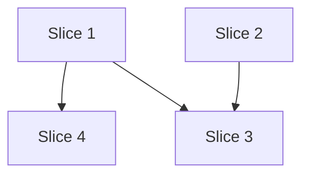

# Plan: /prototype project skill

**Created**: 2026-11-11
**Branch**: feat/prototype-skill
**Status**: implemented
**Gherkin persistence**: plan-file-only

## Goal

Add a `/prototype` project skill so you can iterate fast on a local-only `proto/<name>` branch,
view it on its own port, and then graduate the result into a handoff document and a GitHub issue
that `/dev-team:specs` consumes. Prototype code is reference only and never reaches GitHub. Source:
the approved design doc `docs/specs/prototype-skill/design.md`. No `/specs` artifacts exist; the
acceptance criteria below derive from the design doc.

Stance on high-reversal-cost axes: **integration** — open a PR to `main`, no direct-to-trunk;
**scope** — only the design doc's "In scope" list.

Out of scope (from the design doc): changes to the dev-team plugin, remote backup or sharing of
prototypes, automatic cleanup of `proto/*` branches, and any value stream feature.

## Acceptance Criteria

- [ ] AC1: A push that runs the pre-push hook is refused when its local ref or its remote ref is `refs/heads/proto/*`, except a delete. The refusal happens before tests run. The message names every such ref, says why, and points to `/prototype graduate`. Pushes that skip the hook (`--no-verify`) are out of scope for this criterion; AC13 covers them for Claude.
- [ ] AC2: A push with no `refs/heads/proto/*` ref (for example `prototype-notes`, `feat/proto/x`, or a tag) passes the guard silently with exit 0.
- [ ] AC3: `npm run dev:prototype` serves on port 3001 and exits non-zero if 3001 is taken. `npm run dev` stays on port 3000. `strictPort: true` already exists in `vite.config.js`.
- [ ] AC4: `/prototype start <name>` checks, before it changes anything: the name matches `^[a-z0-9]+(-[a-z0-9]+)*$`; `git status --porcelain` is empty; the Playwright MCP tools (`mcp__playwright__browser_navigate`, `mcp__playwright__browser_take_screenshot`) are available; and port 3001 is free. If port 3001 is taken, the skill shows the process command and offers to stop it, and does not report the prototype as running. On success it creates `proto/<name>` from local `main` (no fetch), starts `npm run dev:prototype` in the background, and reports `http://localhost:3001` only after `curl -sf` succeeds. An unknown subcommand prints the usage line and changes nothing.
- [ ] AC5: If `proto/<name>` already exists, start asks whether to resume it. Yes switches to it and restarts the server; no asks for another name.
- [ ] AC6: On a `proto/*` branch, the skill edits directly with no tests, plan, or review agents. A working step is a change that renders without console errors in a Playwright check. Each working step is committed with the subject `<what>: <why>`, and the body records any approach tried and abandoned. If a commit hook fails, the skill fixes the cause and commits again; it never uses `--no-verify`. On any other branch, the skill refuses to skip the process and points to `/prototype start`.
- [ ] AC7: `/prototype graduate` runs these checks before it changes anything: on `proto/<name>` (or on a `feat/<name>` that holds only a committed handoff, in which case it resumes at the push); clean tree; non-empty diff against `main`; `feat/<name>` absent or handoff-only (else it asks for another name); prototype server answering (else it starts it). A failed check stops graduate with no branch or file created.
- [ ] AC8: Graduate asks one question naming `ui-ux-designer`, `a11y-review`, and `exploratory-testing`, default yes; the reply can drop agents by name. A declined agent is recorded as "Not run". An agent that errors, times out, or returns nothing is recorded as "<agent>: Did not complete". No agent outcome blocks graduate. The interview is prefilled from the diff and commit messages, asks only about gaps, and sends "skip" or "unsure" answers to Open questions.
- [ ] AC9: Graduate creates `feat/<name>` from local `main`. `git diff --name-only main...feat/<name>` lists only `docs/prototypes/<name>.md` and `docs/prototypes/<name>/*.png`. The handoff has all nine template headings; a section with no content says "None" or points to Open questions. Each screenshot is referenced as `<name>/<file>.png` with a one-line text description. Graduate stops the server by port, but only when the process is Vite from this repo; otherwise it shows the process and asks.
- [ ] AC10: Before any push, graduate previews the handoff path, branch, issue title, and label. An edit at the preview amends the handoff commit. The issue title is `Prototype handoff: <name>`; an open issue with that exact title is reused, not duplicated. The `prototype` label is created if missing. Only `feat/<name>` is pushed. Screenshot links in the issue are blob URLs pinned to the commit SHA. On decline or a GitHub failure, the commit stays and the skill prints `/prototype graduate` (retry) and `/dev-team:specs docs/prototypes/<name>.md`. On success it prints `/dev-team:specs <issue-url>`. Every run ends by naming the current branch and reminding you that `proto/<name>` is kept for you to delete.
- [ ] AC11: `/dev-team:specs docs/prototypes/smoke.md` selects validate mode and produces Intent, Architecture, and Acceptance Criteria from the handoff without refusing it. If it refuses, the build stops and escalates, because plugin changes are out of scope.
- [ ] AC12: `README.md` and `.claude/CLAUDE.md` each contain `/prototype`, `dev:prototype`, `proto-push-guard`, and `claude-push-guard`. A grep confirms presence; `/code-review` reads the entries for accuracy.
- [ ] AC13: A Claude Code `PreToolUse` hook exits 2 with a reason on stderr for any Bash command with a plain `git push` segment that has a word starting with `--no-ver`, or a refspec with a `proto/` branch on either side (bare, `+`-prefixed, or `refs/heads/`-qualified), unless that refspec is a delete. A non-delete proto refspec in the same command still blocks. Any segment with an unquoted `HUSKY=0` word also blocks (added at build review). Every other command, and unusable hook input, exits 0 with no output. Non-goals (not blocked): `bash -c`, `$(...)`, `xargs`, `sudo`, `git -c core.hooksPath=...`, shell aliases, and quoted refs or flags.

## Slices

### Slice 1: Refuse pushes of prototype branches

**Depends-on:** none
**Files:** `scripts/proto-push-guard.js`, `scripts/proto-push-guard-cli.js`, `scripts/proto-push-guard.test.js`, `.husky/pre-push`, `vitest.config.js`, `stryker.config.mjs`

`scripts/` holds Node tooling, not app code, so it sits outside `src/`. The `proto/` prefix is
one exported constant, `PROTO_PREFIX`, in `scripts/proto-push-guard.js`.

**Behavior:**

```gherkin
Feature: Prototype branches stay local

  Scenario: Pushing a prototype branch is refused
    # Still passes if: the message wording changes
    Given a local branch named "proto/canvas-zoom"
    When I push that branch
    Then the guard exits with an error
    And the message names "proto/canvas-zoom" and points to "/prototype graduate"

  Scenario: Publishing a prototype under another name is refused
    # Still passes if: the remote name is not in the message
    Given a local branch named "proto/canvas-zoom"
    When I push it to the remote branch "main"
    Then the guard exits with an error and the message names "proto/canvas-zoom"

  Scenario: Pushing two prototype branches names both
    # Still passes if: the refs are named in a different order
    Given I push "feat/a", "proto/b", and "proto/c" in one command
    When the push runs
    Then the guard exits with an error and the message names "proto/b" and "proto/c"

  Scenario Outline: Non-prototype refs pass silently
    # Still passes if: the message wording changes
    Given I push the ref "<ref>"
    When the push runs
    Then the guard exits 0 and prints nothing

    Examples:
      | ref                    |
      | refs/heads/feat/canvas |
      | refs/heads/prototype-notes |
      | refs/heads/proto       |
      | refs/heads/feat/proto/x |
      | refs/tags/proto/v1     |

  Scenario: Deleting a remote prototype branch is allowed
    # Still passes if: the remote never had that branch
    Given a push that deletes "proto/old"
    When the push runs
    Then the guard exits 0 and prints nothing

  Scenario: Push with no refs
    # Still passes if: stdin ends with a trailing newline
    Given nothing to push
    When the push runs
    Then the guard exits 0 and prints nothing

  Scenario: The guard runs before the tests
    # Still passes if: the hook adds comments between the lines
    Given the pre-push hook
    Then the guard command comes before "npm test"
```

**Steps:**

#### Step 1.1: Find prototype refs in pre-push input

**Complexity**: standard
**IMPLEMENT**: `scripts/proto-push-guard.js` exports `PROTO_PREFIX = 'refs/heads/proto/'`,
`isProtoRef(ref)`, `findProtoRefs(input)`, and `refusalMessage(refs)`. `isProtoRef` accepts
short and full forms (`proto/x`, `refs/heads/proto/x`), tolerates a leading `+`, and is
shared with Slice 4. `findProtoRefs` parses lines of
`<local ref> <local sha> <remote ref> <remote sha>`, skips lines without four fields and deletes
(local sha all zeros), and returns each line's proto ref (local or remote) once, in input order.
No side effects.
**TEST**: Vitest table cases for every Slice 1 scenario except the hook-order one, including
`refs/heads/proto/a/b`, mixed refs, empty input, and a malformed line. Add `scripts/**/*.test.js`
to Vitest `include`. Add `scripts/**/*.js` to coverage `include` and Stryker `mutate`, excluding
`scripts/**/*.test.js` and `scripts/proto-push-guard-cli.js`, mirroring `main.jsx`.
**REFACTOR**: Keep parsing and message building as separate pure functions.
**Files**: `scripts/proto-push-guard.js`, `scripts/proto-push-guard.test.js`, `vitest.config.js`, `stryker.config.mjs`
**Covers**: AC1, AC2
**Commit**: `feat: add proto branch push guard`

#### Step 1.2: Wire the CLI into the pre-push hook

**Complexity**: standard
**IMPLEMENT**: `scripts/proto-push-guard-cli.js` reads stdin, calls `findProtoRefs`, prints
`refusalMessage` to stderr, and exits 1 when refs are found. `.husky/pre-push` runs
`node scripts/proto-push-guard-cli.js` as its first command, before `npm test`.
**TEST**: Vitest spawns the CLI with stdin for one proto ref (exit 1, ref on stderr) and empty
stdin (exit 0, no output). Vitest reads `.husky/pre-push` and asserts the guard line comes before
`npm test`. Manual: push a throwaway `proto/x` to a bare temp remote and confirm the push is
refused before tests start.
**REFACTOR**: Keep the CLI under ten lines.
**Files**: `scripts/proto-push-guard-cli.js`, `scripts/proto-push-guard.test.js`, `.husky/pre-push`
**Covers**: AC1
**Commit**: `chore: refuse proto branch pushes in pre-push`

### Slice 2: Prototype dev server on its own port

**Depends-on:** none
**Files:** `package.json`

**Behavior:**

```gherkin
Feature: Prototype dev server

  Scenario: Prototype server uses its own port
    # Still passes if: the server also logs a network URL
    When I run the prototype dev server
    Then the app answers on port 3001

  Scenario: Port 3001 is taken
    # Still passes if: the error text changes wording
    Given port 3001 is in use
    When I run the prototype dev server
    Then it exits non-zero and nothing new listens on another port

  Scenario: Default dev server stays on 3000
    # Still passes if: the prototype server is also running
    When I run the default dev server
    Then the app answers on port 3000 and not on port 3001
```

**Steps:**

#### Step 2.1: Add the dev:prototype script

**Complexity**: trivial
**IMPLEMENT**: Add `"dev:prototype": "vite --port 3001"` to `package.json`. `strictPort` comes from
`vite.config.js`.
**TEST**: Manual. Pass: `curl -sf localhost:3001` succeeds; a second `npm run dev:prototype` exits
non-zero; `npm run dev` answers on 3000 and nothing extra listens on 3001.
**REFACTOR**: None.
**Files**: `package.json`
**Covers**: AC3
**Commit**: `chore: add dev:prototype script on port 3001`

### Slice 3: The /prototype skill and docs

**Depends-on:** 1, 2
**Files:** `.claude/skills/prototype/SKILL.md`, `.claude/skills/prototype/references/graduate.md`, `.claude/skills/prototype/references/handoff-template.md`, `README.md`, `.claude/CLAUDE.md`

`SKILL.md` holds the rules, `start`, iterate, and a router. `references/graduate.md` holds the
graduate procedure. `references/handoff-template.md` holds the handoff. The skill stops the server
by port (`lsof -ti tcp:3001`), so it works across sessions. Only the `/pr` and dev-team quality
gates are skipped on `proto/*`; the Husky commit hooks still run.

**Behavior:**

```gherkin
Feature: Prototype skill

  Scenario: Start a prototype
    # Still passes if: the server prints extra log lines
    Given I am on "main" with a clean tree and port 3001 is free
    When I run "/prototype start canvas-zoom"
    Then I am on a new local branch "proto/canvas-zoom" created from "main"
    And the skill reports "http://localhost:3001" after it answers

  Scenario Outline: Start refuses before changing anything
    # Still passes if: the message wording changes
    Given <condition>
    When I run "/prototype start <name>"
    Then the skill stops with a message about <reason>
    And no branch is created and no server is started

    Examples:
      | condition                         | name         | reason                    |
      | I have uncommitted changes        | canvas-zoom  | committing or stashing    |
      | a clean tree                      | Canvas Zoom  | kebab-case names          |
      | the Playwright MCP tools are absent | canvas-zoom | installing Playwright MCP |

  Scenario: Unknown subcommand
    # Still passes if: the usage text lists extra examples
    When I run "/prototype frobnicate"
    Then the skill prints the usage line and changes nothing

  Scenario: Start while not on main
    # Still passes if: the skill also fetches origin first
    Given I am on "feat/other" with a clean tree
    When I run "/prototype start canvas-zoom"
    Then "proto/canvas-zoom" is created from "main", not from "feat/other"

  Scenario: Start when port 3001 is taken
    # Still passes if: the skill names the process id
    Given another server is listening on port 3001
    When I run "/prototype start canvas-zoom"
    Then the skill says port 3001 is taken and offers to stop that server
    And it does not report the prototype as running

  Scenario: Start with a name that already exists
    # Still passes if: the skill lists the last commit on that branch
    Given a branch "proto/canvas-zoom" exists
    When I run "/prototype start canvas-zoom"
    Then the skill asks whether to resume that branch
    And on yes it switches to it and restarts the prototype server
    And on no it asks for another name

  Scenario: Iterate on a prototype branch
    # Still passes if: commits still go through lint-staged
    Given I am on "proto/canvas-zoom"
    When I ask for a UI change
    Then the skill edits code with no tests, plan, or review agents
    And it checks the result with a Playwright screenshot
    And it commits the working step with a message that says what changed and why

  Scenario: Full process on other branches
    # Still passes if: the skill mentions /prototype
    Given I am on "feat/canvas-zoom"
    When I ask "/prototype" to iterate
    Then the skill refuses to skip tests or review and points to "/prototype start"

  Scenario: Graduate with agents and an issue
    # Still passes if: the screenshots are PNG or JPEG
    Given I am on "proto/canvas-zoom" with a clean tree, a diff against "main", and the server running
    When I run "/prototype graduate", accept the agents, and accept the push
    Then "feat/canvas-zoom" differs from "main" only under "docs/prototypes/"
    And the handoff has every template section, with screenshots referenced by relative path
    And "UX and a11y notes" holds the agent findings
    And a preview of the handoff path, branch, issue title, and label is shown before the push
    And only "feat/canvas-zoom" is pushed
    And one issue labelled "prototype" holds the handoff with SHA-pinned screenshot URLs
    And the server is stopped
    And the skill prints "/dev-team:specs <issue-url>"

  Scenario Outline: Graduate refuses before changing anything
    # Still passes if: the message wording changes
    Given <condition>
    When I run "/prototype graduate"
    Then the skill stops with a message about <reason>
    And no branch or file is created

    Examples:
      | condition                                   | reason                        |
      | I am on "main"                              | running on a proto/* branch    |
      | "proto/canvas-zoom" has uncommitted changes | committing or discarding first |
      | "proto/canvas-zoom" has no diff against main | nothing to graduate            |

  Scenario: Graduate when feat/canvas-zoom exists
    # Still passes if: the skill shows the branch's last commit
    Given a branch "feat/canvas-zoom" exists
    When I run "/prototype graduate"
    Then the skill asks whether to reuse it, only if it holds just the handoff, or to pick another name

  Scenario: Graduate restarts a stopped server
    # Still passes if: the restart takes longer than usual
    Given the prototype server is not running
    When I run "/prototype graduate"
    Then the skill starts it before screenshots and agents run

  Scenario: Graduate and decline the agents
    # Still passes if: the skill asks a second time
    When I run "/prototype graduate" and decline the agents
    Then "UX and a11y notes" says "Not run" and graduate continues

  Scenario: An advisory agent fails
    # Still passes if: the other agents report no findings
    Given "a11y-review" returns an error
    When I accept the agents
    Then "UX and a11y notes" says "a11y-review: Did not complete" and graduate continues

  Scenario: Graduate and decline the push
    # Still passes if: the preview lists the files in another order
    When I run "/prototype graduate" and decline the push
    Then the handoff is committed on local "feat/canvas-zoom" and nothing is pushed
    And the server is stopped
    And the skill prints "/dev-team:specs docs/prototypes/canvas-zoom.md"

  Scenario: The prototype label does not exist
    # Still passes if: the label colour changes
    Given the repo has no "prototype" label
    When I accept the push
    Then the label is created and the issue carries it

  Scenario: GitHub fails after the commit
    # Still passes if: the error text changes
    Given "gh" is unauthenticated
    When I accept the push
    Then no issue exists and the handoff stays committed on "feat/canvas-zoom"
    And the skill prints the retry command and "/dev-team:specs docs/prototypes/canvas-zoom.md"

  Scenario: An open issue with the same title exists
    # Still passes if: the skill prints the issue number
    Given an open issue titled for "canvas-zoom" exists
    When I accept the push
    Then no second issue is created and the skill prints the existing issue URL

  Scenario: Rerunning graduate after a partial failure
    # Still passes if: the skill reprints the preview
    Given a previous graduate committed the handoff on "feat/canvas-zoom" but opened no issue
    And I am on "feat/canvas-zoom"
    When I run "/prototype graduate" again
    Then the skill reuses the commit and opens one issue, with no duplicate branch or issue
```

**Steps:**

#### Step 3.1: Write the skill rules, start, and iterate

**Complexity**: standard
**IMPLEMENT**: `.claude/skills/prototype/SKILL.md`: frontmatter; a usage line for bad or missing
subcommands; the gate-skip rule (only on `proto/*`; Husky hooks still run); `start` with preflight
(kebab-case name, clean tree, Playwright MCP tools present, port 3001 free or offer to stop),
create from `main`, resume-or-rename on an existing branch, background `npm run dev:prototype`,
and a verified URL; iterate with direct edits, Playwright screenshot checks, and what-and-why
commit messages that also record abandoned approaches.
**TEST**: Dry-run checklist rows for every start and iterate scenario (see Dry-run checklist).
**REFACTOR**: Cut wording to the documentation style rules.
**Files**: `.claude/skills/prototype/SKILL.md`
**Covers**: AC4, AC5, AC6
**Commit**: `feat: add /prototype skill start and iterate`

#### Step 3.2: Write the handoff template

**Complexity**: standard
**IMPLEMENT**: `references/handoff-template.md`: Goal, Behavior, Flow, UI (screenshot relative path
plus a text description each), UX and a11y notes ("Not run" and "Did not complete" forms), Decisions
(with rejected options), Data shape, Open questions ("unsure" and skipped answers land here), and
Reference (branch, SHA, reference-only warning, "this file is the source; the issue is a copy").
**TEST**: Dry-run row: a generated handoff has all nine section headings.
**REFACTOR**: One fenced template block the skill fills in.
**Files**: `.claude/skills/prototype/references/handoff-template.md`
**Covers**: AC9
**Commit**: `feat: add /prototype handoff template`

#### Step 3.3: Write graduate up to the local commit

**Complexity**: standard
**IMPLEMENT**: `references/graduate.md` part 1. Graduate's numbered step list is defined once in
`graduate.md` and the progress line ("step n of N") uses it. Graduate runs from `proto/<name>`,
or from a `feat/<name>` that holds only a committed handoff, in which case it resumes at the push.
Stopping a server on port 3001 first checks that the process is Vite from this repo; otherwise
the skill shows the process command and asks before stopping it. Steps: preflight
(proto branch, clean tree, non-empty diff, `feat/<name>` free or reusable, server up or restart);
one agent prompt (default yes, per-agent opt-out); an interview prefilled from the diff and commit
messages that asks only about gaps and accepts "skip"; screenshots saved to the gitignored `.playwright-mcp/`;
`git switch -c feat/<name> main`; copy screenshots and write the handoff under
`docs/prototypes/`; commit; stop the server by port.
**TEST**: Dry-run rows for every graduate preflight, agent, and decline-push scenario; check
`git diff --name-only main...feat/smoke` lists only `docs/prototypes/` files.
**REFACTOR**: Keep each graduate step to one short paragraph.
**Files**: `.claude/skills/prototype/references/graduate.md`, `.claude/skills/prototype/SKILL.md`
**Covers**: AC7, AC8, AC9
**Commit**: `feat: add /prototype graduate handoff`

#### Step 3.4: Write graduate push and issue

**Complexity**: standard
**IMPLEMENT**: `references/graduate.md` part 2: preview (handoff path, branch, issue title, label)
with a chance to edit (an edit amends the handoff commit); on confirm, check `gh auth status`, create the `prototype` label if missing,
push `feat/<name>` only, find an open issue with the same title or create one, and use blob URLs
pinned to the commit SHA for screenshots. On failure, keep the commit and print two commands:
`/prototype graduate` (run from `feat/<name>` to retry) and the local-file `/dev-team:specs`
command. End with the next command, the current branch, and a reminder that
`proto/<name>` is kept for you to delete.
**TEST**: Dry-run rows for the label, GitHub-failure, rerun, and accept paths. Run the accept path
once on this repo with your approval at build time, then close the test issue and delete
`feat/smoke` on the remote. Feed the produced handoff to `/dev-team:specs` and confirm it
validates.
**REFACTOR**: Remove any step that repeats part 1.
**Files**: `.claude/skills/prototype/references/graduate.md`
**Covers**: AC10, AC11
**Commit**: `feat: add /prototype graduate push and issue`

#### Step 3.5: Document the skill

**Complexity**: trivial
**IMPLEMENT**: Add `/prototype`, `npm run dev:prototype`, and the two push guards to `README.md`
and `.claude/CLAUDE.md`. In `.claude/CLAUDE.md` Conventions, add that `scripts/` holds Node tooling (pure module
plus thin `*-cli.js` wrapper, colocated `scripts/**/*.test.js`, CLIs excluded from coverage and
mutation, no imports from `src/`), and add `scripts/**/*.test.js` to the unit tests line.
**TEST**: `grep -l` lists both `README.md` and `.claude/CLAUDE.md` for each of `dev:prototype`,
`/prototype`, `proto-push-guard`, and `claude-push-guard`; `npm run format:check` passes.
**REFACTOR**: None.
**Files**: `README.md`, `.claude/CLAUDE.md`
**Covers**: AC12
**Commit**: `docs: document /prototype`

### Slice 4: Stop Claude from bypassing the push guard

**Depends-on:** 1
**Files:** `scripts/claude-push-guard.js`, `scripts/claude-push-guard-cli.js`, `scripts/claude-push-guard.test.js`, `.claude/settings.json`

The hook is appended as a new `PreToolUse` entry with matcher `Bash`; the graphify entries and
other settings keys are preserved. It reads Claude Code's hook JSON from stdin, checks
`tool_input.command`, and exits 2 with a reason on stderr to block. It reuses `isProtoRef` from
Slice 1. It is deliberately conservative: it checks plain `git push` segments only and accepts the
evasions listed in Risks. It stops Claude only; a push you type yourself still meets the git hook.

A refspec side is normalized by stripping a leading `+` and `refs/heads/`, then matched against
`proto/`. Tags and `feat/proto/x` do not match. A delete (`--delete`, `-d`, or `:proto/x`) is
allowed. `--no-verify` matches any word starting with `--no-ver`, because git accepts abbreviated
long options.

**Behavior:**

```gherkin
Feature: Claude cannot bypass the push guard

  Scenario Outline: Blocked push commands
    # Still passes if: the reason adds a hint to use /prototype graduate
    When Claude runs the Bash command "<command>"
    Then the hook exits 2 and stderr contains "<reason>"

    Examples:
      | command                                   | reason      |
      | git push --no-verify                      | --no-verify |
      | git push origin feat/a --no-verif         | --no-verify |
      | npm test && git push --no-verify origin x | --no-verify |
      | git status; git push --no-verify          | --no-verify |
      | FOO=1 git push --no-verify                | --no-verify |
      | git push origin proto/canvas-zoom         | proto/      |
      | git push origin proto/canvas-zoom:main    | proto/      |
      | git push origin feat/a:proto/b            | proto/      |
      | git push origin +proto/x                  | proto/      |
      | git push origin HEAD:refs/heads/proto/x   | proto/      |
      | git -C ../repo push origin proto/x        | proto/      |
      | git push origin :proto/old proto/new | proto/new |

  Scenario Outline: Allowed commands
    # Still passes if: the command has extra whitespace
    When Claude runs the Bash command "<command>"
    Then the hook exits 0 and prints nothing

    Examples:
      | command                                        |
      | git push origin feat/canvas-zoom               |
      | git push origin feat/proto/x                   |
      | git push origin refs/tags/proto/v1             |
      | git push origin prototype-notes                |
      | git push --delete origin proto/old             |
      | git push -d origin proto/old                   |
      | git push origin :proto/old                     |
      | git commit --no-verify -m wip                  |
      | echo "a && git push --no-verify"               |
      | git commit -m "fix; git push --no-verify docs" |
      | git log --grep="git push --no-verify"          |
      | ls proto/                                      |

  Scenario: A heredoc body mentions a bypass
    # Still passes if: the heredoc delimiter is not EOF
    When Claude runs a "git commit -F-" command whose heredoc body contains "git push --no-verify"
    Then the hook exits 0 and prints nothing

  Scenario Outline: Unusable hook input fails open
    # Still passes if: the payload has extra fields
    Given the hook input is <input>
    Then the hook exits 0 and prints nothing

    Examples:
      | input             |
      | {}                |
      | {"tool_input":{}} |
      | not json          |

  Scenario: The hook is registered for Bash
    # Still passes if: settings.json gains other hooks
    Given ".claude/settings.json"
    Then it has a PreToolUse entry with matcher "Bash" that runs "scripts/claude-push-guard-cli.js"
    And the graphify PreToolUse entries are unchanged
```

**Steps:**

#### Step 4.1: Classify push commands

**Complexity**: complex
**IMPLEMENT**: `scripts/claude-push-guard.js` exports `blockReason(command)`. It removes quoted
strings and heredoc bodies; splits on `&&`, `||`, `;`, `|`, and newlines; keeps segments whose
words are optional `VAR=value` assignments, `git`, optional `-C <dir>` or `-c <cfg>` pairs, then
`push`; and returns a reason for a `--no-ver*` word or a non-delete refspec with a side that passes
`isProtoRef`, else `null`. No side effects.
**TEST**: Vitest table cases for every Slice 4 example row and the heredoc scenario.
**REFACTOR**: Keep stripping, splitting, and rule checks as separate functions.
**Files**: `scripts/claude-push-guard.js`, `scripts/claude-push-guard.test.js`
**Covers**: AC13
**Commit**: `feat: classify push commands that bypass the proto guard`

#### Step 4.2: Register the PreToolUse hook

**Complexity**: standard
**IMPLEMENT**: `scripts/claude-push-guard-cli.js` reads the hook JSON, calls `blockReason`, prints
the reason to stderr and exits 2 when blocked, else exits 0; invalid JSON exits 0. Append a
`PreToolUse` entry with matcher `Bash` to `.claude/settings.json` running
`node "$CLAUDE_PROJECT_DIR/scripts/claude-push-guard-cli.js"`. Exclude the CLI from coverage and
Stryker, as in Slice 1.
**TEST**: Vitest spawns the CLI with a blocked payload (exit 2, stderr has the reason), an allowed
payload, and each unusable input (exit 0, no output). Vitest parses `.claude/settings.json` and
asserts the Bash entry, the CLI path, and that the graphify entries are present. Manual, after a
session restart: ask Claude to run a dry-run push with `--no-verify` against a bare temp remote and
confirm the hook blocks it.
**REFACTOR**: Keep the CLI under ten lines.
**Files**: `scripts/claude-push-guard-cli.js`, `scripts/claude-push-guard.test.js`, `.claude/settings.json`
**Covers**: AC13
**Commit**: `chore: block Claude push-guard bypass in PreToolUse`

### Dry-run checklist (Slice 3)

`/build` fills in one row per Slice 3 scenario, with the prompt used, the observed result, and
pass or fail. Every row must pass. Test branches (`proto/smoke`, `feat/smoke`) are deleted after.

Clone: scratchpad/dry (main reset to feat/prototype-skill 6d0d50d). GitHub: bailejl/ai-enabler (public).

| #   | Scenario                                     | Prompt or action                               | Observed                                                                                                                                                           | Result                         |
| --- | -------------------------------------------- | ---------------------------------------------- | ------------------------------------------------------------------------------------------------------------------------------------------------------------------ | ------------------------------ |
| 1   | Start a prototype                            | start smoke on main, clean tree, 3001 free     | `proto/smoke` created from main (merge-base = main 6d0d50d); `dev:prototype` in background; curl answered in 1 s; URL reported after                               | PASS                           |
| 2   | Start refuses: uncommitted changes           | untracked junk.txt, start smoke                | check 2 porcelain non-empty -> ask commit/stash; no branch                                                                                                         | PASS                           |
| 3   | Start refuses: bad name                      | start "Canvas Zoom"                            | regex no match -> ask kebab-case; no branch                                                                                                                        | PASS                           |
| 4   | Start refuses: Playwright MCP absent         | not runnable (tools present in session)        | text check only: check 3 names both tools and stops                                                                                                                | PASS (text only)               |
| 5   | Unknown subcommand                           | /prototype frobnicate                          | text: prints usage, changes nothing                                                                                                                                | PASS (text only)               |
| 6   | Start while not on main                      | on feat/other (1 extra commit), start smoke    | proto/smoke base 6d0d50d = main, not feat/other 1a50248                                                                                                            | PASS                           |
| 7a  | Port 3001 taken (run 1)                      | python http.server 3001; answer no             | LISTEN pid + `ps` command shown; stop; no branch, no URL                                                                                                           | PASS                           |
| 7b  | Port 3001 taken (run 2)                      | same; answer yes                               | kill pid, re-check -> free, continue                                                                                                                               | PASS                           |
| 8   | Start with existing name                     | on main, start smoke; yes / no                 | check 4 found our Vite and offered stop; resume asked; yes -> switch proto/smoke; no -> new name smoke2 passes check 1                                             | PASS                           |
| 9   | Iterate on proto branch                      | dotted background change                       | edited App.jsx, Playwright navigate + screenshot + console; committed `canvas dots background: make the grid easier to read` with dropped-approach body; hooks ran | PASS (see defects 1, 2)        |
| 10  | Full process on other branches               | ask to iterate on feat/other                   | text: refuses, points to /prototype start                                                                                                                          | PASS (text only)               |
| 11  | Graduate refuses: on main                    | graduate on main                               | Entry: "run on a proto/* branch"                                                                                                                                   | PASS                           |
| 12  | Graduate refuses: dirty                      | junk.txt on proto/smoke                        | clean-tree check fails; nothing created                                                                                                                            | PASS                           |
| 13  | Graduate refuses: no diff                    | proto/empty from main                          | `git diff main...HEAD` empty -> nothing to graduate                                                                                                                | PASS                           |
| 14  | feat/<name> exists (not handoff-only)        | proto/zoom with feat/zoom holding a src commit | handoff-only check fails -> ask another feat_name                                                                                                                  | PASS                           |
| 15  | Graduate restarts stopped server             | G1 with nothing on 3001                        | preflight 4 started dev:prototype, curl ok in 1 s                                                                                                                  | PASS                           |
| 16  | Graduate with agents (G1)                    | accept all three                               | ui-ux-designer and a11y-review returned findings -> UX and a11y notes; exploratory-testing returned only its "provide a charter" line                              | PASS for routing; see defect 3 |
| 17  | Advisory agent fails                         | exploratory-testing (real failure, no charter) | recorded "exploratory-testing: Did not complete"; graduate continued                                                                                               | PASS                           |
| 18  | Decline the agents                           | text check of step 2                           | "Not run" form in template                                                                                                                                         | PASS (text only)               |
| 19  | Interview / Open questions                   | answered "unsure" and later "skip"             | both landed in Open questions                                                                                                                                      | PASS                           |
| 20  | Handoff only under docs/prototypes           | `git diff --name-only main...feat/smoke`       | `docs/prototypes/smoke.md`, `docs/prototypes/smoke/canvas-dots.png` only (SKIP_REPOWISE worked)                                                                    | PASS                           |
| 21  | Decline the push (G1)                        | preview -> decline                             | commit kept locally; server stopped (Vite + cwd matched, killed); printed retry + `/dev-team:specs docs/prototypes/smoke.md`, branch, keep-proto reminder          | PASS                           |
| 22a | GitHub fails (run 1)                         | GH_TOKEN=invalid, from feat/smoke              | entry handoff-only pass; `gh auth status` rc=1 -> step 9; commit kept; no remote branch                                                                            | PASS                           |
| 22b | GitHub fails (run 2)                         | empty GH_CONFIG_DIR                            | same; rc=1; nothing pushed                                                                                                                                         | PASS                           |
| 23  | Preview edit before push                     | edit Flow line                                 | no @{u} -> `SKIP_REPOWISE=1 git commit --amend --no-edit`; still handoff-only                                                                                      | PASS                           |
| 24  | Label missing                                | accept with no `prototype` label               | label created (5319e7), issue carries it                                                                                                                           | PASS (see defect 4)            |
| 25a | Rerun after partial failure + accept (run 1) | G4 from feat/smoke                             | pushed feat/smoke only; created issue #6 with SHA-pinned image URL (HTTP 200 image/png); printed `/dev-team:specs <url>`                                           | PASS                           |
| 26  | Preview edit after push                      | G5 edit Open questions                         | @{u} resolves -> new commit `docs: update smoke prototype handoff`; push fast-forward                                                                              | PASS                           |
| 27a | Existing open issue (run 1)                  | G5 accept                                      | found #6 by exact title; `gh issue edit` body; no new issue                                                                                                        | PASS                           |
| 27b | Existing open issue (run 2)                  | repeat                                         | same #6; 1 issue with that title                                                                                                                                   | PASS                           |
| 25b | Rerun after partial failure (run 2)          | closed #6, rerun from feat/smoke               | no open issue -> created #7 once                                                                                                                                   | PASS (see defect 5)            |
| 28  | Accept path (run 2)                          | G5                                             | push + reuse path worked end to end                                                                                                                                | PASS                           |
| 29  | AC11: /dev-team:specs on handoff             | `/dev-team:specs docs/prototypes/smoke.md`     | validate mode selected; Intent, Architecture, AC produced with citations; 2 open questions -> stakeholder input; stopped before persisting; no refusal             | PASS                           |

## Defects found

1. SKILL.md:52-53 and graduate.md step 4: the Playwright MCP may only write under the repo root
   (`.playwright-mcp/`), not the session scratchpad. It also creates `.playwright-mcp/` (untracked,
   not gitignored) in the repo, which breaks the clean-tree checks in graduate. Fix: gitignore
   `.playwright-mcp/` and save screenshots there, then copy.
2. SKILL.md:54: "no console errors" fails on the app's pre-existing `favicon.ico` 404, so every
   iterate step is blocked. Fix: add a favicon, or ignore resource-load 404s that are not from app
   code.
3. graduate.md step 2: `dev-team:exploratory-testing` needs `--charter '<goal>'`. Without it, it
   stops with "What should I investigate?" and always records "Did not complete". It also writes
   its report to `.dev-team-reports/` in the repo, which dirties the tree. Fix: pass a charter and a small
   `--probe-budget`, and gitignore or relocate its report.
4. graduate.md step 8.5: `gh label list --search` lagged right after label create (empty output
   for a few seconds). A quick rerun would then run `gh label create` on an existing label and
   fail. Fix: check with `gh api repos/<owner>/<repo>/labels/prototype`, or use
   `gh label create --force`.
5. graduate.md step 8.7: `gh issue list --search` lagged right after `gh issue create` (0
   results). A quick rerun could duplicate the issue. Fix: use the list API without `--search`
   (`gh issue list --state open --limit 200 --json number,title,url`) and filter by exact title.
6. handoff-template.md: uses `<name>` throughout while graduate.md uses `proto_name` and
   `feat_name`. Fix: Branch line -> `proto/<proto_name>`; title, image path -> `<feat_name>`.

## GitHub cleanup

- Issues created: https://github.com/bailejl/ai-enabler/issues/6, https://github.com/bailejl/ai-enabler/issues/7. Both closed with "dry-run test".
- Remote `feat/smoke` deleted; `git ls-remote` shows no `feat/smoke` or `proto/*` refs.
- `prototype` label was created in this run and deleted afterwards.
- Ports 3000 and 3001 free. The `.playwright-mcp/` directory this run created in the main repo was removed; the main repo tree is clean.

Six skill-text defects found here were fixed in 0a43714 (screenshot dir, favicon 404, exploratory-testing charter, label `--force`, issue lookup without `--search`, template names). Test issues #6 and #7 closed; remote `feat/smoke` and the test label deleted.

## Parallelization



| Wave | Slices (parallel) |
| ---- | ----------------- |
| 1    | 1, 2              |
| 2    | 3, 4              |

Slice 1 must not edit `package.json`; that file belongs to Slice 2.

## Complexity Classification

Per-step ratings above. Slice 3 is prompt text, so its checks are scenario-mapped dry runs.

## Pre-PR Quality Gate

- [x] All tests pass
- [x] Linter passes
- [x] `/code-review` passes
- [x] Documentation updated
- [x] Dry-run checklist all pass
- AC1 run: `printf 'refs/heads/proto/x 1111111111111111111111111111111111111111 refs/heads/proto/x 0000000000000000000000000000000000000000\n' | node scripts/proto-push-guard-cli.js; echo "exit=$?"`
- AC2 run: `printf 'refs/heads/prototype-notes 1111111111111111111111111111111111111111 refs/heads/feat/proto/x 0000000000000000000000000000000000000000\n' | node scripts/proto-push-guard-cli.js; echo "exit=$?"`
- AC3 run: `npm run dev:prototype > /dev/null 2>&1 & sleep 5; curl -sf -o /dev/null http://localhost:3001 && echo 'first: up on 3001'; npm run dev:prototype > /dev/null 2>&1; echo "second exit=$?"; grep -n strictPort vite.config.js; lsof -ti tcp:3001 -sTCP:LISTEN | xargs kill`
- AC12 run: `for t in dev:prototype /prototype proto-push-guard claude-push-guard; do echo "[$t]"; grep -l -- "$t" README.md .claude/CLAUDE.md; done`
- AC13 run: `printf '{"tool_input":{"command":"git push --no-verify"}}' | node scripts/claude-push-guard-cli.js; echo "blocked exit=$?"; printf '{"tool_input":{"command":"git status"}}' | node scripts/claude-push-guard-cli.js; echo "allowed exit=$?"; printf 'not json' | node scripts/claude-push-guard-cli.js; echo "bad-input exit=$?"`
- Unit tests run: `npm test`

## Skipped (low value)

| Finding                                    | Rationale (one line)                                                      |
| ------------------------------------------ | ------------------------------------------------------------------------- |
| Automated test of the `dev:prototype` port | One CLI flag on Vite; a manual check with pass signals covers it          |
| Automated test of the skill prose          | Prompt text has no executable behavior; scenario-mapped dry runs cover it |

## Risks & Open Questions

- No `/specs` artifacts; acceptance criteria derive from the approved design doc (user chose this).
- Slice 3 behavior depends on Claude following the skill text; dry runs are the only check.
- The Playwright MCP tools come from your user-level Claude config, not this repo. `start` checks
  for them and stops with an install hint if they are absent.
- `git push --no-verify` bypasses the git hook for pushes you type; Slice 4 blocks it for Claude.
  `git -c core.hooksPath=...`, shell aliases, `bash -c`, `$(...)`, `xargs`, and `sudo` can still
  evade Slice 4, as can a quoted ref or flag (`"proto/x"`), `git push --all`, `--mirror`, or `git push origin HEAD`
  while on a proto branch (the git pre-push hook still refuses those), and unusable hook input fails
  open. Accepted: it stops accidents, not intent.
- Once Slice 4 is live, Claude cannot run the Step 1.2 manual push of `proto/x`. Build Step 1.2
  before Slice 4, or you run that check yourself.
- The Step 3.4 accept-path dry run creates a real branch and issue on GitHub. `/build` asks you
  first, then cleans up.
- Both guards check ref names, not commits. `git push origin HEAD:feat/x` or `<sha>:feat/x` from a
  proto branch may publish prototype commits under another name. Accepted, same class as the
  evasions above.
- A `HUSKY=0` with a redirect glued on (`HUSKY=0>/dev/null git push ...`), `env`/`command`/`time`
  options before git (`env -i git push`), or `HUSKY=0` set in an earlier Bash call can still pass
  the Claude guard. Accepted after the round-4 review cap.

### Deviations recorded at build

- `.gitignore`: `/plans/` removed and `"worktree": {"baseRef": "head"}` added to
  `.claude/settings.json` (both approved by you before the build).
- `.husky/pre-commit`: `SKIP_REPOWISE=1` skips the Repowise refresh, so graduate's handoff commit
  holds only `docs/prototypes/` files (AC9). `.gitignore` gains `.playwright-mcp/` for screenshots.
- AC6: the iterate console check ignores a 404 for `/favicon.ico` (the app has no favicon).
- AC10: once `feat/<name>` is pushed, an edit at the preview makes a new commit instead of
  amending, to avoid a force-push.
- Step 4.2: `readHookBlockReason` lives in `scripts/claude-push-guard.js` to keep the CLI under ten
  lines.
- AC13 widened at the backstop security review: any unquoted `HUSKY=0` word also blocks,
  because it skips the git pre-push guard too. Conservative: `HUSKY=0 npm test` and
  `echo HUSKY=0` block as well. A leading redirect (`2>/dev/null git push ...`) no longer hides a
  push.
- AC9 and the Step 3.3 test use the three-dot `main...feat/<name>` (merge-base diff), matching
  `graduate.md`.
- Graduate prints only `/dev-team:specs <issue-url>`; the design doc's `/dev-team:ship`
  alternative was dropped to match AC10.

### Manual checks run at build

- Step 1.2: piping a `refs/heads/proto/x` pre-push line into the CLI exits 1 with the refusal; a
  `feat/x` line exits 0 (logged in `metrics/verify-log.jsonl`).
- Step 2.1: `npm run dev:prototype` answered on 3001; a second instance failed with "Port 3001 is
  already in use"; `npm run dev` stayed on 3000.
- Step 4.2: after restart, Claude Code's PreToolUse hook blocked a `--no-verify --dry-run` push to a
  bare temp remote before it ran.
- Step 3.5: `grep -l` listed both files for all four terms; `format:check` passed.
- Dry-run rows 4, 5, 10 and 18 were checked against the skill text, not executed.

## Plan Review Summary

Plan tier: complex (2 waves) — reviewers: Acceptance, Design, UX, Strategic, Parallelization.

Round 1: Acceptance, Design, and UX returned needs-revision; Strategic and Parallelization approved.
Round 2: all approve. Resolved in revision:

- **Resolved blocker**: Slice 1 - guard matched only the remote ref (`proto/x:main` bypass).
- **Resolved blocker**: Slice 3 - no graduate preflight, failure recovery, or idempotent rerun.
- **Resolved blocker**: Slice 3 - start did not handle port 3001 being taken.
- **Resolved blocker**: Slice 4 - AC11 contradicted its delete example; short ref forms did not match `PROTO_PREFIX`.
- **Resolved blocker**: Slice 4 - missing remote-side, force, qualified, delete, separator, and unusable-input cases.
- **Resolved blocker**: Slice 3 - no iterate, gate-skip, agent decline/failure, label, or gh failure scenarios.

Remaining warnings, accepted:

- `proto/` appears as prose in the skill files; prompt text cannot import `PROTO_PREFIX`. A comment in the guard points to the skill.
- The hook-order test reads `.husky/pre-push` as text.
- Dry runs of prompt text prove one run only; high-risk rows (graduate refusals, gh failure) run twice.
- Slice 1 is heavier than a five-line shell check; kept to follow the repo's tested-functions convention.

## Build Progress

### Slices (grouped by wave)

#### Wave 1

- [x] Slice 1: Refuse pushes of prototype branches
  - [x] Step 1.1: Find prototype refs in pre-push input
  - [x] Step 1.2: Wire the CLI into the pre-push hook
- [x] Slice 2: Prototype dev server on its own port
  - [x] Step 2.1: Add the dev:prototype script

#### Wave 2

- [x] Slice 4: Stop Claude from bypassing the push guard
  - [x] Step 4.1: Classify push commands
  - [x] Step 4.2: Register the PreToolUse hook

- [x] Slice 3: The /prototype skill and docs
  - [x] Step 3.1: Write the skill rules, start, and iterate
  - [x] Step 3.2: Write the handoff template
  - [x] Step 3.3: Write graduate up to the local commit
  - [x] Step 3.4: Write graduate push and issue
  - [x] Step 3.5: Document the skill
