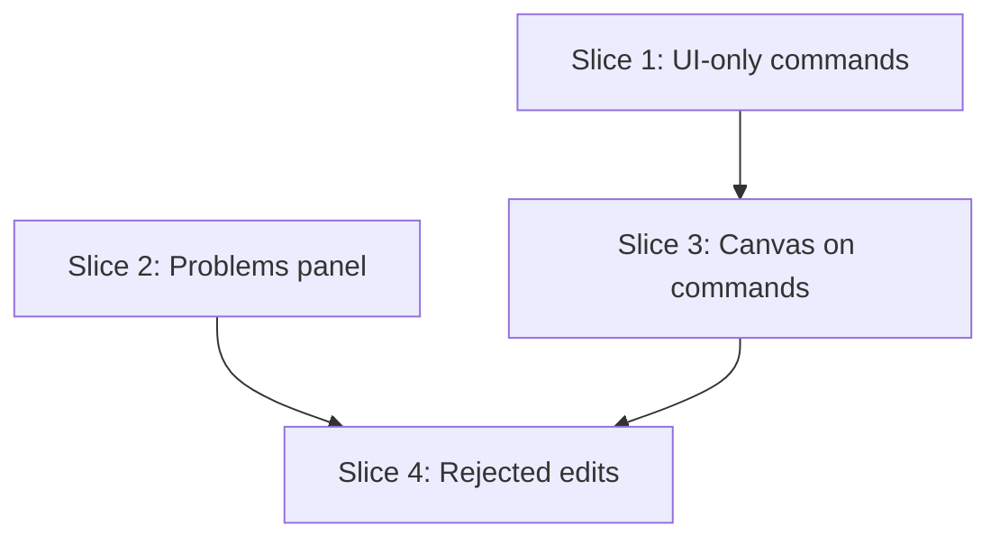

# Plan: R4 UI on commands

**Created**: 2026-11-22
**Branch**: feat/ui-on-commands
**Status**: approved
**Gherkin persistence**: plan-file-only
**Spec**: `docs/specs/ui-on-commands.md` (AC1–AC15, gate passed 2026-11-22). Row 6 of `plans/mvp-order.md`.
**Build waits for**: D1 (`feat/diagnostics-core`) to merge. Slice 4 uses D1's `report(problem)` sink, its Vitest and Playwright gates (`expectDiagnostics`, `e2e/fixtures.js`) and `CHANGELOG.md`. Slices 1–3 do not need D1 to compile, but every new e2e spec imports D1's fixture, so the whole build starts after D1 merges.

## Goal

Make every edit the React UI already has (connect, delete, move) a command from `src/flow/commands/`, so the app and the MCP server follow one set of rules and E3b, E5 and E1 have one place to hook in. The in-memory project becomes the one source of truth for the canvas, cards, metrics and export. App-only commands are flagged `uiOnly` and never become MCP tools. A rejected edit changes nothing, is announced, is listed in a shared problems panel (the one import rejections use too), and is reported through D1's sink.

**Approach stances** (`knowledge/decision-defaults.md`):

- Scope: only the spec's ACs. No new edit features, no undo, no store writes.
- Data change: none. No schema change; positions stay exempt from parity. The plugin bundle is rebuilt because the command table changes.
- Replace vs. merge: the import rejection list is replaced by the shared panel, keeping its heading, focus and Dismiss behavior; each item gains a "Fix:" line (spec decision).
- Integration: one PR with green checks (default). It touches `src/flow` and `mcp/`, so it merges alone, after D1. Splitting into two PRs is an open question below.

**Design decisions made during planning** (correct them at this gate):

- **Move commit rule.** React Flow 12.12.1 sends every move as a `position` change: `dragging: true` while a pointer drag is in progress, and `dragging: false` for the drop of a node drag, the drop of a box-selection drag, and each arrow-key move (its `updateNodePositions` defaults `dragging` to false). The app applies `dragging: true` changes to the view only and turns the `dragging: false` changes of one `onNodesChange` call into one `move_step` edit. One rule covers mouse, selection drags and the keyboard. No `onNodeDragStop` or `onSelectionDragStop` wiring. A move to the step's current position is skipped, so a click never runs a command.
- **Delete seam.** `onBeforeDelete({ nodes, edges })` runs the delete edit and returns `false`, so React Flow never removes anything itself; the project change and the resync do it. Focus after delete runs only when the edit is accepted.
- **No sync effect.** A pure `runEdit(project, commands, context)` returns `{ project, ok, problems, announcement }`. The hook holds the latest project in a ref (so two edits in one tick both apply), then, in the same handler, sets the project state and calls `setNodes(prev => syncCanvas(prev, project))` and `setEdges(...)`. It resyncs after every edit, accepted or rejected, so a rejected move snaps the card back. Import's replacement uses the same path, then asks for the fit as today. `report` and `announce` are called from the handler, never inside a state updater.
- **Hooks.** `useProject.js` keeps the project, export and the import flow. A new `useCanvasEdits.js` holds the canvas view state, `applyEdit`, the edit-rejection state and the React Flow callbacks. `App.jsx` only wires props.
- **Starter.** `project.js` gains `createStarterMemoryProject()` (`{ project, nodes, edges }` from `createStarterProject` and `initialFlow.js` through `toMemoryProject`). `initialFlow.js` stays data only.
- **First rejection wins.** `applyCommands` stops at the first rejected command and returns that command's problems. Later commands would run against a state that will not exist, so their problems would mislead. This narrows the spec's "every problem" to "every problem of the rejected command" (the spec's Ambiguity Log records it).
- **Panels.** The edit panel is a `role="region"` labelled "Edit problems", placed after the import status and before the canvas in the DOM, and is not a live region (the announcer speaks). Import and edit panels can show at the same time; a confirmed import clears the edit panel, because the map it refers to is gone.
- **Focus.** A rejection never moves focus. Dismiss on the edit panel returns focus to the element that had focus when the rejection was shown, if it is still in the page, else to the canvas. When an accepted edit clears the panel while focus is inside it, focus goes to the canvas.
- **MCP filter.** `mcp/tools.js` filters `COMMANDS` on `!uiOnly`; no second exported list. Both command-table uses in `parity.test.js` read the same filtered list.
- **Dev hook.** A window event `aie-dev-command` with `detail: { commands: [{ name, args }] }`, handled by `src/shell/DevCommandTrigger.jsx`, rendered only under `import.meta.env.DEV` like D1's `DevCrashTrigger`. It refuses `replacesProject` commands (those belong to import and E1). Unknown names reach `applyEdit` and reject with `CMD_UNKNOWN`, like any bad command.
- New connection ids come from `crypto.randomUUID()` through the command's `newId`, in place of React Flow's `xy-edge__…` ids. Import accepts any id; no test or fixture uses `xy-edge`. The changelog entry says so.

## Acceptance Criteria

- [ ] AC1 One source of truth: canvas, cards, metrics and export read one project; round-trip unchanged.
- [ ] AC2 Connect is a command; the drag preview still refuses self, duplicate and loop.
- [ ] AC3 Delete is a command, all or nothing; focus after delete as today.
- [ ] AC4 Move is a UI-only command, run once on drop; export writes the new position.
- [ ] AC5 Selection, measuring and hovering never run a command or reach the project.
- [ ] AC6 UI-only commands are not MCP tools; a call gets `CMD_TOOL_UNKNOWN`; docs do not name them; bundle check passes.
- [ ] AC7 Parity unchanged; a UI-only command never counts for a field.
- [ ] AC8 A rejection is announced: "Edit rejected: N problems. <first message>".
- [ ] AC9 A rejection is listed with message and fix (10, then "and N more") and Dismiss; focus stays; next rejection replaces it; next accepted edit clears it.
- [ ] AC10 Import rejections use the same panel and view; behavior as today plus fix lines.
- [ ] AC11 The view keeps `code`, `stepId`, `edgeId` and `field` on each item.
- [ ] AC12 Each problem of a rejected UI command is reported once through D1's `report`.
- [ ] AC13 The command hook exists only in dev builds.
- [ ] AC14 All existing tests pass, changed only for the fix line.
- [ ] AC15 `CLAUDE.md` states the rule.

## Slices

### Slice 1: UI-only commands and all-or-nothing edits

**Depends-on:** none
**Files:** `src/flow/commands/index.js`, `src/flow/commands/index.test.js`, `src/flow/commands/steps.js`, `src/flow/commands/steps.test.js`, `src/flow/session.js`, `mcp/tools.js`, `mcp/tools.test.js`, `mcp/docs.test.js`, `src/flow/schema/parity.test.js`, `plugin/server/aie-mcp.js`, `.claude/CLAUDE.md`

**Behavior:**

```gherkin
Feature: UI-only commands and all-or-nothing edits

  Scenario: Moving a step changes only its position
    # Still passes if: a move also rounds the coordinates
    Given a project with steps "Plan" and "Build"
    When the app moves "Build" to x 420 and y 80
    Then "Build" is at x 420 and y 80
    And "Plan", every step's data and every connection are unchanged

  Scenario: Moving a step that does not exist is rejected
    # Still passes if: the problem lists the valid steps in a different order
    Given a project with steps "Plan" and "Build"
    When the app moves a step id that names no step
    Then the move is rejected with STEP_NOT_FOUND
    And the project is unchanged

  Scenario: Moving a step to a position that is not a number is rejected
    # Still passes if: an infinite coordinate is reported with a different field
    Given a project with step "Build"
    When the app moves "Build" to x "left" and y 80
    Then the move is rejected with STEP_POSITION_MISSING
    And the project is unchanged

  Scenario: A list of commands applies as one edit
    # Still passes if: the summaries are joined in a different order
    Given a project with steps "Plan", "Build" and "Test", connected in that order
    When the app applies "disconnect Plan from Build" and then "remove step Test" as one edit
    Then the project has no Plan to Build connection and no "Test" step

  Scenario: The first rejected command decides the problems
    # Still passes if: the rejected summary is worded differently
    Given a project with step "Build"
    When the app applies "remove step Build", "remove step Nope" and "remove step Gone" as one edit
    Then the edit is rejected with one STEP_NOT_FOUND problem, for "Nope"
    And "Build" is still in the project

  Scenario: An empty edit changes nothing
    # Still passes if: an empty edit is reported as accepted with no summary
    Given a project with step "Build"
    When the app applies an edit with no commands
    Then the project is unchanged and no problem is reported

  Scenario: No UI-only command is an MCP tool
    # Still passes if: the tool list is in a different order
    Given the MCP server's tool list
    Then no command flagged UI-only has a tool
    And every command not flagged UI-only has its tool

  Scenario: Calling a UI-only command over MCP is an unknown tool
    # Still passes if: the problem message is reworded
    Given an MCP session with an open project
    When a client calls move_step
    Then the call is rejected with CMD_TOOL_UNKNOWN, whose list of tools leaves out move_step
    And the project is unchanged

  Scenario: The AI docs do not name a UI-only command
    # Still passes if: a docs paragraph is reworded
    Given every command flagged UI-only
    Then neither llms.txt nor AGENTS.md contains its name

  Scenario: A field set only by a UI-only command fails parity
    # Still passes if: the failure names the command but not the field
    Given a schema field mapped only to a UI-only command
    When the parity check runs
    Then the field is reported as having no command
```

**Steps:**

#### Step 1.1: move_step command, flagged UI-only

**Complexity**: standard
**IMPLEMENT**: `steps.js` adds `move_step: { args: ['stepId', 'x', 'y'], uiOnly: true, apply }`. `apply` finds the step through `findStepOrProblems`, sets `position: { x, y }`, and summarises "Moved step <ref>". The validator checks the numbers (`STEP_POSITION_MISSING`, field `position`). `index.js` documents `uiOnly` beside `needsProject` and `replacesProject`. The stale comments in `steps.js` ("Commands never accept positions") and `session.js` ("Commands never move existing steps") say "MCP commands".
**TEST**: `steps.test.js`: moves one step only; unknown id; string and missing coordinate rejected with `STEP_POSITION_MISSING`; input not mutated.
**REFACTOR**: Share the step-lookup path with `set_step_metrics` if they diverge.
**Files**: `src/flow/commands/steps.js`, `src/flow/commands/steps.test.js`, `src/flow/commands/index.js`, `src/flow/session.js`
**Covers**: AC4
**Commit**: `feat: add the UI-only move_step command`

#### Step 1.2: applyCommands, all or nothing

**Complexity**: standard
**IMPLEMENT**: `applyCommands(project, commands, context)` in `index.js` folds `applyCommand` over the list. On the first rejection it stops and returns `{ ok: false, project: <original>, problems }` with that command's problems. On success it returns the last project and the summaries. An empty list returns the same project with `ok: true` and `changed: false`; a non-empty accepted list has `changed: true`.
**TEST**: `index.test.js`: two accepted; second of three rejected returns the original object and only its problems (the third is never applied); empty list; ids from `newId` stay deterministic.
**REFACTOR**: Reuse `rejectCommand` for the rejected result's shape.
**Files**: `src/flow/commands/index.js`, `src/flow/commands/index.test.js`
**Covers**: AC3
**Commit**: `feat: apply a list of commands as one edit`

#### Step 1.3: MCP leaves UI-only commands out

**Complexity**: standard
**IMPLEMENT**: `mcp/tools.js` builds command tools from `COMMANDS` entries without `uiOnly`. Rebuild the plugin bundle (`npm run build:plugin`).
**TEST**: `tools.test.js`: iterate every `uiOnly` entry and assert no tool; every other command has its tool; a `move_step` call returns `CMD_TOOL_UNKNOWN`, its `tools` text leaves out `move_step`, and the session is unchanged. `docs.test.js`: every `uiOnly` name is absent from `public/llms.txt` and `AGENTS.md`. `npm run check:plugin` passes.
**REFACTOR**: Rename the "each command has its tool" test to "each MCP command".
**Files**: `mcp/tools.js`, `mcp/tools.test.js`, `mcp/docs.test.js`, `plugin/server/aie-mcp.js`
**Covers**: AC6
**Commit**: `feat: keep UI-only commands out of the MCP tools`

#### Step 1.4: Parity counts only MCP commands, and the rule is written down

**Complexity**: trivial
**IMPLEMENT**: `parity.test.js` builds one non-`uiOnly` command list and uses it for both `options.commands` and the mapping check (today's direct `COMMANDS[command].args`). Positions stay in `EXEMPT`. `.claude/CLAUDE.md` gains one Conventions line: React UI edits go through `src/flow/commands`; app-only commands are flagged `uiOnly` and are not MCP tools.
**TEST**: a synthetic mapping to `move_step` fails both checks; the real schema still passes. AC15 is checked by review.
**REFACTOR**: Name the filtered list once at the top of the test.
**Files**: `src/flow/schema/parity.test.js`, `.claude/CLAUDE.md`
**Covers**: AC7, AC15
**Commit**: `test: parity counts only MCP commands`

### Slice 2: Shared problems panel

**Depends-on:** none
**Files:** `src/flow/problemsView.js`, `src/flow/problemsView.test.js`, `src/flow/importFlow.js`, `src/flow/importFlow.test.js`, `src/shell/ProblemsPanel.jsx`, `src/shell/ImportStatus.jsx`, `src/index.css`, `e2e/export-import.spec.js`

**Behavior:**

```gherkin
Feature: Shared problems panel

  Scenario: Each problem shows its message and a labelled fix
    # Still passes if: the fix line uses a different font weight
    Given a list of 2 problems
    When the panel view is built with the heading "Import rejected: 2 problems"
    Then it has 2 items, each with its message and a line starting "Fix:" with its fix
    And no "more" line

  Scenario: Long lists stop at 10 and count the rest
    # Still passes if: the heading wording changes
    Given a list of 14 problems
    When the panel view is built
    Then it lists the first 10 items and the line "and 4 more"

  Scenario: Exactly 10 problems need no "more" line
    # Still passes if: items are listed in reverse order
    Given a list of 10 problems
    When the panel view is built
    Then it lists 10 items and no "more" line

  Scenario: Items keep what later items need and drop untrusted text
    # Still passes if: a severity is also kept on the item
    Given a problem with a code, a step id, a connection id, a field and untrusted text
    When the panel view is built
    Then its item keeps the code, step id, connection id and field
    And the item has no untrusted text

  Scenario: A rejected import uses the shared panel
    # Still passes if: the panel's region label changes wording
    Given the starter map
    When the user imports a file with a missing step position
    Then the import status heading says "Import rejected: 1 problem" and takes focus
    And the item shows the problem's message and its "Fix:" line
    And Dismiss returns focus to Import
```

**Steps:**

#### Step 2.1: Pure problems view

**Complexity**: standard
**IMPLEMENT**: `problemsView.js` exports `MAX_LISTED_PROBLEMS` (moved from `importFlow.js`) and `toProblemsView(heading, problems)` → `{ heading, items: [{ code, message, fix, stepId?, edgeId?, field? }], more }`. Items never carry `untrusted`. The catalog test already requires a non-empty `fix` on every code, so no fallback.
**TEST**: `problemsView.test.js`: 2, 10 and 14 problems (first 10 listed); kept keys; `untrusted` dropped.
**REFACTOR**: Keep the "and N more" wording in one place.
**Files**: `src/flow/problemsView.js`, `src/flow/problemsView.test.js`
**Covers**: AC9, AC11
**Commit**: `feat: add a shared problems view`

#### Step 2.2: Import rejection through the shared view and panel

**Complexity**: standard
**IMPLEMENT**: `describeImportStatus` returns `{ isError: true, view: toProblemsView(...) }` for a rejection. `ProblemsPanel.jsx` renders a `role="region"` with a given label, the heading (optional `takesFocus`), the list (message, then a "Fix:" line), the more line and Dismiss. It is not a live region. `ImportStatus.jsx` renders it with `takesFocus` and the label "Import status"; the success line is unchanged. CSS for the fix line uses existing tokens.
**TEST**: `importFlow.test.js` updated for the view shape. `e2e/export-import.spec.js` rejection tests updated to expect the "Fix:" line; focus, Dismiss and "not a live region" tests unchanged; axe passes.
**REFACTOR**: Remove the list code left in `importFlow.js`.
**Files**: `src/flow/importFlow.js`, `src/flow/importFlow.test.js`, `src/shell/ProblemsPanel.jsx`, `src/shell/ImportStatus.jsx`, `src/index.css`, `e2e/export-import.spec.js`
**Covers**: AC10, AC14
**Commit**: `feat: list import problems in the shared panel with their fixes`

### Slice 3: Canvas edits through commands

**Depends-on:** 1
**Files:** `src/flow/canvas.js`, `src/flow/canvas.test.js`, `src/flow/editFlow.js`, `src/flow/editFlow.test.js`, `src/flow/project.js`, `src/flow/project.test.js`, `src/shell/useProject.js`, `src/shell/useCanvasEdits.js`, `src/shell/useFocusAfterDelete.js`, `src/App.jsx`, `e2e/canvas.js`, `e2e/edits.spec.js`

**Behavior:**

```gherkin
Feature: Canvas edits through commands

  Scenario: A drag connection is added through the connect command
    # Still passes if: the new connection's id format changes
    Given the starter map
    When the user drags from Idea's right handle to Test's left handle
    Then an Idea to Test connection with an arrowhead appears
    And an export contains that connection

  Scenario: The drag preview still refuses a loop, a duplicate and a self-connection
    # Still passes if: the preview refuses for a different reason
    Given the starter map
    When the user drags Production to Plan, Idea to Plan, or Plan to Plan
    Then no connection is added

  Scenario: Deleting a mixed selection removes every selected item as one edit
    # Still passes if: the connections are removed in a different order
    Given the starter map
    When the user selects Build and the Idea to Plan connection and presses Delete
    Then Build, every connection to it, and the Idea to Plan connection are gone
    And the metrics show one step fewer
    And focus moves to the step card the existing focus-after-delete rule picks, as in cards.spec.js

  Scenario: Deleting a connection keeps both steps
    # Still passes if: Delete and Backspace share one handler
    Given the starter map
    When the user selects the Plan to Build connection and presses Backspace
    Then the connection is gone and Plan and Build remain

  Scenario: Dropping a dragged step stores its position
    # Still passes if: the stored position is snapped to a grid
    Given the starter map
    When the user drags Build to a new place and drops it
    Then an export shows Build at the dropped position
    And no other step moved

  Scenario: Dragging a box selection moves each selected step by the drag's offset
    # Still passes if: the steps' order in the export changes
    Given the starter map with Plan and Build box-selected
    When the user drags the selection and drops it
    Then an export shows Plan and Build each moved by the drag's offset
    And no other step moved

  Scenario: An arrow-key move is kept
    # Still passes if: Shift moves by a different step size
    Given the starter map with Build selected
    When the user presses the right arrow key and then connects Idea to Test, which rebuilds the canvas from the project
    Then an export shows Build 5 pixels to the right of where it started
    And the export holds the Idea to Test connection

  # Unit level (Vitest on the move builder).
  Scenario: Only the drop runs a move
    # Still passes if: the drop's change carries extra fields
    Given a set of canvas changes with 5 in-progress drag positions and one drop for Build
    When the move edit is built from them
    Then the in-progress positions build no command
    And the drop builds exactly one move_step with Build's final position

  Scenario: Selecting or clicking a step changes nothing in the project
    # Still passes if: selection also changes the card's outline colour
    Given the starter map
    When the user clicks Build without dragging and then exports
    Then the export carries no selection or size fields and equals an export made before the click

  # Unit level (Vitest on the pure edit runner): today's UI cannot cause these rejections.
  Scenario: A rejected move puts the canvas back
    # Still passes if: the rejection is not announced
    Given a canvas where Build was dragged to a new place
    When the move edit for it is rejected
    Then the canvas Build is drawn at is the project's position
    And the project is unchanged

  # Unit level (Vitest on the pure edit runner).
  Scenario: A rejected delete keeps the canvas and does not ask to move focus
    # Still passes if: the canvas is rebuilt twice
    Given a canvas with Build selected
    When the delete edit for Build is rejected
    Then the outcome does not ask to move focus
    And Build and its connections are still on the canvas

  Scenario: A replaced map from import becomes the project
    # Still passes if: the view fits differently after the replace
    Given the starter map
    When the user imports and confirms a three-step file
    And connects two of its steps
    Then an export holds the file's three steps and the new connection
    And the view fits the three imported steps
```

**Steps:**

#### Step 3.1: Pure canvas mapping and edit builders

**Complexity**: standard
**IMPLEMENT**: `canvas.js` (header: "the canvas adapter: project to view, view events to commands") exports `syncCanvas(previous, project)` → `{ nodes, edges }`: each project node with its aria label (`withAriaLabel`), taking `position` and `data` from the project and keeping only `selected` and `measured` from the previous canvas node of the same id; edges keep `selected`. Edit builders: `connectEdit({ source, target })` (handle ids dropped), `deleteEdit({ nodes, edges })` (`disconnect` for each edge not attached to a deleted node, then `remove_step` for each node; `remove_step` already removes attached edges), `moveEdit(changes, project)` (one `move_step` per `position` change that has a `position`, has `dragging === false`, and differs from the project's position). `project.js` gains `createStarterMemoryProject()`.
**TEST**: `canvas.test.js`: view fields kept by id, dropped for removed ids; position always from the project (a dragged view position is reset); no `selected`, `measured`, `dragging` or handle fields reach a command; delete skips attached edges; move from 5 dragging changes plus 1 drop is one command; keyboard-shaped change (no `dragging: true` before it) is one command; unchanged position builds none. `project.test.js`: the starter memory project passes `validateProjectFile` and has no `ariaLabel`.
**REFACTOR**: Reuse `toExportNode` for the project side so allow-listing stays in one place.
**Files**: `src/flow/canvas.js`, `src/flow/canvas.test.js`, `src/flow/project.js`, `src/flow/project.test.js`
**Covers**: AC1, AC2, AC3, AC4, AC5
**Commit**: `feat: map the project to the canvas and canvas actions to commands`

#### Step 3.2: Pure edit runner

**Complexity**: standard
**IMPLEMENT**: `editFlow.js` exports `runEdit({ project, canvas }, commands, context)` → `{ project, canvas, ok, changed, problems, moveFocus }` over `applyCommands`: `canvas` is always `syncCanvas(canvas, project)` of the resulting project (so a rejection snaps the view back), and `moveFocus` is true only for an accepted edit. It also exports and `reduceEdit(state, event)` with events `rejected { problems, focusReturn }`, `accepted`, `dismiss`, `importReplaced`; state `{ rejection: view | null, focusReturn }`. A rejection builds `toProblemsView('Edit rejected: N problems', problems)` and the announcement "Edit rejected: N problems. <first message>". `accepted` (only when `changed`), `dismiss` and `importReplaced` clear it. An empty edit dispatches nothing.
**TEST**: `editFlow.test.js`: a rejected move returns a canvas with Build at the project position; a rejected delete returns `moveFocus: false` and a canvas that still holds Build and its connections; an accepted delete returns `moveFocus: true`; 1 and 2 problems wording; replace on a second rejection; clear on accepted, dismiss and import; an empty edit leaves a shown rejection; `focusReturn` kept until dismiss.
**REFACTOR**: Share `formatCount` wording with import.
**Files**: `src/flow/editFlow.js`, `src/flow/editFlow.test.js`
**Covers**: AC1, AC3, AC4, AC8, AC9
**Commit**: `feat: add the pure edit runner and rejection flow`

#### Step 3.3: The project drives the canvas

**Complexity**: complex
**IMPLEMENT**: `useProject.js` holds the memory project (starter from `createStarterMemoryProject`) in state plus a ref with the latest value, and exposes `setProjectAndCanvas(next)`. `useCanvasEdits.js` holds the React Flow node and edge state and `applyEdit(commands)`: it runs `runEdit` on the ref's project and the current canvas, updates the ref, and sets the project, nodes and edges from the result in the same handler (accepted or rejected). It holds no logic beyond applying `runEdit`'s result, so the rejection paths are proven by `editFlow.test.js`. `onNodesChange` applies non-`remove` changes to the view, then runs `applyEdit(moveEdit(changes, project))` when that is not empty. `onBeforeDelete` runs `applyEdit(deleteEdit(...))`, calls the focus-after-delete handler only when `moveFocus` is true, after the resync commits (next frame, against the post-edit nodes), and returns `false`. `onConnect` runs `applyEdit(connectEdit(...))`. Import's `applyReplacement` goes through `setProjectAndCanvas`, then asks for the fit, as today. `exportProject` and `MetricsBar` read the project. `App.jsx` wires props only; `addEdge` and `onDelete` go.
**TEST**: new `e2e/edits.spec.js` (imports D1's `e2e/fixtures.js`): drop then export; box-select drag then export (each moved by the offset); arrow key then connect then export; click then export equals before; import then connect then export, and all three imported cards are in the viewport. These existing tests must pass unchanged: `connections.spec.js` "Production right to Plan left (loop)", "Idea right to Plan left (duplicate)", "Plan right to Plan left (self)", the Delete and Backspace tests for an edge and for a step, and "deleting a connection from the keyboard moves focus to the step it started from"; `cards.spec.js` focus-after-delete tests; `metrics.spec.js`; `export-import.spec.js`; `a11y.spec.js`. Add a mixed Delete selection test to `edits.spec.js`.
**REFACTOR**: Keep `App.jsx` free of canvas logic; add `dragStep`, `boxSelect` and `pressArrow` helpers to `e2e/canvas.js`.
**Files**: `src/shell/useProject.js`, `src/shell/useCanvasEdits.js`, `src/shell/useFocusAfterDelete.js`, `src/App.jsx`, `e2e/canvas.js`, `e2e/edits.spec.js`
**Covers**: AC1, AC2, AC3, AC4, AC5, AC14
**Commit**: `refactor: run canvas edits through the command layer`

### Slice 4: Rejected edits announced, listed and logged

**Depends-on:** 2, 3
**Files:** `src/shell/useCanvasEdits.js`, `src/App.jsx`, `src/shell/devCommand.js`, `src/shell/devCommand.test.js`, `src/shell/DevCommandTrigger.jsx`, `e2e/edit-rejection.spec.js`, `e2e/pages.spec.js`, `CHANGELOG.md`

**Behavior:**

```gherkin
Feature: Rejected edits

  Scenario: A rejected edit is announced and listed, and nothing changes
    # Still passes if: the live region text is cleared again after a while
    Given the starter map
    When an edit is sent that removes a step that does not exist
    Then the live region says "Edit rejected: 1 problem." followed by the problem's message
    And the "Edit problems" region shows the heading "Edit rejected: 1 problem" with the message and its "Fix:" line
    And the map still has 6 steps

  Scenario: A rejected edit does not move focus
    # Still passes if: the panel text wording changes
    Given the Build card has focus
    When a rejected edit is sent
    Then the Build card still has focus

  Scenario: The same rejection twice is announced twice
    # Still passes if: the panel is re-rendered rather than updated in place
    Given a rejected edit was announced
    When the same edit is rejected again
    Then the live region's text is cleared and set again, as counted by a page observer of its text changes

  Scenario: A later rejection replaces the list
    # Still passes if: the two rejections have the same first message
    Given the panel shows a rejection of an unknown step
    When an edit adding a step with a blank name and a negative process time is rejected
    Then the panel shows only that edit's 2 problems, STEP_NAME_EMPTY and STEP_COUNT_INVALID

  Scenario: The next accepted edit clears the list
    # Still passes if: an accepted move is not tested, only a connect
    Given the panel shows a rejected edit
    When the user connects Idea to Test
    Then the panel is gone

  Scenario: Selecting a step does not clear the list
    # Still passes if: selection changes the card's outline
    Given the panel shows a rejected edit
    When the user clicks the Build card without dragging
    Then the panel is still shown

  Scenario: A confirmed import clears the list
    # Still passes if: the import dialog wording changes
    Given the panel shows a rejected edit
    When the user imports and confirms a valid file
    Then the edit panel is gone

  Scenario: Dismiss closes the list and returns focus
    # Still passes if: the panel closes with an animation
    Given the Build card had focus when the rejection appeared
    When the user moves to Dismiss with the keyboard and activates it
    Then the panel is gone, the map is unchanged, and focus is on the Build card

  Scenario: Each problem of a rejected edit is logged once
    # Still passes if: the record's time format changes
    Given the starter map
    When an edit is rejected with 2 problems
    Then the console has exactly 2 records from the app, one per problem code
    And no record holds a step name or id

  Scenario: The rejected-edit view passes the accessibility scan
    # Still passes if: the scan runs before the fix line renders
    Given the panel shows a rejected edit
    Then the page has no accessibility violations

  Scenario: The dev command hook is absent from production
    # Still passes if: the hook name is split across strings in the bundle
    Given the production build
    When the dev command event is dispatched
    Then the map is unchanged and no panel appears
    And the production JavaScript contains neither the event name nor the ready attribute

  Scenario: The dev command hook refuses what it should not run
    # Still passes if: an event with extra keys is accepted
    Given the app is open in dev
    When the dev command event carries no commands, or a create_project command
    Then nothing changes and no panel appears

  Scenario: The dev command hook passes an unknown command to the command layer
    # Still passes if: the hook's ready attribute is renamed
    Given the app is open in dev
    When the dev command event names a command that does not exist
    Then the panel lists a CMD_UNKNOWN problem and the map is unchanged
```

**Steps:**

#### Step 4.1: Dev-only command hook

**Complexity**: standard
**IMPLEMENT**: `devCommand.js` exports `DEV_COMMAND_EVENT` (`aie-dev-command`), a ready attribute, and `parseDevCommand(detail)` → a non-empty list of `{ name, args }`, or null for a missing or empty list, a non-object entry, or a `replacesProject` command. `DevCommandTrigger.jsx` takes `onCommands`, listens for the event and sets the ready attribute, like `DevCrashTrigger`. `App.jsx` renders it only under `import.meta.env.DEV`, passing `applyEdit`.
**TEST**: `devCommand.test.js` for `parseDevCommand` (valid list, empty, no list, bad entry, `create_project`). `e2e/pages.spec.js`: in production the event changes nothing, and the bundle lacks the event name and the ready attribute.
**REFACTOR**: Share the "wait for ready attribute" e2e helper with D1's crash tests.
**Files**: `src/shell/devCommand.js`, `src/shell/devCommand.test.js`, `src/shell/DevCommandTrigger.jsx`, `src/App.jsx`, `e2e/pages.spec.js`
**Covers**: AC13
**Commit**: `test: add a dev-only command hook`

#### Step 4.2: Announce, list, log and restore focus

**Complexity**: standard
**IMPLEMENT**: `applyEdit` dispatches `reduceEdit` events: on rejection it records `document.activeElement` as `focusReturn`, calls D1's `report(problem)` once per problem and `announce(...)` (the announcer's clear-then-set re-speaks identical text); on an accepted, changed edit it dispatches `accepted`, and if focus was inside the panel it focuses the canvas. Import's confirm dispatches `importReplaced`. `App.jsx` renders `ProblemsPanel` labelled "Edit problems", after `ImportStatus`, without `takesFocus`; Dismiss focuses `focusReturn` when it is a connected element other than `document.body`, else the canvas. The panel's list has a capped height with its own scroll, so two shown panels leave the canvas usable at 320 px. `CHANGELOG.md` `Unreleased`: "Edits run through the command layer; rejected edits and import problems are listed with their fixes; new connection ids are UUIDs."
**TEST**: `e2e/edit-rejection.spec.js` (D1 fixture; `expectDiagnostics` with the expected codes per test): announce and list; focus kept; repeated rejection re-announced; replace with the 2-problem `add_step`; clear on connect; select keeps it; import clears it; keyboard Dismiss returns focus, and falls back to the canvas when focus was on the body; both panels shown at 320 px leave the canvas controls visible; 2 records for 2 problems with no step name; axe; unknown command lists `CMD_UNKNOWN`; hook refusals.
**REFACTOR**: Keep `useCanvasEdits.js` the only place that calls `report` for edits.
**Files**: `src/shell/useCanvasEdits.js`, `src/App.jsx`, `e2e/edit-rejection.spec.js`, `CHANGELOG.md`
**Covers**: AC8, AC9, AC12
**Commit**: `feat: announce, list and log rejected edits`

## Parallelization



| Wave | Slices (parallel) |
| ---- | ----------------- |
| 1    | 1, 2              |
| 2    | 3                 |
| 3    | 4                 |

All waves start after D1 merges.

## Complexity Classification

Ratings are on each step. Step 3.3 is `complex`: it moves the app's source of truth and touches every canvas callback.

## Pre-PR Quality Gate

**Run commands:**

- `npm test`
- `npm run test:coverage`
- `npm run test:e2e`
- `npm run test:e2e:gate:pages`
- `npm run lint`
- `npm run lint:deep`
- `npm run format:check`
- `npm run build`
- `npm run build:plugin`
- `npm run check:plugin`

- [ ] D1 merged to main and this branch rebased on it
- [ ] `npm test`, `npm run test:e2e` (D1 gates on), `npm run test:coverage` at the current bar
- [ ] `npx stryker run` on `src/flow/commands`, `src/flow/canvas.js`, `src/flow/editFlow.js`, `src/flow/problemsView.js`, `mcp/tools.js`
- [ ] `npm run lint`, `npm run lint:deep`, `npm run format:check`
- [ ] `npm run build:plugin` then `npm run check:plugin`
- [ ] `/code-review` passes
- [ ] `graphify update .` if `graphify-out/` exists

## Risks & Open Questions

- **Split into two PRs?** Answered 2026-11-22: one PR. Slices 1 and 2 (UI-only flag, all-or-nothing edits, MCP filter, shared panel for import) could ship as their own PR, so the riskier canvas rewire does not hold them. Recommended: one PR, because the problems panel and `applyCommands` have no user value until Slice 3 uses them, and two PRs would each need the bundle-serial merge slot. Answer at this gate.
- **Narrowing "every problem".** Accepted 2026-11-22; the spec's AC3 and architecture lines now say so. `applyCommands` stops at the first rejected command (design decision above). If that is accepted, the spec's AC3 wording becomes "with every problem of the rejected command".
- The move rule relies on React Flow 12.12.1 sending `dragging: false` on drop and on arrow keys (read from its source). A React Flow upgrade could change that; `canvas.test.js` pins the shapes and `edits.spec.js` pins the behavior.
- `onBeforeDelete` returning `false` must also stop React Flow's own `remove` changes; the Delete and Backspace e2e tests prove it.
- The edit panel's long-list case ("and N more") is covered by `problemsView.test.js` and the import e2e (14 problems), not by an edit e2e: one command cannot yield more than 10 problems today.
- A shown edit panel clears on any accepted edit (accepted by the stakeholder); a user reading it can lose it to an unrelated drag. Rejections are rare until E3b.
- The plugin bundle is committed; this PR merges alone (mvp-order rule).

## Plan Review Summary

Plan tier: complex (3 waves, 4 slices, a complex step) — reviewers: Acceptance, Design, UX, Strategic, Parallelization.

Round 1: Parallelization approved. Acceptance, Design, UX and Strategic asked for revision. This revision addresses:

- **Resolved blocker**: Slice 3 - arrow-key moves bypassed the drop-only move. Fixed by the move commit rule (position changes with `dragging: false`), which also covers box-selection drags.
- **Resolved blocker**: Slice 4 - focus after Dismiss was undefined. Now returns to the element focused when the rejection appeared, else the canvas.
- **Resolved blocker**: Slice 1 - no test that the AI docs leave out UI-only commands. Added to `docs.test.js`.
- **Resolved blocker**: Slice 3 - "once on drop" was not testable. Pinned by a pure `moveEdit` test.
- **Resolved blocker**: Slice 3 - rejected delete and move were untested. A rejection resyncs the canvas; focus moves only on an accepted delete; both are scenarios.
- **Resolved blocker**: Slice 3 - self and duplicate refusals. Named the existing `connections.spec.js` tests and added a scenario.
- Warnings applied: no sync effect (one handler sets project and canvas; latest project in a ref; fit after import keeps working); `useCanvasEdits.js` split from `useProject.js`; pure `runEdit`; `onBeforeDelete` seam; no `MCP_COMMANDS` export; both parity uses filtered; stale comments fixed; starter composed in `project.js`; first rejection wins, pinned by a test; panel region, DOM order, not a live region, "Fix:" label; repeated announcement; import clears the edit panel; select does not clear it; 2-problem logging; dev hook refuses `replacesProject` and passes unknown names; production bundle check covers the ready attribute; Slice 5 folded into Slices 1 and 4 so nothing in wave 1 needs D1's changelog; changelog notes the id change; weak falsifiers replaced.
- Round 2: UX and Strategic approved. Acceptance flagged one blocker, fixed below after the two-round limit, so it is not re-reviewed; check it at the human gate.
- **Resolved blocker**: Slice 3 - the rejected move and rejected delete scenarios had no executable test. `runEdit` now returns the rebuilt canvas and a `moveFocus` flag, the hook only applies that result, and `editFlow.test.js` covers both rejection paths. Both scenarios are marked unit level.
- Round 2 warnings applied: observable Thens; unit-level labels; the arrow-key scenario checks the connection; the repeat announcement is observed through text changes; the focus card follows the existing rule; `moveEdit` ignores changes without a position; Dismiss treats the body as no target; panel height is capped; focus after delete runs after the resync.
- Noted for E5: arrow keys make one move edit per key press, so undo history will be fine-grained; E5 decides whether to coalesce.
- Observations kept: dependency direction is clean; `uiOnly` extends the existing entry pattern; rollback is a plain revert plus a bundle rebuild.

## Approval

Approved by the user on 2026-11-22, through the coordinator: one PR; the first-rejection narrowing (spec updated); the last Acceptance fix accepted without a third review round. Build waits for D1 to merge.

## Build Progress

### Slices (grouped by wave)

#### Wave 1

- [ ] Slice 1: UI-only commands and all-or-nothing edits
  - [ ] Step 1.1: move_step command, flagged UI-only
  - [ ] Step 1.2: applyCommands, all or nothing
  - [ ] Step 1.3: MCP leaves UI-only commands out
  - [ ] Step 1.4: Parity counts only MCP commands, and the rule is written down
- [ ] Slice 2: Shared problems panel
  - [ ] Step 2.1: Pure problems view
  - [ ] Step 2.2: Import rejection through the shared view and panel

#### Wave 2

- [ ] Slice 3: Canvas edits through commands
  - [ ] Step 3.1: Pure canvas mapping and edit builders
  - [ ] Step 3.2: Pure edit runner
  - [ ] Step 3.3: The project drives the canvas

#### Wave 3

- [ ] Slice 4: Rejected edits announced, listed and logged
  - [ ] Step 4.1: Dev-only command hook
  - [ ] Step 4.2: Announce, list, log and restore focus
