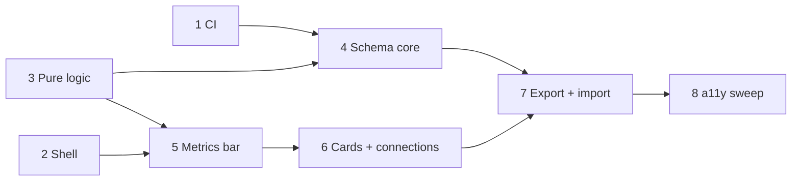

# Plan: UI shell

**Created**: 2026-11-14
**Branch**: feat/ui-shell
**Status**: approved
**Gherkin persistence**: plan-file-only
**Spec**: `docs/specs/ui-shell.md` (AC1–AC46, with amendments S16 and S17). The handoff is `docs/prototypes/ui-shell.md`. The prototype code on `proto/ui-shell` is reference only and is not merged.

## Goal

Rebuild the prototyped UI shell from the spec, with tests:

- A header with the project name and Import and Export.
- A help menu.
- Step cards with PT, LT, %C&A, and queue and batch badges.
- Left-to-right, acyclic, branching connections.
- A metrics bar computed from the steps, with text status ratings.
- Versioned export and import with confirmation.
- A SemVer schema (`0.0.0`) with an upgrade-chain registry whose fixtures and paths are enforced in a new CI workflow.
- WCAG 2.1 AA, except the keyboard connect path, which is deferred.

All decisions and view models live in pure modules under `src/flow/` with Vitest tests. React components only render. Playwright proves each UI behavior, and CI runs both suites.

**Approach stances** (decision-defaults):

- **Scope:** only the spec's AC1–AC46.
  - There is no persistence, no step editing, no project switching, and no keyboard connect path. Each of these has its own deferred spec.
  - There are no new runtime dependencies. The dev dependencies are `@axe-core/playwright` and an action linter.
- **Migrate vs. edit:** the feature is rebuilt from the spec. Nothing is copied from `proto/ui-shell`.
- **Replace vs. merge:** `src/App.jsx` and `src/index.css` are restructured in place. Their current content is a bare canvas. `e2e/example.spec.js` is updated, not deleted.
- **Integration:** one PR per slice, merged to `main` with auto-merge gated on the CI checks.
  - Slice 1 (CI) merges first. Each slice is on `feat/ui-shell-<n>`, cut from current `main`; later waves rebase after their dependencies merge.
  - The repo owner marks both CI jobs as required status checks in branch protection after Slice 1 merges. This is a repo setting, not code.
- **Format fidelity:** not applicable.

## Plan decisions

These decisions are made in the plan. Each one is a detail the spec leaves open, and each is cheap to reverse before `/build`.

- **D1. Empty-map message:** "No steps on this map. Import a project, or reload to restore the starter map." (AC25)
- **D2. Name matching is exact:**
  - Matching is case-sensitive and does not trim whitespace.
  - A name that is empty or only whitespace is invalid. (AC31, AC33, AC34)
- **D3. Badges:**
  - The batch badge hides when batch is absent or 0, the same rule as the queue badge.
  - Each badge carries a visible letter cue ("Q 20", "B 3") so it does not rely on color. (AC8, AC9)
- **D4. Missing optional step fields:**
  - A card shows "—" for a missing PT, LT, or %C&A.
  - In totals, a missing PT or LT counts as 0, and a missing %C&A counts as 100.
  - If total LT is 0, Flow efficiency is "—" with no status. (AC12, AC19)
- **D5. Rounding:**
  - Ratings use the displayed value, rounded to 1 decimal place. So 69.96 displays "70.0%" and rates On target.
  - Durations truncate, so 5840 min → `12d 1h`.
  - %C&A rounds half up, so 87.5 → "88%". (AC21, AC22, AC12)
- **D6. Node type:**
  - An imported node's `type` must be `"step"` or absent. Absent means `"step"`.
  - Any other type is invalid. (AC31)
- **D7. Project id:** an imported `project.id` must be a non-empty string. (AC31, AC29)
- **D8. Validation messages:**
  - Steps are named by label and 1-based position, for example `Step "Build" (#3) is missing a position.`
  - "This is not a project file." adds "Choose a file exported from AI Enabler."
  - The newer-schema message adds "Update the app or re-export the file." (AC32)
- **D9. Visible import status:** besides the live-region announcement, a status line under the header shows the last import outcome. A visible error has a Dismiss control. The text is spoken once, through the Announcer only. (AC32, AC37)
- **D10. Dialog:**
  - The dialog is a native `<dialog>` opened with `showModal()`, named by its heading, with focus starting on Cancel.
  - The buttons are "Replace map" and "Cancel".
  - Esc and a backdrop click take the cancel path.
  - The body names both the current and the incoming project. (AC33–35)
- **D11. How to use:** the section holds five real lines covering connecting, deleting, import and export, the 8-hour day, and the rating words. Help keeps placeholder text. The Glossary adds "Working day" and the three rating words beyond the nine required terms. (AC5, AC6)

## Acceptance Criteria

All criteria are in `docs/specs/ui-shell.md`. Each line is ticked at PR review.

- [ ] AC1–AC3: header (brand, project name, truncation, document title). AC1 is fully met once Import and Export land in Slice 7.
- [ ] AC4–AC6: help menu
- [ ] AC7–AC12: step cards
- [ ] AC13–AC17: connections
- [ ] AC18–AC26: metrics bar
- [ ] AC27: starter project on every load
- [ ] AC28–AC30: export
- [ ] AC31–AC37: import, with every replace confirmed (S16)
- [ ] AC38–AC40: focus, control names, axe
- [ ] AC41–AC46: schema SemVer, upgrade chain, fixtures, CI enforcement, bump rules
- [ ] CI: both jobs green on every slice PR (S17)

## Slices

### Slice 1: CI workflow

**Depends-on:** none
**Files:** `.github/workflows/ci.yml`, `package.json`, `package-lock.json`

**Behavior:**

```gherkin
Feature: Continuous integration

  Scenario: A pull request with passing checks shows green
    # Still passes if: the e2e job skips the axe scans
    Given a pull request against main whose lint, unit, and e2e checks pass
    When CI runs
    Then the "unit" and "e2e" checks both report success

  Scenario: A failing unit test shows a red check
    # Still passes if: the e2e job is skipped after a unit failure
    Given a pull request with one failing unit test
    When CI runs
    Then the "unit" check reports failure

  Scenario: A lint error shows a red check
    # Still passes if: lint warnings are allowed
    Given a pull request with a lint error
    When CI runs
    Then the "unit" check reports failure

  Scenario: A failing e2e test or axe violation shows a red check
    # Still passes if: the unit check is also red
    Given a pull request with one failing Playwright test or one axe violation in a scanned view
    When CI runs
    Then the "e2e" check reports failure
```

**Steps:**

#### Step 1.1: Add the unit and e2e CI jobs

**Complexity**: standard
**IMPLEMENT**: Add `ci.yml`, triggered by `pull_request` and by `push` to `main`. It has two jobs:

- `unit`: checkout with `fetch-depth: 0`, Node from `.nvmrc`, `npm ci`, `npm run lint`, then `npm test`.
- `e2e`: `npx playwright install --with-deps chromium`, then `npm run test:e2e`.

Add `@action-validator/cli` as a dev dependency and an `npm run lint:ci` script that validates the workflow. Also add the `@axe-core/playwright` dev dependency here, so Slice 2 does not touch `package.json` in the same wave.
**TEST**:

1. `npm run lint:ci` passes.
2. On the Slice 1 PR, both checks run green.
3. On a throwaway branch, a deliberately failing unit test and a lint error each turn `unit` red, and a deliberately failing Playwright test turns `e2e` red. Once Slice 2 lands, repeat with an injected axe violation (an unlabeled button). Link the run URLs in the PR as evidence, then delete the branch.

**REFACTOR**: Cache npm by lockfile and Playwright browsers by Playwright version, and share the setup through one composite step.
**Files**: `.github/workflows/ci.yml`, `package.json`, `package-lock.json`
**Covers**: AC45, S17
**Commit**: `ci: run lint, unit and e2e tests on pull requests`

### Slice 2: Shell layout, header, help menu, and accessibility baseline

**Depends-on:** none
**Files:** `src/App.jsx`, `src/index.css`, `src/shell/Header.jsx`, `src/shell/HelpMenu.jsx`, `src/shell/tokens.js`, `src/shell/contrast.js`, `src/shell/contrast.test.js`, `src/shell/glossary.js`, `src/flow/project.js`, `src/flow/project.test.js`, `e2e/shell.spec.js`, `e2e/example.spec.js`, `e2e/axe.js`

**Behavior:**

```gherkin
Feature: App shell

  Scenario: The header shows the mark, the brand, a divider, and the project name
    # Still passes if: the divider is a border instead of an element
    Given the app has loaded
    Then the header shows the app mark, "AI Enabler", a divider, and "Untitled Project"
    And the document title is "Untitled Project · AI Enabler"
    And the page has a banner, a navigation region named "Help", and a main region named "Value stream map"

  Scenario: Every load starts a fresh starter project
    # Still passes if: the new id reuses a prefix of the old one
    Given the user deleted the Idea step
    When the user reloads the page
    Then the map has six steps again
    And browser storage holds no project data

  Scenario: Help sections start collapsed and expand on request
    # Still passes if: opening one section closes the others
    Given the app has loaded
    Then the How to use, Glossary, and Help sections are collapsed
    When the user expands all three sections
    Then Glossary lists each required term with its definition from the spec glossary
    And How to use and Help each show non-empty text
    And the help menu contains no buttons or links

  Scenario: The default view passes an accessibility scan
    # Still passes if: violations exist only in states added by later slices
    Given the app has loaded
    When an axe scan runs with the wcag2a, wcag2aa, wcag21a, and wcag21aa rules and none disabled
    Then it reports zero violations

  Scenario Outline: Theme colors meet contrast minimums
    # Still passes if: an unlisted token pair fails
    Then <foreground> on <background> has a contrast ratio of at least <ratio>

    Examples:
      | foreground        | background        | ratio |
      | header text       | header background | 4.5   |
      | focus ring        | header background | 3     |
      | focus ring        | page background   | 3     |
      | menu text         | menu background   | 4.5   |
```

**Steps:**

#### Step 2.1: Create the starter project identity

**Complexity**: standard
**IMPLEMENT**: Add `createStarterProject({ newId })` to `src/flow/project.js`. It returns `{ id, name: 'Untitled Project' }`. The default `newId` is `crypto.randomUUID`.
**TEST**: Vitest: the name is "Untitled Project", the id comes from the injected generator, and two default calls give different ids.
**REFACTOR**: Name the default-name constant.
**Files**: `src/flow/project.js`, `src/flow/project.test.js`
**Covers**: AC27
**Commit**: `feat: create a starter project with an internal id`

#### Step 2.2: Add theme tokens and a contrast checker

**Complexity**: standard
**IMPLEMENT**: Add `src/shell/tokens.js`, the single source of color values, including the focus-ring token. Add `src/shell/contrast.js` with `contrastRatio(hexA, hexB)` using the WCAG relative-luminance formula. CSS custom properties are generated from the tokens in `App.jsx`.
**TEST**: Vitest: `contrastRatio` against known pairs (#000/#fff = 21, #777/#fff ≈ 4.48), plus the token-pair table above.
**REFACTOR**: Make the token pairs a data table that later slices extend.
**Files**: `src/shell/tokens.js`, `src/shell/contrast.js`, `src/shell/contrast.test.js`
**Covers**: AC38
**Commit**: `feat: add theme tokens with contrast checks`

#### Step 2.3: Render the shell grid and the header

**Complexity**: standard
**IMPLEMENT**: Restructure `App.jsx` into a header, a `nav "Help"`, and a `main "Value stream map"` grid. Add `Header.jsx` with these parts:

- The mark, "AI Enabler", and the divider.
- The project name with ellipsis truncation, a `title`, and the full accessible name.
- A `document.title` effect.
- A global `:focus-visible` outline from the token.

Add `e2e/axe.js` with a shared `scan(page)` helper (the dependency arrives in Slice 1). It uses the four wcag tags and disables no rules.
**TEST**: Playwright `e2e/shell.spec.js`:

- The header parts, the title, and the landmarks.
- Reload after deleting Idea gives six steps, and `localStorage`, `sessionStorage`, and IndexedDB are empty.
- The default-view axe scan.

Update the title assertion in `e2e/example.spec.js`.
**REFACTOR**: Keep the layout sizes as CSS custom properties.
**Files**: `src/App.jsx`, `src/index.css`, `src/shell/Header.jsx`, `e2e/shell.spec.js`, `e2e/example.spec.js`, `e2e/axe.js`
**Covers**: AC1, AC3, AC27, AC38
**Commit**: `feat: add app shell header with project name`

#### Step 2.4: Add the help menu

**Complexity**: standard
**IMPLEMENT**: Add `src/shell/glossary.js`, holding the spec's Glossary rows plus D11's extras. Add `HelpMenu.jsx` with three `<details>` sections:

- How to use: five lines (D11).
- Glossary: a `<dl>`.
- Help: placeholder text.

**TEST**: Playwright:

- All three sections are collapsed by default.
- With all sections expanded, each of the nine required terms shows its spec definition.
- The text is non-empty.
- There are no `button` or `a` elements inside the nav (a `summary` is allowed).
- The axe scan passes with all sections open.

**REFACTOR**: Share one section component.
**Files**: `src/shell/glossary.js`, `src/shell/HelpMenu.jsx`, `src/App.jsx`, `src/index.css`, `e2e/shell.spec.js`
**Covers**: AC4, AC5, AC6, AC40
**Commit**: `feat: add collapsible help menu with glossary`

### Slice 3: Pure value stream logic

**Depends-on:** none
**Files:** `src/flow/duration.js`, `src/flow/duration.test.js`, `src/flow/metrics.js`, `src/flow/metrics.test.js`, `src/flow/stepView.js`, `src/flow/stepView.test.js`, `src/flow/connections.js`, `src/flow/connections.test.js`, `src/flow/initialFlow.js`, `src/flow/initialFlow.test.js`

**Behavior:**

```gherkin
Feature: Value stream calculations

  Scenario Outline: Durations use the two largest working-day units
    # Still passes if: the formatter takes hours instead of minutes and the tests convert
    When <minutes> minutes are formatted
    Then the text is "<text>"

    Examples:
      | minutes | text   |
      | 0       | 0m     |
      | 45      | 45m    |
      | 59      | 59m    |
      | 60      | 1h     |
      | 260     | 4h 20m |
      | 479     | 7h 59m |
      | 480     | 1d     |
      | 481     | 1d     |
      | 600     | 1d 2h  |
      | 959     | 1d 7h  |
      | 5840    | 12d 1h |

  Scenario: The starter steps produce the spec's metrics
    # Still passes if: tile keys are renamed but labels are unchanged
    Given the six starter steps
    Then the metric tiles are, in order:
      | label              | text   | status |
      | Total lead time    | 12d 4h |        |
      | Total process time | 3d 2h  |        |
      | Flow efficiency    | 26.0%  | Watch  |
      | First pass yield   | 53.1%  | Watch  |
      | Total queue        | 34     | Watch  |
      | Avg process time   | 4h 20m |        |
      | Steps              | 6      |        |

  Scenario Outline: Ratings use the displayed value against the thresholds
    # Still passes if: Watch and Needs attention swap colors
    When <metric> is <value>
    Then it is rated <status>

    Examples:
      | metric           | value | status          |
      | Flow efficiency  | 70    | On target       |
      | Flow efficiency  | 69.96 | On target       |
      | Flow efficiency  | 69.9  | Watch           |
      | Flow efficiency  | 45    | Watch           |
      | Flow efficiency  | 20    | Watch           |
      | Flow efficiency  | 19.96 | Watch           |
      | Flow efficiency  | 19.9  | Needs attention |
      | First pass yield | 70    | On target       |
      | First pass yield | 69.9  | Watch           |
      | First pass yield | 60    | Watch           |
      | First pass yield | 50    | Watch           |
      | First pass yield | 49.96 | Watch           |
      | First pass yield | 49.9  | Needs attention |
      | Total queue      | 0     | On target       |
      | Total queue      | 19    | On target       |
      | Total queue      | 20    | Watch           |
      | Total queue      | 35    | Watch           |
      | Total queue      | 50    | Watch           |
      | Total queue      | 51    | Needs attention |
      | Avg process time | 260   | none            |

  Scenario: Average process time rounds to the nearest minute
    # Still passes if: exact divisions are truncated
    Given three steps with process times 20, 20, and 10 minutes
    Then Avg process time shows "17m"

  Scenario: No steps gives dashes and no status
    # Still passes if: the dash tiles keep their status tint color
    Given no steps
    Then every tile's text is "—" and no tile has a status

  Scenario: Zero total lead time leaves flow efficiency unrated
    # Still passes if: total process time also shows a dash
    Given steps whose lead times are all missing
    Then Flow efficiency is "—" with no status

  Scenario: Totals include every step whatever the connections
    # Still passes if: duplicate steps are double-counted
    Given steps A and B connect into C, and step D has no connections
    Then Total lead time is the sum of the lead times of A, B, C, and D

  Scenario Outline: A card's view of a step
    # Still passes if: the badges swap corners
    Given a step with <field> of <value>
    Then the card shows <shown>

    Examples:
      | field | value   | shown                   |
      | queue | 20      | queue badge "Q 20"      |
      | queue | 0       | no queue badge          |
      | queue | absent  | no queue badge          |
      | batch | 3       | batch badge "B 3"       |
      | batch | 0       | no batch badge          |
      | batch | absent  | no batch badge          |
      | %C&A  | 87.4    | "87%"                   |
      | %C&A  | 87.5    | "88%"                   |
      | %C&A  | 0       | "0%"                    |
      | %C&A  | 100     | "100%"                  |
      | %C&A  | absent  | "—"                     |
      | PT    | absent  | "—"                     |
      | LT    | absent  | "—"                     |

  Scenario Outline: Proposed connections are checked
    # Still passes if: rejection reasons are reported in a different order
    Given connections Idea→Plan and Plan→Build
    When the connection <source>→<target> is proposed
    Then it is <result>

    Examples:
      | source | target | result                |
      | Build  | Test   | accepted              |
      | Idea   | Build  | accepted (branching)  |
      | Test   | Build  | accepted (fan-in)     |
      | Plan   | Plan   | rejected as self      |
      | Idea   | Plan   | rejected as duplicate |
      | Build  | Idea   | rejected as a loop    |
      | Plan   | Idea   | rejected as a loop    |

  Scenario: A whole set of connections reports every problem kind
    # Still passes if: only the first problem of each kind is listed
    Given connections A→A, A→B, A→B, and B→A
    Then the problems found are self, duplicate, and loop
```

**Steps:**

#### Step 3.1: Format working-day durations

**Complexity**: trivial
**IMPLEMENT**: Add `formatDuration(minutes)`: 1d = 480 min, the two largest units, truncating.
**TEST**: Vitest table from the outline.
**REFACTOR**: Name the `MINUTES_PER_HOUR` and `HOURS_PER_DAY` constants.
**Files**: `src/flow/duration.js`, `src/flow/duration.test.js`
**Covers**: AC22
**Commit**: `feat: format durations in working days`

#### Step 3.2: Give starter steps their sample data and node type

**Complexity**: trivial
**IMPLEMENT**: Extend `initialFlow.js`. The stages carry the spec's starter data in minutes.
**TEST**: Update `initialFlow.test.js`: each stage's values match the spec table.
**REFACTOR**: Keep the data as one literal table.
**Files**: `src/flow/initialFlow.js`, `src/flow/initialFlow.test.js`
**Covers**: AC27
**Commit**: `feat: add sample data to starter steps`

#### Step 3.3: Compute and rate the metrics as tiles

**Complexity**: standard
**IMPLEMENT**: Add the following to `metrics.js`:

- `computeMetrics(steps)` takes `nodes.map(n => n.data)` and applies D4 and D5.
- `rateMetric(key, rawValue)` rounds to the displayed precision itself, then reads a threshold table (D5).
- `metricTiles(steps)` returns `[{ key, label, text, status, statusLabel }]` in spec order, with "—" when there are no steps.

**TEST**: Vitest: the starter tile table (using 3.2's data), the rating outline, no steps, zero LT, missing fields, and the branching set including an unconnected step.
**REFACTOR**: Extract `sumBy(field)`. Make the thresholds and labels data.
**Files**: `src/flow/metrics.js`, `src/flow/metrics.test.js`
**Covers**: AC18, AC19, AC21, AC23, AC25
**Commit**: `feat: compute and rate value stream metrics`

#### Step 3.4: Build the card view of a step

**Complexity**: standard
**IMPLEMENT**: Add `stepView(data)` to `stepView.js`. It returns the title, PT/LT/%C&A display text with spoken expansions, `queueBadge`, and `batchBadge` (null when hidden), per D3, D4, and D5.
**TEST**: Vitest table from the card outline.
**REFACTOR**: Share `formatDuration`.
**Files**: `src/flow/stepView.js`, `src/flow/stepView.test.js`
**Covers**: AC7, AC8, AC9, AC12
**Commit**: `feat: derive step card view from step data`

#### Step 3.5: Check connections

**Complexity**: standard
**IMPLEMENT**: Add the following to `connections.js`:

- `reachable(edges, from, to)`.
- `connectionProblem(edges, { source, target })`, returning `'self' | 'duplicate' | 'loop' | null`.
- `isValidConnection`.
- `findEdgeProblems(edges)` for whole-file validation.

**TEST**: Vitest tables from both connection scenarios, plus an empty graph.
**REFACTOR**: Build `isValidConnection` and `findEdgeProblems` on the same helpers.
**Files**: `src/flow/connections.js`, `src/flow/connections.test.js`
**Covers**: AC15, AC16
**Commit**: `feat: reject self, duplicate and looping connections`

### Slice 4: Schema versions, validation, upgrades, and the fixture guard

**Depends-on:** 1, 3
**Files:** `src/flow/schema/version.js`, `src/flow/schema/version.test.js`, `src/flow/schema/validate.js`, `src/flow/schema/validate.test.js`, `src/flow/schema/upgrades.js`, `src/flow/schema/upgrades.test.js`, `src/flow/schema/shape.js`, `src/flow/schema/shape.test.js`, `src/flow/schema/fixtures/0.0.0.json`, `src/flow/schema/fixtures/expected/0.0.0.json`, `src/flow/projectFile.js`, `src/flow/projectFile.test.js`, `scripts/schema-fixture-guard.js`, `scripts/schema-fixture-guard.test.js`, `scripts/schema-fixture-guard-cli.js`, `scripts/schema-fixture-guard-cli.test.js`, `.github/workflows/ci.yml`, `docs/schema-versioning.md`

**Behavior:**

```gherkin
Feature: Schema versions and upgrades

  Scenario Outline: Schema versions are parsed strictly
    # Still passes if: the parser accepts very large numbers like "999999.0.0"
    When the schema version <value> is checked
    Then it is <result>

    Examples:
      | value     | result     |
      | "0.0.0"   | valid      |
      | "1.12.3"  | valid      |
      | 1         | not SemVer |
      | "1.0"     | not SemVer |
      | "v1.0.0"  | not SemVer |
      | "1.0.0-b" | not SemVer |
      | "01.0.0"  | not SemVer |
      | "1.0.0+b" | not SemVer |
      | ""        | not SemVer |

  Scenario Outline: Project files are validated rule by rule
    # Still passes if: messages for later rules are reworded
    When a current-version file with <problem> is validated
    Then it fails with "<message>"

    Examples:
      | problem                                   | message                                          |
      | a whitespace-only project name            | The project name is empty.                       |
      | project id ""                             | The project id is missing.                       |
      | step #2 "Plan" with pt -1                 | Step "Plan" (#2) has an invalid process time.    |
      | step #2 "Plan" with pt 1.5                | Step "Plan" (#2) has an invalid process time.    |
      | step #3 "Build" with %C&A 100.5           | Step "Build" (#3) has an invalid %C&A.           |
      | step #3 "Build" with type "group"         | Step "Build" (#3) has an unknown type.           |
      | two steps with id "plan"                  | Two steps share the id "plan".                   |
      | a connection to a missing step            | A connection points to a step that is not there. |
      | a step connected to itself                | Step "Plan" (#2) connects to itself.             |
      | the same connection twice                 | A connection appears twice.                      |
      | a missing position and a loop             | Step "Build" (#3) is missing a position.         |

  Scenario: Upgrades run in order and stamp each version
    # Still passes if: the registry accepts a hop with from greater than to
    Given a test registry with upgrades 0.0.0→0.1.0 and 0.1.0→0.2.0
    When a 0.0.0 file is upgraded
    Then both upgrades run in order and the result has schemaVersion "0.2.0"
    And the input file is unchanged

  Scenario: A file already at the current version passes through unchanged
    # Still passes if: the result is a deep copy rather than the same value
    When a file at the current version is upgraded
    Then the result equals the input

  Scenario: An upgrade that throws becomes a plain error
    # Still passes if: the error text omits the failing version
    Given a test registry whose 0.0.0→0.1.0 upgrade throws
    When a 0.0.0 file is upgraded
    Then the result is a failure that names version 0.0.0, not an exception

  Scenario: Coverage checks name every gap
    # Still passes if: the checks also flag fixtures for unreleased versions
    Given released versions 0.0.0, 0.1.0, and 0.2.0
    And fixtures exist only for 0.0.0
    And the registry has no hop from 0.1.0
    Then the missing fixtures named are 0.1.0 and 0.2.0
    And the versions with no upgrade path named are 0.1.0

  Scenario: The real registry has no gaps
    # Still passes if: an extra unreferenced fixture exists
    Given the app's released versions, fixtures, and registry
    Then no fixture is missing and every released version reaches the current version
    And the fixture files found on disk equal the released versions

  Scenario: Every released fixture upgrades to its expected output
    # Still passes if: the expected output is regenerated in the same commit as an upgrade change
    Given the fixture for each released version
    When it is upgraded and validated
    Then validation passes and the result matches the expected output for that version
    And the fixture itself is unchanged

  Scenario: An export shape change without a version bump fails
    # Still passes if: only the values in an export change
    Given the structural shape of the current version's fixture
    When the exported shape gains, loses, or retypes a field
    Then the shape check fails

  Scenario Outline: The fixture guard blocks changes to released fixtures
    # Still passes if: a change to an expected-output file is allowed
    Given the diff against main lists "<status>" for a released fixture
    Then the guard <result>

    Examples:
      | status | result |
      | A      | passes |
      | M      | fails  |
      | D      | fails  |
      | R100   | fails  |
      | C100   | fails  |
      | T      | fails  |

  Scenario: The guard fails closed when git fails
    # Still passes if: the error text does not name the base ref
    Given git cannot resolve origin/main
    When the guard CLI runs
    Then it exits non-zero with an error
```

**Steps:**

#### Step 4.1: Parse and compare SemVer schema versions

**Complexity**: standard
**IMPLEMENT**: Add `version.js` with these exports: `CURRENT_SCHEMA_VERSION = '0.0.0'`, `RELEASED_SCHEMA_VERSIONS = ['0.0.0']`, `parseSemver` (strict, no prerelease, no leading zeros), and `compareSemver`.
**TEST**: Vitest: the outline rows plus ordering, and that current is the maximum released version.
**REFACTOR**: Return frozen tuples.
**Files**: `src/flow/schema/version.js`, `src/flow/schema/version.test.js`
**Covers**: AC41, AC46
**Commit**: `feat: define SemVer schema versions starting at 0.0.0`

#### Step 4.2: Validate a current-version project file

**Complexity**: complex
**IMPLEMENT**: Add `validateProjectFile(file)` to `validate.js`. It returns `{ ok: true }` or `{ ok: false, message }` for the first problem, in AC31 order:

- Name, nodes and edges arrays, node ids.
- Positions, labels, and type (D6).
- Numeric fields, %C&A range, and unique ids.
- Edge references, then `findEdgeProblems`.
- Project id (D7).

It uses D8 wording.
**TEST**: Vitest: the validation outline (exact messages are settled in this step and the outline updated), plus one row per remaining AC31 rule. Bad steps are placed at position #2 or #3 so an index bug shows. Self and duplicate edges are covered, and a multi-problem file reports only the first problem.
**REFACTOR**: Keep the rules and messages in one ordered table.
**Files**: `src/flow/schema/validate.js`, `src/flow/schema/validate.test.js`
**Covers**: AC31, AC32
**Commit**: `feat: validate project files with plain messages`

#### Step 4.3: Build the upgrade chain and its coverage checks

**Complexity**: complex
**IMPLEMENT**: Add the following to `upgrades.js`:

- `REGISTRY`: ordered `{ from, to, upgrade }`, empty today.
- `upgradeToCurrent(file, { registry, current })`: stamps `schemaVersion = hop.to` itself, and catches exceptions into `{ ok: false, message }`.
- `findMissingFixtures(released, fixtureVersions)` and `findMissingPaths(released, registry, current)`, which return every offending version.

Fixtures are discovered with `import.meta.glob('./fixtures/*.json')` in `upgrades.test.js` only, so the app bundle stays free of fixtures. Add `findRegistryProblems(registry, current)`: from < to, unique `from`, contiguous hops, every `to` at or below current; the path walk is bounded by the registry length so a cyclic registry terminates. The immutable input fixture `fixtures/0.0.0.json` is a canonical project with a branch, a step with optional fields absent, and a batch. It is formatted with Prettier before it is first committed. `fixtures/expected/<v>.json` is written by `toMatchFileSnapshot`.
**TEST**: Vitest:

- The synthetic multi-hop registry, the throwing upgrade, and pass-through at the current version.
- Deep-frozen inputs, to prove upgrades do not mutate them.
- The gap checks and `findRegistryProblems` with broken inputs (from > to, duplicate from, a gap, a cycle).
- The real-registry check, including the glob set equal to the released versions.
- Each released fixture passes `validateProjectFile` and matches its expected snapshot.

**REFACTOR**: Generate the per-version cases from `RELEASED_SCHEMA_VERSIONS`.
**Files**: `src/flow/schema/upgrades.js`, `src/flow/schema/upgrades.test.js`, `src/flow/schema/fixtures/0.0.0.json`, `src/flow/schema/fixtures/expected/0.0.0.json`
**Covers**: AC42, AC44, AC45
**Commit**: `feat: add schema upgrade chain with per-version fixtures`

#### Step 4.4: Serialize for export and check the export shape

**Complexity**: standard
**IMPLEMENT**: Add the following:

- In `projectFile.js`: `toProjectFile({ project, nodes, edges, now })`, which keeps only the AC29 fields, and `projectFileName(name)`.
- In `shape.js`: `shapeOf(value)`, a structural signature of key paths and value types. Array elements contribute the union of their key paths, so optional fields absent on some steps do not cause a diff.

**TEST**: Vitest:

- The whitelist, using input nodes with `selected`, `measured`, `width`, `height`, `dragging`, and `positionAbsolute`, and unknown data keys. The exact output keys are asserted.
- ISO UTC `exportedAt` from the injected `now`.
- Slugs: "Checkout Revamp!" → `checkout-revamp`, " A--B " → `a-b`, "Q3/Q4 Plan" → `q3-q4-plan`, "!!!" → `project`, "Café" → `caf`.
- Exported edges carry exactly `id`, `source`, and `target`, given input edges with `markerEnd`, `selected`, `sourceHandle`, and `type`.
- `shapeOf` of the real starter project's export equals `shapeOf` of the current fixture, and an injected extra key, a missing key, or a retyped key each fail.

**REFACTOR**: Share one node and edge projection list.
**Files**: `src/flow/projectFile.js`, `src/flow/projectFile.test.js`, `src/flow/schema/shape.js`, `src/flow/schema/shape.test.js`
**Covers**: AC28, AC29, AC45
**Commit**: `feat: serialize projects and check export shape`

#### Step 4.5: Guard released fixtures in CI

**Complexity**: standard
**IMPLEMENT**: Add `scripts/schema-fixture-guard.js`, a pure check over `git diff --name-status --no-renames <base>...HEAD` text. Any status other than `A` on `src/flow/schema/fixtures/*.json` fails, and `expected/` is exempt. The CLI wrapper takes an injectable command runner and exits non-zero when git fails. Add a `unit`-job step that runs it against `origin/main`. On a push to `main`, the diff is empty and the guard passes.
**TEST**: Vitest:

- The guard: the status outline, an empty diff, an expected file, and a non-fixture path.
- The CLI, with an injected runner: success, violations, and git failure.

**REFACTOR**: Keep the path pattern as one constant.
**Files**: `scripts/schema-fixture-guard.js`, `scripts/schema-fixture-guard.test.js`, `scripts/schema-fixture-guard-cli.js`, `scripts/schema-fixture-guard-cli.test.js`, `.github/workflows/ci.yml`
**Covers**: AC45
**Commit**: `ci: block edits to released schema fixtures`

#### Step 4.6: Document schema bumps

**Complexity**: trivial
**IMPLEMENT**: Write `docs/schema-versioning.md`, covering these topics:

- The bump levels (AC46).
- Adding a hop and a fixture.
- Regenerating expected snapshots with `vitest -u` and reviewing the diff.
- Why input fixtures are immutable.

**TEST**: Doc-only. AC46 is enforced by the 4.3 checks, which fail when a bump has no hop or fixture.
**REFACTOR**: n/a (doc).
**Files**: `docs/schema-versioning.md`
**Covers**: AC46
**Commit**: `docs: explain schema version bumps and upgrades`

### Slice 5: Metrics bar

**Depends-on:** 2, 3
**Files:** `src/shell/MetricsBar.jsx`, `src/shell/useProject.js`, `src/shell/tokens.js`, `src/shell/contrast.test.js`, `src/App.jsx`, `src/index.css`, `e2e/metrics.spec.js`

**Behavior:**

```gherkin
Feature: Metrics bar

  Scenario: The starter project shows its metrics with status text
    # Still passes if: the status tint colors are swapped
    Given the app has loaded
    Then the metrics bar shows the seven starter tiles in spec order
    And Flow efficiency, First pass yield, and Total queue each show the text "Watch" inside the tile
    And each tile is a term and description pair

  Scenario: Deleting a step updates the tiles in the same update
    # Still passes if: the status line announces nothing
    Given the app has loaded
    When the user selects the Idea step and presses Backspace
    Then the canvas shows 5 cards while Steps shows "5"
    And Total lead time shows "9d 4h" and Total queue shows "14" rated "On target"

  Scenario: An empty map shows dashes and a message
    # Still passes if: the message is not announced
    Given the user has deleted all six steps
    Then every tile shows "—" with no status text
    And the canvas shows "No steps on this map. Import a project, or reload to restore the starter map."

  Scenario Outline: The bar stays aligned or wraps by width
    # Still passes if: wrapped tiles change order
    Given the window is <width> pixels wide
    Then the tiles occupy <rows>
    And no tile value is clipped

    Examples:
      | width | rows              |
      | 1200  | one row           |
      | 1024  | one row           |
      | 1023  | more than one row |
      | 800   | more than one row |

  Scenario Outline: Status tints keep text readable
    # Still passes if: the tile border fails 3:1
    Then tile text on the <status> tint has a contrast ratio of at least 4.5

    Examples:
      | status          |
      | On target       |
      | Watch           |
      | Needs attention |
      | no status       |
```

**Steps:**

#### Step 5.1: Render the metrics bar from tiles

**Complexity**: standard
**IMPLEMENT**: Add `MetricsBar.jsx`, a `<dl>` that renders `metricTiles(steps)`. Status text sits inside each tile, and color comes from status tokens. With no steps, the canvas shows the empty-map message from D1 in a `role="status"` region. One row is guaranteed at 1024px and wider; the bar wraps below that. Add `src/shell/useProject.js`, which owns the project, nodes, edges, and their setters, wrapped in `ReactFlowProvider`; later slices extend it. Wire the bar from `nodes.map(n => n.data)`. Add the status tints to `tokens.js` and the contrast table.
**TEST**:

- Vitest: the tint contrast rows.
- Playwright `e2e/metrics.spec.js`: the starter tiles with `dt`/`dd` pairs, and the deletion with card count and Steps in one `expect.poll`. (Backspace deletion is React Flow's default; Slice 6 makes it explicit.)
- Playwright: deleting all six steps, the width outline using distinct tile `top`s with `scrollWidth <= clientWidth`, and the axe scan of the default view.

**REFACTOR**: Keep `MetricsBar` a pure renderer with no logic.
**Files**: `src/shell/MetricsBar.jsx`, `src/shell/useProject.js`, `src/shell/tokens.js`, `src/shell/contrast.test.js`, `src/App.jsx`, `src/index.css`, `e2e/metrics.spec.js`
**Covers**: AC18, AC20, AC23, AC24, AC25, AC26
**Commit**: `feat: show metrics bar with status ratings`

### Slice 6: Step cards and connections

**Depends-on:** 5
**Files:** `src/shell/StepCard.jsx`, `src/flow/initialFlow.js`, `src/flow/initialFlow.test.js`, `src/shell/tokens.js`, `src/shell/contrast.test.js`, `src/App.jsx`, `src/index.css`, `e2e/cards.spec.js`, `e2e/connections.spec.js`, `e2e/example.spec.js`, `e2e/canvas.js`

**Behavior:**

```gherkin
Feature: Step cards and connections

  Scenario: A card shows its step's values and badges
    # Still passes if: rows render in a different order
    Given the app has loaded
    Then the Build card shows its title "Build", PT "1d", LT "2d 4h", and %C&A "90%"
    And its rows are spoken as "process time", "lead time", and "percent complete and accurate"
    And the Idea card's queue badge "Q 20", named "20 items waiting", sits in the card's upper-left quarter
    And only the Production card has a batch badge "B 3", named "Batch size 3", in its upper-right quarter

  Scenario: Connecting two steps draws an arrow into the target
    # Still passes if: the arrowhead color differs from the edge
    Given the app has loaded
    When the user drags from Idea's right handle to Test's left handle
    Then a connection Idea→Test exists and its end has an arrowhead marker

  Scenario: Several steps may connect into one
    # Still passes if: fan-out is rejected
    Given Build connects to Test
    When the user connects Idea to Test
    Then Test has two incoming connections

  Scenario Outline: Invalid connections are not added
    # Still passes if: the rejected drag shows no visual hint
    Given the app has loaded
    When the user drags from <from> to <to>
    Then the number of connections is unchanged

    Examples:
      | from               | to           |
      | Production's right | Plan's left  |
      | Idea's right       | Plan's left  |
      | Plan's right       | Plan's left  |
      | Idea's right       | empty canvas |
      | Test's left        | Build's right |

  Scenario: Successive connections use the current set
    # Still passes if: duplicate rejection also blocks a reverse-direction duplicate
    Given the app has loaded
    When the user connects Idea to Test, then Idea to Deploy, then Idea to Test again
    Then exactly two new connections exist

  Scenario: Unconnected handles show only when needed
    # Still passes if: handles also show on keyboard focus
    Given Idea's left handle has no connection
    Then its computed opacity is 0
    When the pointer hovers Idea's title
    Then the handle's opacity is still 0
    When the pointer hovers the handle
    Then its opacity is 1

  Scenario: Handles show while a connection is dragged
    # Still passes if: only handles of later steps show
    When the user starts dragging from Idea's right handle
    Then every other card's left handle has opacity 1
    When the user releases over empty canvas
    Then unconnected handles return to opacity 0

  Scenario Outline: Selected items are deleted with either key
    # Still passes if: multi-selection deletes only one item
    Given the app has loaded
    When the user selects <item> and presses <key>
    Then <result>

    Examples:
      | item                | key       | result                                                                    |
      | the Plan→Build edge | Delete    | Plan's right and Build's left handles have opacity 0; other edges remain  |
      | the Plan→Build edge | Backspace | Plan's right and Build's left handles have opacity 0; other edges remain  |
      | the Build step      | Delete    | no connection references Build; Plan's right and Test's left handles hide |
      | the Build step      | Backspace | no connection references Build; Plan's right and Test's left handles hide |

  Scenario: A handle with another connection stays visible
    # Still passes if: the remaining edge is redrawn
    Given Idea connects to Plan and to Test
    When the user deletes Idea→Test
    Then Idea's right handle has opacity 1

  Scenario Outline: Non-text colors meet 3:1
    # Still passes if: hover colors fail
    Then <element> on the canvas background has a contrast ratio of at least 3

    Examples:
      | element                |
      | the edge stroke        |
      | the arrowhead          |
      | the queue badge border |
      | the batch badge border |

  Scenario Outline: Badge text meets 4.5:1
    # Still passes if: the badge border fails
    Then <badge> text on its fill has a contrast ratio of at least 4.5

    Examples:
      | badge       |
      | queue badge |
      | batch badge |
```

**Steps:**

#### Step 6.1: Render step cards with handles

**Complexity**: standard
**IMPLEMENT**: Add `StepCard.jsx`, which renders `stepView(data)`:

- The title, and a `<dl>` with visually hidden expansions.
- Badges with visible letters and visually hidden names.
- One left target handle and one right source handle.

Register `nodeTypes = { step: StepCard }`, and make `toNodes` emit `type: 'step'` in the same step so React Flow never falls back to a missing type. The card borders are subdued, measured as a border-on-surface ratio below 3:1 because the border is decorative. Badge tokens are added to the contrast table.
**TEST**:

- Vitest: the badge contrast rows.
- Playwright `e2e/cards.spec.js`: the card scenario, with the quarter positions taken from bounding boxes.
- `e2e/example.spec.js`: the existing drag-to-connect test is updated to the left and right handles and stays green.
- The axe scan of the default view.

**REFACTOR**: Share one badge component with a variant.
**Files**: `src/shell/StepCard.jsx`, `src/flow/initialFlow.js`, `src/flow/initialFlow.test.js`, `src/shell/tokens.js`, `src/shell/contrast.test.js`, `src/App.jsx`, `src/index.css`, `e2e/cards.spec.js`, `e2e/example.spec.js`
**Covers**: AC7, AC8, AC9, AC10, AC11, AC12, AC13
**Commit**: `feat: render step cards with stats, badges and handles`

#### Step 6.2: Arrowheads, connection rules, and hidden handles

**Complexity**: standard
**IMPLEMENT**: Use `defaultEdgeOptions` with an arrowhead marker. Each card has exactly one left target and one right source handle; the handle's hit area is 20px while the dot stays small, and `@media (hover: none)` keeps handles visible. Opacity transitions are disabled under `prefers-reduced-motion`, which the e2e config sets. Pass `isValidConnection` bound to the current edges through `useCallback` with `edges` as a dependency. Handle visibility works as follows:

- `opacity: 0` when the handle is unconnected.
- `opacity: 1` when the handle itself is hovered, or while a connection is in progress (React Flow's `connectionInProgress` state).

Edge and arrow tokens are added to the contrast table.
**TEST**:

- Vitest: the edge and arrow contrast rows.
- Playwright `e2e/connections.spec.js`: connect, fan-in, the invalid outline, successive connections, and the handle opacity scenarios, read through `getComputedStyle`.

**REFACTOR**: Derive handle classes in one helper.
**Files**: `src/shell/StepCard.jsx`, `src/shell/tokens.js`, `src/shell/contrast.test.js`, `src/App.jsx`, `src/index.css`, `e2e/connections.spec.js`
**Covers**: AC11, AC13, AC14, AC15, AC16
**Commit**: `feat: connect steps left to right with arrowheads`

#### Step 6.3: Delete with Delete or Backspace

**Complexity**: trivial
**IMPLEMENT**: Set `deleteKeyCode={['Delete', 'Backspace']}`.
**TEST**: Playwright: the delete outline, plus the handle that stays visible.
**REFACTOR**: None beyond tidying test helpers into `e2e/canvas.js`, if they are duplicated.
**Files**: `src/App.jsx`, `e2e/connections.spec.js`, `e2e/canvas.js`
**Covers**: AC17
**Commit**: `feat: delete steps and connections with Delete or Backspace`

### Slice 7: Export and import

**Depends-on:** 4, 6
**Files:** `src/flow/importFile.js`, `src/flow/importFile.test.js`, `src/flow/importFlow.js`, `src/flow/importFlow.test.js`, `src/shell/useProject.js`, `src/shell/Header.jsx`, `src/shell/ConfirmDialog.jsx`, `src/shell/Announcer.jsx`, `src/shell/ImportStatus.jsx`, `src/App.jsx`, `src/index.css`, `e2e/export-import.spec.js`, `e2e/fixtures/*.json`

**Behavior:**

```gherkin
Feature: Export and import

  Scenario: Export downloads the project at the current schema version
    # Still passes if: exportedAt uses local time with a Z suffix
    Given the user has selected the Build step
    When the user activates "Export project (JSON)"
    Then "untitled-project.ai-enabler.json" downloads with schemaVersion "0.0.0", an ISO UTC exportedAt, and the project id and name
    And no node has selection or measured-size fields
    And no edge has fields other than id, source, and target
    And exportedAt matches an ISO 8601 UTC timestamp ending in "Z"
    And "Exported untitled-project.ai-enabler.json" is announced

  Scenario: Export then import round-trips unchanged
    # Still passes if: the viewport zoom differs after import
    Given the user moved Build and deleted the Plan→Build connection
    When the user exports, then imports that file and confirms
    Then a second export has the same nodes and edges as the first
    And every metric tile shows the same text as before

  Scenario: A same-name import asks before replacing
    # Still passes if: the dialog text wraps differently
    Given the open project is "Untitled Project"
    When the user imports a valid file named "Untitled Project" with three steps
    Then the app asks "Replace current map with the imported version of Untitled Project?" with focus on Cancel
    When the user chooses "Replace map"
    Then three cards are visible inside the canvas view
    And a following export has the same project id as before
    And "Imported Untitled Project, 3 steps" is announced and shown, and focus is on Import

  Scenario: A different-name import asks, then takes the file's name and id
    # Still passes if: the header updates before the title
    Given the open project is "Untitled Project"
    When the user imports a valid file named "Checkout Revamp" with id "abc"
    Then the app asks "Replace current map with Checkout Revamp?"
    When the user chooses "Replace map"
    Then the header shows "Checkout Revamp" and the document title is "Checkout Revamp · AI Enabler"
    And a following export has project id "abc"
    And every tile matches values computed from the imported steps
    And focus is on Import

  Scenario: Matching ignores the file id
    # Still passes if: case-different names are matched
    Given the open project "Untitled Project" was exported with id X
    When the user imports a file named "Checkout Revamp" with id X
    Then the app asks "Replace current map with Checkout Revamp?"

  Scenario: Name matching is exact
    # Still passes if: trailing spaces are trimmed
    Given the open project is "Untitled Project"
    When the user imports a valid file named "untitled project"
    Then the app asks "Replace current map with untitled project?"

  Scenario Outline: Cancelling changes nothing
    # Still passes if: the dialog stays in the DOM hidden
    Given the replace confirmation is open for a <kind> file
    When the user <action>
    Then the map, name, and id are unchanged
    And "Import cancelled" is announced and focus is on Import

    Examples:
      | kind           | action                 |
      | different-name | chooses Cancel         |
      | different-name | presses Escape         |
      | same-name      | clicks the backdrop    |

  Scenario Outline: Invalid files are rejected with a plain message
    # Still passes if: the error stays after a later success
    When the user imports <file>
    Then nothing on the map changes
    And a visible error says "<message>" with a Dismiss control
    And the error is announced once and focus is on Import

    Examples:
      | file                                 | message                                                                                           |
      | text that is not JSON                | This file is not valid JSON.                                                                      |
      | an array                             | This is not a project file. Choose a file exported from AI Enabler.                               |
      | a file with no schemaVersion         | This is not a project file. Choose a file exported from AI Enabler.                               |
      | schemaVersion "9.0.0" and a bad step | This file uses schema 9.0.0; this app supports up to 0.0.0. Update the app or re-export the file. |
      | step #3 "Build" with no position     | Step "Build" (#3) is missing a position.                                                          |
      | connections that form a loop         | The connections form a loop.                                                                      |

  Scenario: The same file can be chosen again
    # Still passes if: a different file is chosen the second time
    Given the user imported a file that failed validation
    When the user selects the same file again
    Then the error is shown and announced again

  Scenario: Dismissing an error returns focus to Import
    # Still passes if: Dismiss also clears the announcer text
    Given an import error is showing
    When the user activates Dismiss
    Then no import error is shown and focus is on Import

  Scenario: Import states pass an accessibility scan
    # Still passes if: the status line after success is not scanned
    When the shared axe scan runs with an import error showing, and again with the confirmation open
    Then both scans report zero violations

  Scenario: A successful import clears the error
    # Still passes if: the Dismiss control stays focused
    Given an import error is showing
    When the user imports a valid file and confirms
    Then no import error is shown

  Scenario: A long project name keeps Import and Export in view
    # Still passes if: the name is cut at 90 characters
    Given the user imported and confirmed a file whose project name has 100 characters with no spaces
    And the window is 1024 pixels wide
    Then "AI Enabler" stays on one line
    And Import and Export are fully inside the viewport
    And the project name shows an ellipsis, and its tooltip and accessible name are the full 100 characters

  Scenario: Imported data shows hidden badges and rounded quality
    # Still passes if: a batch badge of 0 shows "B 0"
    Given the user imported and confirmed a file with a step whose queue is 0, batch is 0, and %C&A is 87.6
    Then that card shows no queue badge, no batch badge, and "88%"
```

**Steps:**

#### Step 7.1: Parse, check, upgrade, and validate an import

**Complexity**: complex
**IMPLEMENT**: Add `parseImport(text)` to `importFile.js`. It runs these stages in order:

1. JSON parse.
2. Envelope check: the file is a non-null, non-array object and `schemaVersion` is valid SemVer, released, and at or below current. It knows nothing else about the shape, so a future upgrade can restructure `nodes` and `edges`. A lower, unreleased version uses the AC43 message naming both versions.
3. `upgradeToCurrent`.
4. `validateProjectFile`.

It returns `{ ok, file }` or `{ ok: false, message }`.
**TEST**: Vitest:

- The invalid outline rows, plus number, string, and `null` input.
- `"v1.0.0"`, and a lower but unreleased version.
- A newer version together with a bad step, which reports the version message only.
- A test registry whose upgrade throws.
- Every released fixture parses `ok`.

**REFACTOR**: Model the stages as a small pipeline of functions.
**Files**: `src/flow/importFile.js`, `src/flow/importFile.test.js`
**Covers**: AC31, AC32, AC42, AC43
**Commit**: `feat: check, upgrade and validate imported files`

#### Step 7.2: Model the import flow

**Complexity**: standard
**IMPLEMENT**: Add a pure reducer to `importFlow.js`:

- **States:** `idle`, `confirming`, and `error`.
- **Events:** `fileParsed`, `confirm`, `cancel`, and `dismiss`.
- **Output:** the next project and map (via `fromProjectFile`, file to nodes and edges), the confirmation text (same-name or different-name wording), and the announcement and status text.

Same-name keeps the current id; different-name takes the file's name and id. Matching is exact (D2).
**TEST**: Vitest:

- Same name with a different id: confirm text, the id is kept.
- Different name with the same id: confirm text, the file id is taken.
- Case-different names are treated as different.
- Cancel keeps the state.
- An error, then a success, clears the error.
- The announcement strings.

**REFACTOR**: Use tagged state objects.
**Files**: `src/flow/importFlow.js`, `src/flow/importFlow.test.js`
**Covers**: AC33, AC34, AC35, AC36, AC37
**Commit**: `feat: model import confirmation flow`

#### Step 7.3: Export from the header

**Complexity**: standard
**IMPLEMENT**: The header gets an "Export" button whose accessible name is "Export project (JSON)". It downloads `toProjectFile` output. Add `Announcer`, a polite live region mounted empty at load that clears and re-sets the text so repeated messages are spoken.
**TEST**: Playwright `e2e/export-import.spec.js`: the export scenario.
**REFACTOR**: Keep the download helper separate from the button.
**Files**: `src/shell/useProject.js`, `src/shell/Header.jsx`, `src/shell/Announcer.jsx`, `src/App.jsx`, `e2e/export-import.spec.js`
**Covers**: AC1, AC28, AC29, AC30, AC39
**Commit**: `feat: export projects as versioned JSON`

#### Step 7.4: Import with confirmation

**Complexity**: complex
**IMPLEMENT**: The work has four parts.

1. **Import button.** Accessible name "Import project (JSON)". The file input `value` is cleared after each read.
2. **Dialog.** `ConfirmDialog` follows D10, opened with `showModal()` and named by its heading through `aria-labelledby`.
3. **Feedback.** The Announcer speaks after the dialog closes. `ImportStatus` shows the visible outcome or error with Dismiss; Dismiss returns focus to Import. A success line stays until the next import.
4. **After import.** `useProject` applies `fromProjectFile` from `importFlow`, runs `fitView` after a replace, and returns focus to Import.

**TEST**: Playwright `e2e/export-import.spec.js`: every import scenario in this slice, including the two axe scans. Fixture files live in `e2e/fixtures/`.
**REFACTOR**: Keep the components free of decision logic, which lives in `importFlow`.
**Files**: `src/shell/useProject.js`, `src/shell/Header.jsx`, `src/shell/ConfirmDialog.jsx`, `src/shell/ImportStatus.jsx`, `src/App.jsx`, `src/index.css`, `e2e/export-import.spec.js`, `e2e/fixtures/*.json`
**Covers**: AC1, AC2, AC3, AC8, AC12, AC20, AC32, AC33, AC34, AC35, AC37, AC40
**Commit**: `feat: import projects with confirmation`

### Slice 8: Accessibility sweep

**Depends-on:** 7
**Files:** `e2e/a11y.spec.js`, `e2e/fixtures/*.json`, `src/index.css`, `src/shell/tokens.js`

**Behavior:**

```gherkin
Feature: WCAG 2.1 AA sweep

  Scenario Outline: Key views have no axe violations
    # Still passes if: a violation appears only while dragging a connection
    Given the app shows <view>
    When the shared axe scan runs
    Then it reports zero violations

    Examples:
      | view                                                     |
      | the default view                                         |
      | all three help sections expanded                         |
      | an import error                                          |
      | the import confirmation open                             |
      | the empty map                                            |
      | an imported map with On target and Needs attention tiles |
      | a selected step and a selected connection                |

  Scenario: Every control shows a visible focus indicator
    # Still passes if: the focus ring is also shown on mouse click
    When the user tabs through the header buttons, help summaries, cards, React Flow controls, and the dialog buttons
    Then each focused element has a solid outline at least 2 pixels wide
    And the outline has at least 3:1 contrast against the surface behind it

  Scenario: The page reflows at 320 pixels
    # Still passes if: the canvas itself scrolls horizontally
    Given the window is 320 pixels wide
    Then the page outside the canvas has no horizontal scrollbar
    And Import and Export are fully inside the viewport
```

**Steps:**

#### Step 8.1: Sweep the axe scans across all views

**Complexity**: standard
**IMPLEMENT**: Add `e2e/a11y.spec.js` with the seven views. It uses `e2e/fixtures/` files for the imported-map view. Fix any violation in the tokens or CSS.
**TEST**: All seven scans pass.
**REFACTOR**: Share view setup helpers.
**Files**: `e2e/a11y.spec.js`, `e2e/fixtures/*.json`, `src/index.css`, `src/shell/tokens.js`
**Covers**: AC24, AC40
**Commit**: `test: scan all key views with axe`

#### Step 8.2: Audit focus indicators and reflow

**Complexity**: standard
**IMPLEMENT**: Fix any control that is missing the focus token, and fix reflow at 320px. The menu stacks above the canvas below 640px.
**TEST**: Playwright tab walk:

- `outline-style` is not `none`.
- `outline-width` is at least 2px.
- The outline and surface token pair, from `tokens.js`, is at least 3:1.

Also the 320px reflow check.
**REFACTOR**: Use one focus token across surfaces where it passes on all of them.
**Files**: `e2e/a11y.spec.js`, `src/index.css`, `src/shell/tokens.js`
**Covers**: AC38, AC40
**Commit**: `feat: verify focus indicators and reflow`

## Parallelization

<!-- derived by scripts/plan_waves.py -->



| Wave | Slices  | Notes           |
| ---- | ------- | --------------- |
| 1    | 1, 2, 3 | No file overlap |
| 2    | 4, 5    | No file overlap |
| 3    | 6       |                 |
| 4    | 7       |                 |
| 5    | 8       |                 |

## Complexity Classification

| Rating     | Criteria                                                                         | Review depth                                        |
| ---------- | -------------------------------------------------------------------------------- | --------------------------------------------------- |
| `trivial`  | Single-file rename, config change, typo fix, documentation-only                  | Skip inline review; covered by final `/code-review` |
| `standard` | New function, test, module, or behavioral change within existing patterns        | Spec-compliance + relevant quality agents           |
| `complex`  | Architectural change, security-sensitive, cross-cutting concern, new abstraction | Full agent suite including opus-tier agents         |

## Pre-PR Quality Gate

- [ ] All tests pass (`npm test`, `npm run test:e2e`)
- [ ] Linter passes (`npm run lint`, `npm run lint:deep`)
- [ ] Format check passes (`npm run format:check`)
- [ ] Both CI jobs green on the PR
- [ ] `/code-review` passes
- [ ] Documentation updated (`docs/schema-versioning.md`)

## Skipped (low value)

| Finding                                 | Rationale (one line)                                                            |
| --------------------------------------- | ------------------------------------------------------------------------------- |
| Hide the MiniMap for small maps         | A cosmetic suggestion with no observable rule; logged as LOW_VALUE in the spec. |
| Glossary "exactly nine terms" unit test | Data checked against itself; the e2e definition check covers it.                |

## Risks & Open Questions

- **Branch protection:** auto-merge only gates on CI if both jobs are required checks. The repo owner sets this after Slice 1 merges.
- **CI e2e cost:** installing Chromium adds minutes to every PR. Mitigation: cache the Playwright browsers by version.
- **Visible legend:** the UX review suggested a visible legend for PT, LT, %C&A, and the badges. It is not in the spec, so it is out of scope here. The How to use text (D11) and the badge letters (D3) partly cover it. Candidate for the editing spec.
- **React Flow handle opacity during a drag** relies on the library's connection-in-progress state in `@xyflow/react` 12. If that state isn't exposed as expected, fall back to a `connecting` class set through `onConnectStart` and `onConnectEnd`.
- **Expected outputs:** `expected/` is exempt from the guard, so an upgrade change plus `vitest -u` passes CI. `docs/schema-versioning.md` will require explicit reviewer sign-off on any `expected/` diff.
- **Visual-only checks:** AC10 badge hue families and AC11 subdued borders are checked by visual review, not tests.
- **Fixture permanence:** `fixtures/0.0.0.json` becomes immutable once it merges in the Slice 4 PR. Slice 7's round trip uses the same validator and serializer, which Slice 4 already proves against the fixture.

## Plan Review Summary

Plan tier: complex. Reviewers: Acceptance, Design, UX, Strategic, Parallelization (all 5). Two iterations, which is the maximum.

- **Pass 1:** Parallelization approved. Acceptance, Design, UX and Strategic asked for revisions, with blockers. The plan was restructured, and the spec was amended (S16 and S17).
- **Pass 2:** Strategic and UX approved. Design asked for revisions on warnings only. Acceptance had one blocker: the S17 e2e red check. It was fixed after pass 2, along with most warnings:
  - The envelope check no longer depends on the data shape.
  - Fixture discovery is test-only, and the registry structure is checked.
  - `shapeOf` unions array elements, and exported edges are whitelisted.
  - `useProject` moves to Slice 5, and `type: 'step'` moves to Step 6.1.
  - Slice 7 gets its own axe scans and a split import step (7.4, complex).
  - Dismiss focus, backdrop cancel, same-name cancel, `showModal`, and the dialog name.
  - Handle hit area and the no-hover fallback.
  - Avg process time rounding and the validation outline.
  - Killer falsifiers rewritten, and the 320px buttons check.
- **Open warnings, accepted:**
  - The 0.0.0 fixture freezes in Slice 4, before the import UI exists.
  - Validation messages beyond the outline are settled in Step 4.2.
  - Focus after a keyboard delete is not specified.
  - The tab walk has no expected stop list.
  - The success status lifetime is minimal.
  - The pre-PR gate runs `lint:deep` locally; CI runs `lint` only.

## Build Progress

<!-- derived by scripts/plan_waves.py -->

### Wave 1

- [ ] Slice 1: CI workflow
  - [ ] Step 1.1: Add the unit and e2e CI jobs

- [ ] Slice 2: Shell layout, header, help menu, and accessibility baseline
  - [ ] Step 2.1: Create the starter project identity
  - [ ] Step 2.2: Add theme tokens and a contrast checker
  - [ ] Step 2.3: Render the shell grid and the header
  - [ ] Step 2.4: Add the help menu

- [ ] Slice 3: Pure value stream logic
  - [ ] Step 3.1: Format working-day durations
  - [ ] Step 3.2: Give starter steps their sample data and node type
  - [ ] Step 3.3: Compute and rate the metrics as tiles
  - [ ] Step 3.4: Build the card view of a step
  - [ ] Step 3.5: Check connections

### Wave 2

- [ ] Slice 4: Schema versions, validation, upgrades, and the fixture guard
  - [ ] Step 4.1: Parse and compare SemVer schema versions
  - [ ] Step 4.2: Validate a current-version project file
  - [ ] Step 4.3: Build the upgrade chain and its coverage checks
  - [ ] Step 4.4: Serialize for export and check the export shape
  - [ ] Step 4.5: Guard released fixtures in CI
  - [ ] Step 4.6: Document schema bumps

- [ ] Slice 5: Metrics bar
  - [ ] Step 5.1: Render the metrics bar from tiles

### Wave 3

- [ ] Slice 6: Step cards and connections
  - [ ] Step 6.1: Render step cards with handles
  - [ ] Step 6.2: Arrowheads, connection rules, and hidden handles
  - [ ] Step 6.3: Delete with Delete or Backspace

### Wave 4

- [ ] Slice 7: Export and import
  - [ ] Step 7.1: Parse, check, upgrade, and validate an import
  - [ ] Step 7.2: Model the import flow
  - [ ] Step 7.3: Export from the header
  - [ ] Step 7.4: Import with confirmation

### Wave 5

- [ ] Slice 8: Accessibility sweep
  - [ ] Step 8.1: Sweep the axe scans across all views
  - [ ] Step 8.2: Audit focus indicators and reflow
